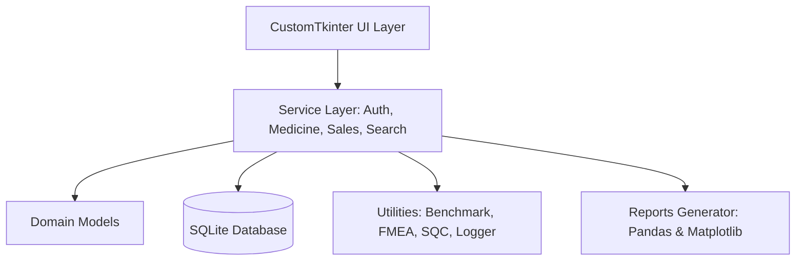

# Pharmacy Management System

## 1. Pharmacy Management System
The Pharmacy Management System is a comprehensive, modern desktop application designed to streamline pharmacy operations. It provides an intuitive interface for managing medicine inventory, processing sales, analyzing data, and monitoring system quality.

## 2. Project Overview
This project focuses on operational efficiency and reliability, with a primary emphasis on **Fast Search & Retrieval**. It demonstrates measurable improvements in database query performance, inventory tracking, and risk management through continuous improvement methodologies.

## 3. Key Features
- **User Authentication**: Secure role-based access for Administrators and Pharmacists.
- **Medicine Inventory CRUD**: Full Create, Read, Update, and Delete operations with validation.
- **Advanced Medicine Search**: Sub-millisecond data retrieval with exact and partial match capabilities.
- **Search Filters**: Dynamic multi-parameter filtering across categories, manufacturers, and stock statuses.
- **Sorting**: Flexible sorting options across all inventory columns.
- **Dashboard Quick Search**: Instant search with live auto-suggestion popups on the main dashboard.
- **Fast Database Retrieval**: Explicit column projection and SQLite B-Tree indexing.
- **Stock and Expiry Monitoring**: Automated low-stock alerts and expiration date validation.
- **Billing and Sales**: Streamlined transaction processing with automatic stock deduction and Poka-Yoke error prevention.
- **Reports and Analytics**: Data aggregation via Pandas and visualization via Matplotlib.
- **FMEA-based Risk Management**: Failure Mode and Effects Analysis for identifying and mitigating operational risks.
- **Defect Tracking / Continuous Improvement**: Integrated Statistical Quality Control (SQC), Fishbone, Pareto, and PDCA Kaizen tracking modules.

## 4. Technology Stack
- **Core Language**: Python 3.x
- **GUI Framework**: CustomTkinter / Tkinter
- **Database**: SQLite3
- **Data Analytics**: Pandas
- **Visualization**: Matplotlib
- **Testing**: Python `unittest` framework

## 5. System Architecture


## 6. Project Structure
```
Pharmacy Management System/
├── main.py                     # Entry point & application initialization
├── requirements.txt            # Project dependencies
├── README.md                   # Project documentation
├── database/                   # Schema, connection pool, and seeding
├── models/                     # Domain entities (User, Medicine, Sale)
├── services/                   # Core business logic and transaction processing
├── utils/                      # Quality control, logging, and benchmarking
├── reports/                    # Data aggregation and visualization
├── ui/                         # CustomTkinter views and components
├── tests/                      # Automated unittest suite
└── docs/                       # Detailed feature and architecture documentation
```

## 7. Database Design and Indexing
The system utilizes a lightweight, zero-configuration SQLite database with foreign key support. To achieve optimal performance, **B-Tree Indexes** are explicitly defined on frequently queried columns (e.g., medicine name, category, manufacturer, expiry date). This prevents unnecessary full table scans during filtering and sorting.

## 8. Search and Retrieval Optimization
The architecture emphasizes fast search and retrieval through:
- **Parameterized Queries**: Eliminating SQL injection risks while improving plan caching.
- **Index Optimization**: B-Tree indexes significantly reduce page retrieval overhead for prefix matching and sorting.
- **In-Memory Filtering**: Minimizing database round-trips for small dataset refinements.
- **Performance Benchmarking**: A dedicated utility measures and logs exact query execution times.

## 9. Demo Credentials
The database automatically seeds demonstration accounts:
- **Admin**: `admin` / `admin123` (Full Access)
- **Pharmacist**: `pharmacist` / `pharma123` (Inventory View & Sales Only)

## 10. Installation and Setup
1. Clone the repository.
2. Ensure Python 3.x is installed.
3. Install dependencies:
   ```bash
   pip install -r requirements.txt
   ```

## 11. How to Run
Launch the application by running the main entry point:
```bash
python main.py
```

## 12. Testing and Quality Verification
The project maintains rigorous quality standards with a comprehensive suite of automated tests covering schema integrity, business logic, CRUD operations, and security.
- **Verified Status**: 175/175 tests passing.
- **Run the Test Suite**:
  ```bash
  python -m unittest discover -s tests -v
  ```

## 13. Security and Validation
- **Authentication**: Passwords are encrypted using PBKDF2 SHA-256 hashing.
- **Input Sanitization**: All UI forms feature comprehensive validation to prevent malformed data entry.
- **Poka-Yoke**: System constraints prevent operational errors (e.g., blocking sales of expired items).

## 14. Future Scope
Proposed enhancements include barcode scanner integration, cloud database synchronization, and automated supplier reordering mechanisms.

## 15. Project Status
The Pharmacy Management System is functionally complete, thoroughly tested, and ready for deployment.
