# Advanced Pharmacy Management System

The **Advanced Pharmacy Management System** is a modular, production-grade desktop application engineered in Python to manage pharmacy operations, medicine catalogue tracking, multi-batch inventory, shelf allocation, procurement, point-of-sale (POS) billing, multi-parameter search, and financial reporting.

* **Academic Course:** BBAT104 – Fundamentals of Total Quality Management
* **Primary Quality Goal:** Q13 – Faster Search & Retrieval
* **Developer:** Priyanshu Pokhariya (Enrollment: 2410303005)
* **Programme:** B.Tech CSE (IoT & Data Science), Section C
* **Institution:** Amrapali University, Haldwani
* **Repository:** [https://github.com/priyanshupokhariya5-crypto/Pharmacy-Management-System](https://github.com/priyanshupokhariya5-crypto/Pharmacy-Management-System)
* **Current Branch:** `release/v2-clean`

---

## Table of Contents

1. [Project Overview](#project-overview)
2. [Main Features](#main-features)
3. [Technology Stack](#technology-stack)
4. [System Architecture](#system-architecture)
5. [Core Workflows](#core-workflows)
6. [Database Overview](#database-overview)
7. [Project Folder Structure](#project-folder-structure)
8. [Installation and Setup](#installation-and-setup)
9. [Database Safety](#database-safety)
10. [Testing](#testing)
11. [TQM Quality Goal – Q13: Faster Search & Retrieval](#tqm-quality-goal--q13-faster-search--retrieval)
12. [Known Limitations](#known-limitations)
13. [Documentation](#documentation)
14. [Screenshots](#screenshots)
15. [Future Improvements](#future-improvements)
16. [Contribution and Maintenance](#contribution-and-maintenance)
17. [License](#license)
18. [Contact / Project Information](#contact--project-information)

---

## Project Overview

The Advanced Pharmacy Management System centralizes operational and financial workflows for retail pharmacies and hospital dispensaries without relying on external web servers or cloud infrastructure. Engineered strictly as a local desktop system using **Python**, **CustomTkinter**, and **SQLite**, the application delivers hardware-accelerated user interfaces, ACID-compliant relational data persistence, and comprehensive operational governance.

### Core Objectives
* **Centralized Store Operations:** Multi-store data isolation and role-aware navigation.
* **Medicine Catalogue Management:** Master medicine registry with dosage, category, price, and manufacturer information.
* **Batch-Wise Inventory Management:** Multi-batch tracking with manufacturing date, expiry date, purchase cost, selling price, and real-time quantity monitoring.
* **Shelf and Expiry Management:** Deterministic separation of different expiries across physical storage locations and First-Expiry, First-Out (FEFO) stock selection.
* **Supplier & Purchase Management:** Supplier directories, purchase orders, line-item batch verification, and atomic stock movements.
* **Search & Retrieval (Q13):** Real-time debounced search across names, codes, batches, categories, and manufacturers with indexed query execution.
* **Billing & Point-of-Sale (POS):** Cart validation, stock allocation, multi-mode payment handling (Cash, UPI, Card), and automated receipt generation.
* **Customer Returns:** Audit-linked sales return handling with restock validation for sellable medicines.
* **Reports & Financial Analytics:** Comprehensive sales, shift reconciliation, batch valuation, and cashier performance summaries with CSV export and Matplotlib charts.
* **Total Quality Management (TQM):** Integrated quality utilities covering Failure Mode and Effects Analysis (FMEA), Statistical Quality Control (SQC), and Plan-Do-Check-Act (PDCA) Kaizen tracking.

---

## Main Features

### 1. Authentication and Role Management
* **Role-Based Access Control (RBAC):** Five canonical user roles with strictly segregated privileges:
  * **Owner:** Cross-store administrative oversight, global reports, staff governance, and audit visibility.
  * **Admin:** Store-level administration, staff onboarding, inventory overrides, and reports.
  * **Pharmacist:** Medicine catalogue management, batch quality inspections, expiry audits, and return verification.
  * **Cashier:** Point-of-sale checkout, customer mobile entry, payment settlement, and shift reconciliation.
  * **Inventory Manager:** Purchase order entry, supplier management, batch receiving, and shelf assignment.
* **Store & Role Context:** Every authenticated session is bound to an active `store_id` and `role`, isolating multi-store transactions.
* **Security & Passwords:** Passwords hashed with PBKDF2 (HMAC-SHA256, 200,000 iterations). Supports staff account activation, deactivation, and password recovery.

### 2. Medicine Catalogue Management
* **Catalogue Operations:** Add, view, edit, search, and archive medicines.
* **Data Integrity & Validation:** Input validation for medicine codes, non-negative retail prices, dosage forms, and categories.
* **Dependency-Aware Deletion:** Deletion checks prevent accidental cascading loss when active inventory batches or historical sales records exist; catalogue items are safely deactivated or archived instead.

### 3. Batch-Wise Inventory Management
* **Granular Batch Attributes:** Each batch tracks `batch_number`, `manufacturing_date`, `expiry_date`, `received_date`, `current_stock`, `cost_price`, `selling_price`, and `supplier_id`.
* **Verification & Quarantine:** Supports batch verification flags (`is_verified`) and quarantine segregation (`is_quarantined`).
* **Stock Movement Audit:** Every addition, sale, return, or manual adjustment writes an immutable record to the `stock_movements` ledger.

### 4. Shelf and Expiry Management
* **Rule 1 (Expiry Segregation):** Batches of the *same medicine* with *different expiry dates* must be stored on separate shelves to prevent physical dispensing mix-ups.
* **Rule 2 (Shelf Consolidation):** Batches of the *same medicine* with *identical expiry dates* may share a shelf even if their batch numbers differ.
* **Rule 3 (Orthogonal Concepts):** Batch number and shelf location are separate concepts: an inventory batch resides at exactly one shelf location, while a shelf location may hold compatible batches.
* **Rule 4 (FEFO Allocation):** Deterministic First-Expiry, First-Out (FEFO) stock allocation for all checkout transactions.
* **Rule 5 (Expiry Exclusion):** Expired batches are strictly excluded from point-of-sale availability.
* **Rule 6 (Eligibility Filtering):** Recalled, quarantined, inactive, unverified, and zero-stock batches cannot be selected for customer dispensing.

### 5. Supplier and Purchase Management
* **Supplier Directory:** Store-scoped supplier profiles with contact details, address, and status.
* **Purchase Orders & Goods Inward:** Multi-item purchase order creation with purchase price, quantity, batch number, expiry date, and shelf assignment.
* **Inward Validation:** Prevents duplicate goods receiving; verifies shelf compatibility and manufacturing/expiry date ordering before committing stock.

### 6. Advanced Search – Q13
* **Multi-Parameter Queries:** Search across medicine name, medicine code, batch number, manufacturer, and category.
* **Interactive Debounce:** Approximately 250 ms debounce delay on keystrokes in Advanced Search prevents query flooding while preserving desktop responsiveness.
* **Flexible Filtering & Sorting:** Dynamic sorting by medicine name, price, and current stock.
* **Dashboard Quick-Search:** Lightweight, immediate search widget embedded directly in user dashboards.
* **Parameterized Execution:** SQL injection prevention using parameterized queries across all database queries.
* **Indexing:** B-Tree indexes on frequently filtered columns (`idx_medicines_name`, `idx_medicines_category`, etc.).
* > [!NOTE]
  > Conventional B-Tree indexes efficiently accelerate exact matches and prefix searches (e.g., `LIKE 'term%'`). Leading-wildcard substring queries (e.g., `LIKE '%term%'`) require full table scans in standard relational database engines unless full-text search extensions (such as SQLite FTS5) are utilized.

### 7. Billing and Point of Sale (POS)
* **Cart Validation & Inventory Locking:** Real-time stock check prevents over-selling.
* **Automatic FEFO Allocation:** Splits cart item quantities across multiple eligible batches in order of earliest expiry.
* **Atomic Transactions:** Checkout updates sales, sale items, batch allocations, stock levels, and audit logs within a single database transaction, rolling back automatically on any error.
* **Multi-Method Payments:** Cash, UPI, and Card settlement with reference/transaction ID tracking.
* **Commercial Rounding:** Exact arithmetic with half-up rounding (`ROUND_HALF_UP`) for discount, subtotal, and tax calculations.
* **Customer Phone Validation:** Enforces standard 10-digit Indian mobile number format (`[6-9]\d{9}`).
* **Receipt Generation & Reprinting:** Clean PDF receipts generated via FPDF with full transaction reprinting capabilities.
* **Poka-Yoke Protections:** Disables duplicate checkout triggers during active submission.

### 8. Returns Management
* **Invoice-Linked Returns:** Returns are validated against original verified sales invoices.
* **Boundary Validation:** Quantity validation prevents returning more items than originally purchased.
* **Stock Segregation:** Sellable returns are returned to inventory with corresponding stock movements; damaged or expired returned goods are isolated and excluded from sellable stock.

### 9. Reports and Analytics
* **Comprehensive Metrics:** Daily, weekly, and monthly sales summaries, payment mode breakdown (Cash, UPI, Card), gross revenue, discounts, taxes, returns, and net revenue.
* **Operational Insights:** Cashier shift performance, medicine sales velocity, and inventory valuation by batch.
* **Exporting & Charting:** Instant CSV data exports generated with Pandas; graphical visualizations rendered using Matplotlib.

### 10. Total Quality Management (TQM)
* **Failure Mode and Effects Analysis (FMEA):**
  * Automated calculation of Risk Priority Numbers:
    $$\text{RPN} = \text{Severity} \times \text{Occurrence} \times \text{Detection}$$
  * Severity, Occurrence, and Detection scored from 1 to 10 (higher Detection score represents *worse* detectability / harder to detect).
  * Risk tiers:
    | RPN Range | Risk Classification | Recommended Action |
    |:---:|:---:|:---|
    | 1–39 | Low | Routine process monitoring |
    | 40–79 | Medium | Preventive maintenance & Standard Operating Procedure update |
    | 80–124 | High | Priority mitigation plan & corrective action |
    | 125–1000 | Critical | Immediate process halt & architectural redesign |
* **Statistical Quality Control (SQC):** Defect logging, Pareto 80/20 defect classification, and Ishikawa (Fishbone) cause-and-effect diagrams.
* **Plan-Do-Check-Act (PDCA):** Continuous improvement Kaizen workflow tracking from problem statement through standardization.
* > [!IMPORTANT]
  > Quality management views (FMEA and SQC) are disabled by default (`ENABLE_REVIEW3_4_FEATURES=0`). They appear in user navigation only when explicitly enabled in the environment.

---

## Technology Stack

| Technology | Purpose | Notes |
|---|---|---|
| **Python** | Application Language | Tested on Python 3.10, 3.11, 3.12, 3.13 (64-bit) |
| **CustomTkinter** (`>=6.0.0`) | Desktop Graphical User Interface | Modern hardware-accelerated vector widgets, dark/light theme |
| **SQLite 3** | Embedded Relational Database | ACID transactions, foreign keys enabled (`PRAGMA foreign_keys = ON`) |
| **Pandas** (`>=2.0.0`) | Tabular Data Analysis & Reporting | Shift metrics, financial summaries, CSV data exports |
| **Matplotlib** (`>=3.7.0`) | Data Visualization | Pareto defect charts, sales velocity graphs, Ishikawa plots |
| **FPDF** | PDF Generation | POS receipts and financial summaries |
| **Pillow** (`>=9.5.0`) | Image Processing | GUI icon rendering and image asset processing |
| **darkdetect** (`>=0.8.0`) | OS Integration | Platform color scheme detection |
| **PyInstaller** | Executable Packaging Support | Standalone Windows distribution build spec (`PharmacyApp.spec`) |
| **Git** | Version Control | Distributed revision control with branch-isolated workflows |

---

## System Architecture

The application implements a 5-layer desktop architecture:

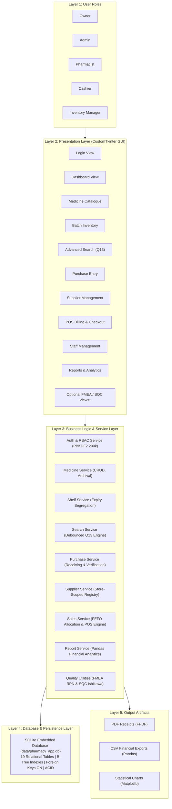

A high-resolution 300 DPI architectural diagram is available at [docs/diagrams/images/fig01_system_architecture.png](docs/diagrams/images/fig01_system_architecture.png).

---

## Core Workflows

### 1. Medicine Search Workflow (Q13)

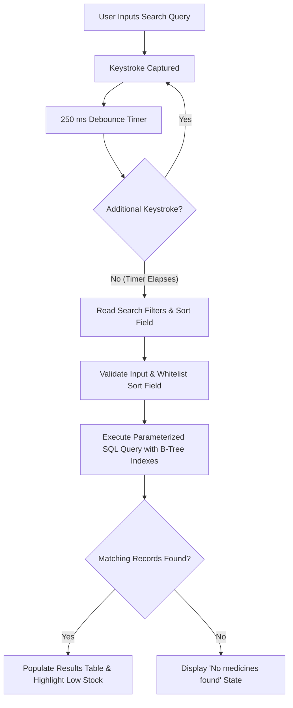

### 2. FEFO Sales and Billing Workflow

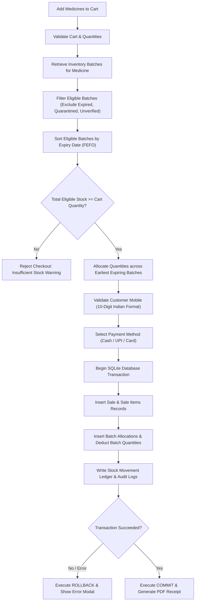

### 3. Purchase Receiving & Inward Workflow

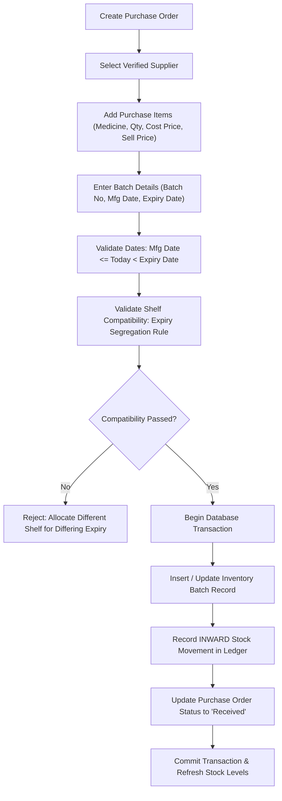

---

## Database Overview

The application utilizes an embedded **SQLite 3** relational database (`data/pharmacy_app.db`) configured with foreign-key enforcement (`PRAGMA foreign_keys = ON`), WAL-mode concurrency, and ACID transaction isolation.

### Verified Database Entities (19 Tables)
* **Master Stores & Access:** `stores`, `users`
* **Medicine & Inventory:** `medicines`, `storage_locations`, `inventory_batches`, `stock_movements`
* **Procurement:** `suppliers`, `purchases`, `purchase_items`
* **Dispensing & Sales:** `sales`, `sale_items`, `sale_batch_allocations`
* **Returns:** `sale_returns`, `sale_return_items`
* **Auditing & Schema Tracking:** `audit_logs`, `schema_migrations`
* **Quality Management (Optional):** `fmea_records`, `sqc_defects`, `pdca_items`

### Relational Schema Overview

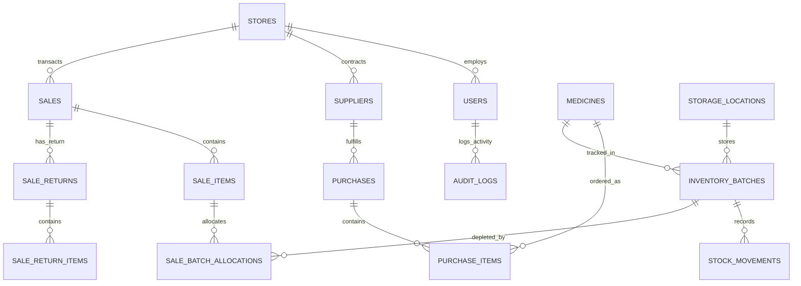

> [!TIP]
> Comprehensive, full-scale **Chen Entity-Relationship Diagrams** featuring attribute ellipses, underlined primary keys, relationship diamonds, and explicit 1:N cardinalities are available in:
> * **Figure 5A (15 Entities Full Landscape Chen ERD):** [docs/diagrams/images/fig05_database_erd.png](docs/diagrams/images/fig05_database_erd.png)
> * **Figure 5B (Inventory & Procurement Chen ERD):** [docs/diagrams/images/fig05b_inventory_purchasing_erd.png](docs/diagrams/images/fig05b_inventory_purchasing_erd.png)
> * **Figure 5C (Sales, Billing & Returns Chen ERD):** [docs/diagrams/images/fig05c_sales_returns_erd.png](docs/diagrams/images/fig05c_sales_returns_erd.png)

---

## Project Folder Structure

```
Pharmacy-Management-System/
├── main.py                     # Primary desktop entry point & CLI database parser
├── requirements.txt            # Python package dependencies
├── PharmacyApp.spec            # PyInstaller desktop executable build specification
├── README.md                   # Primary GitHub project documentation
├── .env                        # Runtime environment configuration (local settings)
├── .gitignore                  # Git repository exclusion rules
│
├── database/                   # Database engine, schema & migrations
│   ├── db.py                   # Thread-safe SQLite connection & transaction context managers
│   ├── schema.py               # DDL table creation, B-Tree indexes, and baseline seeding
│   ├── migration_stage2.py     # Idempotent schema migrations (multi-store, batches, returns)
│   ├── migration_manager.py    # Schema version tracking via schema_migrations table
│   ├── sync.py                 # Candidate-to-target database synchronization utility
│   └── seed_active_store_data.py # Automated test and demonstration seed data
│
├── models/                     # Object-oriented domain entity models
│   ├── user.py                 # User entity & role definitions (Owner, Admin, Pharmacist, Cashier, InvMgr)
│   ├── medicine.py             # Medicine catalogue model with expiry properties
│   ├── batch.py                # Inventory batch model with verification & quarantine flags
│   ├── location.py             # Storage location (shelf, rack, bin) model
│   ├── supplier.py             # Supplier directory model
│   ├── purchase.py             # Purchase order & purchase line item models
│   ├── sale.py                 # Sale, SaleItem, SaleReturn, and SaleReturnItem models
│   └── stock_movement.py       # Stock movement audit ledger model
│
├── services/                   # Application service and business logic layer
│   ├── auth_service.py         # Authentication, PBKDF2 hashing & staff user management
│   ├── rbac.py                 # Role-based access control & permission enforcement guards
│   ├── medicine_service.py     # Medicine catalogue CRUD, validation & archival logic
│   ├── shelf_service.py        # Shelf allocation compatibility & expiry segregation rules
│   ├── search_service.py       # Multi-parameter Q13 debounced search execution engine
│   ├── purchase_service.py     # Purchase order receiving, batch creation & inward movements
│   ├── supplier_service.py     # Store-scoped supplier management
│   ├── sales_service.py        # FEFO stock allocation, cart validation & POS transactions
│   ├── report_service.py       # Pandas-based financial analysis, shift totals & CSV exports
│   └── audit_service.py        # Event logging to audit_logs table
│
├── ui/                         # CustomTkinter graphical presentation layer
│   ├── main_window.py          # Root navigation frame, role-filtered menu & view switcher
│   ├── login.py                # Single-window login panel & password reset dialogs
│   ├── dashboard.py            # Role-tailored dashboards with quick-search widget
│   ├── medicines.py            # Medicine catalogue CRUD interface & archival controls
│   ├── batch_inventory.py      # Batch tracking, shelf assignment & expiry alert interface
│   ├── search.py               # Q13 advanced multi-parameter search interface
│   ├── purchase_entry.py       # Purchase order creation & goods inward receiving view
│   ├── supplier_management.py  # Supplier directory management view
│   ├── billing.py              # Point-of-sale checkout, cart table & payment dialogs
│   ├── staff_management.py     # Staff account administration & role assignment view
│   ├── reports_view.py         # Sales summary, cashier reconciliation & CSV export view
│   ├── fmea_view.py            # Optional FMEA risk analysis & RPN calculation interface
│   ├── sqc_view.py             # Optional SQC defect recording & Pareto/Ishikawa interface
│   └── theme.py                # Central design system colors, fonts, and dimensions
│
├── utils/                      # Helper libraries & cross-cutting utilities
│   ├── paths.py                # Path resolution for source, portable, and frozen environments
│   ├── logger.py               # Application logging framework (app_quality.log)
│   ├── validators.py           # Poka-Yoke input validation (mobile, positive numbers, dates)
│   ├── pdf_generator.py        # FPDF invoice and receipt generation utility
│   ├── fmea.py                 # FMEA RPN risk calculation and tier evaluation
│   └── sqc.py                  # Statistical quality control defect calculations
│
├── data/                       # Local SQLite database files & runtime logs
│   ├── pharmacy_app.db         # Primary production database
│   ├── pharmacy.db             # Baseline / legacy database
│   └── app_quality.log         # Application execution log
│
├── docs/                       # Official academic SRS, documentation & diagrams
│   ├── SRS_Pharmacy_Management_System.md   # Complete implementation-based academic SRS
│   ├── SRS_Pharmacy_Management_System.docx # Formatted Microsoft Word SRS document
│   ├── SRS_Pharmacy_Management_System.pdf  # Final compiled PDF submission document
│   └── diagrams/               # Architectural, UML, DFD, Sequence, and Chen ER diagrams
│       ├── images/             # 300 DPI high-resolution PNG exports (Figures 1–13)
│       └── source/             # Mermaid (.mmd) and PlantUML (.puml) diagram sources
│
├── reports/                    # Quality audit reports & application screenshot captures
│   └── screenshots/            # Verified application GUI screenshots
│
└── tests/                      # Automated unit, integration, and workflow test suites
    ├── conftest.py             # Pytest environment fixtures & Tkinter display initialization
    ├── test_billing_checkout_fix.py
    ├── test_complete_final_audit.py
    ├── test_database.py
    ├── test_database_sync.py
    ├── test_data_workflows_and_rollback.py
    ├── test_fmea.py
    ├── test_invoices.py
    ├── test_login_panel_and_roles_e2e.py
    ├── test_medicine_crud.py
    ├── test_multistore.py
    ├── test_navigation.py
    ├── test_reports.py
    ├── test_sales.py
    ├── test_search.py
    ├── test_sqc.py
    ├── test_stage2_migration.py
    ├── test_stage3_auth_dashboards.py
    ├── test_stage4_purchasing_fefo.py
    ├── test_stage5_billing_pos_returns.py
    ├── test_ui_fixes_billing_and_inventory.py
    └── test_user_controlled_onboarding.py
```

---

## Installation and Setup

### Prerequisites
* **Operating System:** Windows 10 or Windows 11 (64-bit recommended)
* **Python Runtime:** Python 3.10 to Python 3.13 (64-bit)
* **Git:** Installed and configured in system PATH

### Step 1 – Clone the Repository
Open a terminal (PowerShell or Command Prompt) and clone the repository:
```bash
git clone https://github.com/priyanshupokhariya5-crypto/Pharmacy-Management-System.git
cd Pharmacy-Management-System
```

### Step 2 – Create a Virtual Environment
Create an isolated Python virtual environment:
```bash
python -m venv venv
```

### Step 3 – Activate the Virtual Environment
Activate the virtual environment based on your shell:

* **Windows PowerShell:**
  ```powershell
  .\venv\Scripts\Activate.ps1
  ```
  *(If execution policies restrict script execution, run: `Set-ExecutionPolicy -Scope Process -ExecutionPolicy Bypass`)*

* **Windows Command Prompt (CMD):**
  ```cmd
  venv\Scripts\activate.bat
  ```

### Step 4 – Install Dependencies
Install all required packages from `requirements.txt`:
```bash
pip install -r requirements.txt
```

### Step 5 – Environment Configuration
The application reads configuration from environment variables and the local `.env` file. You can configure your environment using the following verified settings:

```ini
# Path to SQLite database (defaults to data/pharmacy_app.db)
PHARMACY_DB_PATH=data/pharmacy_app.db

# Optional data directory override
# PHARMACY_DATA_DIR=data

# Test mode flag: if set to 1, forces data/test_pharmacy.db
# PHARMACY_TEST_MODE=0

# Enable experimental or academic Review 3/4 quality views (FMEA & SQC)
# Defaults to 0 (disabled in normal operation)
ENABLE_REVIEW3_4_FEATURES=0
```

### Step 6 – Run the Application
Launch the application using Python:

* **Standard Desktop GUI Launch (Primary Entry Point):**
  ```bash
  python main.py
  ```

* **Launch with Isolated Test Database:**
  ```bash
  python main.py --test-db
  ```

* **Launch with Custom Database Path:**
  ```bash
  python main.py --db path/to/custom_pharmacy.db
  ```

* **Run Database Synchronization Utility:**
  ```bash
  python main.py --sync-db
  ```

### Step 7 – Running Automated Tests
Run the automated test suite using `pytest`:
```bash
pytest
```
Or run specific test modules:
```bash
pytest tests/test_search.py tests/test_sales.py
```
> [!IMPORTANT]
> The automated test suite executes against isolated in-memory or temporary test databases defined in `tests/conftest.py`. Testing never modifies or overwrites production database files.

---

## Database Safety

The application stores real operational data in local SQLite database files:
* `data/pharmacy_app.db` (Primary production database)
* `data/pharmacy.db` (Baseline reference database)

### Safety Guidelines
1. **Never Delete Production Databases:** Do not delete or wipe `.db` files in `data/` during standard setup.
2. **Backup Before Migrations:** Always create a copy of `data/pharmacy_app.db` prior to running manual migrations or syncing scripts.
3. **Isolated Test Execution:** Always execute automated test runs using `pytest` or `--test-db` flags to guarantee that production tables remain untouched.
4. **Credential Security:** Demo and administrative credentials must never be committed to public Git repositories or included in plain-text README documentation.

---

## Testing

The project maintains an automated test suite across 21 test modules in `tests/`:

* **Authentication & RBAC:** `test_login_panel_and_roles_e2e.py`, `test_stage3_auth_dashboards.py`, `test_user_controlled_onboarding.py`
* **Medicine Catalogue:** `test_medicine_crud.py`
* **Multi-Store Isolation:** `test_multistore.py`
* **Inventory & Purchasing:** `test_stage4_purchasing_fefo.py`, `test_ui_fixes_billing_and_inventory.py`
* **Search & Retrieval (Q13):** `test_search.py`
* **Point-of-Sale & Returns:** `test_billing_checkout_fix.py`, `test_stage5_billing_pos_returns.py`, `test_sales.py`, `test_invoices.py`
* **Database & Migrations:** `test_database.py`, `test_database_sync.py`, `test_stage2_migration.py`, `test_data_workflows_and_rollback.py`
* **Total Quality Management:** `test_fmea.py`, `test_sqc.py`
* **UI & Navigation:** `test_navigation.py`

### Historical Quality Audit Reference
According to the audited benchmark report recorded in `reports/COMPLETE_FINAL_AUDIT_REPORT.md` (dated 31 October 2026), **369 regression tests across 22 test files** were reported passed with zero failures and zero errors in an isolated testing environment.
*(Note: This figure reflects the audited historical release benchmark; current test execution counts vary based on environment configuration and active feature flags).*

---

## TQM Quality Goal – Q13: Faster Search & Retrieval

The project was developed to satisfy the academic quality goal **Q13 – Faster Search & Retrieval** under **BBAT104 – Fundamentals of Total Quality Management**.

### Architectural Search Optimizations
1. **Multi-Parameter Filtering:** Users can filter simultaneously across medicine name, medicine code, batch number, category, and manufacturer.
2. **Keystroke Debouncing (~250 ms):** Advanced search captures keystrokes and waits approximately 250 milliseconds before triggering a query, preventing database saturation during rapid typing.
3. **Targeted B-Tree Indexes:** Dedicated B-Tree indexes (`idx_medicines_name`, `idx_medicines_category`, `idx_batches_med_id`, etc.) accelerate exact matches and prefix lookups.
4. **Parameterized Prepared Queries:** SQL statements use bound parameters, enabling SQLite's query planner to optimize execution plans while guaranteeing complete protection against SQL injection.
5. **Dashboard Quick-Search:** A lightweight lookup mechanism on dashboards allows instant medicine stock verification without navigating to the main search view.

### Technical Clarification on Substring Searches
> [!NOTE]
> Standard relational B-Tree indexes provide logarithmic $O(\log N)$ lookup performance for exact matches and prefix patterns (`LIKE 'Paracetamol%'`). When performing arbitrary leading-wildcard substring searches (`LIKE '%ceta%'`), standard B-Tree indexes cannot be used for index seeks and require a full table scan. Claims of universal search speedups apply specifically to indexed exact/prefix filtering and debounced query frequency management.

---

## Known Limitations

In compliance with academic integrity and strict engineering standards, the following verified system limitations are documented:

1. **Optional Quality Views:** FMEA and SQC navigation items are disabled by default (`ENABLE_REVIEW3_4_FEATURES=0`) and require explicit environment flag activation.
2. **Benchmark View Omission:** The legacy Benchmark View was removed from the active navigation and is not part of the standard production UI.
3. **Leading-Wildcard Indexing:** Conventional SQLite B-Tree indexes do not accelerate arbitrary leading-wildcard substring queries (`LIKE '%term%'`).
4. **Acting-User Fallbacks:** Certain internal permission helpers maintain backward-compatible fallback behaviour when an explicit acting-user context is omitted.
5. **Multi-Field Sales Eligibility:** Sales eligibility validation applies multi-criteria checks (expiry, quarantine, verification, positive stock) rather than relying solely on single-property checks.
6. **Scoped Database Synchronization:** The legacy synchronization tool (`database/sync.py`) maps designated core tables; it does not claim full bi-directional replication of all newly added batch, purchase, and return entities.
7. **PDF Font Symbol Replacement:** The PDF invoice engine uses Latin-1 encoding and substitutes the Unicode Indian Rupee symbol (`₹`) with `Rs.` to avoid encoding exceptions.
8. **Demonstration Quality Records:** Pre-seeded FMEA and SQC records serve as initial demonstrative examples rather than historical clinical incident logs.
9. **Hardware-Dependent Performance:** Numerical search speedups and maximum batch capacities depend on client hardware, disk I/O, and database size.

---

## Documentation

The project includes complete, professional Software Requirements Specification (SRS) documentation:

* **SRS Document (DOCX):** [docs/SRS_Pharmacy_Management_System.docx](docs/SRS_Pharmacy_Management_System.docx)
* **SRS Document (PDF):** [docs/SRS_Pharmacy_Management_System.pdf](docs/SRS_Pharmacy_Management_System.pdf)
* **SRS Document (Markdown):** [docs/SRS_Pharmacy_Management_System.md](docs/SRS_Pharmacy_Management_System.md)
* **Diagram Assets (300 DPI PNG):** [docs/diagrams/images/](docs/diagrams/images/)
* **Diagram Sources (Mermaid / PlantUML):** [docs/diagrams/source/](docs/diagrams/source/)

---

## Screenshots

The following verified screenshots from [reports/screenshots/](reports/screenshots/) showcase the application's actual user interface:

| Screenshot | Description |
|:---:|:---|
| 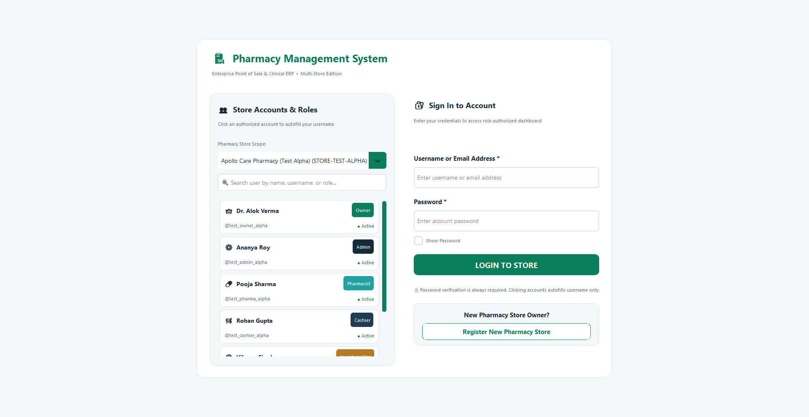 | **Login & Authentication Screen**<br>Single-window CustomTkinter authentication interface with role selection and password recovery. |
| 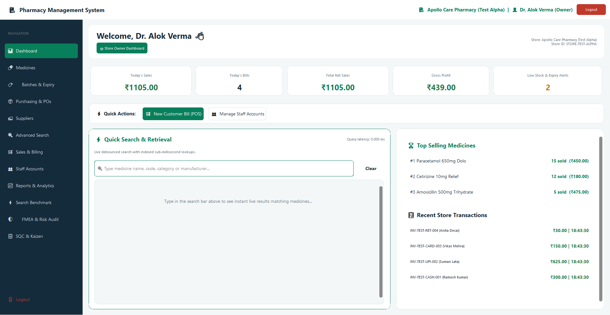 | **Owner Executive Dashboard**<br>High-level multi-store analytics, daily sales volume, active staff counts, and quick-search lookup. |
| 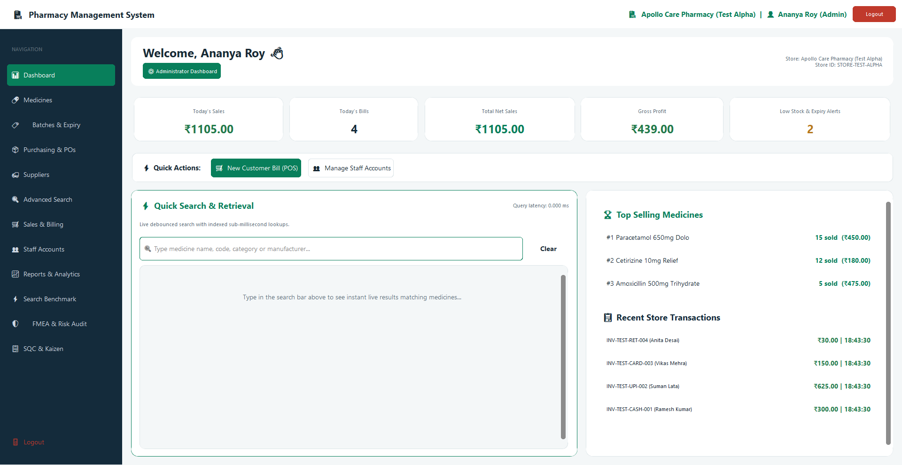 | **Admin Store Dashboard**<br>Store-level administrative overview, low stock notifications, and operational shortcuts. |
| 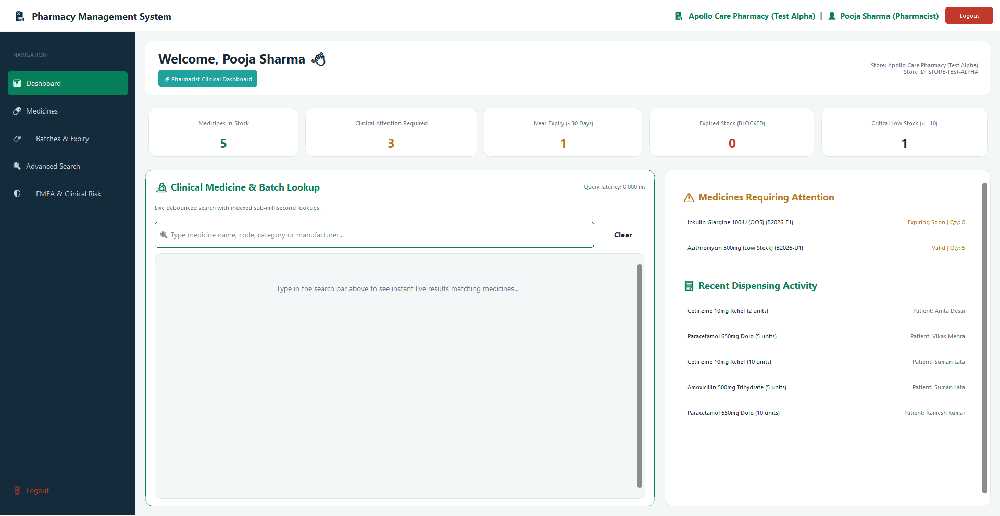 | **Pharmacist Dispensing Dashboard**<br>Medicine catalogue overview, expiry alerts, and batch verification tools. |
| 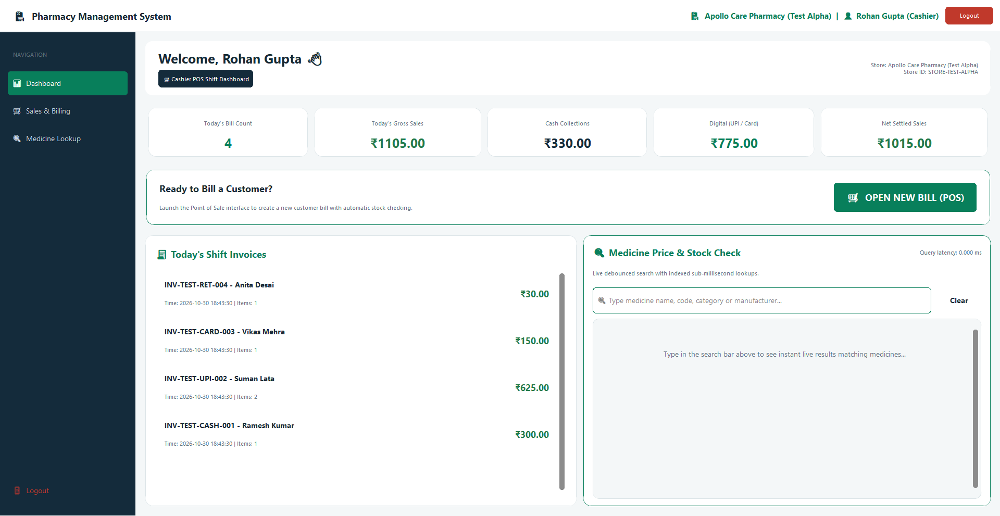 | **Cashier POS Dashboard**<br>Live shift metrics: today's bill count, cash/UPI/card collections, discounts, and net sales. |
| 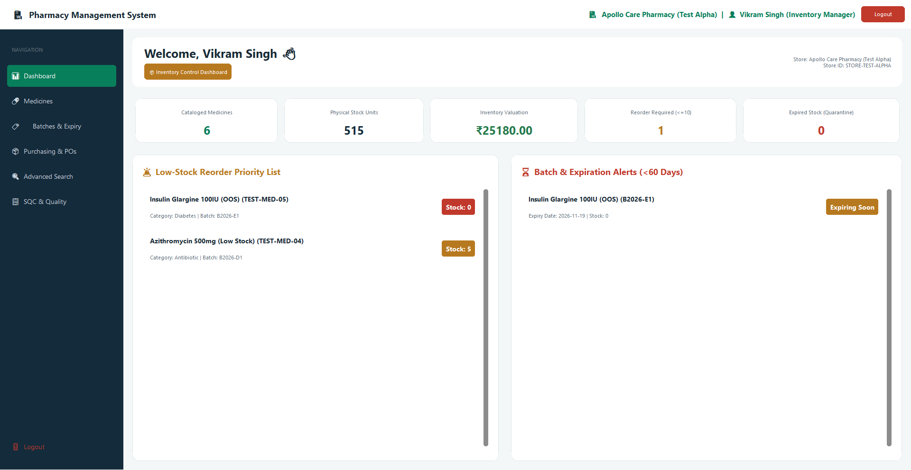 | **Point-of-Sale (POS) Billing**<br>Multi-item cart, mandatory customer phone validation, FEFO batch allocation, and payment modal. |
| 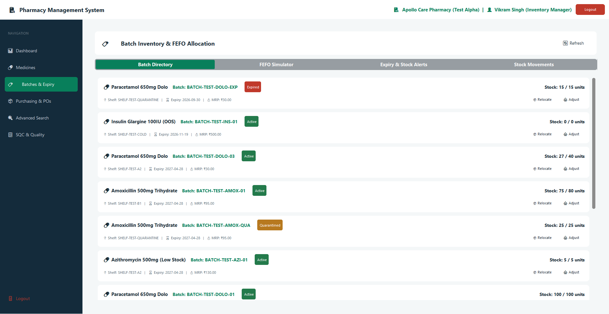 | **Batch Inventory & Shelf Management**<br>Detailed batch tracking, manufacturing/expiry dates, shelf locations, and stock adjustment controls. |
| 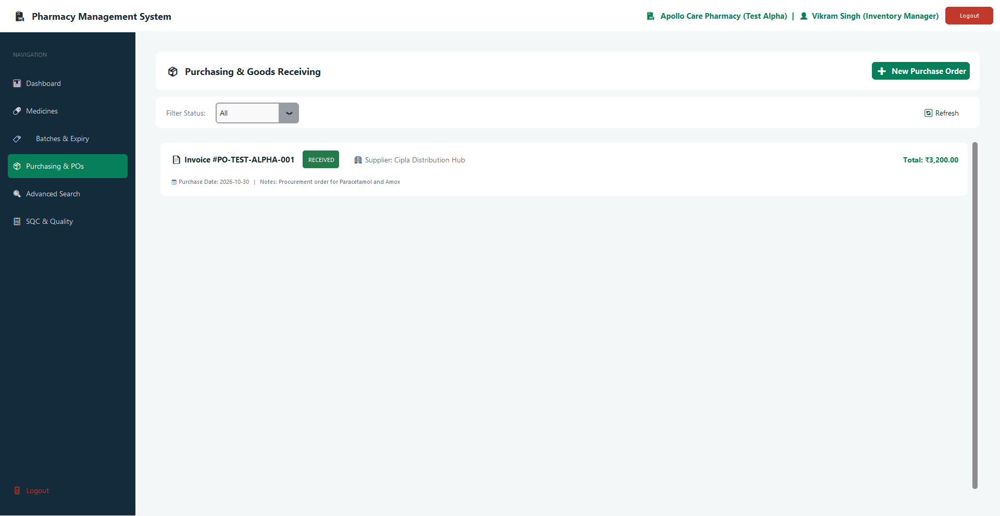 | **Purchasing & Goods Receiving**<br>Purchase order creation, supplier invoice tracking, shelf allocation verification, and inward receiving. |
|  | **Staff Management & RBAC**<br>User account provisioning, canonical role assignment, account activation, and credential reset. |

---

## Future Improvements

Planned future enhancements under consideration:
* **Full-Text Search (FTS5):** Implementation of SQLite FTS5 virtual tables to provide accelerated tokenized substring matching and ranking.
* **Barcode Scanner Hardware Integration:** Native USB/HID barcode reader input support for automatic batch and medicine code entry in POS billing.
* **Automated Data Backup:** Automated scheduled database snapshot and compression utilities.
* **Automated Reordering Triggers:** Dynamic purchase order generation when medicine stock falls below minimum safety thresholds.

---

## Contribution and Maintenance

Contributions and code improvements are welcome. Please follow standard collaborative workflows:

1. **Fork the Repository:** Create a personal fork on GitHub.
2. **Create a Feature Branch:**
   ```bash
   git checkout -b feature/your-feature-name
   ```
3. **Commit Changes:** Adhere to established Python code formatting and docstring conventions.
4. **Execute Tests:** Verify that all automated tests pass in an isolated environment (`pytest`).
5. **Submit a Pull Request:** Open a pull request against the `release/v2-clean` branch with a clear description of the modifications.

---

## License

No license file is currently provided. All rights and permissions remain with the project owner unless a license is added.

---

## Contact / Project Information

* **Project:** Advanced Pharmacy Management System
* **GitHub Repository:** [https://github.com/priyanshupokhariya5-crypto/Pharmacy-Management-System](https://github.com/priyanshupokhariya5-crypto/Pharmacy-Management-System)
* **Course:** BBAT104 – Fundamentals of Total Quality Management
* **Academic Goal:** Q13 – Faster Search & Retrieval
* **Student Author:** Priyanshu Pokhariya
* **Enrollment:** 2410303005
* **Institution:** Amrapali University, Haldwani
