# SOFTWARE REQUIREMENTS SPECIFICATION (SRS)
## Advanced Pharmacy Management System

**Course:** BBAT104 – Fundamentals of Total Quality Management  
**Quality Goal:** Q13 – Faster Search & Retrieval  
**Prepared By:** Priyanshu Pokhariya  
**Enrollment No.:** 2410303005  
**Programme:** B.Tech CSE (IoT & Data Science), Section C  
**Institution:** Amrapali University, Haldwani  
**Academic Session:** 2026–2027  
**Document Type:** Implementation-Based Software Requirements Specification  

---

# DOCUMENT CONTROL

| Item | Description |
|---|---|
| Project Name | Advanced Pharmacy Management System |
| Project Type | Desktop Application |
| Primary Quality Goal | Q13 – Faster Search & Retrieval |
| Programming Language | Python |
| GUI Framework | CustomTkinter |
| Database | SQLite |
| Data Analysis | Pandas |
| Visualization | Matplotlib |
| Repository | https://github.com/priyanshupokhariya5-crypto/Pharmacy-Management-System |

---

# 1. INTRODUCTION

## 1.1 Purpose

This Software Requirements Specification describes the implemented functionality, system architecture, database structure, business rules, user interfaces, quality requirements and testing approach of the Advanced Pharmacy Management System.

The document is intended for developers, testers, pharmacy staff, academic evaluators and future maintainers.

It focuses on the actual implementation of the project rather than describing unimplemented or hypothetical functionality.

## 1.2 Project Scope

The Pharmacy Management System is a Python-based desktop application designed to manage pharmacy operations.

It provides facilities for:

- User authentication and role-based navigation.
- Medicine inventory management.
- Batch-wise stock management.
- Supplier and purchase management.
- Advanced medicine search.
- Dashboard quick-search.
- Billing and sales management.
- FEFO-based stock allocation.
- Customer return management.
- Sales and inventory reports.
- Quality management through FMEA and SQC modules.

The main objective is to improve search and retrieval performance under the TQM quality goal Q13.

## 1.3 Intended Users

The system supports five user roles:

1. Owner
2. Admin
3. Pharmacist
4. Cashier
5. Inventory Manager

Each role receives navigation and operational access according to the application's role-aware configuration.

## 1.4 Definitions

| Term | Description |
|---|---|
| PMS | Pharmacy Management System |
| Q13 | Faster Search & Retrieval |
| FEFO | First Expiry, First Out |
| RBAC | Role-Based Access Control |
| FMEA | Failure Mode and Effects Analysis |
| RPN | Risk Priority Number |
| SQC | Statistical Quality Control |
| PDCA | Plan–Do–Check–Act |
| POS | Point of Sale |
| Poka-Yoke | Error-prevention technique |

## 1.5 Reference Material

This specification is based on the supplied project README, database modules, models, services, UI implementation, utilities, tests and supplied final audit report.

The audit report dated 31 October 2026 reports 369 regression tests across 22 files passed, with zero failures/errors. This is historical evidence reported by that document and was not independently rerun during preparation of this SRS.

---

# 2. OVERALL SYSTEM DESCRIPTION

## 2.1 Product Perspective

The system follows a modular desktop application architecture.

Its main layers are:

1. Presentation Layer – CustomTkinter GUI.
2. Service Layer – Business logic and application operations.
3. Model Layer – Application data models.
4. Database Layer – SQLite database and migrations.
5. Reporting and Quality Layer – Pandas, Matplotlib, FMEA and SQC utilities.

Figure 1 illustrates the complete system architecture, showing all operational layers, services, database components and file output channels. Figure 3 provides the Level 0 Context Diagram illustrating system boundaries with external entities, while Figure 13 outlines the physical repository folder structure.

```mermaid
graph TD
    subgraph Actors["User Roles (Authenticated Context)"]
        Owner["Owner"]
        Admin["Admin"]
        Pharm["Pharmacist"]
        Cash["Cashier"]
        InvMgr["Inventory Manager"]
    end

    subgraph Presentation["Presentation Layer (CustomTkinter GUI)"]
        LoginV["Login View"]
        DashV["Dashboard View"]
        MedV["Medicine Management"]
        BatchV["Batch Management"]
        SrchV["Advanced Search (Q13)"]
        PurV["Purchase Management"]
        SupV["Supplier Management"]
        BillV["Billing (POS)"]
        StaffV["Staff Management"]
        RepV["Reports View"]
        FmeaV["Optional FMEA View*"]
        SqcV["Optional SQC View*"]
    end

    subgraph Service["Business Logic & Service Layer"]
        AuthSvc["Auth & Permission Logic (PBKDF2 200k)"]
        MedSvc["Medicine Service (CRUD, Archival)"]
        ShelfSvc["Shelf Service (Expiry Rules)"]
        SrchSvc["Search Service (Debounce, Query Builder)"]
        PurSvc["Purchase Service (Inward, POs)"]
        SupSvc["Supplier Service"]
        SalesSvc["Sales Service (FEFO Allocation)"]
        RepSvc["Report Service (Pandas Engine)"]
        TqmUtil["FMEA & SQC Utilities"]
        ValUtil["Validators & Audit Logger"]
    end

    subgraph Persistence["Data Persistence & File Outputs"]
        DB[("SQLite Database\n(pharmacy_app.db)\n19 Relational Tables")]
        PDF["PDF Invoices (FPDF)"]
        CSV["CSV Report Exports"]
        Charts["Matplotlib Charts"]
    end

    Actors --> Presentation
    Presentation --> Service
    Service --> Persistence
```

*Figure 1: Complete System Architecture (Layered Model)*

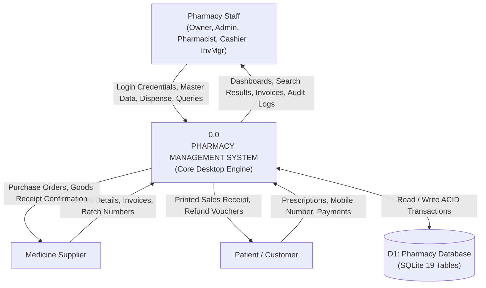

*Figure 3: DFD Level 0 (Context Diagram)*

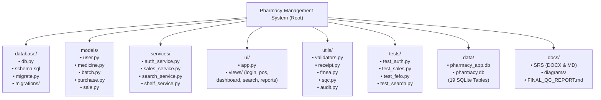

*Figure 13: Project Folder Structure Diagram*

## 2.2 Main System Functions

The application provides:

- Login and authentication.
- Role-aware dashboard and navigation.
- Medicine CRUD operations.
- Batch inventory management.
- Shelf and expiry management.
- Supplier management.
- Purchase order creation and receiving.
- Advanced search and filtering.
- Dashboard quick-search.
- Billing and checkout.
- FEFO-based stock allocation.
- Customer returns.
- Sales and inventory reporting.
- CSV report export.
- FMEA and SQC quality analysis when enabled.

Figure 4 illustrates the Level 1 Data Flow Diagram (DFD) showing the interactions between the 7 core functional subsystems, external entities and the 6 underlying database stores.

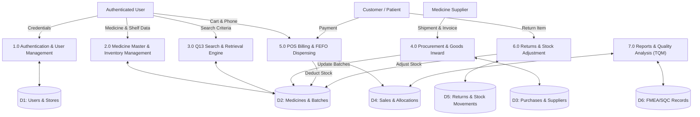

*Figure 4: DFD Level 1 Subsystem Processes and Data Stores*

## 2.3 User Roles

| Role | Main Accessible Features |
|---|---|
| Cashier | Dashboard, Billing, Medicine Lookup |
| Pharmacist | Dashboard, Medicines, Batches, Advanced Search |
| Inventory Manager | Dashboard, Medicines, Batches, Purchasing, Advanced Search |
| Owner | Dashboard, Medicines, Batches, Purchasing, Suppliers, Search, Billing, Staff, Reports |
| Admin | Dashboard, Medicines, Batches, Purchasing, Suppliers, Search, Billing, Staff, Reports |

FMEA and SQC views are configuration-dependent.

Figure 2 depicts the complete UML Use Case Diagram for the five user roles, defining role-based system boundaries and access permissions.

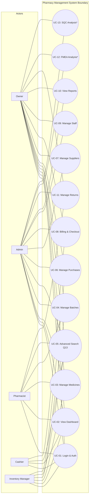

*Figure 2: UML Use Case Diagram*

## 2.4 Operating Environment

- Python runtime.
- CustomTkinter GUI framework.
- SQLite database.
- Pandas.
- Matplotlib.
- FPDF-based document generation.
- PyInstaller packaging support.

The project README identifies Python 3.13 as the runtime environment.

Figure 10 presents the Deployment Diagram illustrating the local desktop environment hosting the application runtime, database files and output artifacts.

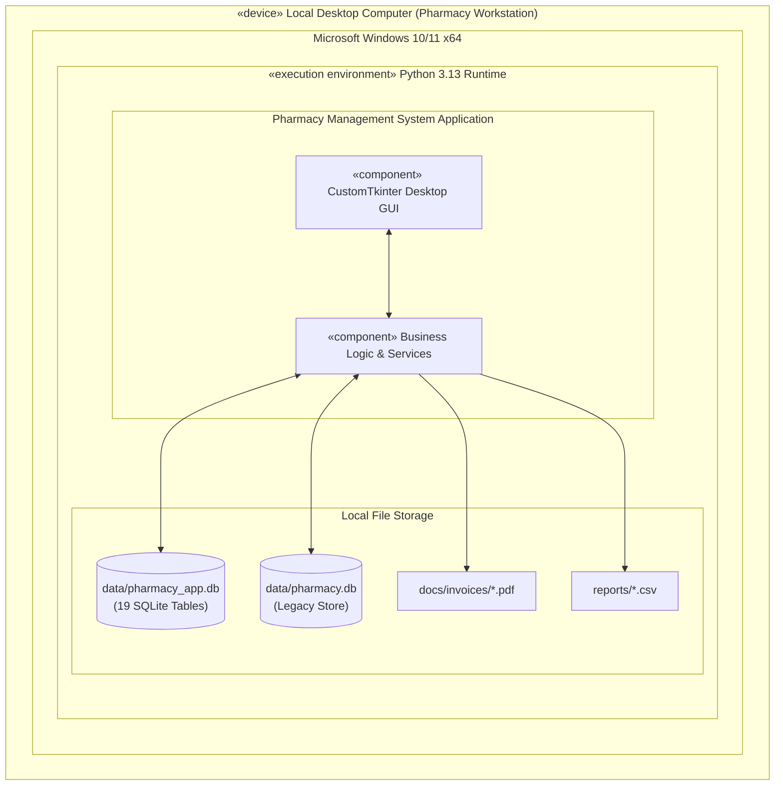

*Figure 10: Deployment Diagram (Standalone Desktop Architecture)*

## 2.5 Design Constraints

- The application uses SQLite for persistence.
- User-provided SQL values must be parameterized.
- Stock-changing operations must preserve transactional consistency.
- Expired and ineligible stock must not be sold.
- Batch number and shelf location are different concepts.
- Search sorting must use an allowed list of fields.
- FMEA/SQC navigation is disabled by default through the feature configuration.
- Benchmark View is not part of the current main navigation.

---

# 3. FUNCTIONAL REQUIREMENTS

## 3.1 Authentication and User Management

- **FR-AUTH-01:** The system shall provide a login interface.
- **FR-AUTH-02:** Users shall authenticate using username and password.
- **FR-AUTH-03:** The login interface shall support store and role context.
- **FR-AUTH-04:** New password hashes shall use PBKDF2-HMAC-SHA256 with 200,000 iterations and a 16-byte salt.
- **FR-AUTH-05:** The system shall retain a 100,000-iteration legacy password verification fallback.
- **FR-AUTH-06:** The application shall display role-aware navigation.
- **FR-AUTH-07:** Owner/Admin users shall be able to create, activate, deactivate and reset staff accounts.
- **FR-AUTH-08:** Store-scoped operations shall use store identifiers where supported by the relevant services.

## 3.2 Medicine Management

- **FR-MED-01:** Authorized users shall be able to add medicine records.
- **FR-MED-02:** Users shall be able to view medicine records.
- **FR-MED-03:** Authorized users shall be able to update medicine details.
- **FR-MED-04:** The system shall support medicine deactivation or archiving.
- **FR-MED-05:** Deletion shall be blocked when dependent records prevent safe removal.
- **FR-MED-06:** Medicine creation can register an opening inventory batch and shelf location.
- **FR-MED-07:** The system shall validate medicine details before saving.

## 3.3 Batch Inventory Management

- **FR-BAT-01:** Inventory shall be maintained at batch level.
- **FR-BAT-02:** Batch records shall contain medicine, batch number, expiry date, manufacturing date, received date, quantity, price, status, verification and shelf location information.
- **FR-BAT-03:** The same medicine with different expiry dates shall be assigned to separate shelves.
- **FR-BAT-04:** Batches of the same medicine with identical expiry dates may share a shelf even if their batch numbers differ.
- **FR-BAT-05:** Batch number and shelf location shall be treated as separate concepts.
- **FR-BAT-06:** The system shall validate shelf compatibility and active location status.
- **FR-BAT-07:** Expired, recalled, quarantined, inactive, unverified and zero-stock batches shall not be eligible for sale where the sales service applies these checks.
- **FR-BAT-08:** The system shall maintain stock movement records.

## 3.4 Supplier Management

- **FR-SUP-01:** Authorized Owner/Admin users shall manage supplier records.
- **FR-SUP-02:** Supplier records shall be associated with the appropriate store context.
- **FR-SUP-03:** Supplier information shall be available for purchasing operations.

## 3.5 Purchase Management

- **FR-PUR-01:** The system shall support purchase order creation.
- **FR-PUR-02:** Purchase orders shall contain purchase item records.
- **FR-PUR-03:** Supplier invoice uniqueness shall be validated within the store.
- **FR-PUR-04:** Receiving shall validate batch number, manufacturing date, expiry date, quantity, prices and shelf location.
- **FR-PUR-05:** Duplicate receiving shall be prevented.
- **FR-PUR-06:** Receiving shall create or increment inventory batches.
- **FR-PUR-07:** Stock movement records shall be generated during successful receipt.
- **FR-PUR-08:** Purchase receipt shall update applicable legacy medicine quantity information.
- **FR-PUR-09:** A received purchase order shall not be cancelled through the ordinary cancellation path.

Figure 9 illustrates the complete purchase order and goods receiving workflow, highlighting date verification, shelf validation and inventory increment.

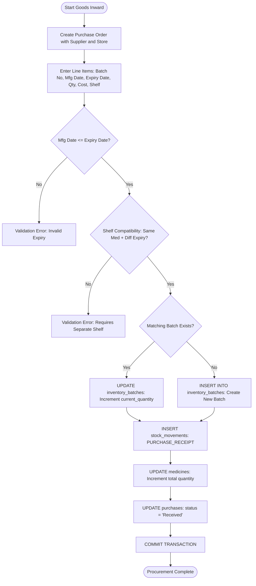

*Figure 9: Purchase and Goods Receiving Flow*

## 3.6 Advanced Search and Retrieval – Q13

- **FR-SRCH-01:** The system shall support multi-parameter medicine search.
- **FR-SRCH-02:** Partial-text search shall support medicine name, medicine code, batch, manufacturer and category.
- **FR-SRCH-03:** Advanced Search shall support applicable filters.
- **FR-SRCH-04:** Search results shall support sorting through an allowed sort-field list.
- **FR-SRCH-05:** Dashboard quick-search shall return a maximum of eight results.
- **FR-SRCH-06:** Advanced Search shall use approximately 250 ms input debounce.
- **FR-SRCH-07:** Search operations shall use parameterized SQL values.
- **FR-SRCH-08:** The database schema shall define B-Tree indexes for medicine name, category, manufacturer, expiry date and medicine code.
- **FR-SRCH-09:** Search performance shall be measured using representative datasets before claiming a numerical speed improvement.

**Technical note:** A conventional B-Tree index generally cannot perform a normal index seek for arbitrary substring searches using a leading wildcard such as `LIKE '%text%'`. Therefore, the existence of indexes alone does not prove that all partial-text queries are faster.

Figure 7 outlines the activity workflow of the Q13 debounced search engine.

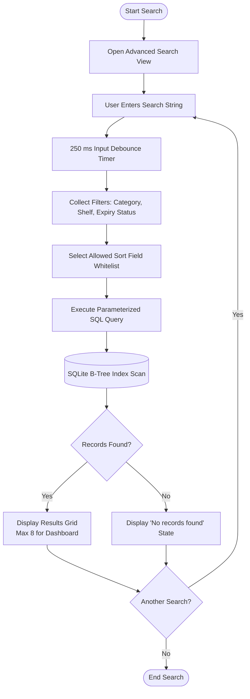

*Figure 7: Activity Diagram: Medicine Search (Q13 Engine)*

## 3.7 Billing and Sales Management

- **FR-SALE-01:** The system shall validate cart items before checkout.
- **FR-SALE-02:** The system shall verify stock availability.
- **FR-SALE-03:** Expired stock shall not be sold.
- **FR-SALE-04:** Inactive, unverified, recalled, quarantined and zero-stock batches shall be excluded from allocation according to the sales eligibility rules.
- **FR-SALE-05:** The system shall allocate stock using FEFO.
- **FR-SALE-06:** FEFO ordering shall use expiry date, creation time and batch ID for deterministic ordering.
- **FR-SALE-07:** Sale creation and stock deduction shall occur transactionally.
- **FR-SALE-08:** Failed operations shall roll back partial stock changes.
- **FR-SALE-09:** The billing process shall validate the customer's Indian mobile number.
- **FR-SALE-10:** Supported payment modes shall include Cash, UPI and Card.
- **FR-SALE-11:** The system shall calculate discount and tax after discount.
- **FR-SALE-12:** Billing totals shall use nearest-rupee half-up rounding.
- **FR-SALE-13:** Duplicate checkout processing shall be prevented.
- **FR-SALE-14:** The application shall support receipt generation, printing and reprinting.

Figure 6 depicts the Sequence Diagram for POS checkout and FEFO allocation. Figure 8 illustrates the detailed FEFO stock allocation flowchart.

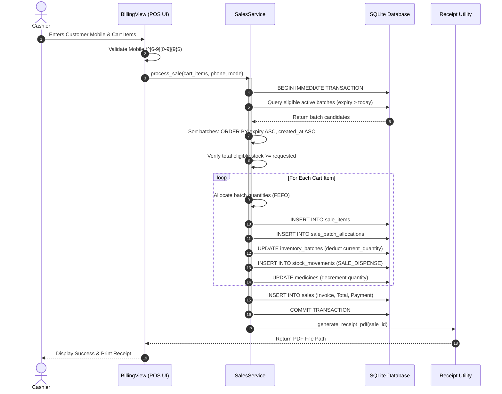

*Figure 6: Sequence Diagram: Billing and FEFO Allocation*

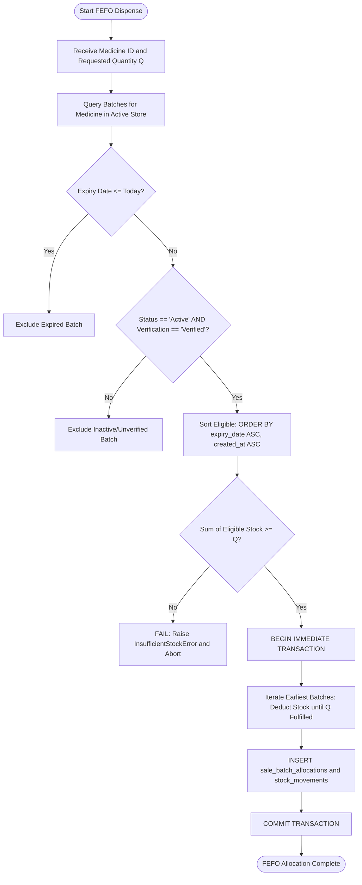

*Figure 8: Activity Diagram: FEFO Allocation*

## 3.8 Customer Return Management

- **FR-RET-01:** Returns shall be linked to the original sale.
- **FR-RET-02:** The system shall prevent returned quantity from exceeding the remaining returnable quantity.
- **FR-RET-03:** Only eligible sellable returns may be restocked as saleable inventory.
- **FR-RET-04:** Damaged or expired returns shall not be added to saleable stock.
- **FR-RET-05:** Return operations shall create appropriate stock movement and audit records.

## 3.9 Reports and Analytics

- **FR-REP-01:** The system shall provide sales summaries.
- **FR-REP-02:** Reports shall include supported payment mode, discount, tax, refund and net sales information.
- **FR-REP-03:** The system shall support cashier performance reports.
- **FR-REP-04:** The system shall support medicine sales reports.
- **FR-REP-05:** The system shall support batch inventory valuation reports.
- **FR-REP-06:** Pandas and Matplotlib shall be used for supported data processing and visualization.
- **FR-REP-07:** Supported report data shall be exportable to CSV.

## 3.10 TQM and Quality Management

- **FR-TQM-01:** The system shall support FMEA records.
- **FR-TQM-02:** RPN shall be calculated as Severity × Occurrence × Detection.
- **FR-TQM-03:** Severity, Occurrence and Detection shall each use scores from 1 to 10.
- **FR-TQM-04:** The system shall classify RPN values into defined risk levels.
- **FR-TQM-05:** The system shall support SQC defect records and quality analysis.
- **FR-TQM-06:** Quality utilities shall support Pareto analysis, Fishbone analysis and PDCA improvement activities.
- **FR-TQM-07:** FMEA/SQC navigation shall remain conditional on the feature configuration.

Figure 11 outlines the FMEA risk assessment workflow and RPN classification tiers, while Figure 12 illustrates the closed-loop Deming PDCA continuous improvement cycle.

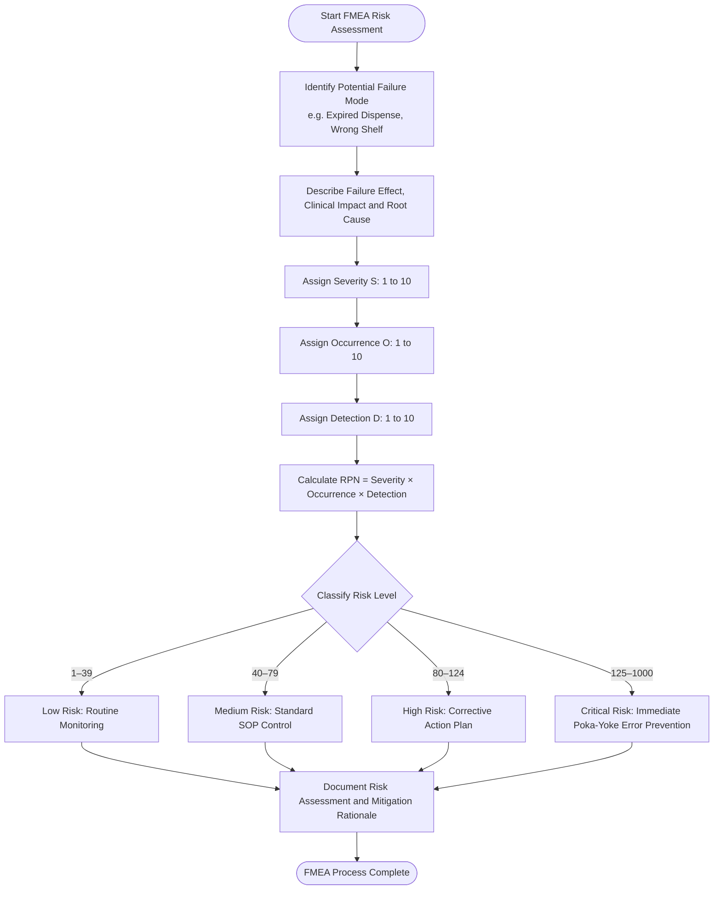

*Figure 11: FMEA Risk Assessment Flow*

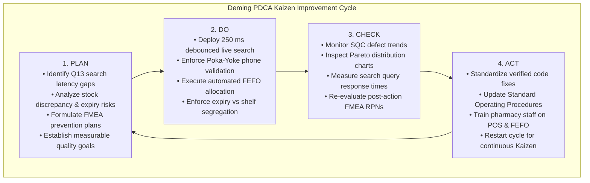

*Figure 12: PDCA Continuous Improvement Cycle*

---

# 4. NON-FUNCTIONAL REQUIREMENTS

## 4.1 Performance

- Advanced Search uses a 250 ms debounce.
- Dashboard quick-search is limited to eight results.
- Search performance shall be evaluated through repeatable tests.
- No numerical speedup is claimed without measured evidence.

## 4.2 Security

- Passwords shall be stored using password hashing.
- SQL values shall be parameterized.
- Role-aware navigation shall control visible application functionality.
- Store context shall be applied to supported store-scoped operations.

## 4.3 Reliability

- Stock updates shall use database transactions.
- Failed transactions shall roll back.
- Foreign-key enforcement shall be enabled.
- Sales and purchasing operations shall preserve inventory consistency.

## 4.4 Usability

- The interface shall provide clear navigation.
- Forms shall validate user input.
- Poka-Yoke controls shall prevent invalid operational entries.
- Search shall support filters and sorting.

## 4.5 Maintainability

- Presentation, service, model and database responsibilities shall remain separated.
- Database migrations shall be managed through the project's migration mechanism.
- Tests shall use isolated databases.

---

# 5. DATABASE REQUIREMENTS

## 5.1 Main Entities

| Entity | Purpose |
|---|---|
| Stores | Store-level data separation |
| Users | User accounts and roles |
| Medicines | Medicine catalogue |
| Suppliers | Supplier information |
| Storage Locations | Shelf and location information |
| Inventory Batches | Batch-level stock |
| Purchases | Purchase orders |
| Purchase Items | Purchase order line items |
| Stock Movements | Inventory movement history |
| Sales | Billing transactions |
| Sale Items | Sold medicine lines |
| Sale Batch Allocations | Batch allocation against sales |
| Sale Returns | Customer returns |
| Sale Return Items | Returned medicine details |
| Audit Logs | Audit-related events |
| FMEA Records | Failure mode and risk analysis |
| SQC Records | Quality observations and analysis |

Figure 5A presents the main conceptual Entity-Relationship Diagram (ERD) using traditional Chen notation (rectangles for entities, ellipses for attributes, underlined primary keys, diamonds for relationships, and explicit 1:N cardinalities) across all 15 verified operational entities. Figures 5B and 5C provide complementary Chen subsystem views for inventory procurement and sales dispensing respectively.

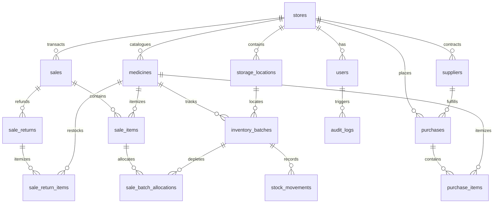

*Figure 5A: Main Conceptual Chen ER Diagram (Full Landscape Model)*

*Figure 5B: Detailed Inventory & Purchasing Subsystem Chen ERD*

*Figure 5C: Detailed Sales, Billing & Returns Subsystem Chen ERD*

## 5.2 Database Layer

The database layer uses SQLite.

Observed database capabilities include:

- Foreign-key enforcement.
- `sqlite3.Row` row handling.
- Parameterized execution and fetch helpers.
- Transaction management.
- Rollback on failure.

## 5.3 Migration

The inspected migration `20261029_01_batch_inventory` introduces batch inventory, suppliers, storage locations, purchases, purchase items, stock movements, sale batch allocations, returns and audit-related tables.

Legacy medicine stock is migrated into batch records. Missing supplier or manufacturing information may be flagged for verification.

## 5.4 Data Integrity

1. Stock-changing operations must be transactional.
2. Foreign-key constraints must remain enabled.
3. Different expiry dates require separate shelf locations.
4. Same-expiry batches may share a shelf.
5. Expired stock must not be sold.
6. Damaged and expired returns must not become saleable stock.
7. Return quantities must not exceed the original sale's remaining returnable quantity.

---

# 6. BUSINESS RULES

| ID | Business Rule |
|---|---|
| BR-01 | FEFO allocates the earliest-expiring eligible stock first. |
| BR-02 | Expired stock cannot be sold. |
| BR-03 | Recalled or quarantined stock cannot be sold. |
| BR-04 | Inactive and unverified batches are excluded from sale allocation. |
| BR-05 | Zero-stock batches cannot be allocated. |
| BR-06 | Same medicine with different expiry dates requires separate shelves. |
| BR-07 | Same medicine with identical expiry dates may share a shelf. |
| BR-08 | Batch number and shelf location are different concepts. |
| BR-09 | Damaged/expired returns are not saleable stock. |
| BR-10 | Received purchase orders cannot be ordinarily cancelled. |
| BR-11 | Customer mobile number must pass configured Indian mobile validation. |
| BR-12 | Tax is calculated after discount. |
| BR-13 | Billing totals use half-up rounding. |

---

# 7. TQM IMPLEMENTATION

## 7.1 Q13 – Faster Search & Retrieval

The system implements Q13 through:

- Multi-parameter search.
- Partial-text search.
- Advanced filters.
- Sorting.
- Dashboard quick-search.
- B-Tree indexes on selected medicine fields.
- Parameterized SQL queries.
- Debounced live search.

Search optimization must be validated using representative datasets and repeatable measurements.

## 7.2 FMEA

RPN formula:

`RPN = Severity × Occurrence × Detection`

Each factor ranges from 1 to 10.

| RPN | Risk Level |
|---:|---|
| 1–39 | Low |
| 40–79 | Medium |
| 80–124 | High |
| 125–1000 | Critical |

A higher Detection score means the failure is more difficult to detect and represents worse detectability.

Seeded FMEA data represents initial qualitative assessment, not measured failure rates.

## 7.3 SQC

The quality utilities include:

- Defect records.
- Pareto analysis.
- Fishbone analysis.
- PDCA improvement activities.

Seeded SQC records are demonstration/initial data, not historical production measurements.

**Configuration:** `ENABLE_REVIEW3_4_FEATURES` defaults to `0`, so FMEA/SQC navigation is disabled unless enabled.

---

# 8. EXTERNAL INTERFACES

## 8.1 User Interface

The application uses CustomTkinter.

Observed views include:

- Login.
- Dashboard.
- Medicines.
- Batches.
- Purchasing.
- Suppliers.
- Advanced Search.
- Billing.
- Staff Management.
- Reports.

FMEA/SQC views are optional and configuration-dependent.

## 8.2 Software Interfaces

| Component | Purpose |
|---|---|
| Python | Application runtime |
| CustomTkinter | Desktop GUI |
| SQLite | Database |
| Pandas | Data processing |
| Matplotlib | Charts |
| FPDF | PDF documents |
| PyInstaller | Packaging support |

## 8.3 File Outputs

The application supports CSV report exports and PDF sales/purchase documents.

The PDF utility normalizes text for its configured Latin-1 output path and may replace the rupee symbol with `Rs.`. Full Unicode output is not guaranteed.

---

# 9. TESTING AND VALIDATION

## 9.1 Test Areas

The supplied project tests cover areas including:

- FMEA.
- SQC.
- Login and roles.
- Medicine CRUD.
- Multi-store.
- Navigation.
- Reports.
- Sales.
- Search.
- Migration.
- Purchasing and FEFO.
- Billing and returns.
- UI fixes.

## 9.2 Reported Audit Evidence

The supplied `COMPLETE_FINAL_AUDIT_REPORT.md`, dated 31 October 2026, reports:

- 31 focused audit checks.
- 369 regression tests across 22 files.
- Zero failures/errors.
- 16 GUI captures.

These are reported results from the supplied audit document and were not independently rerun while preparing this SRS. Other project documentation contains conflicting test totals.

## 9.3 Acceptance Criteria

The release should be validated for:

1. Login and role-aware navigation.
2. Medicine CRUD and validation.
3. Batch creation and receiving.
4. Shelf and expiry rules.
5. FEFO allocation.
6. Exclusion of ineligible stock.
7. Transactional billing and rollback.
8. Customer return restrictions.
9. Advanced Search and quick-search.
10. Report generation and CSV export.
11. Optional FMEA/SQC configuration.
12. Protection of production databases during tests.

---

# 10. DEPLOYMENT AND MAINTENANCE

## 10.1 Configuration

The project supports:

- `PHARMACY_DATA_DIR`
- `PHARMACY_DB_PATH`
- `.env`
- Test-mode configuration.

The actual release environment must be checked before deployment.

## 10.2 Database Safety

The following production database files must not be modified during documentation work or isolated testing:

- `data/pharmacy.db`
- `data/pharmacy_app.db`

Use isolated test databases and back up production data before migrations.

## 10.3 Packaging

The project README identifies PyInstaller as packaging support. The final build should be validated against actual dependency versions and target operating system.

---

# 11. KNOWN LIMITATIONS AND RELEASE VERIFICATION

1. FMEA/SQC UI is disabled by default.
2. Benchmark View is not present in current main navigation.
3. B-Tree indexes do not automatically accelerate leading-wildcard substring searches.
4. Some internal permission helpers retain compatibility behaviour when acting-user context is absent.
5. The sales service performs additional verification checks beyond the batch convenience eligibility property.
6. The legacy synchronization utility covers selected legacy tables; complete synchronization of all new batch/purchase/return entities is not claimed.
7. PDF output may substitute `Rs.` for the rupee symbol.
8. Seeded FMEA/SQC data is not historical production measurement data.
9. Numerical search speedup and maximum dataset capacity are not claimed without release measurements.
10. Current test totals should be confirmed against the release test run.

---

# 12. REQUIREMENTS TRACEABILITY MATRIX

| Requirement Group | Implementation Area | Test Area |
|---|---|---|
| Authentication | Login, user model, permissions | Login and roles |
| Medicine | Medicine model/service/UI | Medicine CRUD |
| Batch | InventoryBatch, ShelfService | Migration and FEFO |
| Purchasing | PurchaseService, SupplierService | Purchasing |
| Search | SearchService, Advanced Search | Search tests |
| Sales | SalesService, Billing UI | Sales and billing |
| Returns | SaleReturn models and SalesService | Return tests |
| Reports | ReportService, Reports UI | Report tests |
| TQM | FMEA/SQC utilities and views | FMEA/SQC tests |
| Database | db.py, schema and migration | Migration and multi-store tests |

---

# APPENDIX A – SYSTEM ARCHITECTURE

Figure 1 illustrates the high-level layered software architecture across presentation, service, data access and persistence layers.

*Figure 1: Complete System Architecture (Layered Model)*

---

# APPENDIX B – FEFO SALES FLOW

Figure 8 depicts the detailed FEFO stock eligibility filtering and allocation algorithm. Figure 6 shows the sequence of interactions during a complete POS billing transaction.

*Figure 8: Activity Diagram: FEFO Allocation*

*Figure 6: Sequence Diagram: Billing and FEFO Allocation*

---

# APPENDIX C – PURCHASE RECEIVING FLOW

Figure 9 illustrates the purchase order creation, line item entry, shelf compatibility verification and batch receipt workflow.

*Figure 9: Purchase and Goods Receiving Flow*

---

# APPENDIX D – SEARCH FLOW

Figure 7 illustrates the Q13 search flow including debouncing, parameterization and index-assisted querying.

*Figure 7: Activity Diagram: Medicine Search (Q13 Engine)*

---

# APPENDIX E – FMEA RISK CLASSIFICATION

Figure 11 depicts the step-by-step FMEA risk assessment workflow from failure mode identification through RPN calculation and classification.

*Figure 11: FMEA Risk Assessment Flow*

| Factor | Range | Meaning |
|---|---:|---|
| Severity | 1–10 | Impact of failure |
| Occurrence | 1–10 | Likelihood assessment |
| Detection | 1–10 | Difficulty of detecting failure |
| RPN | 1–1000 | Severity × Occurrence × Detection |

| RPN | Classification |
|---:|---|
| 1–39 | Low |
| 40–79 | Medium |
| 80–124 | High |
| 125–1000 | Critical |
