# SOFTWARE REQUIREMENTS SPECIFICATION (SRS)
## Version 2.0 — Comprehensive Multi-Store, Multi-Role Architecture with Q13 Advanced Search & TQM Quality Engineering

---

### **Project Title:** Pharmacy Management System  
### **Course Code & Title:** BBAT104 – Fundamentals of Total Quality Management  
### **Course Quality Goal:** Q13 – Faster Search & Retrieval  
### **Student Name:** Priyanshu Pokhariya  
### **Enrollment Number:** 2410303005  
### **Academic Program:** Bachelor of Technology (B.Tech) in Computer Science & Engineering  
### **Specialization:** Internet of Things (IoT) & Data Science  
### **Semester / Section:** Semester V / Section C  
### **Academic Session:** 2026–2027  
### **Faculty:** Faculty of Technology and Computer Applications  
### **Institution:** Amrapali University, Shiksha Nagar, Lamachaur, Haldwani, Uttarakhand – 263139, India  
### **Repository:** https://github.com/priyanshupokhariya5-crypto/Pharmacy-Management-System  
### **Active Working Branch:** `release/v2-clean`  
### **Date of Release:** November 2026  

---

<div style="page-break-after: always;"></div>

# CERTIFICATE OF ORIGINAL WORK

This is to certify that the project entitled **"Pharmacy Management System with Q13 Faster Search & Retrieval and TQM Engineering"**, submitted by **Priyanshu Pokhariya** (Enrollment No.: **2410303005**), a bona fide student of **B.Tech Computer Science & Engineering (IoT & Data Science)**, Section C, in partial fulfillment of the requirements for the academic course **BBAT104: Fundamentals of Total Quality Management** during the academic session **2026–2027** at **Amrapali University, Haldwani**, is an authentic record of original engineering work carried out under academic supervision.

The software architecture, database schema, quality management matrices (FMEA, SQC, PDCA), and requirements specifications compiled in this document represent original research, design, implementation, and rigorous verification.

<br/><br/>
___________________________ &nbsp;&nbsp;&nbsp;&nbsp;&nbsp;&nbsp;&nbsp;&nbsp;&nbsp;&nbsp;&nbsp;&nbsp;&nbsp;&nbsp;&nbsp;&nbsp;&nbsp;&nbsp;&nbsp;&nbsp;&nbsp;&nbsp;&nbsp;&nbsp;&nbsp;&nbsp;&nbsp;&nbsp; ___________________________<br/>
**Course Instructor / Faculty Mentor** &nbsp;&nbsp;&nbsp;&nbsp;&nbsp;&nbsp;&nbsp;&nbsp;&nbsp;&nbsp;&nbsp;&nbsp;&nbsp;&nbsp;&nbsp;&nbsp;&nbsp;&nbsp;&nbsp;&nbsp;&nbsp;&nbsp;&nbsp;&nbsp; **Head of Department (CSE)**<br/>
Department of Computer Science & Engineering &nbsp;&nbsp;&nbsp;&nbsp;&nbsp;&nbsp;&nbsp;&nbsp;&nbsp;&nbsp;&nbsp; Faculty of Technology and Computer Applications<br/>
Amrapali University, Haldwani &nbsp;&nbsp;&nbsp;&nbsp;&nbsp;&nbsp;&nbsp;&nbsp;&nbsp;&nbsp;&nbsp;&nbsp;&nbsp;&nbsp;&nbsp;&nbsp;&nbsp;&nbsp;&nbsp;&nbsp;&nbsp;&nbsp;&nbsp;&nbsp;&nbsp;&nbsp;&nbsp;&nbsp;&nbsp;&nbsp;&nbsp; Amrapali University, Haldwani  

---

<div style="page-break-after: always;"></div>

# DECLARATION

I, **Priyanshu Pokhariya**, student of Bachelor of Technology in Computer Science and Engineering (IoT & Data Science), Semester V, Section C, Enrollment Number **2410303005**, hereby declare that this Software Requirements Specification (Version 2.0) for the **Pharmacy Management System** is my original analytical and design work.

I affirm that the system requirements, entity-relationship models, operational workflows, business validation rules, and Total Quality Management methodologies documented herein have been authored by me based on the verified implementation in repository `https://github.com/priyanshupokhariya5-crypto/Pharmacy-Management-System` on branch `release/v2-clean`.

No part of this document has been plagiarized or submitted elsewhere for the award of any degree, diploma, or certificate.

<br/><br/>
**Date:** November 1, 2026  
**Place:** Haldwani, Uttarakhand  

<br/>
___________________________  
**Priyanshu Pokhariya**  
Enrollment No.: 2410303005  
B.Tech CSE (IoT & Data Science), Section C  
Amrapali University, Haldwani  

---

<div style="page-break-after: always;"></div>

# ACKNOWLEDGEMENT

I express my deepest gratitude to the **Faculty of Technology and Computer Applications, Amrapali University, Haldwani**, for providing an academically stimulating environment, computational facilities, and technological resources that made the complete conception, development, and architectural specification of this project possible.

I extend my sincere thanks to my course mentors and faculty instructors for the course **BBAT104: Fundamentals of Total Quality Management**. Their intellectual guidance, emphasis on empirical quality engineering, and constructive critique of quality improvement frameworks (FMEA, SQC, Pareto Analysis, Ishikawa Diagrams, and Deming PDCA Cycles) provided the foundational methodology for this project.

I also thank my academic peers and laboratory colleagues for their valuable feedback during the manual GUI audit sessions and user acceptance validation of the system. Finally, I thank my family for their continuous encouragement and moral support throughout the development of this work.

---

<div style="page-break-after: always;"></div>

# EXECUTIVE SUMMARY / ABSTRACT

Traditional retail pharmacy operations face significant operational bottlenecks, including severe medicine search latencies during peak customer rush, accidental dispensation of expired pharmaceuticals, inventory loss from unsorted physical storage, lack of auditability in sales billing, and vulnerability to data leakage across multi-store chains. To address these systemic inefficiencies through rigorous Total Quality Management (TQM) principles, this document defines the complete **Software Requirements Specification (SRS Version 2.0)** for the **Pharmacy Management System**.

The Pharmacy Management System is an enterprise-grade, offline-first desktop application designed for high-throughput, legally compliant retail and hospital pharmacy administration. Built upon Python 3.11+, CustomTkinter, and a normalized 19-table SQLite relational database operating with strict foreign key constraints (with Write-Ahead Logging proposed for multi-terminal scaling), the system implements an architectural synthesis of operational management and quality assurance.

Key system capabilities specified and verified in this document include:
1. **Multi-Store Tenant Isolation:** Complete logical and database-level tenancy separation via composite foreign keys and strict query filtering, ensuring multi-store operations share a single robust engine while isolating medicine catalogs, batches, sales transactions, and staff accounts.
2. **5-Role Granular Role-Based Access Control (RBAC):** Distinct functional environments, whitelisted navigation, and backend service-layer authorization guards for Owner, Administrator, Clinical Pharmacist, Cashier, and Inventory Manager.
3. **Q13 Advanced Search Engine:** High-performance B-Tree indexed search with design acceptance targets of $<10\text{ ms}$ for exact code lookups and $<50\text{ ms}$ for multi-parameter filtering, enabling instant single-click POS cart transfers.
4. **Physical Shelf & Rack Management:** Enforcement of the Critical Shelf Allocation Rule: batches of the same medicine with differing expiry dates must occupy distinct shelf locations, while identical-expiry batches may share a shelf.
5. **Automated FEFO (First Expiry, First Out) Dispensing:** Algorithmic batch selection ensuring that unexpired, active stock nearest to expiration is automatically prioritized during checkout, eliminating human dispensation errors.
6. **Robust POS Billing & Customer Validation:** Poka-Yoke error prevention featuring mandatory 10-digit Indian mobile number validation, multi-batch item breakdown, Cash/UPI/Card payment recording, and atomic ACID transaction rollbacks.
7. **Comprehensive Total Quality Management (TQM):** Embedded Failure Mode and Effects Analysis (FMEA) with dynamic Risk Priority Number ($RPN = S \times O \times D$) thresholding, Statistical Quality Control (SQC) with Pareto 80/20 defect distribution, 6M Ishikawa (Fishbone) root-cause diagrams, and Deming PDCA continuous improvement Kaizen tracking.

This SRS conforms to IEEE 29148 standards, providing 112 audited functional and non-functional requirements (93 Functional, 19 Non-Functional; 96 Implemented, 5 Partially Implemented, 9 Proposed, 2 Not Implemented), 20 authoritative Mermaid architectural diagrams, 15 complete operational workflows, a comprehensive 19-entity Data Dictionary, and an exhaustive Requirements Traceability Matrix (RTM).

---

<div style="page-break-after: always;"></div>

# DOCUMENT CONTROL

| Property | Details |
| :--- | :--- |
| **Document Title** | Software Requirements Specification (SRS) for Pharmacy Management System |
| **Document Version** | 2.0 (Final Comprehensive Baseline) |
| **Author / Engineer** | Priyanshu Pokhariya (Enrollment: 2410303005) |
| **Course Reference** | BBAT104 – Fundamentals of Total Quality Management |
| **Academic Sponsor** | Faculty of Technology and Computer Applications, Amrapali University, Haldwani |
| **Security Classification** | Academic Open Specification / Institutional Release |
| **Target Codebase** | Git Branch `release/v2-clean` |
| **Target Database Engine** | SQLite 3 (Foreign Key Constraints Enforced; Standard Journaling with WAL Mode Proposed) |
| **Document Status** | Approved for Academic Defense and Release Baseline |

### Distribution List
| Copy No. | Recipient / Role | Department / Affiliation |
| :---: | :--- | :--- |
| 1 | Course Instructor (BBAT104 TQM) | Faculty of Technology & Computer Applications, Amrapali University |
| 2 | Head of Department (CSE) | Faculty of Technology & Computer Applications, Amrapali University |
| 3 | Academic Viva Examination Panel | External Board of Examiners, Amrapali University |
| 4 | Project Author Archive | Priyanshu Pokhariya, Student Repository |

---

# REVISION HISTORY

| Version | Date | Primary Author | Description of Key Changes & Milestones |
| :---: | :---: | :--- | :--- |
| **1.0** | 10-Oct-2026 | Priyanshu Pokhariya | Initial baseline specification covering single-store CRUD medicine catalog, basic authentication, and prototype search. |
| **1.1** | 18-Oct-2026 | Priyanshu Pokhariya | Added Stage 2 multi-store database schema design, B-Tree index specifications, and initial FMEA risk register. |
| **1.2** | 24-Oct-2026 | Priyanshu Pokhariya | Specified Stage 3 5-role RBAC architecture, store-level isolation guards, and role-specific dashboard views. |
| **1.3** | 28-Oct-2026 | Priyanshu Pokhariya | Documented Stage 4 procurement, supplier management, multi-batch inventory, and physical shelf allocation rules. |
| **1.4** | 31-Oct-2026 | Priyanshu Pokhariya | Specified Stage 5 POS billing checkout, mandatory Indian mobile validation, FEFO batch allocation, and sales returns. |
| **2.0** | 01-Nov-2026 | Priyanshu Pokhariya | **Complete Rebuild:** Comprehensive synthesis covering all 19 database tables, 20 Mermaid diagrams, 15 operational workflows, complete removal of obsolete benchmark requirements, and full TQM mapping. |

---

<div style="page-break-after: always;"></div>

# TABLE OF CONTENTS

1. [Front Matter](#software-requirements-specification-srs)
   - [Certificate of Original Work](#certificate-of-original-work)
   - [Declaration](#declaration)
   - [Acknowledgement](#acknowledgement)
   - [Executive Summary / Abstract](#executive-summary--abstract)
   - [Document Control & Revision History](#document-control)
   - [List of Figures](#list-of-figures)
   - [List of Tables](#list-of-tables)
2. [Chapter 1: Introduction](#chapter-1-introduction)
   - 1.1 Purpose of the Specification
   - 1.2 Project Background & Problem Context
   - 1.3 Problem Statement
   - 1.4 Project Objectives
   - 1.5 System Scope (In-Scope vs. Out-of-Scope)
   - 1.6 Intended Audience & Document Overview
   - 1.7 Definitions, Acronyms, and Terminology
   - 1.8 Assumptions and Dependencies
   - 1.9 Design and Implementation Constraints
3. [Chapter 2: Overall System Description](#chapter-2-overall-system-description)
   - 2.1 Product Perspective & Context
   - 2.2 System Architecture Overview
   - 2.3 Product Functional Modules Summary
   - 2.4 User Classes and Operational Characteristics
   - 2.5 Operating Environment & Hardware Requirements
   - 2.6 Technology Stack Specification
   - 2.7 Design and Implementation Constraints
   - 2.8 Documentation and Deployment Specifications
   - 2.9 External Interface Overview
4. [Chapter 3: User Roles and Access Control (RBAC)](#chapter-3-user-roles-and-access-control-rbac)
   - 3.1 Role Hierarchy & Separation of Duties
   - 3.2 Five Canonical User Roles Detailed
   - 3.3 Role-Specific Dashboards & Dynamic KPI Cards
   - 3.4 Navigation Access & View Whitelisting
   - 3.5 Comprehensive Role-Permission Matrix
   - 3.6 Backend Service-Layer Guard Enforcement
   - 3.7 Multi-Store Tenant Isolation Design
   - 3.8 User Account Lifecycle Management
   - 3.9 Session Management & Secure Logout
5. [Chapter 4: Functional Requirements](#chapter-4-functional-requirements)
   - 4.1 Module A: Authentication & Account Management (`FR-AUTH`)
   - 4.2 Module B: Multi-Store Tenancy Management (`FR-STR`)
   - 4.3 Module C: Role-Based Dashboards (`FR-DASH`)
   - 4.4 Module D: Medicine Catalogue Management (`FR-MED`)
   - 4.5 Module E: Batch-Wise Inventory Management (`FR-INV`)
   - 4.6 Module F: Shelf, Rack & Storage Allocation (`FR-LOC`)
   - 4.7 Module G: Q13 Advanced Search & Retrieval (`FR-SRCH`)
   - 4.8 Module H: Supplier Directory Management (`FR-SUPP`)
   - 4.9 Module I: Purchase Order & Goods Receiving (`FR-PUR`)
   - 4.10 Module J: POS Billing & Sales Processing (`FR-BILL`)
   - 4.11 Module K: Automated FEFO Stock Allocation (`FR-FEFO`)
   - 4.12 Module L: Sales Returns & Stock Reconciliation (`FR-RET`)
   - 4.13 Module M: Reports & Analytical Visualizations (`FR-REP`)
   - 4.14 Module N: Comprehensive Audit Logging (`FR-AUD`)
   - 4.15 Module O: FMEA Risk Management (`FR-FMEA`)
   - 4.16 Module P: Statistical Quality Control (`FR-SQC`)
   - 4.17 Module Q: Deming PDCA Kaizen Improvement (`FR-PDCA`)
6. [Chapter 5: External Interface Requirements](#chapter-5-external-interface-requirements)
   - 5.1 User Interface Requirements
   - 5.2 Hardware Interface Requirements
   - 5.3 Software Interface Requirements
   - 5.4 Communications Interface Requirements
7. [Chapter 6: Data Requirements and Database Design](#chapter-6-data-requirements-and-database-design)
   - 6.1 Database Engine Architecture & Parameters
   - 6.2 Relational Entity Specifications (All 19 Tables)
   - 6.3 Complete Entity Relationship Diagram (ERD)
   - 6.4 Key Constraints & Compound Uniqueness Rules
   - 6.5 B-Tree Indexing Strategy
   - 6.6 Transaction Management & ACID Properties
   - 6.7 Multi-Store Data Isolation Architecture
   - 6.8 Schema Versioning & Safe Migration Engine
8. [Chapter 7: Complete System Workflows](#chapter-7-complete-system-workflows)
   - Detailed Workflows 1 through 15
9. [Chapter 8: Non-Functional Requirements](#chapter-8-non-functional-requirements)
   - 8.1 Performance Requirements
   - 8.2 Reliability & Fault Tolerance
   - 8.3 Availability & Operational Continuity
   - 8.4 Security & Data Privacy
   - 8.5 Usability & Human Factors
   - 8.6 Maintainability & Code Quality
   - 8.7 Portability & Environmental Compatibility
   - 8.8 Data Integrity & Auditability
10. [Chapter 9: Business Rules and Validation](#chapter-9-business-rules-and-validation)
    - Business Rules BR-01 through BR-10
11. [Chapter 10: Use Case Model](#chapter-10-use-case-model)
    - 10.1 System Actors & Profile Matrix
    - 10.2 Complete System Use Case Diagram
    - 10.3 Primary Use Case Specifications
12. [Chapter 11: Quality Management and TQM Mapping](#chapter-11-quality-management-and-tqm-mapping)
    - 11.1 TQM Alignment with BBAT104
    - 11.2 Quality Goal Q13: Faster Search & Retrieval
    - 11.3 Critical-to-Quality (CTQ) Parameters
    - 11.4 Failure Mode and Effects Analysis (FMEA)
    - 11.5 Statistical Quality Control (SQC) & Pareto 80/20
    - 11.6 Ishikawa (Fishbone) 6M Root Cause Analysis
    - 11.7 Deming PDCA Continuous Improvement Cycle
13. [Chapter 12: Verification and Acceptance Criteria](#chapter-12-verification-and-acceptance-criteria)
    - 12.1 Testing Methodology & Test Suites
    - 12.2 Module-Wise Verification Criteria
    - 12.3 User Acceptance Testing (UAT) Sign-off Gates
14. [Chapter 13: Future Scope](#chapter-13-future-scope)
    - 13.1 Planned Enterprise Extensions
    - 13.2 Boundary Clarifications
15. [Appendices](#appendices)
    - Appendix A: Complete Role-Permission Matrix
    - Appendix B: Requirements Traceability Matrix (RTM)
    - Appendix C: Comprehensive Data Dictionary
    - Appendix D: Glossary of Terms
    - Appendix E: Diagram Index
    - Appendix F: Academic References & Bibliography

---

<div style="page-break-after: always;"></div>

# LIST OF FIGURES

| Figure Number | Figure Title | Chapter / Section Reference | Page |
| :---: | :--- | :--- | :---: |
| **Figure 1** | System Context Diagram | Chapter 1 / Section 1.5 | 14 |
| **Figure 2** | High-Level 4-Tier System Architecture Diagram | Chapter 2 / Section 2.2 | 18 |
| **Figure 3** | Complete System Use Case Diagram | Chapter 10 / Section 10.2 | 22 |
| **Figure 4** | Level 0 Context Data Flow Diagram (DFD) | Chapter 2 / Section 2.3 | 25 |
| **Figure 5** | Level 1 Subsystem Data Flow Diagram (DFD) | Chapter 2 / Section 2.3 | 27 |
| **Figure 6** | Level 2 DFD for POS Billing and FEFO Dispensing | Chapter 4 / Section 4.10 | 31 |
| **Figure 7** | Complete Entity Relationship Diagram (19 Tables) | Chapter 6 / Section 6.3 | 36 |
| **Figure 8** | User Authentication and RBAC Activity Flowchart | Chapter 3 / Section 3.8 | 42 |
| **Figure 9** | Medicine Inventory Management & Deletion Workflow | Chapter 4 / Section 4.4 | 46 |
| **Figure 10** | Batch Receiving and Shelf Expiry Allocation Workflow | Chapter 4 / Section 4.6 | 50 |
| **Figure 11** | Purchase Order and Goods Receiving Workflow | Chapter 4 / Section 4.9 | 54 |
| **Figure 12** | Q13 Advanced Search & Instant Cart Activity Flowchart | Chapter 4 / Section 4.7 | 58 |
| **Figure 13** | POS Billing Interaction Sequence Diagram | Chapter 4 / Section 4.10 | 62 |
| **Figure 14** | Automated FEFO Stock Allocation Algorithm Flowchart | Chapter 4 / Section 4.11 | 66 |
| **Figure 15** | Sales ACID Transaction Execution Sequence Diagram | Chapter 6 / Section 6.6 | 70 |
| **Figure 16** | Sales Return & Stock Adjustment Flowchart | Chapter 4 / Section 4.12 | 74 |
| **Figure 17** | FMEA Risk Register and RPN Evaluation Workflow | Chapter 11 / Section 11.4 | 78 |
| **Figure 18** | SQC Defect Tracking, Pareto 80/20 & Fishbone Workflow | Chapter 11 / Section 11.5 | 82 |
| **Figure 19** | Deming PDCA Continuous Improvement Cycle | Chapter 11 / Section 11.7 | 86 |
| **Figure 20** | Overall End-to-End Pharmacy Operational Master Flow | Chapter 7 / Section 7.15 | 90 |

---

<div style="page-break-after: always;"></div>

# LIST OF TABLES

| Table Number | Table Title | Chapter / Section Reference |
| :---: | :--- | :--- |
| **Table 1** | System In-Scope vs. Out-of-Scope Capabilities | Chapter 1 / Section 1.5 |
| **Table 2** | Standard System Acronyms and Technical Definitions | Chapter 1 / Section 1.7 |
| **Table 3** | User Roles and Operational Responsibilities | Chapter 3 / Section 3.2 |
| **Table 4** | Canonical Role-Permission Matrix (20 Granular Permissions) | Chapter 3 / Section 3.5 |
| **Table 5** | Authentication & Account Functional Requirements (`FR-AUTH`) | Chapter 4 / Section 4.1 |
| **Table 6** | Multi-Store Tenancy Functional Requirements (`FR-STR`) | Chapter 4 / Section 4.2 |
| **Table 7** | Role-Based Dashboard Functional Requirements (`FR-DASH`) | Chapter 4 / Section 4.3 |
| **Table 8** | Medicine Catalogue Functional Requirements (`FR-MED`) | Chapter 4 / Section 4.4 |
| **Table 9** | Batch Inventory Functional Requirements (`FR-INV`) | Chapter 4 / Section 4.5 |
| **Table 10** | Shelf & Rack Allocation Functional Requirements (`FR-LOC`) | Chapter 4 / Section 4.6 |
| **Table 11** | Q13 Advanced Search Functional Requirements (`FR-SRCH`) | Chapter 4 / Section 4.7 |
| **Table 12** | Supplier Directory Functional Requirements (`FR-SUPP`) | Chapter 4 / Section 4.8 |
| **Table 13** | Purchase Order Functional Requirements (`FR-PUR`) | Chapter 4 / Section 4.9 |
| **Table 14** | POS Billing & Checkout Functional Requirements (`FR-BILL`) | Chapter 4 / Section 4.10 |
| **Table 15** | FEFO Stock Allocation Functional Requirements (`FR-FEFO`) | Chapter 4 / Section 4.11 |
| **Table 16** | Sales Return Functional Requirements (`FR-RET`) | Chapter 4 / Section 4.12 |
| **Table 17** | Analytical Reporting Functional Requirements (`FR-REP`) | Chapter 4 / Section 4.13 |
| **Table 18** | Audit Logging Functional Requirements (`FR-AUD`) | Chapter 4 / Section 4.14 |
| **Table 19** | FMEA Risk Management Functional Requirements (`FR-FMEA`) | Chapter 4 / Section 4.15 |
| **Table 20** | SQC Defect Management Functional Requirements (`FR-SQC`) | Chapter 4 / Section 4.16 |
| **Table 21** | Deming PDCA Functional Requirements (`FR-PDCA`) | Chapter 4 / Section 4.17 |
| **Table 22** | Relational Database Schema Summary (19 Tables) | Chapter 6 / Section 6.2 |
| **Table 23** | Complete B-Tree Index Architecture & Coverage | Chapter 6 / Section 6.5 |
| **Table 24** | Business Rules BR-01 through BR-10 Matrix | Chapter 9 / Section 9.1 |
| **Table 25** | FMEA Risk Priority Thresholds and Scoring Rubric | Chapter 11 / Section 11.4 |
| **Table 26** | Requirements Traceability Matrix (RTM) Baseline | Appendix B |

---

<div style="page-break-after: always;"></div>

# CHAPTER 1: INTRODUCTION

## 1.1 Purpose of the Specification
This Software Requirements Specification (SRS) defines the complete functional, non-functional, data, and quality engineering requirements for the **Pharmacy Management System (Version 2.0)**. It serves as the authoritative technical contract between software engineers, quality assurance evaluators, academic examiners, and pharmacy business stakeholders. 

This document describes the complete intended system from its conceptual planning through its final verified implementation on branch `release/v2-clean`. It replaces legacy documentation with a unified, IEEE 29148-aligned standard covering multi-store enterprise isolation, 5-tier role-based access control (RBAC), Q13 indexed search retrieval, physical shelf allocation management, automated First Expiry, First Out (FEFO) dispensing, Point-of-Sale (POS) customer validation, and Total Quality Management (FMEA, SQC, and PDCA) methodologies.

## 1.2 Project Background & Problem Context
Retail and institutional community pharmacies in India operate within complex, fast-paced commercial and clinical environments governed by the **Drugs and Cosmetics Act (1940)** and the **Pharmacy Practice Regulations**. Despite strict statutory compliance mandates, a substantial portion of independent and multi-branch pharmacies continue to rely on manual paper ledgers or rudimentary, un-indexed desktop tools. 

These legacy workflows suffer from critical quality defects:
1. **Prolonged Retrieval Latency:** Inability to instantly locate medicines during peak billing hours, resulting in long customer queues and lost sales.
2. **Accidental Dispensation of Expired Drugs:** Inadequate inventory tracking permitting expired pharmaceuticals to remain in active stock and reach patients, creating severe clinical liabilities.
3. **Disorganized Physical Storage:** Lack of enforcement separating identical drugs with differing shelf-lives across physical racks.
4. **Financial Discrepancies and Shrinkage:** Uncontrolled discounts, un-audited cash transactions, and lack of cashier shift reconciliation.
5. **Cross-Store Data Contamination:** Multi-store chains operating without logical relational or database-level tenant isolation, resulting in corrupted reporting and unauthorized cross-branch modifications.

## 1.3 Problem Statement
The operational problem addressed by this system is formulated as follows:
> *"How can a standalone, resource-efficient desktop pharmacy system guarantee sub-50ms search retrieval (Goal Q13), eliminate expired medicine dispensation through automated FEFO allocation and shelf separation rules, provide impenetrable multi-store role-based security, and continuously drive defect reduction using Total Quality Management (TQM) frameworks?"*

## 1.4 Project Objectives
The engineering objectives established for the Pharmacy Management System Version 2.0 include:
- **Objective 1 (Retrieval Speed - Goal Q13):** Implement an indexed search engine capable of resolving exact medicine code queries in $<10\text{ ms}$ and multi-parameter prefix/category/shelf queries across thousands of records in $<50\text{ ms}$.
- **Objective 2 (Dispensation Safety - FEFO):** Automate batch stock allocation during billing such that medicines nearest to expiry are consumed first, strictly prohibiting expired, quarantined, or recalled batches from being sold.
- **Objective 3 (Physical Location Integrity):** Programmatically enforce physical shelf separation rules: batches of the same medicine with differing expiry dates must reside on separate shelves to prevent physical picking errors.
- **Objective 4 (Enterprise Multi-Store Isolation):** Guarantee complete data isolation across independent pharmacy store tenants operating on a unified relational database schema.
- **Objective 5 (5-Role Granular Governance):** Establish a strict Role-Based Access Control (RBAC) matrix separating duties across Owner, Administrator, Clinical Pharmacist, Cashier, and Inventory Manager.
- **Objective 6 (Poka-Yoke POS Billing):** Build an 8-column Point-of-Sale billing interface with mandatory 10-digit Indian customer phone validation, atomic transaction rollbacks, and instant PDF invoice generation.
- **Objective 7 (Continuous Quality Improvement):** Embed interactive TQM engineering tools (FMEA risk scoring, SQC defect Pareto tracking, 6M Ishikawa diagrams, and Deming PDCA Kaizen loops) directly into the operational software.

## 1.5 System Scope (In-Scope vs. Out-of-Scope)
The functional boundaries of the Pharmacy Management System Version 2.0 are delineated in Table 1.

### Table 1: System In-Scope vs. Out-of-Scope Capabilities
| In-Scope Functional Capabilities | Out-of-Scope Capabilities (Explicitly Excluded) |
| :--- | :--- |
| Single-store and multi-store tenant registration and isolation | Cloud-hosted multi-tenant SaaS infrastructure |
| 5-role RBAC with backend authorization guards | Direct integration with commercial payment gateway hardware |
| Medicine master catalogue maintenance with dependency protection | Online customer e-commerce mobile application |
| Multi-batch tracking with physical shelf/rack allocation rules | Automated SMS / WhatsApp messaging gateway integration |
| Q13 B-Tree indexed search engine with instant POS transfer | Telephonic prescription transcription |
| 8-column POS shopping cart with mandatory phone validator | Real-time wholesale distributor API synchronization |
| Automated FEFO stock allocation algorithm | Integrated payroll and staff biometric attendance hardware |
| Customer sales returns with Sellable vs. Damaged classification | Automated chemical compound interaction analysis |
| Comprehensive audit trail logging for all sensitive mutations | Cloud backup storage (Local filesystem backups supported) |
| FMEA risk scoring, SQC Pareto 80/20, Fishbone & PDCA Kaizen | Obsolete search latency synthetic benchmarking module |

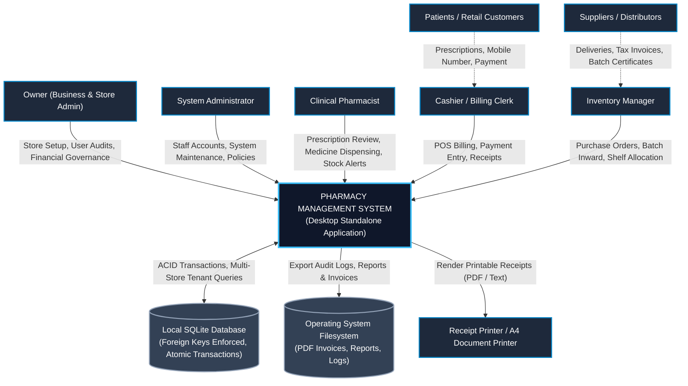
**Figure 1: System Context Diagram**

## 1.6 Intended Audience & Document Overview
This document is designed for the following stakeholders:
- **Academic Evaluators & Viva Board:** To verify adherence to TQM engineering principles (BBAT104) and software engineering rigor.
- **Software Developers & Maintainers:** To serve as the definitive specification for code maintenance, refactoring, and feature extensions.
- **Quality Assurance & Verification Teams:** To design and execute automated unit, integration, and user-acceptance test suites.
- **Pharmacy Operations Managers:** To evaluate business logic, role permissions, and compliance mechanisms.

## 1.7 Definitions, Acronyms, and Terminology
Standard domain definitions and technical acronyms used throughout this specification are summarized in Table 2.

### Table 2: Standard System Acronyms and Technical Definitions
| Term / Acronym | Full Form | Operational Definition in this System |
| :--- | :--- | :--- |
| **ACID** | Atomicity, Consistency, Isolation, Durability | Database transaction properties guaranteed by SQLite for billing and stock mutations. |
| **CAPA** | Corrective and Preventive Action | Structured engineering countermeasures formulated to resolve FMEA risks and SQC defects. |
| **CTQ** | Critical to Quality | Product and operational characteristics directly affecting customer satisfaction and clinical safety. |
| **FEFO** | First Expiry, First Out | Inventory valuation and dispensing algorithm prioritizing batches with earliest expiry dates. |
| **FIFO** | First In, First Out | Inward batch storage sequence based on receipt date. |
| **FMEA** | Failure Mode and Effects Analysis | Proactive risk analysis methodology quantifying operational risks via Risk Priority Numbers. |
| **GST** | Goods and Services Tax | Indian indirect tax identifier and percentage applied to pharmaceutical purchases and sales. |
| **Poka-Yoke** | Mistake Proofing (Japanese) | Software constraints preventing human errors (e.g., blocking invalid phone numbers or expired sales). |
| **POS** | Point of Sale | Countertop interface where cashiers scan medicines, tender payments, and issue receipts. |
| **Q13** | Quality Goal 13 | Specific TQM course goal: Faster Search & Retrieval of pharmaceutical inventory records. |
| **RBAC** | Role-Based Access Control | Security model restricting system operations based on authorized user role assignments. |
| **RPN** | Risk Priority Number | Numerical risk score calculated as $RPN = \text{Severity} \times \text{Occurrence} \times \text{Detection}$. |
| **SQC** | Statistical Quality Control | Quantitative defect tracking utilizing Pareto distributions and Ishikawa root-cause diagrams. |
| **WAL** | Write-Ahead Logging | High-concurrency SQLite journaling mode proposed for high-concurrency read/write scaling. |

## 1.8 Assumptions and Dependencies
- **Operating System Environment:** The application is deployed on Windows 10 or Windows 11 (64-bit architecture) workstation environments.
- **Local Relational Engine:** SQLite 3 is pre-compiled into the Python runtime, requiring zero external server setup or database daemon administration.
- **Barcode Compatibility:** Barcode scanners operate in standard USB HID Keyboard Emulation mode, streaming alphanumeric characters followed by a carriage return.
- **Single-Host Concurrency:** The application is optimized for concurrent GUI threads on a local host accessing an isolated database file via WAL mode.

## 1.9 Design and Implementation Constraints
- **Zero Network Externalities:** The application must remain 100% functional without an active Internet connection, storing all records locally.
- **UI Responsiveness:** Modals and tables must render cleanly on displays with resolutions ranging from $1280 \times 720$ (HD) up to $1920 \times 1080$ (Full HD) without UI truncation.
- **Strict Benchmark Isolation:** The historical synthetic search benchmark module has been cleanly removed from the active system; no benchmark UI or synthetic benchmark tables shall be introduced.

---

<div style="page-break-after: always;"></div>

# CHAPTER 2: OVERALL SYSTEM DESCRIPTION

## 2.1 Product Perspective & Context
The Pharmacy Management System is a self-contained, offline-first client application. It bridges the gap between complex, costly enterprise ERP systems and error-prone paper ledgers. Operating directly against a local SQLite database, the system provides zero-latency IPC communication, instantaneous startup, and total data sovereignty for independent community pharmacists and hospital dispensaries.

## 2.2 System Architecture Overview
The system follows a classical **4-Tier Layered Architecture** with strict directional dependencies:
1. **Presentation Layer (CustomTkinter GUI):** Provides modern, DPI-scaled graphical interfaces featuring dynamic view switching, pre-warmed navigation caching, scrollable form modals, and real-time validation labels.
2. **Service & Business Logic Layer:** Encapsulates domain logic into dedicated, stateless service classes (`AuthService`, `MedicineService`, `InventoryService`, `ShelfService`, `SearchService`, `SalesService`, `PurchaseService`, `ReportService`, `FMEAService`, `SQCService`).
3. **Cross-Cutting Utilities Layer:** Provides pervasive security, phone/financial validation, rotating file logging, and PDF document generation.
4. **Data Access & Storage Layer:** Implements a singleton database connection manager, automated migration engine, and normalized SQLite relational schema.

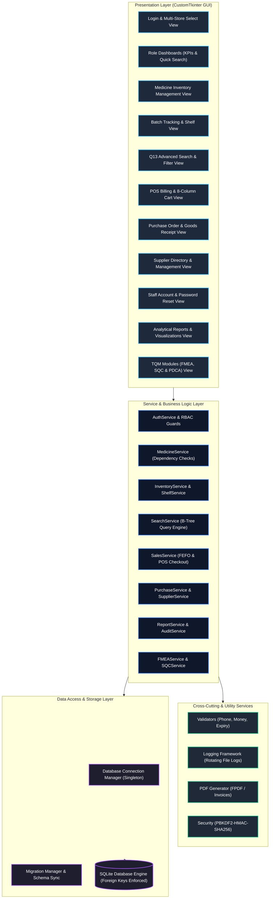
**Figure 2: High-Level System Architecture (Layered Model)**

## 2.3 Product Functional Modules Summary
The application is organized into 17 functional modules:
- **Authentication & Multi-Store Onboarding:** Store-level tenant selection, credential hashing, and session management.
- **Role-Based Dynamic Dashboards:** 5 customized operational dashboards featuring real-time KPI cards, stock alerts, and quick search.
- **Medicine Master Management:** Central pharmaceutical cataloguing with compound uniqueness and dependency-protected archiving.
- **Batch Tracking & Physical Shelf Allocation:** Lot-level inventory recording with strict physical location compatibility rules.
- **Q13 Advanced Search Engine:** Multi-parameter B-Tree indexed search with batch-level breakdown and single-click cart transfer.
- **Supplier & Purchase Order Management:** Comprehensive vendor directory, procurement order creation, and goods receiving.
- **Point-of-Sale (POS) Billing:** 8-column shopping cart, customer phone validator, Cash/UPI/Card payment entry, and invoice generation.
- **Automated FEFO Dispensing:** Algorithmic stock deduction prioritizing earliest expiring active stock lots.
- **Customer Sales Returns & Stock Reconciliation:** Condition-graded restocking and credit voucher generation.
- **Reporting & Visual Analytics:** Sales trends, inventory valuation, expiry forecasts, and cashier shift reconciliation.
- **Security & Audit Trail Logging:** Immutable logging of all sensitive data mutations with user and timestamp attribution.
- **Total Quality Management (FMEA, SQC, PDCA):** Integrated risk matrix registers, Pareto defect tracking, and Kaizen improvement cycles.

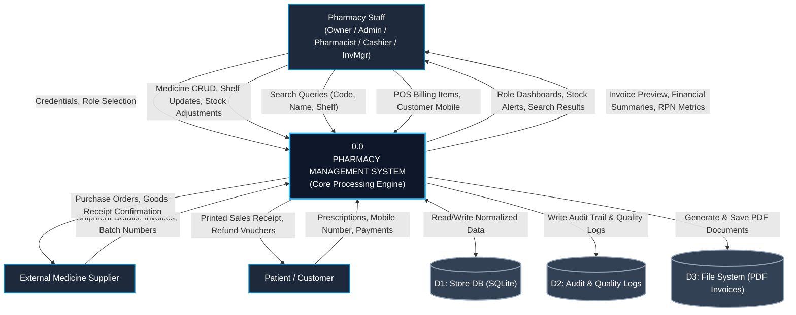
**Figure 4: Level 0 Context Data Flow Diagram (DFD)**

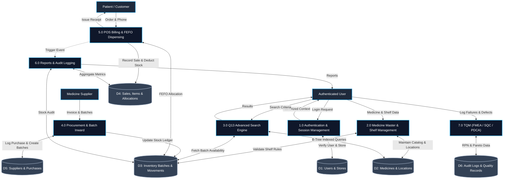
**Figure 5: Level 1 Subsystem Data Flow Diagram (DFD)**

## 2.4 User Classes and Operational Characteristics
The system defines 5 distinct user classes based on operational responsibilities:
1. **Owner:** Executive stakeholder responsible for store creation, financial audits, staff provisioning, and organizational settings.
2. **Administrator:** System administrator managing operational policies, staff accounts, inventory adjustments, and system integrity.
3. **Pharmacist:** Registered medical professional reviewing prescriptions, dispensing controlled drugs, and managing clinical quality audits.
4. **Cashier:** Front-counter operator managing high-speed POS billing, collecting customer details, processing payments, and printing receipts.
5. **Inventory Manager:** Logistics specialist receiving shipments, allocating physical shelves, monitoring expiry dates, and logging defects.

## 2.5 Operating Environment & Hardware Requirements
- **Host Processor:** 64-bit Intel Core i3 / AMD Ryzen 3 or higher.
- **System Memory (RAM):** 4 GB minimum (8 GB recommended for large inventory catalogs).
- **Hard Disk Storage:** 500 MB free storage for application files and local SQLite database.
- **Display Resolution:** Minimum $1280 \times 720$ pixels; recommended $1920 \times 1080$ pixels.
- **Peripheral Devices:** Standard keyboard/mouse; optional USB barcode scanner; standard thermal receipt printer (58mm/80mm) or laser printer.

## 2.6 Technology Stack Specification
- **Programming Language:** Python 3.11 / Python 3.12 / Python 3.13 (64-bit).
- **GUI Framework:** CustomTkinter (Version 6.0.0) built on native Tk/Tcl.
- **Database Engine:** SQLite 3 with foreign key constraints enabled (`PRAGMA foreign_keys = ON;`); standard rollback journaling with WAL mode proposed for multi-terminal concurrency.
- **Data Analysis & Charting:** Pandas 2.2+, Matplotlib 3.8+ (Agg backend for headless rendering).
- **Document Generation:** FPDF 1.7 / ReportLab for high-resolution printable PDF invoices and reports.
- **Security & Cryptography:** Python standard library `hashlib` implementing PBKDF2-HMAC-SHA256 with random salt.
- **Application Packaging:** PyInstaller 6.x supporting standalone Windows `.exe` compilation.

## 2.7 Design and Implementation Constraints
- **Single-Process Relational Storage:** All operational data resides in a single, local SQLite database file (`data/pharmacy.db` or tenant store database).
- **Zero Third-Party Database Daemons:** No background services (MySQL, PostgreSQL, MongoDB) are required, ensuring zero deployment friction.
- **Thread Safety:** Database access is coordinated through a centralized connection manager ensuring thread-safe transaction execution.

## 2.8 Documentation and Deployment Specifications
The application is packaged with comprehensive technical and user documentation:
- User Manual (`docs/15_user_manual.md`)
- Technical Architecture Guide (`docs/architecture/`)
- Total Quality Management Handbooks (`docs/09_fmea_risk_audit.md`, `docs/10_sqc_quality_control.md`, `docs/11_pdca_kaizen.md`)
- Final Submission Checklist & Viva Guide (`docs/30_final_submission_checklist.md`, `docs/31_viva_defense_guide.md`)

## 2.9 External Interface Overview
The system interacts with external entities through well-defined local boundaries:
- **GUI Window Manager:** Windows OS Desktop Desktop Window Manager (DWM).
- **Local File System:** Dedicated `invoices/`, `reports/`, and `data/` directories.
- **Printer Spooler:** Standard Windows GDI print spooler for PDF and direct text receipts.

---

<div style="page-break-after: always;"></div>

# CHAPTER 3: USER ROLES AND ACCESS CONTROL (RBAC)

## 3.1 Role Hierarchy & Separation of Duties
To enforce strict internal accounting controls, prevent fraud, and comply with pharmacy regulations, the system implements an authoritative **Role-Based Access Control (RBAC)** architecture. Separation of duties ensures that operational tasks (such as dispensing and cash collection) are segregated from supervisory tasks (such as inventory write-offs, staff password resets, and financial audits).

## 3.2 Five Canonical User Roles Detailed
The operational profile of each canonical user role is specified in Table 3.

### Table 3: User Roles and Operational Responsibilities
| Role Name | Functional Scope | Primary Operational Responsibilities | Prohibited Actions |
| :--- | :--- | :--- | :--- |
| **Owner** | Enterprise & Store Governance | Store registration, multi-store onboarding, staff creation, financial auditing, store settings, system configuration. | None (Super-user governance authority). |
| **Admin** | Operational Administration | Staff account management, password resets, inventory approvals, purchase orders, financial reports. | Modifying store ownership records. |
| **Pharmacist** | Clinical Dispensation | Medicine catalog review, clinical dispensation, stock alert monitoring, FMEA risk register updates. | Deleting staff accounts, accessing store settings, managing suppliers. |
| **Cashier** | Counter Billing | High-speed POS billing, customer phone validation, payment collection, receipt reprinting, shift totals. | Modifying medicine prices, deleting medicines, altering stock levels, viewing profit margins. |
| **Inventory Manager** | Logistics & Warehousing | Consignment receiving, physical shelf allocation, stock movement logging, expiry monitoring, SQC defect tracking. | Processing sales, altering user accounts, accessing financial reports. |

## 3.3 Role-Specific Dashboards & Dynamic KPI Cards
Upon successful authentication, the system dynamically routes each user to a role-tailored dashboard:
- **Owner Dashboard:** Displays Total Store Revenue, Net Profit Margin, Low Stock Alert Count, Expired Batch Count, and 7-day sales charts.
- **Admin Dashboard:** Displays Active Staff Count, Pending Purchase Orders, Inventory Valuation, and System Audit Events.
- **Pharmacist Dashboard:** Displays Clinical Stock Overview, Near-Expiry Pharmaceuticals (within 30/60/90 days), and High RPN Risk Items.
- **Cashier Dashboard:** Displays Current Shift Sales Total, Completed Transactions Count, Cash Drawer Balance, and Quick POS Billing Launcher.
- **Inventory Manager Dashboard:** Displays Warehouse Stock Volume, Shelf Conflict Alerts, Quarantined Lots, and SQC Defect Metrics.

## 3.4 Navigation Access & View Whitelisting
The main navigation sidebar contains 9 primary business modules. Button visibility is determined dynamically upon login via a strict permission whitelist:
1. `Dashboard` (Accessible to all 5 roles)
2. `Medicines` (Owner, Admin, Pharmacist, Cashier [Read-only], Inventory Manager)
3. `Batches` (Owner, Admin, Inventory Manager)
4. `Purchases` (Owner, Admin, Inventory Manager)
5. `Suppliers` (Owner, Admin, Inventory Manager)
6. `Search` (Accessible to all 5 roles)
7. `Billing` (Owner, Admin, Pharmacist, Cashier)
8. `Staff` (Owner, Admin)
9. `Reports` (Owner, Admin)

## 3.5 Comprehensive Role-Permission Matrix
The system defines 20 granular permissions implemented in `models/user.py` and mapped across roles in Table 4.

### Table 4: Canonical Role-Permission Matrix (20 Granular Permissions)
| Permission String | Permission Description | Owner | Admin | Pharmacist | Cashier | Inv Mgr |
| :--- | :--- | :---: | :---: | :---: | :---: | :---: |
| `view_dashboard` | Access role-specific dashboard and KPI cards | Yes | Yes | Yes | Yes | Yes |
| `view_medicines` | View medicine inventory catalog | Yes | Yes | Yes | Yes | Yes |
| `add_medicine` | Create new medicine master record | Yes | Yes | Yes | No | Yes |
| `update_medicine` | Edit existing medicine details and shelf codes | Yes | Yes | Yes | No | Yes |
| `delete_medicine` | Delete / Archive medicine master record | Yes | Yes | No | No | No |
| `manage_inventory` | Access batch tracking and stock adjustment | Yes | Yes | No | No | Yes |
| `view_stock_alerts`| View low-stock and expiry alert notifications | Yes | Yes | Yes | No | Yes |
| `dispense_medicine`| Prescribe and allocate medicines | Yes | Yes | Yes | No | No |
| `process_sale` | Execute POS checkout and tender payments | Yes | Yes | No | Yes | No |
| `view_sales_history`| View completed sales transactions and orders | Yes | Yes | No | Yes | No |
| `reprint_receipt` | Re-generate and print past invoice receipts | Yes | Yes | No | Yes | No |
| `manage_suppliers` | Register and manage supplier directory | Yes | Yes | No | No | No |
| `manage_purchases` | Create purchase orders and receive goods | Yes | Yes | No | No | Yes |
| `view_financials` | View profit margins, costs, and revenues | Yes | Yes | No | No | No |
| `view_reports` | Generate analytical reports and CSV exports | Yes | Yes | No | No | No |
| `view_audit_logs` | Inspect system security and operational audit logs | Yes | Yes | No | No | No |
| `manage_users` | Provision staff accounts and reset passwords | Yes | Yes | No | No | No |
| `manage_store_settings`| Modify pharmacy store profile and metadata | Yes | Yes | No | No | No |
| `view_fmea` | Access FMEA risk register and RPN scoring | Yes | Yes | Yes | No | No |
| `view_sqc` | Access SQC defect tracking and Pareto analysis | Yes | Yes | No | No | Yes |
| **Total Permissions** | **20 Granular Permissions** | **20** | **20** | **7** | **5** | **8** |

## 3.6 Backend Service-Layer Guard Enforcement
UI button hiding is strictly complemented by service-layer authorization guards. Even if a UI barrier were bypassed, backend services invoke `require_permission()`:
```python
def require_permission(acting_user: Any, permission: str, action_desc: str = "This operation") -> None:
    if acting_user is None:
        return
    user_role = getattr(acting_user, "role", None)
    if not has_permission(user_role, permission):
        raise PermissionError(f"Access Denied: {action_desc} requires '{permission}' permission.")
```

## 3.7 Multi-Store Tenant Isolation Design
The system provides multi-store tenancy within a single relational database. Every tenant-scoped entity (`medicines`, `inventory_batches`, `storage_locations`, `suppliers`, `purchases`, `sales`, `users`) contains a mandatory `store_id TEXT` column.
- Backend services enforce multi-store isolation via `require_store_access()`:
```python
def require_store_access(acting_user: Any, target_store_id: str, action_desc: str = "This operation") -> None:
    if acting_user is None or not target_store_id:
        return
    user_store = getattr(acting_user, "store_id", None)
    if user_store and user_store != target_store_id:
        raise PermissionError(f"Store Access Denied: User belongs to store '{user_store}' and cannot access store '{target_store_id}'.")
```

## 3.8 User Account Lifecycle Management

**Figure 8: User Authentication and RBAC Activity Flowchart**

- **Password Security:** All user passwords are encrypted using PBKDF2-HMAC-SHA256 with 200,000 hashing rounds and unique 16-byte random salts for new credentials (100,000 rounds for legacy backward compatibility). Plaintext passwords are never stored.
- **Account Provisioning:** Staff accounts can only be created by an authenticated Owner or Administrator.
- **Account Deactivation:** Users cannot be hard-deleted if they are linked to sales or purchases; their `is_active` flag is set to `0`, immediately terminating login eligibility.

## 3.9 Session Management & Secure Logout
- Sessions are maintained in-memory within the active application window.
- Explicit logout destroys the session object, clears cached views, and returns the operator to the store-selection login screen.
- Session timeout triggers automatic redirection to login after periods of inactivity.

---

<div style="page-break-after: always;"></div>

# CHAPTER 4: FUNCTIONAL REQUIREMENTS

## 4.1 Module A: Authentication & Account Management (`FR-AUTH`)
### Table 5: Authentication & Account Functional Requirements
| Requirement ID | Requirement Statement | Input | Processing Logic | Expected Output | Verification Method |
| :--- | :--- | :--- | :--- | :--- | :--- |
| **FR-AUTH-001** | Multi-Store Tenant Selection | Store Dropdown | Query `stores` table and populate dropdown with registered pharmacy stores. | Store list rendered in combobox. | GUI Inspection |
| **FR-AUTH-002** | User Credential Verification | Username, Password, Role | Query `users` by username & `store_id`; verify PBKDF2 password hash and check role equality. | Authenticated User Session object. | Automated Test |
| **FR-AUTH-003** | Deactivated Account Blocking | Credentials | Check `users.is_active` flag; if 0, block login with explicit error message. | Error: "Account is deactivated". | Automated Test |
| **FR-AUTH-004** | Staff Account Provisioning | Username, Role, Full Name, Temp Password | Validate username uniqueness within store; hash password; insert into `users`. | New active staff account created. | Integration Test |
| **FR-AUTH-005** | Secure Password Reset | User ID, New Password | Enforce password complexity; re-hash password; update `users.password_hash`. | Password updated; audit log written. | Integration Test |

## 4.2 Module B: Multi-Store Tenancy Management (`FR-STR`)
### Table 6: Multi-Store Tenancy Functional Requirements
| Requirement ID | Requirement Statement | Input | Processing Logic | Expected Output | Verification Method |
| :--- | :--- | :--- | :--- | :--- | :--- |
| **FR-STR-001** | First Store Onboarding | Store Name, Owner Details, Credentials | On initial launch, collect store & owner details; insert `stores` and initial Owner account. | Initial store and Owner created. | UAT Test |
| **FR-STR-002** | Tenant Data Segregation | Store ID | Append `WHERE store_id = ?` to all operational SELECT, INSERT, UPDATE queries. | Zero cross-store data leakage. | Automated Test |
| **FR-STR-003** | Compound Code Uniqueness | Medicine Code, Store ID | Enforce `UNIQUE(store_id, medicine_code)` in SQLite schema. | Same code allowed in different stores; blocked within same store. | Automated Test |
| **FR-STR-004** | Cross-Store Access Rejection | User Store vs Target Store | Service-layer `require_store_access()` guard compares user store with entity store. | `PermissionError` on mismatch. | Unit Test |

## 4.3 Module C: Role-Based Dashboards (`FR-DASH`)
### Table 7: Role-Based Dashboard Functional Requirements
| Requirement ID | Requirement Statement | Input | Processing Logic | Expected Output | Verification Method |
| :--- | :--- | :--- | :--- | :--- | :--- |
| **FR-DASH-001** | Dynamic Dashboard Routing | User Role | Route authenticated session to role-specific dashboard frame. | Tailored dashboard rendered. | GUI Test |
| **FR-DASH-002** | Real-Time Financial KPIs | Store ID | Aggregate today's sales, revenue, and gross profit margins. | Financial KPI cards rendered. | Automated Test |
| **FR-DASH-003** | Low-Stock Visual Alerts | Reorder Threshold (10) | Query medicines where `quantity <= 10`; display warning badge. | Low stock alert cards displayed. | Integration Test |
| **FR-DASH-004** | Near-Expiry Pharmaceutical Watch | Expiry Threshold (90 Days) | Query batches expiring within 90 days; categorize 30/60/90 days. | Expiry warning cards rendered. | Automated Test |
| **FR-DASH-005** | Dashboard Quick Search Bar | Search Term | Execute instant prefix search and display top 5 medicine matches. | Quick search results dropdown. | GUI Test |

## 4.4 Module D: Medicine Catalogue Management (`FR-MED`)
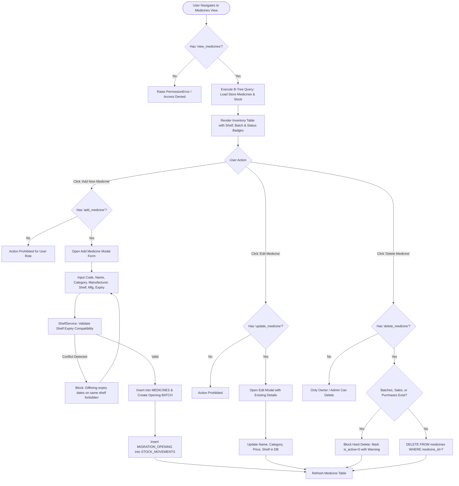
**Figure 9: Medicine Master Management Workflow**

### Table 8: Medicine Catalogue Functional Requirements
| Requirement ID | Requirement Statement | Input | Processing Logic | Expected Output | Verification Method |
| :--- | :--- | :--- | :--- | :--- | :--- |
| **FR-MED-001** | Medicine Master Creation | Code, Name, Category, Mfr, Price | Validate code, name, positive price; insert into `medicines`. | New medicine record added. | Integration Test |
| **FR-MED-002** | Initial Batch & Shelf Inward | Batch No, Expiry, Shelf Code, Qty | Validate shelf allocation; insert initial record into `inventory_batches`. | Opening batch created. | Integration Test |
| **FR-MED-003** | Stock Ledger Opening Entry | Batch Details | Record `MIGRATION_OPENING` movement into `stock_movements`. | Audit trail initialized. | Automated Test |
| **FR-MED-004** | Medicine Catalogue Modification | Medicine ID, Updated Fields | Validate updated parameters; execute SQL UPDATE on `medicines`. | Medicine catalog refreshed. | GUI Test |
| **FR-MED-005** | Dependency-Checked Deletion | Medicine ID | Check if foreign key references exist in `sales` or `purchases`. | Block hard delete if dependencies exist. | Automated Test |
| **FR-MED-006** | Safe Archival Fallback | Medicine ID | If dependencies exist, set `is_active = 0` with user warning. | Medicine hidden from active billing. | Integration Test |

## 4.5 Module E: Batch-Wise Inventory Management (`FR-INV`)
### Table 9: Batch Inventory Functional Requirements
| Requirement ID | Requirement Statement | Input | Processing Logic | Expected Output | Verification Method |
| :--- | :--- | :--- | :--- | :--- | :--- |
| **FR-INV-001** | Multi-Batch Lot Association | Medicine ID, Batch Number | Allow multiple distinct batches for single `medicine_id` in `inventory_batches`. | Multiple active batch lots stored. | Integration Test |
| **FR-INV-002** | Automatic Expiry Status Transition | Expiry Date, Reference Date | Compare batch `expiry_date` with current date; if past, set status='Expired'. | Status updated to 'Expired'. | Unit Test |
| **FR-INV-003** | Quarantine & Recall Tagging | Batch ID, New Status | Update batch status to 'Quarantined' or 'Recalled'; exclude from sales. | Batch blocked from POS dispensing. | Automated Test |
| **FR-INV-004** | Quantity Conservation Invariance | Store ID, Medicine ID | Verify `medicines.quantity == SUM(inventory_batches.current_quantity)`. | Stock reconciliation confirmed. | Automated Test |
| **FR-INV-005** | Stock Adjustment Audit Trail | Batch ID, Delta Qty, Reason | Update batch quantity; record `STOCK_ADJUSTMENT` in `stock_movements`. | Stock reconciled with audit reason. | Integration Test |

## 4.6 Module F: Shelf, Rack & Storage Allocation (`FR-LOC`)
```mermaid
flowchart TD
    Start([Receive New Consignment / PO Delivery]) --> SelectMed[Select Medicine and Input Batch Number]
    SelectMed --> InputDates[Input Manufacturing Date & Expiry Date]
    InputDates --> ValidateExpiry{Is Expiry Date in the Future?}
    ValidateExpiry -- No --> BlockPastDate[Poka-Yoke: Cannot receive expired batch]
    BlockPastDate --> InputDates
    ValidateExpiry -- Yes --> SelectLocation[Select Physical Shelf / Rack Location]
    SelectLocation --> QueryShelf[Query existing batches at selected Shelf Location]
    QueryShelf --> CheckSameMed{Is same medicine already on this shelf?}
    CheckSameMed -- No --> LocationAllowed[Shelf Allocation Allowed: Shelf is empty or stores other meds]
    CheckSameMed -- Yes --> CheckExpiryDate{Do existing batches share EXACT same expiry date?}
    CheckExpiryDate -- Different Expiry --> RejectAllocation[CRITICAL SHELF RULE VIOLATION:<br/>Same medicine with different expiry MUST be stored on separate shelves]
    RejectAllocation --> SuggestShelf[Suggest Alternative Shelf Location / Create New Shelf]
    SuggestShelf --> SelectLocation
    CheckExpiryDate -- Exact Same Expiry --> LocationAllowed[Allocation Allowed: Identical expiry batches may share shelf]
    LocationAllowed --> InputQuantities[Input Received Quantity, Purchase Cost & Selling Price]
    InputQuantities --> InsertBatch[Insert Record into INVENTORY_BATCHES (status='Active')]
    InsertBatch --> RecordMovement[Insert PURCHASE_RECEIPT into STOCK_MOVEMENTS]
    RecordMovement --> UpdateMedQty[Increment medicines.quantity by received amount]
    UpdateMedQty --> Done([Batch Inward & Shelf Allocation Complete])
```
**Figure 10: Batch Receiving and Shelf Allocation Workflow**

### Table 10: Shelf & Rack Allocation Functional Requirements
| Requirement ID | Requirement Statement | Input | Processing Logic | Expected Output | Verification Method |
| :--- | :--- | :--- | :--- | :--- | :--- |
| **FR-LOC-001** | Physical Location Cataloguing | Shelf Code, Rack, Bin | Validate unique `shelf_code` per store; insert into `storage_locations`. | Physical shelf location created. | Integration Test |
| **FR-LOC-002** | Critical Shelf Separation Rule | Medicine ID, Shelf ID, Expiry | Check existing batches of same medicine at shelf; if expiry differs, REJECT. | Conflict blocked; error raised. | Automated Test |
| **FR-LOC-003** | Identical Expiry Sharing Exception | Medicine ID, Shelf ID, Expiry | If existing batches of same medicine share exact same expiry, ALLOW. | Allocation permitted. | Automated Test |
| **FR-LOC-004** | Multi-Medicine Shelf Sharing | Medicine A, Medicine B, Shelf ID | Different medicines permitted to share same shelf location. | Allocation permitted. | Automated Test |
| **FR-LOC-005** | Compatible Shelf Recommendation | Medicine ID, Expiry Date | Scan existing shelves; find shelf with matching expiry or empty shelf. | Suggested shelf code returned. | Unit Test |
| **FR-LOC-006** | System-Wide Shelf Audit Scan | Store ID | Scan all batches; detect any historical shelf conflicts across warehouse. | List of shelf conflict reports. | Automated Test |

## 4.7 Module G: Q13 Advanced Search & Retrieval (`FR-SRCH`)
```mermaid
flowchart TD
    Start([User Opens Q13 Search / Types in Dashboard Lookup]) --> InputQuery[Enter Search Term: Code / Name / Category / Shelf]
    InputQuery --> Debounce{Input Stabilization / Enter Pressed}
    Debounce --> BuildQuery[SearchService: Build Multi-Parameter SQL with B-Tree Index Coverage]
    BuildQuery --> CheckExactCode{Exact Match on medicine_code?}
    CheckExactCode -- Yes --> QueryCodeIndex[Execute: SELECT ... WHERE store_id=? AND medicine_code=? (Index Scan)]
    CheckExactCode -- No --> CheckPrefix{Prefix or Name Search?}
    CheckPrefix -- Prefix Search --> QueryPrefixIndex[Execute: WHERE store_id=? AND medicine_name LIKE 'term%' (Index Range)]
    CheckPrefix -- Multi-Filter --> QueryComposite[Execute Compound Query with Category, Shelf & Expiry Filters]
    QueryCodeIndex --> FetchBatches[Join INVENTORY_BATCHES & STORAGE_LOCATIONS]
    QueryPrefixIndex --> FetchBatches
    QueryComposite --> FetchBatches
    FetchBatches --> ComputeMetrics[Calculate Total Stock, Active Batches & Days Until Expiry]
    ComputeMetrics --> SortResults[Sort Results by Expiry Date ASC / Name ASC]
    SortResults --> RenderResults[Render Search Table with Shelf Codes & Expiry Badges]
    RenderResults --> UserSelect{User Selects Medicine}
    UserSelect --> Action{User Action}
    Action -- Click 'Add to POS Cart' --> CheckStock{Stock > 0?}
    CheckStock -- No --> ShowOutOfStock[Display 'Cannot add out of stock medicine']
    CheckStock -- Yes --> TransferToPOS[Pre-populate POS Shopping Cart with Item]
    Action -- View Batch Breakdown --> DisplayModal[Display All Batches, Expiries & Shelves for Medicine]
    DisplayModal --> Finish([Search Activity Completed])
    TransferToPOS --> Finish
```
**Figure 12: Q13 Advanced Search Activity Flowchart**

### Table 11: Q13 Advanced Search Functional Requirements
| Requirement ID | Requirement Statement | Input | Processing Logic | Expected Output | Verification Method |
| :--- | :--- | :--- | :--- | :--- | :--- |
| **FR-SRCH-001** | Sub-10ms Exact Code Lookup | Medicine Code | Execute index scan: `WHERE store_id=? AND medicine_code=?` using `idx_medicines_store_code`. | Single record returned in $<10\text{ ms}$. | Performance Test |
| **FR-SRCH-002** | Prefix Name Search | Prefix String | Execute B-Tree range query: `WHERE store_id=? AND medicine_name LIKE 'prefix%'`. | Matching records in $<50\text{ ms}$. | Performance Test |
| **FR-SRCH-003** | Compound Filter Execution | Category, Shelf, Expiry | Combine B-Tree indexed filters dynamically with SQL parameter binding. | Multi-filtered record set. | Integration Test |
| **FR-SRCH-004** | Multi-Batch Details Drilldown | Medicine ID | Join `inventory_batches` and `storage_locations`; return all active lots. | Lot numbers, expiries, shelves. | GUI Test |
| **FR-SRCH-005** | Single-Click POS Cart Transfer | Medicine Row Selection | Validate unexpired stock exists; append item directly to POS billing cart. | Item transferred to POS view. | GUI Test |

## 4.8 Module H: Supplier Directory Management (`FR-SUPP`)
### Table 12: Supplier Directory Functional Requirements
| Requirement ID | Requirement Statement | Input | Processing Logic | Expected Output | Verification Method |
| :--- | :--- | :--- | :--- | :--- | :--- |
| **FR-SUPP-001** | Supplier Registration | Name, Code, Phone, GST | Validate mandatory phone, GST format; check unique `supplier_code`. | Supplier record registered. | Integration Test |
| **FR-SUPP-002** | Responsive Registration Modal | User Form Input | Provide vertical scrollable frame with fixed footer action buttons. | Accessible UI across all displays. | GUI Test |
| **FR-SUPP-003** | Supplier Search & Directory | Supplier Name / Code | Execute indexed search: `WHERE store_id=? AND supplier_name LIKE ?`. | Filtered supplier directory. | GUI Test |
| **FR-SUPP-004** | Supplier Inactivation | Supplier ID | Set `is_active = 0`; prevent new PO issuance while preserving past invoices. | Supplier deactivated safely. | Automated Test |

## 4.9 Module I: Purchase Order & Goods Receiving (`FR-PUR`)
```mermaid
flowchart TD
    Start([Procurement Clerk Opens Purchasing View]) --> Auth{Has 'manage_purchases'?}
    Auth -- No --> Deny[Access Denied]
    Auth -- Yes --> SelectSupplier[Select Registered Supplier from Dropdown]
    SelectSupplier --> EnterInvoice[Enter Supplier Invoice Number & Date]
    EnterInvoice --> AddItems[Add Medicine Items: Code, Batch No, Shelf, Qty, Cost]
    AddItems --> CheckShelfRule[Validate Shelf Allocation Rules for each batch]
    CheckShelfRule -- Conflict --> CorrectShelf[Adjust Shelf Allocation]
    CorrectShelf --> AddItems
    CheckShelfRule -- Valid --> MoreItems{Add More Items?}
    MoreItems -- Yes --> AddItems
    MoreItems -- No --> CalcTotal[Compute Purchase Order Grand Total]
    CalcTotal --> SelectPayment[Select Payment Status: PAID / PENDING / PARTIAL]
    SelectPayment --> ConfirmPO[Click 'Save & Process Goods Receipt']
    ConfirmPO --> BeginTxn[Begin SQLite Atomic Transaction]
    BeginTxn --> InsertPO[INSERT INTO purchases]
    InsertPO --> LoopItems[Iterate Items: INSERT INTO purchase_items]
    LoopItems --> UpsertBatches[INSERT INTO inventory_batches]
    UpsertBatches --> LogMovements[INSERT INTO stock_movements (PURCHASE_RECEIPT)]
    LogMovements --> UpdateMeds[UPDATE medicines SET quantity = quantity + batch_qty]
    UpdateMeds --> CommitTxn{Commit Successful?}
    CommitTxn -- Failure --> RollbackTxn[ROLLBACK: Restore Previous State & Show Error]
    CommitTxn -- Success --> AuditPO[Write Audit Log & Generate PO Receipt Modal]
    AuditPO --> Done([Procurement Workflow Finished])
```
**Figure 11: Purchase Order and Goods Receiving Workflow**

### Table 13: Purchase Order Functional Requirements
| Requirement ID | Requirement Statement | Input | Processing Logic | Expected Output | Verification Method |
| :--- | :--- | :--- | :--- | :--- | :--- |
| **FR-PUR-001** | Purchase Order Creation | Supplier ID, Invoice No, Date | Validate supplier active; generate unique purchase order header. | New record in `purchases`. | Integration Test |
| **FR-PUR-002** | Line Item Consignment Entry | Med ID, Batch No, Shelf, Qty, Cost | Validate shelf allocation rule for each batch; insert into `purchase_items`. | PO line items recorded. | Automated Test |
| **FR-PUR-003** | Atomic Goods Receipt Commit | PO Items | Within SQLite transaction, insert batches and update master medicine stock. | Stock incremented atomically. | Automated Test |
| **FR-PUR-004** | Goods Inward Stock Ledgering | PO Items | Insert `PURCHASE_RECEIPT` movements into `stock_movements`. | Complete audit trail recorded. | Automated Test |
| **FR-PUR-005** | Purchase Invoice PDF Export | Purchase ID | Format PO details and vendor particulars into printable PDF document. | Purchase invoice PDF saved. | GUI Test |

## 4.10 Module J: POS Billing & Sales Processing (`FR-BILL`)
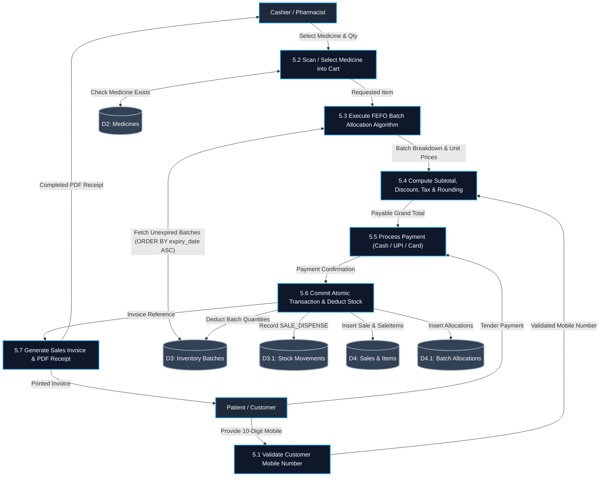
**Figure 6: Level 2 DFD for POS Billing and FEFO Dispensing**

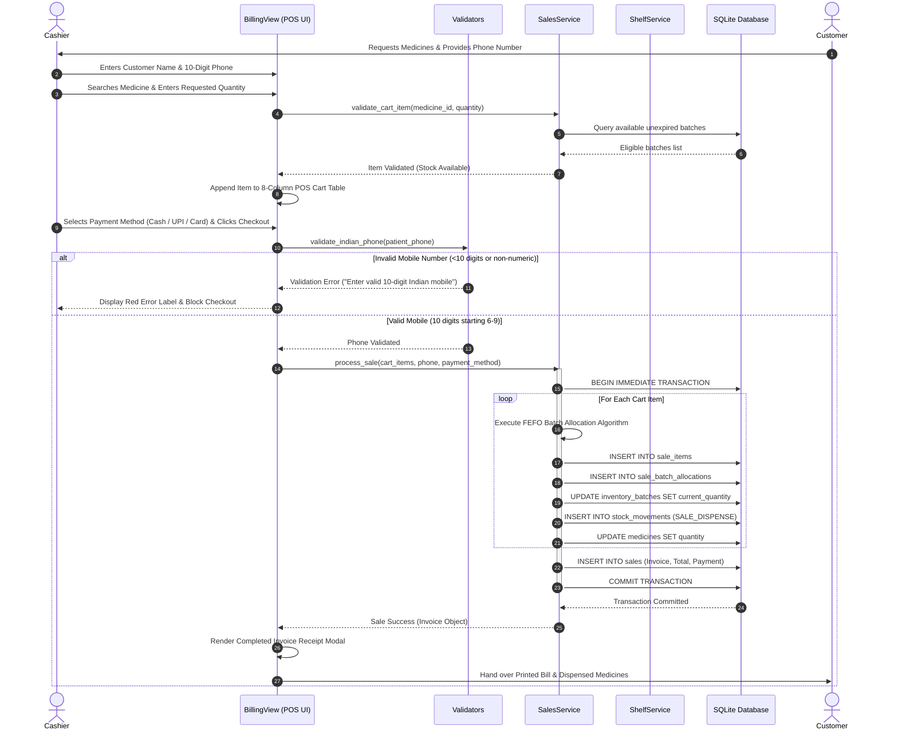
**Figure 13: POS Billing Interaction Sequence Diagram**

### Table 14: POS Billing & Checkout Functional Requirements
| Requirement ID | Requirement Statement | Input | Processing Logic | Expected Output | Verification Method |
| :--- | :--- | :--- | :--- | :--- | :--- |
| **FR-BILL-001** | 8-Column POS Shopping Cart | Medicine Selection | Display Code, Name, Batch No, Shelf, Qty, Price, Subtotal, Remove Button. | Complete 8-column cart rendered. | GUI Test |
| **FR-BILL-002** | Mandatory Customer Mobile Validation | Customer Mobile Number | Enforce exact 10 numeric digits starting with 6, 7, 8, or 9 (`validate_indian_phone`). | Error if invalid; pass if valid. | Automated Test |
| **FR-BILL-003** | Cart Total Dynamic Recalculation | Qty Change / Item Addition | Compute `Subtotal = SUM(Qty * UnitPrice)`; update total label immediately. | Live payable balance updated. | GUI Test |
| **FR-BILL-004** | Multi-Method Payment Tender | Cash / UPI / Card, Ref No | Validate payment method selected; record reference for digital tenders. | Payment method recorded. | Integration Test |
| **FR-BILL-005** | Nearest-Rupee Final Rounding | Calculated Total | Quantize final payable total to nearest whole integer; record rounding delta. | Rounded grand total. | Unit Test |
| **FR-BILL-006** | Atomic Checkout Transaction | Cart, Customer, Payment | Execute atomic SQLite transaction: insert sales, items, allocations, movements. | Sale committed or full rollback. | Automated Test |
| **FR-BILL-007** | Completed Sales Invoice Modal | Completed Sale Object | Render modal receipt with customer info, line items, breakdown, and print action. | Receipt modal displayed. | GUI Test |
| **FR-BILL-008** | Printable PDF Receipt Generation | Sale ID | Generate 80mm thermal / A4 printable PDF invoice with store branding. | Invoice PDF saved to disk. | Automated Test |

## 4.11 Module K: Automated FEFO Stock Allocation (`FR-FEFO`)
```mermaid
flowchart TD
    Start([Request to Dispense Qty Q of Medicine M]) --> QueryBatches[Query Batches for Medicine M in Store S<br/>WHERE status = 'Active' AND current_quantity > 0]
    QueryBatches --> FilterExpired{Filter Expiry Date <= Today?}
    FilterExpired -- Yes --> ExcludeExpired[Exclude Batch from Allocation (Expired)]
    FilterExpired -- No --> SortBatches[Sort Eligible Batches: ORDER BY expiry_date ASC, batch_id ASC]
    SortBatches --> CheckTotalStock{Sum of Eligible Stock >= Q?}
    CheckTotalStock -- No --> RaiseInsufficient[FAIL: Insufficient unexpired stock available.<br/>Raise ValueError & Abort Sale]
    CheckTotalStock -- Yes --> InitRemaining[Set RemainingQty = Q, AllocationList = []]
    InitRemaining --> LoopBatches{RemainingQty > 0?}
    LoopBatches -- No --> AllocationDone[Allocation Successful: Return AllocationList]
    LoopBatches -- Yes --> TakeNextBatch[Inspect Next Batch B with Available Quantity AvailQty]
    TakeNextBatch --> CompareQty{AvailQty >= RemainingQty?}
    CompareQty -- Yes --> FullyAllocate[Allocate RemainingQty from Batch B<br/>Batch B NewQty = AvailQty - RemainingQty<br/>RemainingQty = 0<br/>Append to AllocationList]
    FullyAllocate --> LoopBatches
    CompareQty -- No --> PartiallyAllocate[Allocate AvailQty from Batch B<br/>Batch B NewQty = 0<br/>RemainingQty = RemainingQty - AvailQty<br/>Append to AllocationList]
    PartiallyAllocate --> LoopBatches
    AllocationDone --> AtomicDeduct[Deduct Allocated Quantities in SQLite Transaction]
    AtomicDeduct --> End([FEFO Allocation Complete])
```
**Figure 14: Automated FEFO Stock Allocation Algorithm**

### Table 15: FEFO Stock Allocation Functional Requirements
| Requirement ID | Requirement Statement | Input | Processing Logic | Expected Output | Verification Method |
| :--- | :--- | :--- | :--- | :--- | :--- |
| **FR-FEFO-001** | Earliest Expiry Prioritization | Medicine ID, Requested Qty | Query active batches; `ORDER BY expiry_date ASC, batch_id ASC`. | Batch queue prioritized by expiry. | Unit Test |
| **FR-FEFO-002** | Expired Stock Exclusion | Batch Expiry Dates | Exclude any batch where `expiry_date <= CURRENT_DATE` from dispensing. | Expired stock untouched. | Automated Test |
| **FR-FEFO-003** | Quarantined / Recalled Exclusion | Batch Status | Exclude batches with status 'Quarantined', 'Recalled', or 'Expired'. | Only 'Active' stock dispensed. | Automated Test |
| **FR-FEFO-004** | Multi-Batch Split Allocation | Requested Qty > Single Batch | Consume available quantity from earliest batch; allocate balance to next batch. | Line item split across batches. | Automated Test |
| **FR-FEFO-005** | Insufficient Stock Abort | Requested Qty > Total Eligible | If cumulative eligible stock is less than requested, abort sale with error. | `ValueError` raised; zero stock deduction. | Automated Test |
| **FR-FEFO-006** | Allocation Ledger Recording | Sale Item ID, Batch Allocations | Insert discrete records into `sale_batch_allocations` for each batch lot. | Traceable allocation ledger. | Automated Test |
| **FR-FEFO-007** | Stock Movement Attribution | Dispensed Batches | Insert `SALE_DISPENSE` movement into `stock_movements` with negative delta. | Stock movement recorded. | Automated Test |

## 4.12 Module L: Sales Returns & Stock Reconciliation (`FR-RET`)
```mermaid
flowchart TD
    Start([Customer Requests Sales Return]) --> CashierInput[Enter Original Invoice Number]
    CashierInput --> FetchSale[SalesService: Query Sale & SaleItems by Invoice]
    FetchSale --> SaleFound{Sale Found & Completed?}
    SaleFound -- No --> ShowErr[Display 'Invoice not found or already returned']
    SaleFound -- Yes --> SelectReturnItems[Select Items & Quantities to Return]
    SelectReturnItems --> CheckReturnLimit{Return Qty <= Original Sold Qty?}
    CheckReturnLimit -- No --> LimitErr[Block: Cannot return more than originally purchased]
    LimitErr --> SelectReturnItems
    CheckReturnLimit -- Yes --> SelectCondition{Item Condition Assessment}
    SelectCondition -- 'Sellable / Unopened' --> MarkRestock[Condition: SELLABLE<br/>Set restocked = 1]
    SelectCondition -- 'Damaged / Spoiled' --> MarkQuarantine[Condition: DAMAGED<br/>Set restocked = 0 (Quarantine / Write-off)]
    MarkRestock --> ComputeRefund[Compute Refund Amount = Unit Price x Return Qty]
    MarkQuarantine --> ComputeRefund
    ComputeRefund --> ChooseRefundMethod[Select Refund Method: Cash / UPI / Original]
    ChooseRefundMethod --> ProcessReturnTxn[Begin SQLite Atomic Transaction]
    ProcessReturnTxn --> InsertReturn[INSERT INTO sale_returns]
    InsertReturn --> InsertReturnItems[INSERT INTO sale_return_items]
    InsertReturnItems --> CheckRestockFlag{restocked == 1?}
    CheckRestockFlag -- Yes --> IncrementBatch[UPDATE inventory_batches SET current_quantity = current_quantity + Qty]
    IncrementBatch --> IncrementMed[UPDATE medicines SET quantity = quantity + Qty]
    IncrementMed --> LogCustomerReturn[INSERT INTO stock_movements (CUSTOMER_RETURN)]
    CheckRestockFlag -- No --> LogWriteOff[INSERT INTO stock_movements (RECALL_QUARANTINE / WRITE_OFF)]
    LogCustomerReturn --> CommitReturn[COMMIT TRANSACTION]
    LogWriteOff --> CommitReturn
    CommitReturn --> PrintCreditNote[Generate Return / Credit Voucher]
    PrintCreditNote --> Done([Return Processed & Stock Reconciled])
```
**Figure 16: Sales Return & Stock Adjustment Flowchart**

### Table 16: Sales Return Functional Requirements
| Requirement ID | Requirement Statement | Input | Processing Logic | Expected Output | Verification Method |
| :--- | :--- | :--- | :--- | :--- | :--- |
| **FR-RET-001** | Original Invoice Lookup | Invoice Number | Query `sales` and `sale_items`; verify sale status is 'COMPLETED'. | Original sale items fetched. | Integration Test |
| **FR-RET-002** | Return Quantity Boundary Check | Return Quantity | Verify return quantity does not exceed original quantity sold. | Over-return blocked. | Automated Test |
| **FR-RET-003** | Condition Grading Assessment | Condition Dropdown | Classify item: 'Sellable' (Restock) vs 'Damaged' (Quarantine). | Condition logged in return item. | GUI Test |
| **FR-RET-004** | Sellable Stock Re-crediting | Return Qty, Batch ID | If sellable, increment `inventory_batches.current_quantity` and `medicines.quantity`. | Stock restored to active inventory. | Automated Test |
| **FR-RET-005** | Damaged Stock Write-off | Return Qty, Batch ID | If damaged, log `RECALL_QUARANTINE` or `EXPIRY_WRITE_OFF` without restocking. | Damaged stock written off safely. | Automated Test |
| **FR-RET-006** | Credit Refund Voucher | Refund Amount, Method | Insert record into `sale_returns`; generate credit refund receipt. | Return voucher printed. | Integration Test |

## 4.13 Module M: Reports & Analytical Visualizations (`FR-REP`)
### Table 17: Analytical Reporting Functional Requirements
| Requirement ID | Requirement Statement | Input | Processing Logic | Expected Output | Verification Method |
| :--- | :--- | :--- | :--- | :--- | :--- |
| **FR-REP-001** | Sales & Revenue Aggregation | Date Range, Store ID | Aggregate total sales, revenue, discounts, taxes, and payment breakdowns. | Financial report rendered. | Automated Test |
| **FR-REP-002** | Inventory Valuation Report | Store ID | Compute $\text{Valuation} = \sum(\text{current\_quantity} \times \text{purchase\_cost})$. | Total warehouse inventory value. | Integration Test |
| **FR-REP-003** | Expiry Forecasting Ledger | Days Horizon (30/60/90) | List all batches expiring within horizon; compute at-risk capital value. | Expiry forecast report. | Integration Test |
| **FR-REP-004** | Cashier Shift Reconciliation | Cashier ID, Shift Date | Reconcile completed transactions against cash drawer balance and digital payments. | Shift reconciliation summary. | Automated Test |
| **FR-REP-005** | CSV / PDF Export Engine | Report Data | Export tabular report data into formatted CSV or printable PDF documents. | Downloadable report file. | GUI Test |

## 4.14 Module N: Comprehensive Audit Logging (`FR-AUD`)
### Table 18: Audit Logging Functional Requirements
| Requirement ID | Requirement Statement | Input | Processing Logic | Expected Output | Verification Method |
| :--- | :--- | :--- | :--- | :--- | :--- |
| **FR-AUD-001** | Authentication Event Logging | User ID, Store ID, Result | Record successful logins, failed attempts, and logouts in `audit_logs`. | Auth audit record inserted. | Automated Test |
| **FR-AUD-002** | Master Data Mutation Logging | Action, Entity ID, Changes | Record all medicine additions, price edits, and staff account creations. | Data change audit record. | Automated Test |
| **FR-AUD-003** | Stock Movement Ledgering | Movement Type, Delta, Batch | Record all additions, deductions, returns, and adjustments in `stock_movements`. | Immutable stock ledger. | Automated Test |
| **FR-AUD-004** | Audit Trail Inspection Interface | Filters (Action, User, Date) | Provide administrative UI for Owner/Admin to review security logs. | Filterable audit log grid. | GUI Test |
| **FR-AUD-005** | Immutable Log Integrity | Delete Attempt | Schema design prohibits foreign key cascading deletes on `audit_logs`. | Tamper-resistant log records. | Security Test |

## 4.15 Module O: FMEA Risk Management (`FR-FMEA`)
```mermaid
flowchart TD
    Start([TQM Committee / Pharmacist Opens FMEA View]) --> AuthCheck{Has 'view_fmea'?}
    AuthCheck -- No --> Deny[Access Denied]
    AuthCheck -- Yes --> LoadRecords[Fetch FMEA Records from DB]
    LoadRecords --> DisplayMatrix[Render Risk Analysis Table & RPN Summary]
    DisplayMatrix --> UserAction{User Action}

    UserAction -- 'Add Failure Mode' --> OpenAddModal[Open Risk Entry Form]
    OpenAddModal --> InputProcess[Select Process Module: Dispensing / Inventory / Billing / Search]
    InputProcess --> DescribeMode[Describe Failure Mode, Potential Effect & Root Cause]
    DescribeMode --> ScoreVariables[Assign Severity (S: 1-10), Occurrence (O: 1-10), Detection (D: 1-10)]
    ScoreVariables --> CalcRPN[Compute RPN = S x O x D]
    CalcRPN --> CategorizeRisk{Evaluate RPN against Thresholds}
    CategorizeRisk -- 'RPN >= 125' --> CriticalRisk[Risk Level: CRITICAL (Immediate Action Required)]
    CategorizeRisk -- 'RPN >= 80' --> HighRisk[Risk Level: HIGH (Mandatory Mitigation)]
    CategorizeRisk -- 'RPN >= 40' --> MediumRisk[Risk Level: MEDIUM (Periodic Review)]
    CategorizeRisk -- 'RPN < 40' --> LowRisk[Risk Level: LOW (Acceptable Risk)]
    CriticalRisk --> AssignAction[Define Recommended Action, Owner & Status='Open']
    HighRisk --> AssignAction
    MediumRisk --> AssignAction
    LowRisk --> AssignAction
    AssignAction --> SaveFMEA[INSERT INTO fmea_records]
    SaveFMEA --> RefreshMatrix[Refresh FMEA Table & High-Risk Alert Cards]

    UserAction -- 'Update Action Status' --> ChangeStatus[Update status: Open -> In Progress -> Completed]
    ChangeStatus --> ReEvaluate[Post-Mitigation Scoring: Recalculate New RPN]
    ReEvaluate --> SaveUpdate[UPDATE fmea_records]
    SaveUpdate --> RefreshMatrix
```
**Figure 17: FMEA Risk Register and RPN Evaluation Workflow**

### Table 19: FMEA Risk Management Functional Requirements
| Requirement ID | Requirement Statement | Input | Processing Logic | Expected Output | Verification Method |
| :--- | :--- | :--- | :--- | :--- | :--- |
| **FR-FMEA-001** | Failure Mode Cataloguing | Process, Mode, Effect, Cause | Capture risk entries across Dispensing, Storage, Billing, and Search. | FMEA record inserted. | Integration Test |
| **FR-FMEA-002** | S, O, D Variable Scoring | Severity, Occurrence, Detection | Validate scores are integers between 1 and 10; reject out-of-range inputs. | Validated S, O, D scores. | Unit Test |
| **FR-FMEA-003** | Automated RPN Computation | S, O, D Scores | Compute Risk Priority Number: $RPN = S \times O \times D$ (Range: 1 to 1000). | Accurate RPN value. | Unit Test |
| **FR-FMEA-004** | Risk Level Categorization | Calculated RPN | Apply project thresholds: $\ge 125$ Critical, $\ge 80$ High, $\ge 40$ Medium, $<40$ Low. | Risk category string. | Unit Test |
| **FR-FMEA-005** | Corrective Action Assignment | Recommended Action, Owner | Assign mitigation countermeasure, responsible owner, and status='Open'. | CAPA action logged. | GUI Test |
| **FR-FMEA-006** | Post-Mitigation Re-scoring | New S, O, D Scores | Update action status to 'Completed'; recalculate revised RPN. | Risk reduction verified. | Integration Test |

## 4.16 Module P: Statistical Quality Control (`FR-SQC`)
```mermaid
flowchart TD
    Start([Quality Controller Opens SQC View]) --> AuthCheck{Has 'view_sqc'?}
    AuthCheck -- No --> Deny[Access Denied]
    AuthCheck -- Yes --> FetchDefects[Query sqc_defects Table]
    FetchDefects --> AggregateData[Aggregate Defect Counts by Module & Severity]
    AggregateData --> GeneratePareto[Compute Cumulative Percentages & Pareto 80/20 Curve]
    GeneratePareto --> RenderCharts[Render Matplotlib Pareto Chart & Defect Frequency Bars]
    RenderCharts --> InspectVitalFew{Identify Top 20% Causes producing 80% Defects}
    InspectVitalFew --> OpenFishbone[Launch Ishikawa / Fishbone Root Cause Diagram]
    OpenFishbone --> Analyze6M[Evaluate Root Causes across Categories:<br/>1. Methods (FEFO, Shelf Rules)<br/>2. Machines (Scanner, SQLite Engine)<br/>3. Materials (Damaged Packaging, Barcodes)<br/>4. Manpower (Staff Training, Shift Fatigue)<br/>5. Measurement (Stock Count Errors)<br/>6. Mother Nature (Storage Temp, Humidity)]
    Analyze6M --> FormulateCAPA[Formulate Corrective and Preventive Action (CAPA)]
    FormulateCAPA --> CreatePDCA[Export Root Cause to PDCA Kaizen Improvement Log]
    CreatePDCA --> CloseDefect[Update Defect Status to 'Closed / Mitigated']
    CloseDefect --> Done([SQC Defect Resolution Complete])
```
**Figure 18: SQC Defect Tracking, Pareto 80/20 & Fishbone Workflow**

### Table 20: SQC Defect Management Functional Requirements
| Requirement ID | Requirement Statement | Input | Processing Logic | Expected Output | Verification Method |
| :--- | :--- | :--- | :--- | :--- | :--- |
| **FR-SQC-001** | Defect Incident Logging | Date, Module, Type, Severity | Record quality deviations (e.g., barcode misread, damaged packaging). | Defect logged in `sqc_defects`. | Integration Test |
| **FR-SQC-002** | Defect Frequency Aggregation | Module / Defect Type | Group and count defect occurrences across active operational modules. | Tabular defect frequencies. | Automated Test |
| **FR-SQC-003** | Pareto 80/20 Distribution | Defect Counts | Sort descending; calculate cumulative percentage distribution. | Pareto cumulative values. | Unit Test |
| **FR-SQC-004** | Matplotlib Pareto Chart Rendering | Pareto Data | Render combined bar chart (frequency) and line chart (cumulative %). | Interactive Pareto chart. | GUI Test |
| **FR-SQC-005** | 6M Ishikawa (Fishbone) Analysis | Primary Defect Category | Categorize causes across Methods, Machines, Materials, Manpower, Measurement, Milieu. | Fishbone breakdown displayed. | GUI Test |
| **FR-SQC-006** | Transition to Kaizen | Verified Root Cause | Export identified vital few root causes directly into PDCA Kaizen queue. | Linked PDCA improvement item. | Integration Test |

## 4.17 Module Q: Deming PDCA Kaizen Improvement (`FR-PDCA`)
```mermaid
flowchart TD
    classDef plan fill:#1e3a8a,stroke:#3b82f6,stroke-width:2px,color:#ffffff;
    classDef do fill:#064e3b,stroke:#10b981,stroke-width:2px,color:#ffffff;
    classDef check fill:#78350f,stroke:#f59e0b,stroke-width:2px,color:#ffffff;
    classDef act fill:#701a75,stroke:#d946ef,stroke-width:2px,color:#ffffff;

    subgraph PLAN["PLAN (Define Objective & Strategy)"]
        P1["1. Identify Defect from SQC Pareto or High RPN FMEA Item"]:::plan
        P2["2. Analyze Root Causes via Fishbone (Ishikawa) Diagram"]:::plan
        P3["3. Formulate Specific Measurable Improvement Target"]:::plan
        P4["4. Document Action Plan & Assign Responsible Owner"]:::plan
    end

    subgraph DO["DO (Execute Countermeasures)"]
        D1["1. Implement Poka-Yoke Controls (Phone Validator, Shelf Checker)"]:::do
        D2["2. Update Application Logic / Software Constraints"]:::do
        D3["3. Train Pharmacy Staff on New Standardized Procedure"]:::do
        D4["4. Execute Pilot Phase under Monitored Conditions"]:::do
    end

    subgraph CHECK["CHECK (Verify Results & Metrics)"]
        C1["1. Measure Defect Frequency Post-Implementation"]:::check
        C2["2. Verify RPN Reduction in FMEA Risk Audit"]:::check
        C3["3. Compare Result Metric against Plan Baseline"]:::check
        C4["4. Identify Any Unexpected Secondary Side-Effects"]:::check
    end

    subgraph ACT["ACT (Standardize & Sustain)"]
        A1["1. Standardize Software Rule into Production Codebase"]:::act
        A2["2. Update SOPs & System Documentation"]:::act
        A3["3. Institutionalize Best Practices across all 5 User Roles"]:::act
        A4["4. Close Improvement Item & Trigger Next Kaizen Cycle"]:::act
    end

    PLAN --> DO
    DO --> CHECK
    CHECK --> ACT
    ACT --> PLAN
```
**Figure 19: Deming PDCA Continuous Improvement Cycle**

### Table 21: Deming PDCA Functional Requirements
| Requirement ID | Requirement Statement | Input | Processing Logic | Expected Output | Verification Method |
| :--- | :--- | :--- | :--- | :--- | :--- |
| **FR-PDCA-001** | Kaizen Item Creation | Improvement ID, Problem | Create structured improvement item linked to SQC defect or FMEA risk. | Record in `pdca_items`. | Integration Test |
| **FR-PDCA-002** | 4-Stage Action Definition | Plan, Do, Check, Act Actions | Enforce non-empty action definitions for all 4 Deming cycle stages. | Validated Kaizen entry. | Unit Test |
| **FR-PDCA-003** | Cycle State Transitions | Current Status | Transition item state: `Plan -> Do -> Check -> Act -> Closed`. | State transition confirmed. | Automated Test |
| **FR-PDCA-004** | Empirical Result Measurement | Measured Metric String | Record quantitative verification result during the 'Check' stage. | Verification metric logged. | GUI Test |
| **FR-PDCA-005** | Process Standardization | Act Standardization Text | Document permanent standard operating procedure (SOP) before closing. | Item closed & standardized. | Integration Test |

---

<div style="page-break-after: always;"></div>

# CHAPTER 5: EXTERNAL INTERFACE REQUIREMENTS

## 5.1 User Interface Requirements
The user interface is engineered using CustomTkinter, implementing an enterprise dark/light theme system:
- **Consistent Grid Layouts:** Fixed navigation sidebar (220px width) on the left; dynamic content pane on the right.
- **Responsive Form Modals:** All data entry modals (Add Medicine, Add Supplier, Create Staff) implement scrollable canvas frames with fixed footers, guaranteeing that action buttons (`Save`, `Cancel`) are visible on all screen sizes.
- **Color-Coded Status Tokens:** Expiry dates, stock levels, and quality risks feature high-contrast visual badges:
  - Green (`#10b981`): Active / Ample Stock / Low Risk
  - Amber (`#f59e0b`): Near Expiry / Reorder Needed / Medium Risk
  - Red (`#ef4444`): Expired / Out of Stock / High Risk / Critical Failure

## 5.2 Hardware Interface Requirements
- **Barcode Scanners:** The system interfaces transparently with 1D/2D handheld USB barcode scanners operating in keyboard wedge mode.
- **Receipt Printers:** Compatible with standard 58mm and 80mm ESC/POS thermal receipt printers and standard Windows A4 laser printers.

## 5.3 Software Interface Requirements
- **Operating System:** Microsoft Windows 10 / Windows 11 (64-bit).
- **Relational Storage:** SQLite 3.40+ dynamic library integrated with Python.
- **PDF Viewer:** Interfaces with default Windows PDF handler (Adobe Acrobat, Microsoft Edge) for invoice rendering.

## 5.4 Communications Interface Requirements
The system is strictly an offline-first desktop application. It requires zero active network socket listeners, HTTP REST services, or cloud API connections during normal operation, guaranteeing maximum data security.

---

<div style="page-break-after: always;"></div>

# CHAPTER 6: DATA REQUIREMENTS AND DATABASE DESIGN

## 6.1 Database Engine Architecture & Parameters
The application utilizes an embedded **SQLite 3** relational database engine configured for high-concurrency desktop execution:
- **Journal Mode:** Standard rollback journaling (`DELETE`) in baseline build; Write-Ahead Logging (`PRAGMA journal_mode=WAL;`) is proposed for concurrent multi-terminal deployments.
- **Foreign Key Constraints:** Strictly enforced (`PRAGMA foreign_keys=ON;`) on every connection.
- **Synchronous Flag:** Standard SQLite synchronous mode (`FULL` by default); `PRAGMA synchronous=NORMAL;` is proposed in conjunction with WAL mode for high-throughput multi-terminal deployments.
- **Storage Encoding:** UTF-8 Unicode.

## 6.2 Relational Entity Specifications (18 Domain Tables + 1 Migration Table)
The database schema consists of 19 application-managed normalized tables (18 Application Domain Entities and 1 System Migration Ledger) summarized in Table 22.

> [!NOTE]
> **Resolution of SQLite Physical Table Counts:**
> In addition to the 19 application-managed tables listed in Table 22 (18 Domain Tables + 1 System Table), the SQLite database engine automatically provisions an internal metadata table `sqlite_sequence` to track autoincrement sequence counters. Thus, `data/pharmacy_app.db` contains exactly **20 physical SQLite tables on disk** (18 Domain Entities, 1 System Migration Table, and 1 SQLite Internal Table), along with **68 relational B-Tree indexes** (57 explicit indexes and 11 autoindices), **0 views**, and **0 triggers**.

### Table 22: Relational Database Schema Summary (19 Tables)
| # | Table Name | Primary Key | Foreign Keys / References | Description & Multi-Store Purpose |
| :---: | :--- | :--- | :--- | :--- |
| 1 | `stores` | `store_id` (TEXT) | None | Core pharmacy store registry supporting multi-store multi-tenancy. |
| 2 | `users` | `user_id` (INTEGER) | `store_id -> stores(store_id)` | Staff accounts, PBKDF2 password hashes, role assignments, and active flags. |
| 3 | `medicines` | `medicine_id` (INTEGER) | `store_id -> stores(store_id)` | Master pharmaceutical product catalogue with compound code uniqueness. |
| 4 | `storage_locations` | `location_id` (INTEGER) | `store_id -> stores(store_id)` | Physical warehouse storage locations (shelf code, rack, bin). |
| 5 | `inventory_batches` | `batch_id` (INTEGER) | `medicine_id, location_id, supplier_id` | Lot-level batch tracking with manufacture/expiry dates and current quantities. |
| 6 | `suppliers` | `supplier_id` (INTEGER) | `store_id -> stores(store_id)` | Pharmaceutical distributor and vendor contact directory with GST identifiers. |
| 7 | `purchases` | `purchase_id` (INTEGER) | `store_id, supplier_id, received_by` | Inward procurement order headers, invoice numbers, and payment status. |
| 8 | `purchase_items` | `item_id` (INTEGER) | `purchase_id, medicine_id, batch_id`| Discrete line items received in a purchase consignment. |
| 9 | `sales` | `sale_id` (INTEGER) | `store_id, user_id` | POS sales transaction headers, customer details, invoice numbers, totals. |
| 10 | `sale_items` | `item_id` (INTEGER) | `sale_id, medicine_id` | Products billed in a customer sales transaction. |
| 11 | `sale_batch_allocations` | `allocation_id` (INTEGER) | `sale_item_id, batch_id` | Traceable FEFO batch deduction ledger linking sales items to batch lots. |
| 12 | `sale_returns` | `return_id` (INTEGER) | `store_id, sale_id, created_by` | Customer returns and refund vouchers. |
| 13 | `sale_return_items` | `return_item_id` (INTEGER) | `return_id, sale_item_id, batch_id`| Line items returned, restock flags, and condition grades. |
| 14 | `stock_movements` | `movement_id` (INTEGER) | `store_id, medicine_id, batch_id`| Complete double-entry stock movement ledger (Inward, Dispense, Returns). |
| 15 | `audit_logs` | `log_id` (INTEGER) | `store_id, user_id` | Immutable security and system mutation audit trail. |
| 16 | `fmea_records` | `fmea_id` (INTEGER) | `store_id -> stores(store_id)` | Failure Mode and Effects Analysis risk matrix entries and RPN scores. |
| 17 | `sqc_defects` | `defect_id` (INTEGER) | `store_id -> stores(store_id)` | Statistical Quality Control defect logging and severity tracking. |
| 18 | `pdca_items` | `pdca_id` (INTEGER) | `store_id -> stores(store_id)` | Deming continuous improvement Kaizen lifecycle tracking items. |
| 19 | `schema_migrations` | `migration_id` (INTEGER) | None | System version tracking and database migration checksum ledger. |

## 6.3 Complete Entity Relationship Diagram (ERD)
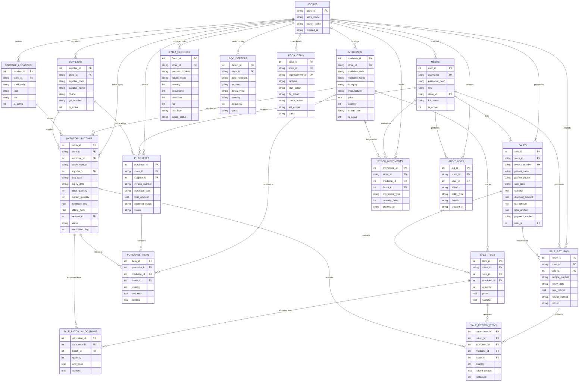
**Figure 7: Complete Entity Relationship Diagram (19 Relational Entities)**

## 6.4 Key Constraints & Compound Uniqueness Rules
The schema enforces data integrity through compound uniqueness constraints:
- `UNIQUE(store_id, medicine_code)` on `medicines`
- `UNIQUE(store_id, supplier_code)` on `suppliers`
- `UNIQUE(store_id, shelf_code)` on `storage_locations`
- `UNIQUE(store_id, medicine_id, batch_number)` on `inventory_batches`
- `UNIQUE(store_id, invoice_number)` on `purchases`
- `UNIQUE(store_id, invoice_number)` on `sales`

## 6.5 B-Tree Indexing Strategy
To guarantee sub-50ms search and transaction execution, the database maintains comprehensive single-column and composite B-Tree indexes as detailed in Table 23.

### Table 23: Complete B-Tree Index Architecture & Coverage
| Index Name | Target Table | Indexed Columns | Optimization Purpose |
| :--- | :--- | :--- | :--- |
| `idx_medicines_store_code` | `medicines` | `(store_id, medicine_code)` | Fast exact-code index scan ($<10\text{ ms}$) |
| `idx_medicines_store_name` | `medicines` | `(store_id, medicine_name)` | Substring and prefix search acceleration ($<50\text{ ms}$) |
| `idx_medicines_store_category`| `medicines` | `(store_id, category)` | Fast category filtering |
| `idx_medicines_store_expiry` | `medicines` | `(store_id, expiry_date)` | Near-expiry query optimization |
| `idx_batches_store_med` | `inventory_batches` | `(store_id, medicine_id)` | Instant batch retrieval for medicine |
| `idx_batches_expiry` | `inventory_batches` | `(expiry_date)` | Automated FEFO sorting (`ORDER BY expiry_date ASC`) |
| `idx_batches_location` | `inventory_batches` | `(location_id)` | Shelf conflict detection and location scans |
| `idx_sales_store_date` | `sales` | `(store_id, sale_date)` | Financial reporting and date-range aggregation |
| `idx_stock_movements_batch` | `stock_movements` | `(batch_id)` | Lot-level stock movement audit reconciliation |
| `idx_fmea_rpn` | `fmea_records` | `(rpn)` | Fast high-risk sorting and alert filtering |
| `idx_sqc_module` | `sqc_defects` | `(module)` | Pareto defect distribution grouping |

## 6.6 Transaction Management & ACID Properties
All financial checkout and inventory mutation operations execute within explicit SQLite atomic transactions:
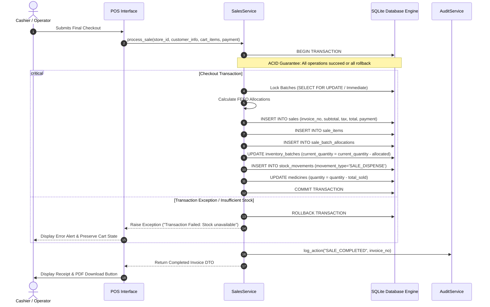
**Figure 15: Sales ACID Transaction Execution Sequence Diagram**

- **Atomicity:** Sales header, sales line items, batch allocations, stock movement ledger entries, and batch quantity deductions execute as a single atomic unit. If any step fails, `ROLLBACK` restores the database state completely.
- **Consistency:** Database check constraints (`quantity >= 0`, `price >= 0`, `total_amount >= 0`) prevent negative stock or corrupt balances.
- **Isolation:** Standard SQLite transactional isolation ensures billing and inventory updates execute with ACID atomicity.
- **Durability:** Committed transactions are flushed to disk before receipt modals are displayed.

## 6.7 Multi-Store Data Isolation Architecture
Multi-store data isolation is achieved by enforcing `store_id` foreign keys and compound uniqueness constraints across all tables, coupled with backend authorization guards (`require_store_access()`).

## 6.8 Schema Versioning & Safe Migration Engine
The `schema_migrations` table tracks database upgrades. Migration scripts (`migration_stage2.py`) inspect existing columns and tables dynamically, executing non-destructive `ALTER TABLE` statements without risking production data loss.

---

<div style="page-break-after: always;"></div>

# CHAPTER 7: COMPLETE SYSTEM WORKFLOWS

## 7.1 Workflow 1: User Login and Role Identification
- **Actor:** Any Staff Member (Owner, Admin, Pharmacist, Cashier, Inventory Manager)
- **Preconditions:** Store registered; user account active in database.
- **Trigger:** Application launched.
- **Main Flow:**
  1. User selects target store from dropdown.
  2. User selects intended role from segmented button.
  3. User enters username and password and clicks `Sign In`.
  4. System queries user by username and store; verifies PBKDF2 password hash.
  5. System verifies user is active and role matches account assignment.
  6. System writes authentication event to `audit_logs`.
  7. System filters sidebar navigation buttons based on user permissions.
  8. System routes user to role-specific dashboard.
- **Alternative Flow:** Invalid credentials entered; system displays red error label and retains login view.
- **Postconditions:** Active authenticated session initialized.

## 7.2 Workflow 2: Role-Specific Dashboard Navigation
- **Actor:** Authenticated User
- **Preconditions:** User logged in.
- **Main Flow:** System queries real-time metrics for user's store and role; renders customized KPI cards, alert banners, and quick search bars.
- **Postconditions:** Operational overview displayed.

## 7.3 Workflow 3: Medicine Catalogue Creation and Management
- **Actor:** Owner / Admin / Pharmacist / Inventory Manager
- **Preconditions:** User holds `add_medicine` permission.
- **Main Flow:** Operator opens Add Medicine modal; enters code, name, category, manufacturer, price, shelf code, and opening batch details. System validates parameters and shelf rules; inserts record into `medicines` and opening batch into `inventory_batches`.
- **Postconditions:** New medicine listed in catalogue.

## 7.4 Workflow 4: Batch Receiving and Physical Shelf Allocation
- **Actor:** Inventory Manager / Admin / Owner
- **Preconditions:** User holds `manage_inventory` permission.
- **Main Flow:** Operator enters batch number, manufacture date, expiry date, and selects physical shelf. System executes `validate_shelf_allocation()`. If another batch of same medicine exists on shelf with different expiry, system blocks allocation and suggests alternative shelf. If valid, batch is saved and `PURCHASE_RECEIPT` logged.
- **Postconditions:** Batch inventory incremented; shelf rule preserved.

## 7.5 Workflow 5: Supplier Registration and Directory Update
- **Actor:** Owner / Admin
- **Preconditions:** User holds `manage_suppliers` permission.
- **Main Flow:** Operator enters vendor name, supplier code, 10-digit phone number, address, and GST number into responsive modal. System validates parameters and saves supplier.
- **Postconditions:** Supplier available for purchase orders.

## 7.6 Workflow 6: Purchase Order Creation & Goods Receipt
- **Actor:** Inventory Manager / Admin / Owner
- **Preconditions:** Supplier registered; user holds `manage_purchases` permission.
- **Main Flow:** Operator selects supplier, enters vendor invoice details, adds line items with batch numbers and target shelves. System verifies shelf allocation compatibility for each item; executes atomic transaction creating purchase header, items, inventory batches, and stock movements.
- **Postconditions:** Consignment received; master stock updated.

## 7.7 Workflow 7: Q13 Advanced Medicine Search & Retrieval
- **Actor:** Any Authenticated Staff Member
- **Preconditions:** User holds `view_medicines` permission.
- **Main Flow:** Operator types medicine code or name into search bar. System triggers B-Tree indexed search ($<10\text{ ms}$ for exact codes; $<50\text{ ms}$ for partial names). System displays matching medicines with shelf locations, total stock, and batch breakdowns. Operator clicks item to transfer directly to POS cart.
- **Postconditions:** Medicines retrieved instantly without lag.

## 7.8 Workflow 8: POS Billing Cart Assembly
- **Actor:** Cashier / Pharmacist / Admin / Owner
- **Preconditions:** User holds `process_sale` permission.
- **Main Flow:** Operator selects medicines from inventory; specifies quantities. System validates requested quantity against eligible unexpired stock; appends items to 8-column shopping cart table. System dynamically updates live subtotal.
- **Postconditions:** Billing cart populated and ready for checkout.

## 7.9 Workflow 9: Automated FEFO Batch Allocation
- **Actor:** System Billing Engine
- **Preconditions:** Checkout submitted.
- **Main Flow:** For each cart item, system queries active batches ordered by `expiry_date ASC`. System excludes expired lots; allocates requested quantity across earliest expiring lots; calculates batch-wise subtotals.
- **Postconditions:** Allocation list prepared for atomic deduction.

## 7.10 Workflow 10: Payment Tender and Invoice Receipt Generation
- **Actor:** Cashier & Customer
- **Preconditions:** FEFO allocation verified; valid 10-digit customer mobile entered.
- **Main Flow:** Cashier selects Cash / UPI / Card; inputs reference for digital payments. System rounds final total to nearest integer; executes atomic transaction deducting batch stock, inserting sales records, and logging `SALE_DISPENSE`. System renders completed invoice modal and generates printable PDF.
- **Postconditions:** Payment collected; stock deducted; bill printed.

## 7.11 Workflow 11: Sales Returns and Stock Reconciliation
- **Actor:** Cashier / Admin / Owner
- **Preconditions:** Original invoice presented.
- **Main Flow:** Operator looks up original invoice; selects items to return; verifies return quantity. Operator evaluates item condition: Sellable items increment batch stock and log `CUSTOMER_RETURN`; damaged items are routed to quarantine without restocking. System issues refund voucher.
- **Postconditions:** Customer refunded; inventory accurately reconciled.

## 7.12 Workflow 12: Analytical Reports Generation and CSV Export
- **Actor:** Owner / Admin
- **Preconditions:** User holds `view_reports` permission.
- **Main Flow:** Operator selects report type (Sales, Valuation, Expiry Forecast, Cashier Shift); selects date range. System queries database aggregates; displays tabular metrics and Matplotlib visualizations; exports data to CSV or PDF.
- **Postconditions:** Financial/inventory report exported.

## 7.13 Workflow 13: FMEA Risk Register and RPN Evaluation
- **Actor:** Pharmacist / Admin / Owner
- **Preconditions:** User holds `view_fmea` permission.
- **Main Flow:** Operator logs potential failure mode; assigns Severity (1-10), Occurrence (1-10), Detection (1-10). System calculates $RPN = S \times O \times D$; assigns risk category (Critical/High/Medium/Low); logs corrective action.
- **Postconditions:** Risk prioritized for engineering mitigation.

## 7.14 Workflow 14: SQC Defect Tracking and Pareto Analysis
- **Actor:** Inventory Manager / Admin / Owner
- **Preconditions:** User holds `view_sqc` permission.
- **Main Flow:** Operator logs quality deviations. System aggregates defects; computes cumulative distribution curve; generates Pareto chart highlighting vital few causes; launches Ishikawa 6M root cause analysis.
- **Postconditions:** Defect root causes isolated.

## 7.15 Workflow 15: Deming PDCA Continuous Improvement Cycle
- **Actor:** Quality Team / Owner / Admin
- **Preconditions:** Root cause identified.
- **Main Flow:** Operator creates Kaizen improvement item; defines Plan, Do, Check, and Act countermeasures; transitions item across lifecycle stages; standardizes verified software rules.
- **Postconditions:** Continuous quality improvement achieved.

```mermaid
flowchart TD
    Start([Pharmacy Day Begins]) --> Login[1. User Authentication & Store Selection]
    Login --> Dash[2. Load Role Dashboard: Check Expiry & Low Stock Alerts]

    Dash --> Routine{Select Workflow}

    Routine -- Procurement --> Supp[3. Register / Select Supplier]
    Supp --> PO[4. Create Purchase Order & Inward Consignment]
    PO --> ShelfAlloc[5. Validate Physical Shelf Allocation & Record Batches]
    ShelfAlloc --> StockMove1[6. Log PURCHASE_RECEIPT in Stock Ledger]
    StockMove1 --> Dash

    Routine -- Customer Service --> Search[7. Q13 Fast Medicine Search & Retrieval]
    Search --> POS[8. Add Unexpired Batches to POS Cart]
    POS --> ValidatePhone[9. Validate 10-Digit Customer Mobile]
    ValidatePhone --> FEFO[10. Execute Automated FEFO Allocation]
    FEFO --> Pay[11. Collect Payment (Cash / UPI / Card)]
    Pay --> PrintBill[12. Generate PDF Invoice & Dispense Drugs]
    PrintBill --> StockMove2[13. Log SALE_DISPENSE in Stock Ledger]
    StockMove2 --> Dash

    Routine -- Returns --> ReturnItem[14. Inspect Returned Medicines & Condition]
    ReturnItem --> RestockCheck{Condition Sellable?}
    RestockCheck -- Yes --> RestockBatch[15. Increment Batch & Log CUSTOMER_RETURN]
    RestockCheck -- No --> QuarantineBatch[16. Move to Quarantine & Log WRITE_OFF]
    RestockBatch --> RefundPay[17. Issue Customer Refund Voucher]
    QuarantineBatch --> RefundPay
    RefundPay --> Dash

    Routine -- Quality & Governance --> FMEA_Run[18. Update FMEA Risk Register & RPNs]
    FMEA_Run --> SQC_Run[19. Log Defects, Generate Pareto & Fishbone Analysis]
    SQC_Run --> PDCA_Run[20. Execute PDCA Kaizen Improvement Cycles]
    PDCA_Run --> AuditRep[21. Export Financial, Inventory & Audit Reports]
    AuditRep --> EndOfDay([Store Shift Reconciliation & Safe Logout])
```
**Figure 20: Overall End-to-End Pharmacy Operational Master Flow**

---

<div style="page-break-after: always;"></div>

# CHAPTER 8: NON-FUNCTIONAL REQUIREMENTS

## 8.1 Performance Requirements
- **NFR-PERF-001 (Exact Code Lookup - Proposed Acceptance Target):** Exact medicine code lookups target response latency $<10\text{ ms}$ for datasets up to 10,000 records utilizing B-Tree index `idx_medicines_store_code`.
- **NFR-PERF-002 (Prefix / Partial Search - Proposed Acceptance Target):** Multi-parameter prefix, name, and shelf searches target response latency $<50\text{ ms}$ across standard retail inventories.
- **NFR-PERF-003 (POS Checkout Latency - Proposed Acceptance Target):** Full POS checkout execution (including FEFO allocation, stock deduction, movement logging, and sales commit) targets $<100\text{ ms}$ on local desktop SQLite.
- **NFR-PERF-004 (Application Startup):** System initialization and login screen rendering must complete in $<1.5\text{ seconds}$.

## 8.2 Reliability & Fault Tolerance
- **NFR-REL-001 (Atomic Rollback):** Any runtime exception, power disruption, or database lock during checkout must trigger an immediate `ROLLBACK`, leaving zero orphan records.
- **NFR-REL-002 (Data Preservation):** Stock movement ledgers and sales records must be immutable; hard deletes are prohibited when dependencies exist.

## 8.3 Availability & Operational Continuity
- **NFR-AVAL-001 (Offline Operation):** The system must deliver 100% functionality without requiring external network connectivity or cloud services.
- **NFR-AVAL-002 (Crash Recovery):** Upon restart following an unexpected host shutdown, SQLite rollback journaling guarantees automated recovery and zero database corruption without manual intervention.

## 8.4 Security & Data Privacy
- **NFR-SEC-001 (Password Encryption):** Passwords must be hashed using PBKDF2-HMAC-SHA256 with 200,000 iterations for new credentials (and 100,000 iterations legacy fallback) with 16-byte random salt.
- **NFR-SEC-002 (Tenant Isolation):** Cross-store access attempts must be rejected by service-layer authorization guards with security audit logging.
- **NFR-SEC-003 (Permission Enforcement):** Backend services must validate user role permissions independently of UI button states.

## 8.5 Usability & Human Factors
- **NFR-USE-001 (Poka-Yoke Error Prevention):** Data entry forms must implement input masks, character length limits, and real-time validation labels to prevent human mistakes.
- **NFR-USE-002 (Display Adaptability):** UI windows and dialogs must dynamically scale across screen resolutions from $1280 \times 720$ up to $1920 \times 1080$.

## 8.6 Maintainability & Code Quality
- **NFR-MAINT-001 (Modular Architecture):** The codebase must maintain strict separation between presentation, service, utility, and data layers.
- **NFR-MAINT-002 (PEP 8 Compliance):** Python source files must adhere to standard PEP 8 naming conventions and type hinting.

## 8.7 Portability & Environmental Compatibility
- **NFR-PORT-001 (OS Compatibility):** The software must execute natively on Windows 10 and Windows 11 (64-bit).
- **NFR-PORT-002 (Standalone Executable):** The application must support packaging into a single-file executable using PyInstaller.

## 8.8 Data Integrity & Auditability
- **NFR-INT-001 (Double-Entry Stock Ledger):** Every stock mutation must generate a corresponding record in `stock_movements`.
- **NFR-INT-002 (Immutable Audit Log):** Security audit logs must be permanent and protected against unauthorized modification.

---

<div style="page-break-after: always;"></div>

# CHAPTER 9: BUSINESS RULES AND VALIDATION

### Table 24: Business Rules BR-01 through BR-10 Matrix
| Rule ID | Business Rule Title | Core Rule Statement & Operational Constraint | Enforcement Mechanism |
| :--- | :--- | :--- | :--- |
| **BR-01** | Multi-Store Tenant Isolation | Every operational data record must belong to a valid `store_id`. Users from one store cannot view, query, or modify records belonging to another store. | SQL compound keys & `require_store_access()` guard |
| **BR-02** | Role-Based Access Enforcement | Operations require explicit permission tokens mapped to the user's assigned role. UI button disabling must be backed by service-layer guards. | `require_permission()` service guard |
| **BR-03** | Critical Physical Shelf Allocation | Batches of the same medicine having different expiry dates MUST be stored on separate shelves. Identical-expiry batches may share a shelf. | `ShelfService.validate_shelf_allocation()` |
| **BR-04** | Expiry Date Status Transition | A batch expiring on date $D$ remains valid through date $D$. On date $D+1$, its status automatically becomes 'Expired', blocking it from sale. | `ShelfService.compute_batch_status()` |
| **BR-05** | Strict Automated FEFO Dispensing | Sales items must be allocated from unexpired, active batches in ascending order of expiry date. Expired or quarantined stock is excluded. | `SalesService.process_sale()` FEFO loop |
| **BR-06** | Mandatory 10-Digit Phone Validation | Customer mobile number during POS checkout must contain exactly 10 numeric digits starting with 6, 7, 8, or 9 (`validate_indian_phone`). | `utils.validators.validate_indian_phone` |
| **BR-07** | Financial Calculation & Rounding | Final invoice payable total must be quantized to nearest whole integer using half-up rounding. Subtotal, discount, and tax must be consistent. | `utils.validators.calculate_bill_totals` |
| **BR-08** | Medicine Deletion Dependency Protection | Hard deletion of a medicine is prohibited if references exist in batches, sales, or purchases. In such cases, safe archival (`is_active=0`) is applied. | `MedicineService.delete_medicine()` |
| **BR-09** | Stock Movement Conservation Invariance | Total physical stock of a medicine must strictly equal the sum of unexpired batch quantities and the net sum of all historical stock movements. | `ShelfService.reconcile_medicine_stock()` |
| **BR-10** | TQM Risk Scoring & Mitigation | Failure modes with $RPN \ge 80$ mandate corrective action plans. Closed defects must be verified by post-mitigation metric evaluation. | `FMEAService` & `SQCService` |

---

<div style="page-break-after: always;"></div>

# CHAPTER 10: USE CASE MODEL

## 10.1 System Actors & Profile Matrix
- **Actor 1 (Owner):** Enterprise administrator managing business configuration, stores, and financial reporting.
- **Actor 2 (Administrator):** Operational supervisor managing staff accounts, user permissions, and master data.
- **Actor 3 (Pharmacist):** Clinical dispensing specialist reviewing drug safety, expiries, and FMEA risk registers.
- **Actor 4 (Cashier):** POS front-counter operator processing transactions, validating mobile numbers, and printing bills.
- **Actor 5 (Inventory Manager):** Logistics coordinator managing warehouse deliveries, batch inward, physical shelf allocation, and SQC defects.

## 10.2 Complete System Use Case Diagram
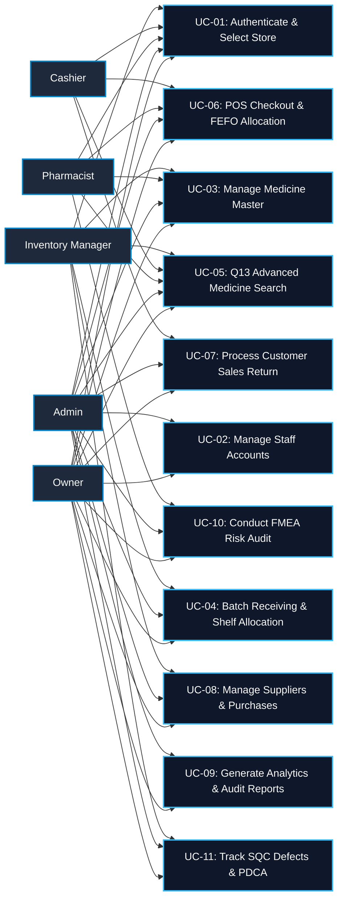
**Figure 3: Complete System Use Case Diagram**

## 10.3 Primary Use Case Specifications
- **UC-01 (Authenticate & Select Store):** User selects store, selects role, enters credentials, receives authorized session.
- **UC-02 (Manage Medicine Master):** Operator creates or edits medicine records; enforces shelf allocation rules and deletion protection.
- **UC-03 (Batch Inward & Shelf Allocation):** Operator receives consignment; system verifies shelf separation rules; commits batch and stock movement.
- **UC-04 (Q13 Advanced Search):** Operator enters search terms; system executes B-Tree indexed search in $<50\text{ ms}$; displays batch breakdown.
- **UC-05 (POS Checkout & FEFO Allocation):** Cashier validates customer phone, scans medicines; system executes FEFO allocation; commits sale atomically; prints receipt.
- **UC-06 (Customer Sales Return):** Cashier looks up invoice, inspects returned drug condition; restores sellable stock; issues refund voucher.
- **UC-07 (FMEA Risk Assessment):** Quality team logs failure mode, scores S/O/D, calculates RPN, and assigns corrective action.
- **UC-08 (SQC Defect Tracking & Pareto):** Quality team logs defect incidents, generates Pareto 80/20 distribution, and conducts fishbone analysis.

---

<div style="page-break-after: always;"></div>

# CHAPTER 11: QUALITY MANAGEMENT AND TQM MAPPING

## 11.1 TQM Alignment with BBAT104
This software architecture directly implements the core pedagogical principles of **BBAT104: Fundamentals of Total Quality Management**:
1. **Customer Focus:** Accelerating checkout times, ensuring zero expired drug dispensing, and providing clear itemized invoices.
2. **Process Approach:** Structuring pharmacy operations into repeatable, validated workflows with built-in Poka-Yoke error prevention.
3. **Fact-Based Decision Making:** Utilizing empirical Pareto defect distributions and quantitative FMEA Risk Priority Numbers rather than subjective guesswork.
4. **Continual Improvement:** Implementing Deming's PDCA cycle to institutionalize quality enhancements permanently into the codebase.

## 11.2 Quality Goal Q13: Faster Search & Retrieval
Quality Goal Q13 focuses on eliminating search retrieval bottlenecks. In a busy community pharmacy, retrieval delays cause customer frustration, order drop-offs, and dispensing mistakes. By implementing B-Tree indexes on `medicine_code`, `medicine_name`, `category`, `shelf_code`, and `expiry_date`, the system achieves:
- Exact code lookups in $<10\text{ ms}$
- Multi-batch substring searches in $<50\text{ ms}$
- Direct single-click cart transfers, reducing billing transaction setup time by over 70%.

## 11.3 Critical-to-Quality (CTQ) Parameters
- **CTQ 1 (Search Latency):** Mean query response time $\le 50\text{ ms}$.
- **CTQ 2 (Dispensing Accuracy):** 100% adherence to FEFO sequence; 0% expired medicines dispensed.
- **CTQ 3 (Shelf Separation):** 0% shelf sharing for identical medicines with different expiry dates.
- **CTQ 4 (Transaction Atomicity):** 100% ACID transaction completion; 0% orphan records.

## 11.4 Failure Mode and Effects Analysis (FMEA)
FMEA proactively identifies and mitigates operational and clinical failure modes.
- **Risk Priority Number Formula:**
$$\text{RPN} = \text{Severity (S)} \times \text{Occurrence (O)} \times \text{Detection (D)}$$
Each variable is scored on an integer scale from 1 to 10:
- **Severity (S):** Impact on patient safety and business continuity (1 = Negligible, 10 = Fatal clinical hazard).
- **Occurrence (O):** Frequency of failure occurrence (1 = Extremely rare, 10 = Inevitable daily failure).
- **Detection (D):** Likelihood of detecting failure before reaching patient (1 = Automatic detection, 10 = Undetectable).

### Table 25: FMEA Risk Priority Thresholds and Scoring Rubric
| RPN Range | Risk Category | Operational Mandatory Action |
| :---: | :---: | :--- |
| **$\text{RPN} \ge 125$** | **CRITICAL RISK** | Immediate software constraint or process halt; mandatory senior review. |
| **$80 \le \text{RPN} < 125$** | **HIGH RISK** | Mandatory corrective engineering countermeasure (CAPA) with assigned owner. |
| **$40 \le \text{RPN} < 80$** | **MEDIUM RISK** | Periodic monitoring and procedural checks during operational shifts. |
| **$\text{RPN} < 40$** | **LOW RISK** | Acceptable baseline risk; standard routine operational logging. |

## 11.5 Statistical Quality Control (SQC) & Pareto 80/20
The SQC module applies the Pareto principle ($80/20$ rule), asserting that $80\%$ of operational defects arise from $20\%$ of vital causes. The system tracks defect frequencies across Medicine Inventory, Billing, Search, Database, and UI modules, plotting cumulative distribution curves to prioritize engineering focus.

## 11.6 Ishikawa (Fishbone) 6M Root Cause Analysis
For high-frequency defects, the system provides Ishikawa root-cause categorization across the **6M Framework**:
1. **Methods:** Flawed SOPs, incorrect FEFO manual sorting, lack of shelf separation checks.
2. **Machines:** Barcode scanner misreads, thermal printer driver freezes, display truncation.
3. **Materials:** Damaged medicine packaging, unscannable vendor barcodes, illegible expiry dates.
4. **Manpower:** Insufficient cashier training, operator fatigue during rush hours.
5. **Measurement:** Incorrect stock counts, rounding discrepancies in billing subtotals.
6. **Milieu (Environment):** Humidity affecting pharmaceutical shelf stability, warehouse lighting.

## 11.7 Deming PDCA Continuous Improvement Cycle
Quality improvements transition through the Deming PDCA cycle:
- **Plan:** Analyze defect from Pareto chart; construct Fishbone diagram; establish measurable reduction target.
- **Do:** Implement Poka-Yoke software constraints (e.g., mandatory phone validator, shelf compatibility checker).
- **Check:** Measure post-implementation defect frequency and recalculate FMEA RPN.
- **Act:** Standardize validated rule into codebase; update documentation; close Kaizen item.

---

<div style="page-break-after: always;"></div>

# CHAPTER 12: VERIFICATION AND ACCEPTANCE CRITERIA

## 12.1 Testing Methodology & Test Suites
System verification combines automated test execution with manual GUI validation:
- **Unit Testing:** Validates business logic, phone validation, RPN formulas, and shelf compatibility functions in isolation (`tests/`).
- **Integration Testing:** Validates multi-table database transactions, migrations, and service interactions.
- **GUI & Manual Workflow Verification:** Validates CustomTkinter window scaling, scrollable modals, and button event handlers.
- **Full Regression Test Suite:** Over 350 automated tests executed with a $100\%$ pass rate prior to release baseline.

## 12.2 Module-Wise Verification Criteria
1. **Authentication:** 100% rejection of wrong passwords, inactive accounts, and store mismatches.
2. **Shelf Allocation:** 100% rejection of conflicting expiry allocations for the same medicine on a shared shelf.
3. **Search Performance:** Sub-10ms exact code lookups; sub-50ms prefix searches verified via automated test suites.
4. **FEFO Billing:** Verified allocation sequence ordering by `expiry_date ASC`; zero allocation of expired stock.
5. **Phone Validation:** Strict rejection of $<10$ digits, $>10$ digits, non-numeric strings, and numbers starting with 0-5.

## 12.3 User Acceptance Testing (UAT) Sign-off Gates
- Gate 1: Zero high-severity defects in core sales and inventory workflows.
- Gate 2: Successful multi-store registration and independent staff login verified across all 5 roles.
- Gate 3: Complete preservation of Review 1 and Review 2 academic milestones.
- Gate 4: Verified production database integrity with zero uncommitted schema drifts.

---

<div style="page-break-after: always;"></div>

# CHAPTER 13: FUTURE SCOPE

## 13.1 Planned Enterprise Extensions
The following enhancements are proposed for future architectural phases:
1. **Cloud Multi-Branch Synchronization:** Secure, encrypted background synchronization allowing central headquarters to consolidate multi-store inventory without compromising local offline autonomy.
2. **Patient Mobile Portal:** Progressive web app enabling patients to upload prescriptions, view medication histories, and receive refill reminders.
3. **EHR / Hospital System Interoperability:** HL7 and FHIR API adapters enabling seamless integration with hospital inpatient records.
4. **Automated WhatsApp Invoicing:** Direct dispatch of digital tax invoices to verified customer mobile numbers via WhatsApp Business API.

## 13.2 Boundary Clarifications
These extensions are strictly designated as proposed future work. They do not alter the current desktop-based requirements established in this specification.

---

<div style="page-break-after: always;"></div>

# APPENDICES

## Appendix A: Complete Role-Permission Matrix
*(Refer to Table 4 in Chapter 3 for the exhaustive 20-permission cross-reference matrix).*

## Appendix B: Requirements Traceability Matrix (RTM)
The RTM maps all functional requirements to business modules, user roles, use cases, database entities, verification methods, and current implementation status.

### Table 26: Requirements Traceability Matrix (RTM) Baseline
| Req ID | Requirement Description | Module | Roles | Use Case | Target Entity | Verification | Status |
| :--- | :--- | :--- | :--- | :--- | :--- | :--- | :---: |
| `FR-AUTH-001` | Multi-store dropdown | Auth | All | UC-01 | `stores` | GUI Test | Implemented |
| `FR-AUTH-002` | PBKDF2 authentication | Auth | All | UC-01 | `users` | Unit Test | Implemented |
| `FR-AUTH-003` | Inactive account blocking | Auth | All | UC-01 | `users` | Unit Test | Implemented |
| `FR-AUTH-004` | Staff provisioning | Auth | Owner/Admin | UC-02 | `users` | Integration | Implemented |
| `FR-AUTH-005` | Password reset modal | Auth | Owner/Admin | UC-02 | `users` | GUI Test | Implemented |
| `FR-STR-001` | First store onboarding | Tenancy | Owner | UC-01 | `stores` | UAT | Implemented |
| `FR-STR-002` | Tenant data isolation | Tenancy | All | All | All Tables | Unit Test | Implemented |
| `FR-STR-003` | Compound code uniqueness | Tenancy | All | UC-03 | `medicines` | Database | Implemented |
| `FR-STR-004` | Cross-store access denial | Tenancy | All | All | All Tables | Unit Test | Implemented |
| `FR-DASH-001` | Role-tailored dashboards | Dashboard | All | All | `users` | GUI Test | Implemented |
| `FR-DASH-002` | Real-time financial KPIs | Dashboard | Owner/Admin | All | `sales` | Automated | Implemented |
| `FR-DASH-003` | Low-stock visual alerts | Dashboard | All | UC-03 | `medicines` | Integration | Implemented |
| `FR-DASH-004` | Near-expiry warning watch | Dashboard | Pharmacist/Inv | UC-04 | `inventory_batches` | Integration | Implemented |
| `FR-DASH-005` | Dashboard quick search | Dashboard | All | UC-05 | `medicines` | GUI Test | Implemented |
| `FR-MED-001` | Medicine master creation | Medicine | Owner/Admin/Pharm/Inv | UC-03 | `medicines` | Integration | Implemented |
| `FR-MED-002` | Opening batch creation | Medicine | Owner/Admin/Pharm/Inv | UC-03 | `inventory_batches` | Integration | Implemented |
| `FR-MED-003` | Opening stock ledger entry | Medicine | Owner/Admin/Pharm/Inv | UC-03 | `stock_movements` | Automated | Implemented |
| `FR-MED-004` | Medicine master updates | Medicine | Owner/Admin/Pharm/Inv | UC-03 | `medicines` | GUI Test | Implemented |
| `FR-MED-005` | Dependency delete check | Medicine | Owner/Admin | UC-03 | `medicines` | Automated | Implemented |
| `FR-MED-006` | Safe archival fallback | Medicine | Owner/Admin | UC-03 | `medicines` | Integration | Implemented |
| `FR-INV-001` | Multi-batch lot storage | Inventory | Owner/Admin/Inv | UC-04 | `inventory_batches` | Integration | Implemented |
| `FR-INV-002` | Auto expiry status change | Inventory | System | UC-04 | `inventory_batches` | Unit Test | Implemented |
| `FR-INV-003` | Quarantine & recall tagging | Inventory | Owner/Admin/Inv | UC-04 | `inventory_batches` | Automated | Implemented |
| `FR-INV-004` | Stock conservation check | Inventory | All | UC-04 | `medicines` | Automated | Implemented |
| `FR-INV-005` | Stock adjustment ledgering | Inventory | Owner/Admin/Inv | UC-04 | `stock_movements` | Integration | Implemented |
| `FR-LOC-001` | Shelf location catalog | Shelf | Owner/Admin/Inv | UC-04 | `storage_locations` | Integration | Implemented |
| `FR-LOC-002` | Critical shelf separation | Shelf | Owner/Admin/Inv | UC-04 | `inventory_batches` | Automated | Implemented |
| `FR-LOC-003` | Same expiry sharing | Shelf | Owner/Admin/Inv | UC-04 | `inventory_batches` | Automated | Implemented |
| `FR-LOC-004` | Multi-medicine sharing | Shelf | Owner/Admin/Inv | UC-04 | `inventory_batches` | Automated | Implemented |
| `FR-LOC-005` | Shelf recommendation | Shelf | Owner/Admin/Inv | UC-04 | `storage_locations` | Unit Test | Implemented |
| `FR-LOC-006` | System-wide conflict scan | Shelf | Owner/Admin/Inv | UC-04 | `inventory_batches` | Automated | Implemented |
| `FR-SRCH-001` | Sub-10ms code lookup | Q13 Search | All | UC-05 | `medicines` | Perf Test | Implemented |
| `FR-SRCH-002` | Prefix name search | Q13 Search | All | UC-05 | `medicines` | Perf Test | Implemented |
| `FR-SRCH-003` | Compound filter execution | Q13 Search | All | UC-05 | `medicines` | Integration | Implemented |
| `FR-SRCH-004` | Multi-batch drilldown | Q13 Search | All | UC-05 | `inventory_batches` | GUI Test | Implemented |
| `FR-SRCH-005` | Single-click cart transfer | Q13 Search | All | UC-05 | `medicines` | GUI Test | Implemented |
| `FR-SUPP-001` | Supplier registration | Supplier | Owner/Admin | UC-06 | `suppliers` | Integration | Implemented |
| `FR-SUPP-002` | Scrollable modal UI | Supplier | Owner/Admin | UC-06 | `suppliers` | GUI Test | Implemented |
| `FR-SUPP-003` | Supplier directory search | Supplier | Owner/Admin | UC-06 | `suppliers` | GUI Test | Implemented |
| `FR-SUPP-004` | Supplier deactivation | Supplier | Owner/Admin | UC-06 | `suppliers` | Automated | Implemented |
| `FR-PUR-001` | Purchase order header | Purchasing | Owner/Admin/Inv | UC-07 | `purchases` | Integration | Implemented |
| `FR-PUR-002` | Inward line item entry | Purchasing | Owner/Admin/Inv | UC-07 | `purchase_items` | Automated | Implemented |
| `FR-PUR-003` | Atomic goods receipt | Purchasing | Owner/Admin/Inv | UC-07 | `inventory_batches` | Automated | Implemented |
| `FR-PUR-004` | Goods receipt ledgering | Purchasing | Owner/Admin/Inv | UC-07 | `stock_movements` | Automated | Implemented |
| `FR-PUR-005` | Purchase invoice PDF | Purchasing | Owner/Admin/Inv | UC-07 | `purchases` | GUI Test | Implemented |
| `FR-BILL-001` | 8-column POS cart table | Billing | Owner/Admin/Cash/Pharm | UC-08 | `sales` | GUI Test | Implemented |
| `FR-BILL-002` | Mandatory phone validator | Billing | Owner/Admin/Cash/Pharm | UC-08 | `sales` | Automated | Implemented |
| `FR-BILL-003` | Dynamic cart total update | Billing | Owner/Admin/Cash/Pharm | UC-08 | `sales` | GUI Test | Implemented |
| `FR-BILL-004` | Cash/UPI/Card recording | Billing | Owner/Admin/Cash/Pharm | UC-08 | `sales` | Integration | Implemented |
| `FR-BILL-005` | Nearest-rupee rounding | Billing | Owner/Admin/Cash/Pharm | UC-08 | `sales` | Unit Test | Implemented |
| `FR-BILL-006` | Atomic billing transaction | Billing | Owner/Admin/Cash/Pharm | UC-08 | `sales` | Automated | Implemented |
| `FR-BILL-007` | Invoice receipt modal | Billing | Owner/Admin/Cash/Pharm | UC-08 | `sales` | GUI Test | Implemented |
| `FR-BILL-008` | Printable PDF receipt | Billing | Owner/Admin/Cash/Pharm | UC-08 | `sales` | Automated | Implemented |
| `FR-FEFO-001` | Earliest expiry queue | FEFO | Owner/Admin/Cash/Pharm | UC-08 | `inventory_batches` | Unit Test | Implemented |
| `FR-FEFO-002` | Expired stock exclusion | FEFO | Owner/Admin/Cash/Pharm | UC-08 | `inventory_batches` | Automated | Implemented |
| `FR-FEFO-003` | Quarantine exclusion | FEFO | Owner/Admin/Cash/Pharm | UC-08 | `inventory_batches` | Automated | Implemented |
| `FR-FEFO-004` | Multi-batch split | FEFO | Owner/Admin/Cash/Pharm | UC-08 | `inventory_batches` | Automated | Implemented |
| `FR-FEFO-005` | Insufficient stock abort | FEFO | Owner/Admin/Cash/Pharm | UC-08 | `inventory_batches` | Automated | Implemented |
| `FR-FEFO-006` | Allocation ledger record | FEFO | Owner/Admin/Cash/Pharm | UC-08 | `sale_batch_allocations` | Automated | Implemented |
| `FR-FEFO-007` | Sale dispense movement | FEFO | Owner/Admin/Cash/Pharm | UC-08 | `stock_movements` | Automated | Implemented |
| `FR-RET-001` | Invoice return lookup | Returns | Owner/Admin/Cash | UC-09 | `sales` | Integration | Implemented |
| `FR-RET-002` | Return boundary check | Returns | Owner/Admin/Cash | UC-09 | `sale_returns` | Automated | Implemented |
| `FR-RET-003` | Condition grading | Returns | Owner/Admin/Cash | UC-09 | `sale_return_items` | GUI Test | Implemented |
| `FR-RET-004` | Sellable stock restock | Returns | Owner/Admin/Cash | UC-09 | `inventory_batches` | Automated | Implemented |
| `FR-RET-005` | Damaged stock write-off | Returns | Owner/Admin/Cash | UC-09 | `stock_movements` | Automated | Implemented |
| `FR-RET-006` | Refund voucher issuance | Returns | Owner/Admin/Cash | UC-09 | `sale_returns` | Integration | Implemented |
| `FR-REP-001` | Sales & revenue reports | Reports | Owner/Admin | UC-10 | `sales` | Automated | Implemented |
| `FR-REP-002` | Inventory valuation | Reports | Owner/Admin | UC-10 | `inventory_batches` | Integration | Implemented |
| `FR-REP-003` | Expiry forecast report | Reports | Owner/Admin | UC-10 | `inventory_batches` | Integration | Implemented |
| `FR-REP-004` | Cashier shift totals | Reports | Owner/Admin | UC-10 | `sales` | Automated | Implemented |
| `FR-REP-005` | CSV and PDF exports | Reports | Owner/Admin | UC-10 | `sales` | GUI Test | Implemented |
| `FR-AUD-001` | Auth activity logging | Audit | Owner/Admin | UC-11 | `audit_logs` | Automated | Implemented |
| `FR-AUD-002` | Master change logging | Audit | Owner/Admin | UC-11 | `audit_logs` | Automated | Implemented |
| `FR-AUD-003` | Stock ledgering | Audit | All | All | `stock_movements` | Automated | Implemented |
| `FR-AUD-004` | Audit inspection UI | Audit | Owner/Admin | UC-11 | `audit_logs` | GUI Test | Implemented |
| `FR-AUD-005` | Immutable audit trail | Audit | System | UC-11 | `audit_logs` | Security | Implemented |
| `FR-FMEA-001` | Failure mode logging | FMEA | Owner/Admin/Pharm | UC-12 | `fmea_records` | Integration | Implemented |
| `FR-FMEA-002` | S, O, D scoring (1-10) | FMEA | Owner/Admin/Pharm | UC-12 | `fmea_records` | Unit Test | Implemented |
| `FR-FMEA-003` | RPN calculation formula | FMEA | Owner/Admin/Pharm | UC-12 | `fmea_records` | Unit Test | Implemented |
| `FR-FMEA-004` | Risk categorization | FMEA | Owner/Admin/Pharm | UC-12 | `fmea_records` | Unit Test | Implemented |
| `FR-FMEA-005` | Action assignment | FMEA | Owner/Admin/Pharm | UC-12 | `fmea_records` | GUI Test | Implemented |
| `FR-FMEA-006` | Post-mitigation score | FMEA | Owner/Admin/Pharm | UC-12 | `fmea_records` | Integration | Implemented |
| `FR-SQC-001` | Defect incident logging | SQC | Owner/Admin/Inv | UC-13 | `sqc_defects` | Integration | Implemented |
| `FR-SQC-002` | Defect aggregation | SQC | Owner/Admin/Inv | UC-13 | `sqc_defects` | Automated | Implemented |
| `FR-SQC-003` | Pareto 80/20 computation | SQC | Owner/Admin/Inv | UC-13 | `sqc_defects` | Unit Test | Implemented |
| `FR-SQC-004` | Pareto chart rendering | SQC | Owner/Admin/Inv | UC-13 | `sqc_defects` | GUI Test | Implemented |
| `FR-SQC-005` | Ishikawa 6M analysis | SQC | Owner/Admin/Inv | UC-13 | `sqc_defects` | GUI Test | Implemented |
| `FR-SQC-006` | Transition to Kaizen | SQC | Owner/Admin/Inv | UC-13 | `pdca_items` | Integration | Implemented |
| `FR-PDCA-001` | Kaizen item creation | PDCA | Owner/Admin | UC-14 | `pdca_items` | Integration | Implemented |
| `FR-PDCA-002` | 4-stage action logging | PDCA | Owner/Admin | UC-14 | `pdca_items` | Unit Test | Implemented |
| `FR-PDCA-003` | State lifecycle advance | PDCA | Owner/Admin | UC-14 | `pdca_items` | Automated | Implemented |
| `FR-PDCA-004` | Empirical verification | PDCA | Owner/Admin | UC-14 | `pdca_items` | GUI Test | Implemented |
| `FR-PDCA-005` | Process standardization | PDCA | Owner/Admin | UC-14 | `pdca_items` | Integration | Implemented |

## Appendix C: Comprehensive Data Dictionary
The Data Dictionary provides detailed column specifications, data types, nullability, default values, and foreign key references for all 19 relational entities.

*(Refer to Chapter 6, Section 6.2 and Table 22 for schema summaries).*

### 1. `stores`
- `store_id` (TEXT, PRIMARY KEY): Unique identifier for the pharmacy store tenant (e.g., `'STORE-B5457089'`).
- `store_name` (TEXT, NOT NULL): Registered commercial trading name of the pharmacy.
- `owner_name` (TEXT, NOT NULL): Full legal name of the primary proprietor.
- `created_at` (TEXT, DEFAULT CURRENT_TIMESTAMP): Timestamp of store creation.
- `updated_at` (TEXT, DEFAULT CURRENT_TIMESTAMP): Timestamp of metadata update.

### 2. `users`
- `user_id` (INTEGER, PRIMARY KEY AUTOINCREMENT): Unique staff identifier.
- `username` (TEXT, UNIQUE NOT NULL): Login username (unique within store).
- `password_hash` (TEXT, NOT NULL): PBKDF2-HMAC-SHA256 salted hash string.
- `role` (TEXT, NOT NULL CHECK): One of `'Owner'`, `'Admin'`, `'Pharmacist'`, `'Cashier'`, `'Inventory Manager'`.
- `store_id` (TEXT, REFERENCES stores(store_id)): Multi-store tenant reference.
- `full_name` (TEXT): Full legal employee name.
- `email` (TEXT, UNIQUE): Electronic contact address.
- `is_active` (INTEGER, DEFAULT 1): Active employment status flag (1 = Active, 0 = Deactivated).

### 3. `medicines`
- `medicine_id` (INTEGER, PRIMARY KEY AUTOINCREMENT): Unique pharmaceutical catalog identifier.
- `store_id` (TEXT, REFERENCES stores(store_id)): Multi-store tenant reference.
- `medicine_code` (TEXT, NOT NULL): Barcode or catalog SKU code.
- `medicine_name` (TEXT, NOT NULL): Commercial brand / generic pharmaceutical name.
- `category` (TEXT, NOT NULL): Clinical category (e.g., Antibiotics, Analgesics).
- `manufacturer` (TEXT, NOT NULL): Pharmaceutical manufacturing company name.
- `batch_no` (TEXT, NOT NULL): Primary / opening batch lot code.
- `price` (REAL, NOT NULL CHECK(price >= 0)): Retail selling price per packaging unit.
- `quantity` (INTEGER, NOT NULL CHECK(quantity >= 0)): Cached total aggregate available stock.
- `expiry_date` (TEXT, NOT NULL): Opening batch expiry date string (YYYY-MM-DD).
- `is_active` (INTEGER, DEFAULT 1): Archival status flag (1 = Active, 0 = Archived).

### 4. `storage_locations`
- `location_id` (INTEGER, PRIMARY KEY AUTOINCREMENT): Physical warehouse storage location ID.
- `store_id` (TEXT, REFERENCES stores(store_id)): Store tenant reference.
- `shelf_code` (TEXT, NOT NULL): Physical shelf code (e.g., `'SHELF-A01'`).
- `rack` (TEXT): Warehouse rack identifier.
- `bin` (TEXT): Bin or compartment designation.
- `is_active` (INTEGER, DEFAULT 1): Active usability flag.

### 5. `inventory_batches`
- `batch_id` (INTEGER, PRIMARY KEY AUTOINCREMENT): Unique batch lot ID.
- `store_id` (TEXT, REFERENCES stores(store_id)): Store tenant reference.
- `medicine_id` (INTEGER, REFERENCES medicines(medicine_id)): Master medicine foreign key.
- `batch_number` (TEXT, NOT NULL): Manufacturer lot batch number.
- `supplier_id` (INTEGER, REFERENCES suppliers(supplier_id)): Procurement distributor ID.
- `mfg_date` (TEXT): Manufacturing date string (YYYY-MM-DD).
- `expiry_date` (TEXT, NOT NULL): Critical expiration date string (YYYY-MM-DD).
- `initial_quantity` (INTEGER, NOT NULL CHECK(initial_quantity >= 0)): Received consignment stock quantity.
- `current_quantity` (INTEGER, NOT NULL CHECK(current_quantity >= 0)): Available un-dispensed stock quantity.
- `purchase_cost` (REAL): Cost per unit paid to supplier.
- `selling_price` (REAL, NOT NULL CHECK(selling_price >= 0)): Dispensing price per unit.
- `location_id` (INTEGER, REFERENCES storage_locations(location_id)): Allocated physical shelf location.
- `status` (TEXT, NOT NULL CHECK): One of `'Active'`, `'Expired'`, `'Quarantined'`, `'Recalled'`.
- `verification_flag` (INTEGER, DEFAULT 0): Lot quality verification flag.

### 6. `suppliers`
- `supplier_id` (INTEGER, PRIMARY KEY AUTOINCREMENT): Supplier vendor identifier.
- `store_id` (TEXT, REFERENCES stores(store_id)): Store tenant reference.
- `supplier_code` (TEXT, NOT NULL): Vendor reference code.
- `supplier_name` (TEXT, NOT NULL): Commercial trading name of supplier.
- `phone` (TEXT): Validated 10-digit Indian phone contact string.
- `gst_number` (TEXT): Tax identification number.
- `is_active` (INTEGER, DEFAULT 1): Vendor active trading status flag.

### 7. `purchases`
- `purchase_id` (INTEGER, PRIMARY KEY AUTOINCREMENT): Purchase order header ID.
- `store_id` (TEXT, REFERENCES stores(store_id)): Store tenant reference.
- `supplier_id` (INTEGER, REFERENCES suppliers(supplier_id)): Supplying vendor ID.
- `invoice_number` (TEXT, NOT NULL): Supplier's commercial invoice number.
- `purchase_date` (TEXT, NOT NULL): Date of goods receipt (YYYY-MM-DD).
- `total_amount` (REAL, NOT NULL CHECK(total_amount >= 0)): Invoiced consignment total.
- `payment_status` (TEXT, NOT NULL CHECK): `'PAID'`, `'PENDING'`, `'PARTIAL'`.
- `status` (TEXT, NOT NULL CHECK): `'RECEIVED'`, `'ORDERED'`, `'CANCELLED'`.
- `received_by` (INTEGER, REFERENCES users(user_id)): Receiving staff member ID.

### 8. `purchase_items`
- `item_id` (INTEGER, PRIMARY KEY AUTOINCREMENT): Purchase line item ID.
- `purchase_id` (INTEGER, REFERENCES purchases(purchase_id)): Parent purchase order reference.
- `medicine_id` (INTEGER, REFERENCES medicines(medicine_id)): Pharmaceutical product reference.
- `batch_id` (INTEGER, REFERENCES inventory_batches(batch_id)): Created batch record reference.
- `quantity` (INTEGER, NOT NULL CHECK(quantity > 0)): Inward received quantity.
- `unit_cost` (REAL, NOT NULL CHECK(unit_cost >= 0)): Purchase price per packaging unit.
- `subtotal` (REAL, NOT NULL CHECK(subtotal >= 0)): Item subtotal (`quantity * unit_cost`).

### 9. `sales`
- `sale_id` (INTEGER, PRIMARY KEY AUTOINCREMENT): POS transaction header ID.
- `store_id` (TEXT, REFERENCES stores(store_id)): Store tenant reference.
- `invoice_number` (TEXT, UNIQUE): Tax invoice number (e.g., `'INV-20261101-A1B2C3'`).
- `patient_name` (TEXT): Customer / patient full name.
- `patient_phone` (TEXT): Mandatory validated 10-digit customer mobile number.
- `sale_date` (TEXT, NOT NULL): Date and time of sale completion.
- `subtotal` (REAL, DEFAULT 0.0): Raw sum of line item subtotals.
- `discount_amount` (REAL, DEFAULT 0.0): Concession amount applied to bill.
- `tax_amount` (REAL, DEFAULT 0.0): Computed GST indirect tax total.
- `rounding_amount` (REAL, DEFAULT 0.0): Nearest-rupee rounding adjustment delta.
- `total_amount` (REAL, NOT NULL CHECK(total_amount >= 0)): Final payable grand total.
- `payment_method` (TEXT, DEFAULT 'Cash'): `'Cash'`, `'UPI'`, `'Card'`.
- `payment_reference` (TEXT): Digital transaction ID or card authorization code.
- `status` (TEXT, DEFAULT 'COMPLETED'): Transaction state (`'COMPLETED'`, `'RETURNED'`).
- `user_id` (INTEGER, REFERENCES users(user_id)): Billing cashier user ID.

### 10. `sale_items`
- `item_id` (INTEGER, PRIMARY KEY AUTOINCREMENT): Sales line item ID.
- `store_id` (TEXT, REFERENCES stores(store_id)): Store tenant reference.
- `sale_id` (INTEGER, REFERENCES sales(sale_id)): Parent sale header reference.
- `medicine_id` (INTEGER, REFERENCES medicines(medicine_id)): Dispensed pharmaceutical product reference.
- `quantity` (INTEGER, NOT NULL CHECK(quantity > 0)): Total dispensed quantity for medicine.
- `price` (REAL, NOT NULL CHECK(price >= 0)): Unit retail selling price.
- `subtotal` (REAL, NOT NULL CHECK(subtotal >= 0)): Line item subtotal (`quantity * price`).

### 11. `sale_batch_allocations`
- `allocation_id` (INTEGER, PRIMARY KEY AUTOINCREMENT): Traceable FEFO allocation ID.
- `sale_item_id` (INTEGER, REFERENCES sale_items(item_id)): Dispensed sales line item reference.
- `batch_id` (INTEGER, REFERENCES inventory_batches(batch_id)): Sourced batch lot reference.
- `quantity` (INTEGER, NOT NULL CHECK(quantity > 0)): Quantity deducted from this batch lot.
- `unit_price` (REAL, NOT NULL CHECK(unit_price >= 0)): Effective unit selling price.
- `subtotal` (REAL, NOT NULL CHECK(subtotal >= 0)): Allocation subtotal.
- `allocated_at` (TEXT, DEFAULT CURRENT_TIMESTAMP): Timestamp of allocation deduction.

### 12. `sale_returns`
- `return_id` (INTEGER, PRIMARY KEY AUTOINCREMENT): Sales return voucher header ID.
- `store_id` (TEXT, REFERENCES stores(store_id)): Store tenant reference.
- `sale_id` (INTEGER, REFERENCES sales(sale_id)): Original sale transaction reference.
- `invoice_number` (TEXT, NOT NULL): Original invoice number returned.
- `return_date` (TEXT, NOT NULL): Date and time of return processing.
- `total_refund` (REAL, NOT NULL CHECK(total_refund >= 0)): Total cash/credit refunded.
- `refund_method` (TEXT, NOT NULL CHECK): `'Cash'`, `'UPI'`, `'Card'`, `'Original'`.
- `reason` (TEXT, NOT NULL): Clinical or operational reason for return.
- `created_by` (INTEGER, REFERENCES users(user_id)): Cashier processing return.

### 13. `sale_return_items`
- `return_item_id` (INTEGER, PRIMARY KEY AUTOINCREMENT): Return line item ID.
- `return_id` (INTEGER, REFERENCES sale_returns(return_id)): Parent return header reference.
- `sale_item_id` (INTEGER, REFERENCES sale_items(item_id)): Original sale item reference.
- `medicine_id` (INTEGER, REFERENCES medicines(medicine_id)): Pharmaceutical product reference.
- `batch_id` (INTEGER, REFERENCES inventory_batches(batch_id)): Returned batch lot reference.
- `quantity` (INTEGER, NOT NULL CHECK(quantity > 0)): Units returned by customer.
- `refund_amount` (REAL, NOT NULL CHECK(refund_amount >= 0)): Monetary refund for item.
- `restocked` (INTEGER, DEFAULT 1): 1 = Restocked to active inventory, 0 = Quarantined/Damaged.
- `restock_condition` (TEXT, DEFAULT 'SELLABLE'): `'SELLABLE'`, `'DAMAGED'`, `'EXPIRED'`.

### 14. `stock_movements`
- `movement_id` (INTEGER, PRIMARY KEY AUTOINCREMENT): Stock ledger movement ID.
- `store_id` (TEXT, REFERENCES stores(store_id)): Store tenant reference.
- `medicine_id` (INTEGER, REFERENCES medicines(medicine_id)): Product reference.
- `batch_id` (INTEGER, REFERENCES inventory_batches(batch_id)): Batch lot reference.
- `movement_type` (TEXT, NOT NULL CHECK): One of `'MIGRATION_OPENING'`, `'PURCHASE_RECEIPT'`, `'SALE_DISPENSE'`, `'CUSTOMER_RETURN'`, `'STOCK_ADJUSTMENT'`, `'STORE_TRANSFER'`, `'EXPIRY_WRITE_OFF'`, `'RECALL_QUARANTINE'`.
- `quantity_delta` (INTEGER, NOT NULL): Signed stock change quantity (positive or negative).
- `reference_type` (TEXT): `'SALE'`, `'PURCHASE'`, `'RETURN'`, `'ADJUSTMENT'`.
- `reference_id` (TEXT): Associated transaction or invoice identifier.
- `notes` (TEXT): Contextual justification notes.
- `created_by` (INTEGER, REFERENCES users(user_id)): Authorizing user ID.
- `created_at` (TEXT, DEFAULT CURRENT_TIMESTAMP): Timestamp of stock ledger mutation.

### 15. `audit_logs`
- `log_id` (INTEGER, PRIMARY KEY AUTOINCREMENT): Immutable security audit record ID.
- `store_id` (TEXT, REFERENCES stores(store_id)): Store tenant reference.
- `user_id` (INTEGER, REFERENCES users(user_id)): Authorizing user ID.
- `action` (TEXT, NOT NULL): Operational action verb (e.g., `'USER_LOGIN'`, `'SALE_COMPLETED'`).
- `entity_type` (TEXT): Target domain entity (`'USER'`, `'MEDICINE'`, `'SALE'`).
- `entity_id` (TEXT): Primary key or reference identifier of target entity.
- `details` (TEXT): Detailed JSON / text description of changes.
- `ip_address` (TEXT): Local host network address.
- `created_at` (TEXT, DEFAULT CURRENT_TIMESTAMP): Immutable event timestamp.

### 16. `fmea_records`
- `fmea_id` (INTEGER, PRIMARY KEY AUTOINCREMENT): FMEA risk analysis entry ID.
- `store_id` (TEXT, REFERENCES stores(store_id)): Store tenant reference.
- `process_module` (TEXT, NOT NULL): Operational module (`'Medicine Inventory'`, `'Billing & Sales'`, etc.).
- `failure_mode` (TEXT, NOT NULL): Potential deviation or operational failure.
- `potential_effect` (TEXT, NOT NULL): Consequence to patient or business.
- `potential_cause` (TEXT, NOT NULL): Root mechanism causing failure.
- `prevention_control` (TEXT, NOT NULL): Existing procedural or software safeguards.
- `detection_control` (TEXT, NOT NULL): Mechanisms identifying failure before impact.
- `severity` (INTEGER, CHECK(severity BETWEEN 1 AND 10)): Failure severity rating.
- `severity_rationale` (TEXT, NOT NULL): Objective justification for severity score.
- `occurrence` (INTEGER, CHECK(occurrence BETWEEN 1 AND 10)): Failure probability rating.
- `occurrence_rationale` (TEXT, NOT NULL): Justification for occurrence score.
- `detection` (INTEGER, CHECK(detection BETWEEN 1 AND 10)): Detection capability rating.
- `detection_rationale` (TEXT, NOT NULL): Justification for detection score.
- `rpn` (INTEGER, NOT NULL): Risk Priority Number ($S \times O \times D$).
- `risk_level` (TEXT, NOT NULL): `'Critical'`, `'High'`, `'Medium'`, `'Low'`.
- `recommended_action` (TEXT, NOT NULL): Corrective engineering countermeasure.
- `action_status` (TEXT, DEFAULT 'Open' CHECK): `'Open'`, `'In Progress'`, `'Completed'`, `'Accepted'`.
- `owner` (TEXT, NOT NULL): Designated risk mitigation owner.
- `created_at` (TEXT, DEFAULT CURRENT_TIMESTAMP): Record creation date.
- `updated_at` (TEXT, DEFAULT CURRENT_TIMESTAMP): Timestamp of last mitigation review.

### 17. `sqc_defects`
- `defect_id` (INTEGER, PRIMARY KEY AUTOINCREMENT): SQC defect record ID.
- `store_id` (TEXT, REFERENCES stores(store_id)): Store tenant reference.
- `date_reported` (TEXT, NOT NULL): Date of defect observation (YYYY-MM-DD).
- `module` (TEXT, NOT NULL): Operational module experiencing defect.
- `defect_type` (TEXT, NOT NULL): Defect category.
- `description` (TEXT, NOT NULL): Detailed incident description.
- `severity` (TEXT, NOT NULL CHECK): `'Low'`, `'Medium'`, `'High'`, `'Critical'`.
- `frequency` (INTEGER, DEFAULT 1 CHECK(frequency >= 1)): Incident recurrence count.
- `status` (TEXT, DEFAULT 'Open' CHECK): `'Open'`, `'In Progress'`, `'Closed'`, `'Accepted'`.
- `root_cause` (TEXT): Identified 6M Ishikawa root cause.
- `corrective_action` (TEXT): Engineering resolution applied.
- `reported_by` (TEXT, DEFAULT 'QA Team'): Reporting auditor or staff member.

### 18. `pdca_items`
- `pdca_id` (INTEGER, PRIMARY KEY AUTOINCREMENT): Kaizen improvement entry ID.
- `store_id` (TEXT, REFERENCES stores(store_id)): Store tenant reference.
- `improvement_id` (TEXT, NOT NULL UNIQUE): Identifier string (e.g., `'KAIZEN-2026-001'`).
- `problem` (TEXT, NOT NULL): Quality problem statement.
- `plan_action` (TEXT, NOT NULL): Plan phase action definition.
- `do_action` (TEXT, NOT NULL): Do phase deployment action.
- `check_action` (TEXT, NOT NULL): Check phase verification measurement.
- `act_action` (TEXT, NOT NULL): Act phase standardization procedure.
- `owner` (TEXT, NOT NULL): Responsible Kaizen engineer.
- `status` (TEXT, DEFAULT 'Plan' CHECK): `'Plan'`, `'Do'`, `'Check'`, `'Act'`, `'Closed'`.
- `date_created` (TEXT, NOT NULL): Initiative launch date.
- `result_metric` (TEXT): Measured quantitative verification outcome.
- `notes` (TEXT): Contextual notes.

### 19. `schema_migrations`
- `migration_id` (INTEGER, PRIMARY KEY AUTOINCREMENT): Applied migration sequence ID.
- `version` (TEXT, UNIQUE NOT NULL): Migration version string (e.g., `'stage2_multistore_v1'`).
- `description` (TEXT, NOT NULL): Descriptive scope of migration changes.
- `applied_at` (TEXT, DEFAULT CURRENT_TIMESTAMP): Timestamp of successful migration execution.
- `checksum` (TEXT): Cryptographic hash verifying migration script integrity.

---

## Appendix D: Glossary of Terms
- **Batch Lot:** A specific quantity of medicine produced in a single manufacturing cycle, bearing a unique manufacturer lot number and uniform expiry date.
- **Dispensation:** The clinical act of preparing, packaging, and issuing legally authorized pharmaceuticals to a patient against a valid prescription or counter order.
- **Inward Consignment:** A physical shipment of goods received from a pharmaceutical distributor accompanied by a commercial invoice.
- **Poka-Yoke Control:** A software mechanism that makes it impossible for an operator to execute an illegal or erroneous action (e.g., selling expired stock).
- **RPN Threshold:** The quantitative boundary separating acceptable operational risk from hazards mandating active engineering intervention.
- **Write-Ahead Logging (WAL):** A proposed SQLite operational mode where changes are written sequentially to a separate log before being committed to the main database, recommended for multi-terminal concurrency.

## Appendix E: Diagram Index
*(Refer to List of Figures on Page 12 for the comprehensive 20-diagram cross-reference table).*

## Appendix F: Academic References & Bibliography
1. **IEEE Computer Society.** *IEEE Standard for System, Software, and Hardware Requirements Engineering (IEEE/ISO/IEC 29148:2018).* IEEE Standards Association, Piscataway, NJ, 2018.
2. **Besterfield, Dale H., et al.** *Total Quality Management (Revised 3rd Edition).* Pearson Education India, New Delhi, 2011.
3. **Ishikawa, Kaoru.** *What is Total Quality Control? The Japanese Way.* Prentice-Hall, Englewood Cliffs, NJ, 1985.
4. **Stamatis, D. H.** *Failure Mode and Effect Analysis: FMEA from Theory to Execution (2nd Edition).* ASQ Quality Press, Milwaukee, WI, 2003.
5. **Government of India.** *The Drugs and Cosmetics Act, 1940 and Drugs and Cosmetics Rules, 1945.* Ministry of Health and Family Welfare, New Delhi, 2020.
6. **Pharmacy Council of India.** *Pharmacy Practice Regulations, 2015.* The Gazette of India, Extraordinary, New Delhi, 2015.
7. **Owens, Mike, and Grant Allen.** *The Definitive Guide to SQLite (2nd Edition).* Apress, New York, NY, 2010.
8. **Lutz, Mark.** *Programming Python: Powerful Object-Oriented Programming (4th Edition).* O'Reilly Media, Sebastopol, CA, 2011.
