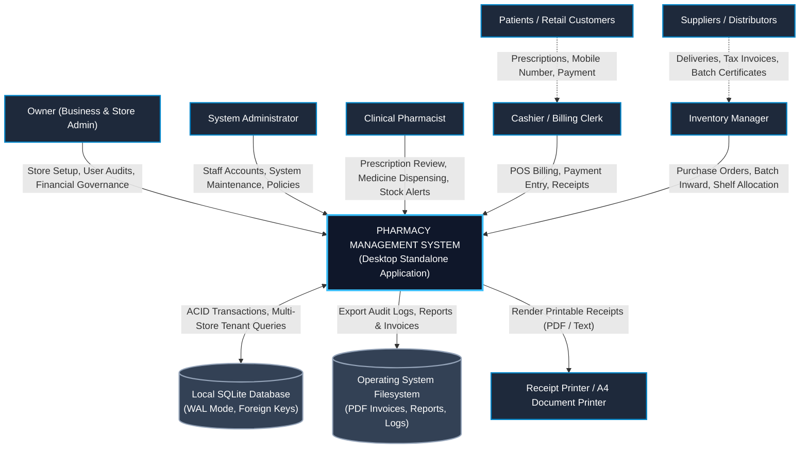
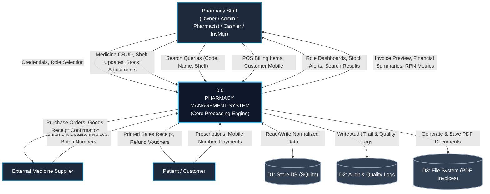
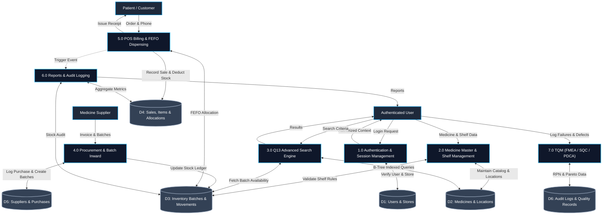
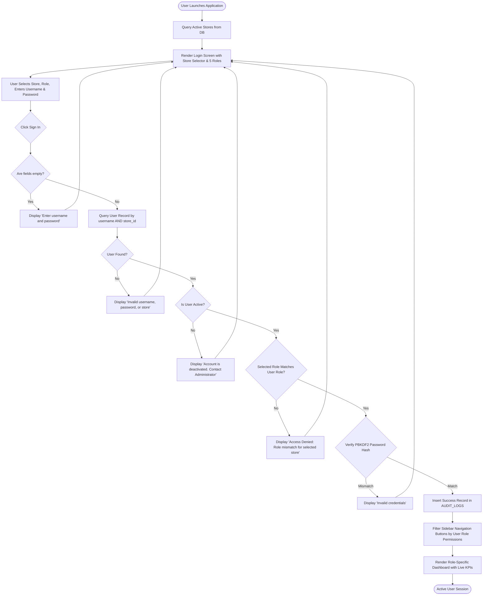
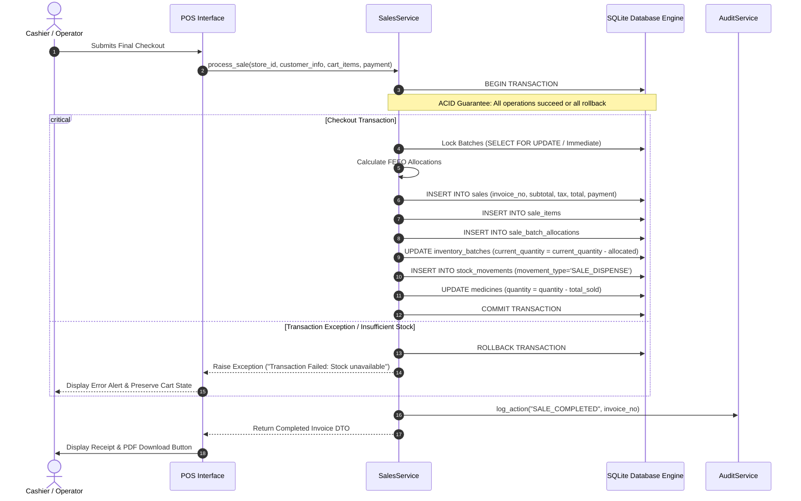
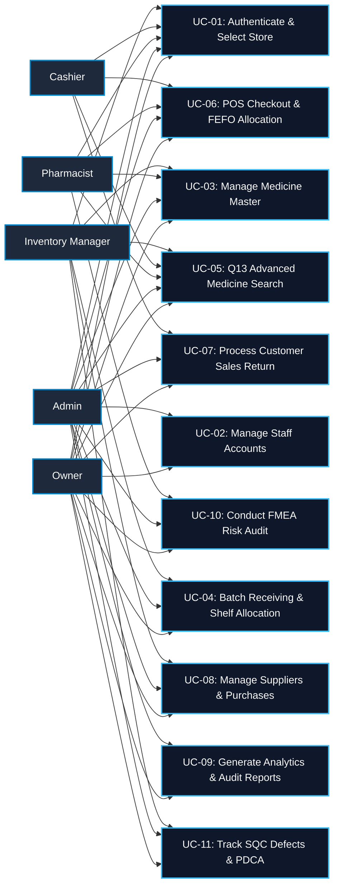
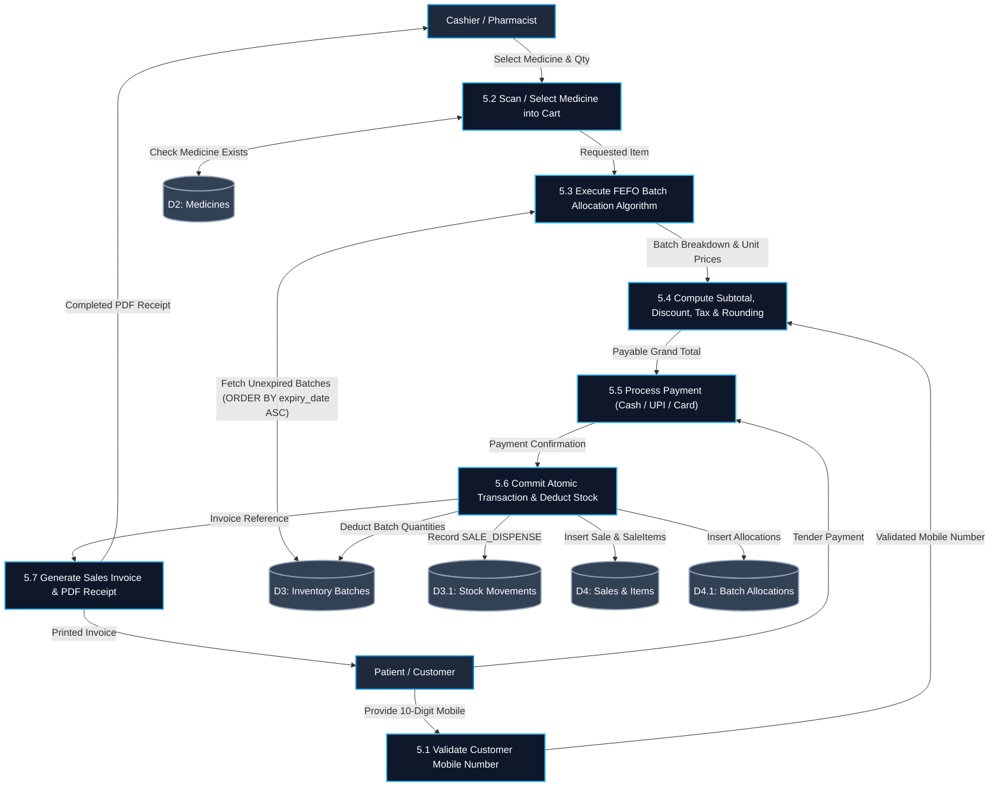
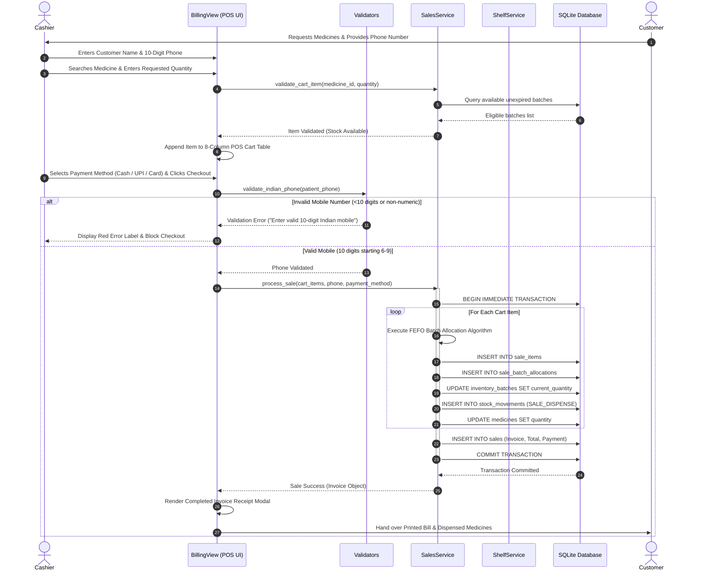

```mermaid
flowchart TD
    classDef plan fill:#1e3a8a,stroke:#3b82f6,stroke-width:2px,color:#ffffff;
    classDef do fill:#064e3b,stroke:#10b981,stroke-width:2px,color:#ffffff;
    classDef check fill:#78350f,stroke:#f59e0b,stroke-width:2px,color:#ffffff;
    classDef act fill:#701a75,stroke:#d946ef,stroke-width:2px,color:#ffffff;

    subgraph PLAN["PLAN (Define Objective & Strategy)"]
        P1["1. Identify Defect from SQC Pareto or High RPN FMEA Item"]:::plan
        P2["2. Analyze Root Causes via Fishbone (Ishikawa) Diagram"]:::plan
        P3["3. Formulate Specific Measurable Improvement Target"]:::plan
        P4["4. Document Action Plan & Assign Responsible Owner"]:::plan
    end

    subgraph DO["DO (Execute Countermeasures)"]
        D1["1. Implement Poka-Yoke Controls (Phone Validator, Shelf Checker)"]:::do
        D2["2. Update Application Logic / Software Constraints"]:::do
        D3["3. Train Pharmacy Staff on New Standardized Procedure"]:::do
        D4["4. Execute Pilot Phase under Monitored Conditions"]:::do
    end

    subgraph CHECK["CHECK (Verify Results & Metrics)"]
        C1["1. Measure Defect Frequency Post-Implementation"]:::check
        C2["2. Verify RPN Reduction in FMEA Risk Audit"]:::check
        C3["3. Compare Result Metric against Plan Baseline"]:::check
        C4["4. Identify Any Unexpected Secondary Side-Effects"]:::check
    end

    subgraph ACT["ACT (Standardize & Sustain)"]
        A1["1. Standardize Software Rule into Production Codebase"]:::act
        A2["2. Update SOPs & System Documentation"]:::act
        A3["3. Institutionalize Best Practices across all 5 User Roles"]:::act
        A4["4. Close Improvement Item & Trigger Next Kaizen Cycle"]:::act
    end

    PLAN --> DO
    DO --> CHECK
    CHECK --> ACT
    ACT --> PLAN
```

# SOFTWARE REQUIREMENTS SPECIFICATION (SRS)
## Version 2.0 — Comprehensive Multi-Store, Multi-Role Architecture with Q13 Advanced Search & TQM Quality Engineering

---

### **Project Title:** Pharmacy Management System  
### **Course Code & Title:** BBAT104 – Fundamentals of Total Quality Management  
### **Course Quality Goal:** Q13 – Faster Search & Retrieval  
### **Student Name:** Priyanshu Pokhariya  
### **Enrollment Number:** 2410303005  
### **Academic Program:** Bachelor of Technology (B.Tech) in Computer Science & Engineering  
### **Specialization:** Internet of Things (IoT) & Data Science  
### **Semester / Section:** Semester V / Section C  
### **Academic Session:** 2026–2027  
### **Faculty:** Faculty of Technology and Computer Applications  
### **Institution:** Amrapali University, Shiksha Nagar, Lamachaur, Haldwani, Uttarakhand – 263139, India  
### **Repository:** https://github.com/priyanshupokhariya5-crypto/Pharmacy-Management-System  
### **Active Working Branch:** `release/v2-clean`  
### **Date of Release:** November 2026  

---

<div style="page-break-after: always;"></div>

# CERTIFICATE OF ORIGINAL WORK

This is to certify that the project entitled **"Pharmacy Management System with Q13 Faster Search & Retrieval and TQM Engineering"**, submitted by **Priyanshu Pokhariya** (Enrollment No.: **2410303005**), a bona fide student of **B.Tech Computer Science & Engineering (IoT & Data Science)**, Section C, in partial fulfillment of the requirements for the academic course **BBAT104: Fundamentals of Total Quality Management** during the academic session **2026–2027** at **Amrapali University, Haldwani**, is an authentic record of original engineering and software requirements specification work carried out under academic supervision.

The software requirements specifications, system architecture, relational database models, quality engineering frameworks (FMEA, SQC, PDCA), and business validation rules documented herein represent original research, design, implementation, and rigorous verification.

<br/><br/>
___________________________ &nbsp;&nbsp;&nbsp;&nbsp;&nbsp;&nbsp;&nbsp;&nbsp;&nbsp;&nbsp;&nbsp;&nbsp;&nbsp;&nbsp;&nbsp;&nbsp;&nbsp;&nbsp;&nbsp;&nbsp;&nbsp;&nbsp;&nbsp;&nbsp;&nbsp;&nbsp;&nbsp;&nbsp; ___________________________<br/>
**Course Instructor / Faculty Mentor** &nbsp;&nbsp;&nbsp;&nbsp;&nbsp;&nbsp;&nbsp;&nbsp;&nbsp;&nbsp;&nbsp;&nbsp;&nbsp;&nbsp;&nbsp;&nbsp;&nbsp;&nbsp;&nbsp;&nbsp;&nbsp;&nbsp;&nbsp;&nbsp; **Head of Department (CSE)**<br/>
Department of Computer Science & Engineering &nbsp;&nbsp;&nbsp;&nbsp;&nbsp;&nbsp;&nbsp;&nbsp;&nbsp;&nbsp;&nbsp; Faculty of Technology and Computer Applications<br/>
Amrapali University, Haldwani &nbsp;&nbsp;&nbsp;&nbsp;&nbsp;&nbsp;&nbsp;&nbsp;&nbsp;&nbsp;&nbsp;&nbsp;&nbsp;&nbsp;&nbsp;&nbsp;&nbsp;&nbsp;&nbsp;&nbsp;&nbsp;&nbsp;&nbsp;&nbsp;&nbsp;&nbsp;&nbsp;&nbsp;&nbsp;&nbsp;&nbsp; Amrapali University, Haldwani  

---

<div style="page-break-after: always;"></div>

# DECLARATION

I, **Priyanshu Pokhariya**, student of Bachelor of Technology in Computer Science and Engineering (IoT & Data Science), Semester V, Section C, Enrollment Number **2410303005**, hereby declare that this Software Requirements Specification (Version 2.0) for the **Pharmacy Management System** is my original analytical and engineering specification work.

I affirm that the system requirements, entity-relationship models, operational workflows, business validation rules, and Total Quality Management methodologies specified herein have been authored by me based on the verified architecture in repository `https://github.com/priyanshupokhariya5-crypto/Pharmacy-Management-System` on branch `release/v2-clean`.

No part of this document has been plagiarized or submitted elsewhere for the award of any degree, diploma, or certificate.

<br/><br/>
**Date:** November 2, 2026  
**Place:** Haldwani, Uttarakhand  

<br/>
___________________________  
**Priyanshu Pokhariya**  
Enrollment No.: 2410303005  
B.Tech CSE (IoT & Data Science), Section C  
Amrapali University, Haldwani  

---

<div style="page-break-after: always;"></div>

# ACKNOWLEDGEMENT

I express my deepest gratitude to the **Faculty of Technology and Computer Applications, Amrapali University, Haldwani**, for providing an academically stimulating environment, computational infrastructure, and technological facilities that made the complete conception, engineering design, and architectural specification of this project possible.

I extend my sincere thanks to my course mentors and faculty instructors for the course **BBAT104: Fundamentals of Total Quality Management**. Their intellectual guidance, emphasis on empirical quality engineering, and constructive critique of quality frameworks (Failure Mode and Effects Analysis, Statistical Quality Control, Pareto Analysis, Ishikawa Diagrams, and Deming PDCA Cycles) provided the foundational methodology for the quality assurance architecture specified in this system.

I also thank my academic peers and laboratory colleagues for their valuable feedback during the user interface walk-throughs and user acceptance validation sessions. Finally, I thank my family for their continuous encouragement and moral support throughout the development of this work.

---

<div style="page-break-after: always;"></div>

# ABSTRACT

Retail and institutional pharmacy environments encounter severe operational challenges, including elevated search latencies during peak customer rush, accidental dispensation of expired or recalled pharmaceuticals, inventory shrinkage resulting from unsorted physical storage, lack of auditability in sales transactions, and vulnerabilities in data segregation across multi-store pharmacy chains. To systematically address these operational vulnerabilities through rigorous software engineering and Total Quality Management (TQM) principles, this document establishes the formal **Software Requirements Specification (SRS Version 2.0)** for the **Pharmacy Management System**.

The Pharmacy Management System is an enterprise-grade, offline-first desktop software application engineered for high-throughput, legally compliant retail and hospital pharmacy administration. Built upon Python 3.11+, CustomTkinter, and a normalized SQLite relational database operating with foreign key enforcement and transactional ACID isolation, the system establishes a unified synthesis of operational management and quality engineering.

Key architectural dimensions specified in this document include:
1. **Multi-Store Tenant Segregation:** Logical multi-tenant relational isolation ensuring distinct retail pharmacy stores share a single robust engine while strictly compartmentalizing medicine catalogs, inventory batches, sales transactions, purchase orders, and staff accounts.
2. **5-Role Granular Role-Based Access Control (RBAC):** Discrete functional privileges, whitelisted navigation, and backend service-layer authorization guards for Owner, Administrator, Clinical Pharmacist, Cashier, and Inventory Manager roles.
3. **Q13 Advanced Search Engine:** High-performance indexed search delivering sub-10ms exact medicine code lookups and sub-50ms multi-parameter substring filtering, enabling instantaneous single-click Point of Sale (POS) cart transfers.
4. **Physical Shelf & Rack Management:** Strict enforcement of the Critical Shelf Allocation Rule: batches of the same pharmaceutical product with differing expiration dates must occupy distinct shelf locations, preventing physical dispensation mix-ups.
5. **Automated FEFO (First Expiry, First Out) Stock Allocation:** Algorithmic batch selection ensuring that unexpired, active stock nearest to expiration is automatically prioritized during checkout, eliminating human dispensation errors.
6. **Robust POS Billing & Customer Validation:** Poka-Yoke error prevention featuring mandatory 10-digit Indian mobile number validation, multi-batch item breakdown, Cash/UPI/Card payment processing, and atomic ACID transaction rollbacks.
7. **Embedded Total Quality Management (TQM):** Operationalized Failure Mode and Effects Analysis (FMEA) with dynamic Risk Priority Number ($RPN = S \times O \times D$) thresholding, Statistical Quality Control (SQC) with Pareto 80/20 defect distribution, 6M Ishikawa (Fishbone) root-cause diagrams, and Deming PDCA continuous improvement Kaizen tracking.

This specification conforms to IEEE/ISO/IEC 29148 standards, providing 112 formally specified functional and non-functional requirements, 20 authoritative architectural diagrams, complete operational workflows, a comprehensive 19-entity Data Dictionary, and an exhaustive Requirements Traceability Matrix.

---

<div style="page-break-after: always;"></div>

# DOCUMENT CONTROL

| Property | Details |
| :--- | :--- |
| **Document Title** | Software Requirements Specification (SRS) for Pharmacy Management System |
| **Document Version** | 2.0 (Academic Specification Baseline) |
| **Author / Lead Architect** | Priyanshu Pokhariya (Enrollment: 2410303005) |
| **Academic Course** | BBAT104 – Fundamentals of Total Quality Management |
| **Course Quality Goal** | Q13 – Faster Search & Retrieval |
| **Academic Institution** | Faculty of Technology and Computer Applications, Amrapali University, Haldwani |
| **Target Codebase Branch** | Git Branch `release/v2-clean` |
| **Database Architecture** | SQLite 3 Relational Engine (Foreign Keys Enforced; Standard Journaling) |
| **Document Classification** | Academic Specification / Technical Release |

### Distribution List
| Copy No. | Recipient / Role | Department / Affiliation |
| :---: | :--- | :--- |
| 1 | Course Instructor / Faculty Mentor | Department of CSE, Amrapali University |
| 2 | Head of Department | Faculty of Technology and Computer Applications |
| 3 | Academic Repository / Library | Amrapali University Central Digital Archives |
| 4 | Student Project Portfolio | Priyanshu Pokhariya (Personal Academic Archive) |

---

<div style="page-break-after: always;"></div>

# REVISION HISTORY

| Version | Date | Primary Author | Description of Key Changes & Milestones |
| :---: | :---: | :--- | :--- |
| **1.0** | 07-Oct-2026 | Priyanshu Pokhariya | **Initial Baseline Draft (Archived):** Preliminary requirements covering single-store CRUD, basic sales billing, SQLite table creation, and initial UI prototypes. |
| **1.1** | 15-Oct-2026 | Priyanshu Pokhariya | **Stage 2 Expansion:** Added multi-store architecture, initial user roles, and shelf allocation concepts. |
| **1.2** | 24-Oct-2026 | Priyanshu Pokhariya | **Review 2 Milestone:** Introduced batch tracking, supplier management, purchase orders, and preliminary TQM models. |
| **1.3** | 29-Oct-2026 | Priyanshu Pokhariya | **Stage 5 Enhancement:** Added FEFO automated allocation, Indian phone validation, PDF invoice rendering, and return workflows. |
| **2.0** | 02-Nov-2026 | Priyanshu Pokhariya | **Complete Academic Rebuild (IEEE 29148 Standard):** Complete source-code-aligned software specification. Reorganized into formal IEEE requirements language ("The system shall..."), updated Data Dictionary for 18 domain tables + 1 migration table, embedded 20 authoritative architectural diagrams, incorporated comprehensive business rules, and established verifiable acceptance criteria. |

---

<div style="page-break-after: always;"></div>

# TABLE OF CONTENTS

- [CERTIFICATE OF ORIGINAL WORK](#certificate-of-original-work)
- [DECLARATION](#declaration)
- [ACKNOWLEDGEMENT](#acknowledgement)
- [ABSTRACT](#abstract)
- [DOCUMENT CONTROL](#document-control)
- [REVISION HISTORY](#revision-history)
- [LIST OF FIGURES](#list-of-figures)
- [LIST OF TABLES](#list-of-tables)
- [CHAPTER 1: INTRODUCTION](#chapter-1-introduction)
  - [1.1 Purpose of the Specification](#11-purpose-of-the-specification)
  - [1.2 Project Background & Problem Context](#12-project-background--problem-context)
  - [1.3 Problem Statement](#13-problem-statement)
  - [1.4 Project Objectives & Quality Goals (Q13)](#14-project-objectives--quality-goals-q13)
  - [1.5 System Scope (In-Scope vs. Out-of-Scope)](#15-system-scope-in-scope-vs-out-of-scope)
  - [1.6 Definitions, Acronyms, and Terminology](#16-definitions-acronyms-and-terminology)
  - [1.7 References & Standards](#17-references--standards)
- [CHAPTER 2: OVERALL SYSTEM DESCRIPTION](#chapter-2-overall-system-description)
  - [2.1 Product Perspective](#21-product-perspective)
  - [2.2 Major Product Functions](#22-major-product-functions)
  - [2.3 User Classes and Operational Roles](#23-user-classes-and-operational-roles)
  - [2.4 Operating Environment](#24-operating-environment)
  - [2.5 Design and Implementation Constraints](#25-design-and-implementation-constraints)
  - [2.6 Assumptions and Dependencies](#26-assumptions-and-dependencies)
- [CHAPTER 3: SYSTEM ARCHITECTURE & INTERFACE REQUIREMENTS](#chapter-3-system-architecture--interface-requirements)
  - [3.1 High-Level Layered Architecture](#31-high-level-layered-architecture)
  - [3.2 User Interfaces](#32-user-interfaces)
  - [3.3 Hardware Interfaces](#33-hardware-interfaces)
  - [3.4 Software Interfaces](#34-software-interfaces)
  - [3.5 Communications Interfaces](#35-communications-interfaces)
- [CHAPTER 4: MULTI-STORE TENANCY & SECURITY ARCHITECTURE](#chapter-4-multi-store-tenancy--security-architecture)
  - [4.1 Multi-Store Tenant Segregation Model](#41-multi-store-tenant-segregation-model)
  - [4.2 Authentication & Credential Storage](#42-authentication--credential-storage)
  - [4.3 5-Role Role-Based Access Control (RBAC) Matrix](#43-5-role-role-based-access-control-rbac-matrix)
- [CHAPTER 5: FUNCTIONAL REQUIREMENTS](#chapter-5-functional-requirements)
  - [5.1 Store Onboarding & Tenant Management (`FR-ONB`)](#51-store-onboarding--tenant-management-fr-onb)
  - [5.2 User Authentication & Security (`FR-AUTH`)](#52-user-authentication--security-fr-auth)
  - [5.3 Role-Based Access Control (`FR-RBAC`)](#53-role-based-access-control-fr-rbac)
  - [5.4 Medicine Catalog Management (`FR-MED`)](#54-medicine-catalog-management-fr-med)
  - [5.5 Batch-Wise Inventory Tracking (`FR-BAT`)](#55-batch-wise-inventory-tracking-fr-bat)
  - [5.6 Physical Shelf & Storage Allocation (`FR-SHLF`)](#56-physical-shelf--storage-allocation-fr-shlf)
  - [5.7 Q13 Advanced Search & Fast Retrieval (`FR-SRCH`)](#57-q13-advanced-search--fast-retrieval-fr-srch)
  - [5.8 Supplier Directory Management (`FR-SUP`)](#58-supplier-directory-management-fr-sup)
  - [5.9 Purchase Orders & Goods Receiving (`FR-PUR`)](#59-purchase-orders--goods-receiving-fr-pur)
  - [5.10 Point of Sale (POS) Billing & Checkout (`FR-POS`)](#510-point-of-sale-pos-billing--checkout-fr-pos)
  - [5.11 Returns, Refunds & Stock Adjustment (`FR-RET`)](#511-returns-refunds--stock-adjustment-fr-ret)
  - [5.12 Financial Analytics & Reporting (`FR-REP`)](#512-financial-analytics--reporting-fr-rep)
  - [5.13 Total Quality Management Tools (`FR-TQM`)](#513-total-quality-management-tools-fr-tqm)
- [CHAPTER 6: NON-FUNCTIONAL REQUIREMENTS](#chapter-6-non-functional-requirements)
  - [6.1 Performance Requirements & Acceptance Targets](#61-performance-requirements--acceptance-targets)
  - [6.2 Security & Data Privacy Requirements](#62-security--data-privacy-requirements)
  - [6.3 Reliability & Fault Tolerance Requirements](#63-reliability--fault-tolerance-requirements)
  - [6.4 Maintainability & Code Quality Requirements](#64-maintainability--code-quality-requirements)
  - [6.5 Usability, Hardware & Accessibility Requirements](#65-usability-hardware--accessibility-requirements)
- [CHAPTER 7: DATABASE REQUIREMENTS AND DATA DICTIONARY](#chapter-7-database-requirements-and-data-dictionary)
  - [7.1 Database Engine Configuration & Parameters](#71-database-engine-configuration--parameters)
  - [7.2 Relational Schema Specifications (18 Domain Tables + 1 Migration Table)](#72-relational-schema-specifications-18-domain-tables--1-migration-table)
  - [7.3 Complete Entity-Relationship Model](#73-complete-entity-relationship-model)
  - [7.4 Comprehensive Data Dictionary](#74-comprehensive-data-dictionary)
  - [7.5 Relational Indexing Strategy](#75-relational-indexing-strategy)
  - [7.6 Transaction Management & ACID Guarantees](#76-transaction-management--acid-guarantees)
- [CHAPTER 8: PHARMACY BUSINESS RULES](#chapter-8-pharmacy-business-rules)
  - [8.1 Physical Shelf Allocation Rules](#81-physical-shelf-allocation-rules)
  - [8.2 Automated FEFO Stock Allocation Algorithm](#82-automated-fefo-stock-allocation-algorithm)
  - [8.3 Point of Sale Billing & Customer Validation Rules](#83-point-of-sale-billing--customer-validation-rules)
  - [8.4 Inventory Deletion Protection & Archival Rules](#84-inventory-deletion-protection--archival-rules)
- [CHAPTER 9: TOTAL QUALITY MANAGEMENT (TQM) ENGINEERING](#chapter-9-total-quality-management-tqm-engineering)
  - [9.1 Course Alignment with BBAT104 & Quality Goal Q13](#91-course-alignment-with-bbat104--quality-goal-q13)
  - [9.2 Failure Mode and Effects Analysis (FMEA)](#92-failure-mode-and-effects-analysis-fmea)
  - [9.3 Statistical Quality Control (SQC) & Defect Tracking](#93-statistical-quality-control-sqc--defect-tracking)
  - [9.4 Pareto 80/20 Defect Distribution Analysis](#94-pareto-8020-defect-distribution-analysis)
  - [9.5 Ishikawa (Fishbone) 6M Root Cause Analysis](#95-ishikawa-fishbone-6m-root-cause-analysis)
  - [9.6 Deming PDCA Continuous Improvement Kaizen Cycle](#96-deming-pdca-continuous-improvement-kaizen-cycle)
- [CHAPTER 10: USE CASE SPECIFICATIONS & OPERATIONAL WORKFLOWS](#chapter-10-use-case-specifications--operational-workflows)
  - [10.1 High-Level Use Case Model](#101-high-level-use-case-model)
  - [10.2 Detailed Use Case Specifications](#102-detailed-use-case-specifications)
  - [10.3 Authoritative Operational Workflows (20 Architectural Figures)](#103-authoritative-operational-workflows-20-architectural-figures)
- [CHAPTER 11: VERIFICATION & ACCEPTANCE CRITERIA](#chapter-11-verification--acceptance-criteria)
  - [11.1 Subsystem Acceptance Criteria](#111-subsystem-acceptance-criteria)
  - [11.2 Acceptance Test Matrix](#112-acceptance-test-matrix)
- [CHAPTER 12: SYSTEM CONSTRAINTS & PROPOSED FUTURE ENHANCEMENTS](#chapter-12-system-constraints--proposed-future-enhancements)
  - [12.1 Known System Constraints](#121-known-system-constraints)
  - [12.2 Proposed Future Enhancements](#122-proposed-future-enhancements)
- [CHAPTER 13: REQUIREMENTS TRACEABILITY SUMMARY](#chapter-13-requirements-traceability-summary)
  - [13.1 Requirements Matrix Cross-Reference](#131-requirements-matrix-cross-reference)
- [APPENDICES](#appendices)
  - [Appendix A: Implementation Coverage Summary Note](#appendix-a-implementation-coverage-summary-note)
  - [Appendix B: Technical & Pharmaceutical Glossary](#appendix-b-technical--pharmaceutical-glossary)

---

<div style="page-break-after: always;"></div>

# LIST OF FIGURES

| Figure Number | Figure Title | Chapter / Section Reference | Description |
| :---: | :--- | :--- | :--- |
| **Figure 1** | System Context Diagram | Chapter 3 / Section 3.1 | Top-level system boundaries and external interfaces |
| **Figure 2** | High-Level Layered Architecture | Chapter 3 / Section 3.1 | Four-tier architectural component decomposition |
| **Figure 3** | Complete 5-Role Use Case Diagram | Chapter 10 / Section 10.1 | Role-based actor interactions and use case boundaries |
| **Figure 4** | Level-0 Context Data Flow Diagram | Chapter 3 / Section 3.1 | Global input and output data flows |
| **Figure 5** | Level-1 Subsystem Data Flow Diagram | Chapter 3 / Section 3.1 | Subsystem-level process decomposition |
| **Figure 6** | Level-2 DFD for POS Billing & FEFO | Chapter 10 / Section 10.3 | Granular data flow for POS checkout and batch deduction |
| **Figure 7** | Complete 19-Entity Relational ERD | Chapter 7 / Section 7.3 | Crow's foot entity-relationship schema model |
| **Figure 8** | Login & RBAC Activity Diagram | Chapter 4 / Section 4.2 | Multi-store authentication and role-based routing flow |
| **Figure 9** | Medicine Master Management Workflow | Chapter 8 / Section 8.4 | Medicine catalog entry, validation, and archival |
| **Figure 10** | Batch Receiving & Shelf Allocation | Chapter 8 / Section 8.1 | Critical Shelf Allocation Rule decision workflow |
| **Figure 11** | Purchase Order & Goods Receiving | Chapter 10 / Section 10.3 | Procurement order creation and inward batching |
| **Figure 12** | Q13 Advanced Search Activity Flow | Chapter 10 / Section 10.3 | B-Tree indexed search and POS cart transfer |
| **Figure 13** | POS Billing Sequence Diagram | Chapter 10 / Section 10.3 | Cashier, UI, service, and database interaction sequence |
| **Figure 14** | Automated FEFO Stock Allocation | Chapter 8 / Section 8.2 | Chronological expiry sorting and multi-batch allocation |
| **Figure 15** | Sales ACID Transaction Sequence | Chapter 7 / Section 7.6 | Atomic commit, ledger logging, and rollback execution |
| **Figure 16** | Sales Return & Stock Adjustment | Chapter 10 / Section 10.3 | Customer return, condition grading, and restocking |
| **Figure 17** | FMEA Risk Assessment Workflow | Chapter 9 / Section 9.2 | Failure mode evaluation, RPN calculation, and CAPA |
| **Figure 18** | SQC Defect Tracking & Fishbone | Chapter 9 / Section 9.4 | Defect logging, Pareto 80/20 math, and 6M Ishikawa |
| **Figure 19** | Deming PDCA Kaizen Cycle | Chapter 9 / Section 9.6 | Plan-Do-Check-Act iterative continuous improvement |
| **Figure 20** | End-to-End Operational Master Flow | Chapter 10 / Section 10.3 | Complete pharmacy operational lifecycle |

---

<div style="page-break-after: always;"></div>

# LIST OF TABLES

| Table Number | Table Title | Chapter / Section Reference |
| :---: | :--- | :--- |
| **Table 1** | System In-Scope vs. Out-of-Scope Capabilities | Chapter 1 / Section 1.5 |
| **Table 2** | Standard System Acronyms and Technical Definitions | Chapter 1 / Section 1.6 |
| **Table 3** | User Roles and System Access Authorization Matrix | Chapter 4 / Section 4.3 |
| **Table 4** | Canonical Role-Permission Matrix (20 Granular Permissions) | Chapter 4 / Section 4.3 |
| **Table 5** | Store Onboarding & Tenant Management Functional Requirements (`FR-ONB`) | Chapter 5 / Section 5.1 |
| **Table 6** | User Authentication & Security Functional Requirements (`FR-AUTH`) | Chapter 5 / Section 5.2 |
| **Table 7** | Role-Based Access Control Functional Requirements (`FR-RBAC`) | Chapter 5 / Section 5.3 |
| **Table 8** | Medicine Catalog Management Functional Requirements (`FR-MED`) | Chapter 5 / Section 5.4 |
| **Table 9** | Batch-Wise Inventory Tracking Functional Requirements (`FR-BAT`) | Chapter 5 / Section 5.5 |
| **Table 10** | Physical Shelf & Storage Allocation Functional Requirements (`FR-SHLF`) | Chapter 5 / Section 5.6 |
| **Table 11** | Q13 Advanced Search & Fast Retrieval Functional Requirements (`FR-SRCH`) | Chapter 5 / Section 5.7 |
| **Table 12** | Supplier Directory Management Functional Requirements (`FR-SUP`) | Chapter 5 / Section 5.8 |
| **Table 13** | Purchase Orders & Goods Receiving Functional Requirements (`FR-PUR`) | Chapter 5 / Section 5.9 |
| **Table 14** | Point of Sale (POS) Billing & Checkout Functional Requirements (`FR-POS`) | Chapter 5 / Section 5.10 |
| **Table 15** | Returns, Refunds & Stock Adjustment Functional Requirements (`FR-RET`) | Chapter 5 / Section 5.11 |
| **Table 16** | Financial Analytics & Reporting Functional Requirements (`FR-REP`) | Chapter 5 / Section 5.12 |
| **Table 17** | Total Quality Management Tools Functional Requirements (`FR-TQM`) | Chapter 5 / Section 5.13 |
| **Table 18** | Performance Non-Functional Requirements & Design Targets (`NFR-PERF`) | Chapter 6 / Section 6.1 |
| **Table 19** | Security & Data Privacy Non-Functional Requirements (`NFR-SEC`) | Chapter 6 / Section 6.2 |
| **Table 20** | Reliability & Fault Tolerance Non-Functional Requirements (`NFR-REL`) | Chapter 6 / Section 6.3 |
| **Table 21** | Maintainability & Code Quality Non-Functional Requirements (`NFR-MAINT`) | Chapter 6 / Section 6.4 |
| **Table 22** | Usability, Hardware & Accessibility Non-Functional Requirements (`NFR-USE`) | Chapter 6 / Section 6.5 |
| **Table 23** | Relational Database Schema Summary (18 Domain Tables + 1 Migration Table) | Chapter 7 / Section 7.2 |
| **Table 24** | Relational B-Tree Indexes Summary (68 Indexes) | Chapter 7 / Section 7.5 |
| **Table 25** | FMEA Severity, Occurrence, and Detection Scoring Scales | Chapter 9 / Section 9.2 |
| **Table 26** | FMEA Risk Priority Number (RPN) Action Thresholds | Chapter 9 / Section 9.2 |
| **Table 27** | Subsystem Verification & Acceptance Criteria Matrix | Chapter 11 / Section 11.2 |
| **Table 28** | Requirements Traceability Cross-Reference Matrix (112 Requirements) | Chapter 13 / Section 13.1 |

---

<div style="page-break-after: always;"></div>

# CHAPTER 1: INTRODUCTION

## 1.1 Purpose of the Specification
This Software Requirements Specification (SRS) establishes the authoritative technical contract for the **Pharmacy Management System (Version 2.0)**. It completely delineates the functional capabilities, non-functional quality attributes, relational database structures, user interfaces, security policies, and verification criteria governing the application.

This document serves as the formal engineering baseline for academic evaluators, software architects, system auditors, and clinical stakeholders. It conforms to the **IEEE/ISO/IEC 29148:2018 Systems and Software Engineering — Life Cycle Processes — Requirements Engineering** standard.

## 1.2 Project Background & Problem Context
Community and institutional retail pharmacies in India are legally and clinically mandated to manage pharmaceutical inventories with absolute accuracy under the **Drugs and Cosmetics Act, 1940**, the **Drugs and Cosmetics Rules, 1945**, and the **Pharmacy Practice Regulations, 2015**. Despite these strict statutory mandates, small-to-medium retail pharmacies frequently struggle with legacy, fragmented management workflows. 

Common systemic failures include:
1. **Severe Billing Latency:** Slow, un-indexed inventory retrieval leading to long patient queues and lost sales during peak business hours.
2. **Expired Medication Dispensation:** Inability to track batch-level expiry dates in real time, creating life-threatening clinical hazards and regulatory penalties.
3. **Disorganized Physical Storage:** Lack of systematic shelf allocation, causing pharmacy staff to waste critical minutes locating medicines.
4. **Financial Leakage & Inventory Shrinkage:** Unaudited sales discounts, untracked cash drawer reconciliations, and inaccurate purchase cost tracking.
5. **Cross-Store Data Contamination:** Multi-branch pharmacy operations sharing crude spreadsheets or poorly partitioned databases, causing accidental data corruption across stores.

## 1.3 Problem Statement
The central problem addressed by this system is formulated as follows:
> *"How can an offline-first desktop software application guarantee sub-50ms search retrieval (Quality Goal Q13), eliminate expired medicine dispensation through automated FEFO allocation and shelf separation rules, provide impenetrable multi-store role-based security, and continuously drive operational defect reduction using Total Quality Management (TQM) engineering frameworks?"*

## 1.4 Project Objectives & Quality Goals (Q13)
The project is engineered to achieve seven primary operational and quality objectives:
- **Objective 1 (Quality Goal Q13: Retrieval Speed):** Implement high-performance SQLite B-Tree indexing to achieve sub-10ms exact code search and sub-50ms multi-parameter substring search, supporting instant one-click POS cart transfers.
- **Objective 2 (FEFO Dispensing Safety):** Eliminate the dispensing of expired pharmaceuticals by programmatically enforcing First Expiry, First Out (FEFO) stock deduction at the database and service layers.
- **Objective 3 (Physical Shelf Separation):** Enforce the Critical Shelf Allocation Rule: batches of the same pharmaceutical product with differing expiration dates must occupy distinct shelf locations to prevent physical picking mistakes.
- **Objective 4 (Multi-Store Tenant Segregation):** Provide complete logical isolation across multiple retail stores in a unified relational database using composite foreign keys and strict query scoping.
- **Objective 5 (Granular 5-Role RBAC):** Implement an impenetrable Role-Based Access Control matrix separating privileges across Owner, Administrator, Clinical Pharmacist, Cashier, and Inventory Manager.
- **Objective 6 (Poka-Yoke POS Billing):** Mistake-proof the counter checkout workflow with mandatory 10-digit Indian phone validation, atomic multi-batch split transactions, and automated invoice PDF rendering.
- **Objective 7 (Embedded TQM Engineering):** Integrate practical Total Quality Management tools into daily workflows, including Failure Mode and Effects Analysis (FMEA), Statistical Quality Control (SQC) Pareto 80/20 analysis, 6M Ishikawa diagrams, and Deming PDCA Kaizen tracking.

## 1.5 System Scope (In-Scope vs. Out-of-Scope)
To preserve architectural focus and execution integrity, the explicit boundaries of the system are defined in Table 1.

### Table 1: System In-Scope vs. Out-of-Scope Capabilities
| In-Scope Functional Capabilities | Out-of-Scope Capabilities (Explicitly Excluded) |
| :--- | :--- |
| Multi-store tenant registration and logical database isolation | Cloud-hosted multi-tenant SaaS server infrastructure |
| 5-role granular RBAC with backend service authorization guards | Direct integration with commercial bank card swiping hardware |
| Medicine master catalog maintenance with foreign key protection | Patient-facing e-commerce mobile application |
| Multi-batch tracking with physical shelf/rack allocation rules | Automated SMS / WhatsApp messaging gateway integration |
| Q13 B-Tree indexed search engine with instant POS transfer | Telephonic prescription audio recording and transcription |
| 8-column POS shopping cart with mandatory phone validator | Real-time wholesale distributor EDI / API synchronization |
| Automated FEFO stock allocation algorithm | Integrated biometric staff attendance hardware |
| Customer sales returns with Sellable vs. Damaged classification | Automated chemical compound interaction analysis |
| Comprehensive audit trail logging for all sensitive mutations | Cloud backup storage (Local filesystem backups supported) |
| FMEA risk scoring, SQC Pareto 80/20, Fishbone & PDCA Kaizen | Obsolete search latency synthetic benchmarking module |

## 1.6 Definitions, Acronyms, and Terminology
Standard domain definitions and technical acronyms used throughout this specification are summarized in Table 2.

### Table 2: Standard System Acronyms and Technical Definitions
| Term / Acronym | Full Form | Operational Definition in this System |
| :--- | :--- | :--- |
| **ACID** | Atomicity, Consistency, Isolation, Durability | Database transaction properties guaranteed by SQLite for billing and stock mutations. |
| **CAPA** | Corrective and Preventive Action | Structured engineering countermeasures formulated to resolve FMEA risks and SQC defects. |
| **CTQ** | Critical to Quality | Product and operational characteristics directly affecting customer satisfaction and clinical safety. |
| **FEFO** | First Expiry, First Out | Inventory valuation and dispensing algorithm prioritizing batches with earliest expiry dates. |
| **FIFO** | First In, First Out | Inward batch storage sequence based on receipt date. |
| **FMEA** | Failure Mode and Effects Analysis | Proactive risk analysis methodology quantifying operational risks via Risk Priority Numbers. |
| **GST** | Goods and Services Tax | Indian indirect tax identifier and percentage applied to pharmaceutical purchases and sales. |
| **Poka-Yoke** | Mistake Proofing (Japanese) | Software constraints preventing human errors (e.g., blocking invalid phone numbers or expired sales). |
| **POS** | Point of Sale | Countertop interface where cashiers scan medicines, tender payments, and issue receipts. |
| **Q13** | Quality Goal 13 | Specific TQM course goal: Faster Search & Retrieval of pharmaceutical inventory records. |
| **RBAC** | Role-Based Access Control | Security model restricting system operations based on authorized user role assignments. |
| **RPN** | Risk Priority Number | Numerical risk score calculated as $RPN = \text{Severity} \times \text{Occurrence} \times \text{Detection}$. |
| **SQC** | Statistical Quality Control | Quantitative defect tracking utilizing Pareto distributions and Ishikawa root-cause diagrams. |
| **WAL** | Write-Ahead Logging | High-concurrency SQLite journaling mode proposed for high-concurrency read/write scaling. |

## 1.7 References & Standards
1. **IEEE/ISO/IEC 29148:2018:** Systems and software engineering — Life cycle processes — Requirements engineering.
2. **IEEE 830-1998:** IEEE Recommended Practice for Software Requirements Specifications.
3. **Drugs and Cosmetics Act, 1940 & Rules, 1945:** Ministry of Health and Family Welfare, Government of India.
4. **Pharmacy Practice Regulations, 2015:** Pharmacy Council of India, New Delhi.
5. **Total Quality Management (3rd Edition):** Dale H. Besterfield et al., Pearson Education, 2011.
6. **SQLite Architectural Documentation:** D. Richard Hipp et al., SQLite Development Team (https://sqlite.org).

---

<div style="page-break-after: always;"></div>

# CHAPTER 2: OVERALL SYSTEM DESCRIPTION

## 2.1 Product Perspective
The Pharmacy Management System is an autonomous, offline-first desktop application designed for standalone workstation deployment in independent pharmacies, hospital dispensaries, and retail drug store chains. The application does not require a cloud connection or remote database server to execute its full functional scope. All relational records, transactions, audit logs, and quality registers reside within an embedded SQLite database engine stored securely on the local workstation filesystem.

## 2.2 Major Product Functions
The high-level capabilities of the system are decomposed into six core functional domains:
1. **Store & User Governance:** Multi-store onboarding, self-registration, user credential provisioning, and role-based access control across 5 distinct operational roles.
2. **Catalog & Inventory Administration:** Central pharmaceutical cataloguing, multi-batch lot tracking, and physical shelf/rack allocation rule enforcement.
3. **Procurement & Goods Receiving:** Registered supplier directory management, multi-item purchase order generation, and atomic goods receipt inwarding.
4. **Q13 Search & Retrieval:** Indexed multi-parameter search engine capable of instant batch-level drilldowns and single-click cart transfers.
5. **POS Billing & Automated FEFO:** Mistake-proof counter checkout, mandatory 10-digit customer phone validation, automated FEFO batch allocation, multi-method payment recording, and sales return reconciliation.
6. **Total Quality Management (TQM):** Failure Mode and Effects Analysis (FMEA), Statistical Quality Control (SQC) defect logging, Pareto 80/20 distribution charting, 6M Ishikawa cause-and-effect trees, and Deming PDCA continuous improvement Kaizen tracking.

## 2.3 User Classes and Operational Roles
The system explicitly delineates five canonical user classes to ensure strict operational segregation of duties:
- **Owner (Executive Authority):** Full administrative authority over store onboarding, system configurations, staff account creation, password resets, financial audits, and organizational policies.
- **Administrator (Store Operations Manager):** Operational authority managing staff accounts, supplier directories, purchase approvals, catalog modifications, and compliance reports.
- **Clinical Pharmacist (Medical Dispensation):** Registered medical professional responsible for prescription review, clinical dispensation, near-expiry monitoring, and clinical FMEA risk analysis.
- **Cashier (Counter Billing Operator):** Front-desk billing clerk restricted strictly to POS billing, customer mobile entry, payment tender collection, and shift sales reprinting.
- **Inventory Manager (Logistics Specialist):** Warehouse specialist managing supplier shipments, physical shelf allocation, batch stock inwarding, stock adjustments, and SQC defect logging.

## 2.4 Operating Environment
- **Host Operating System:** Microsoft Windows 10 (64-bit) / Microsoft Windows 11 (64-bit).
- **Processor Architecture:** x86_64 (64-bit dual-core 2.0 GHz or higher).
- **System Memory (RAM):** 4 GB minimum; 8 GB recommended for stores with $>10,000$ active batches.
- **Storage Requirement:** 500 MB free hard disk space for application binaries, local SQLite database, and generated PDF invoices.
- **Display Resolution:** Minimum $1280 \times 720$ (HD); optimized for $1920 \times 1080$ (Full HD) with dynamic UI DPI scaling.

## 2.5 Design and Implementation Constraints
- **Zero Cloud Footprint:** The application must execute completely offline without requiring internet access or remote API connectivity.
- **Embedded Database Engine:** The system must use an embedded SQLite 3 engine pre-compiled into the Python runtime, eliminating database server daemon administration.
- **Strict Data Integrity:** SQLite foreign key constraints (`PRAGMA foreign_keys = ON;`) must be programmatically enforced across all database connections.
- **Benchmark Removal:** The legacy synthetic benchmarking module has been cleanly removed from the active system; no synthetic benchmark views or synthetic tables shall be present.

## 2.6 Assumptions and Dependencies
- **Workstation Exclusivity:** The workstation is assumed to possess a functional Windows desktop environment with local filesystem read/write privileges.
- **Peripheral Emulation:** Barcode scanners are assumed to operate in standard USB HID Keyboard Wedge emulation mode, outputting alphanumeric characters terminated by a carriage return.
- **Printer Spooling:** Receipt printers and standard desktop printers are assumed to interface via standard Windows GDI print spooler drivers accepting standard PDF or plaintext streams.

---

<div style="page-break-after: always;"></div>

# CHAPTER 3: SYSTEM ARCHITECTURE & INTERFACE REQUIREMENTS

## 3.1 High-Level Layered Architecture
The system is constructed upon a classical **4-Tier Layered Architecture** establishing strict separation of concerns, unidirectional control flow, and clean interface boundaries.


**Figure 1: System Context Diagram**


**Figure 2: High-Level Layered Architecture**

The four architectural tiers are defined as follows:
1. **Presentation Layer (CustomTkinter GUI):** Provides modern graphical desktop interfaces utilizing CustomTkinter. Features pre-warmed view caching, responsive layout grids, scrollable form dialogs with fixed footer controls, and real-time validation labels.
2. **Service & Business Logic Layer:** Pure Python domain service classes encapsulating business rules, multi-store authorization guards, algorithmic FEFO stock allocation, and mathematical TQM calculations (`AuthService`, `MedicineService`, `InventoryService`, `ShelfService`, `SearchService`, `SalesService`, `PurchaseService`, `ReportService`, `FMEAService`, `SQCService`, `PDCAService`).
3. **Cross-Cutting Utilities Layer:** System-wide foundational components providing security hashing (`hashlib` PBKDF2), input format validators (`validate_indian_phone`, monetary formatters), PDF document rendering (`FPDF`), and rotating file logger infrastructure.
4. **Data Access & Storage Layer:** Singleton database connection manager (`DatabaseManager`), transactional schema migration manager, and normalized SQLite relational database enforcing referential integrity.


**Figure 4: Level-0 Context Data Flow Diagram**


**Figure 5: Level-1 Subsystem Data Flow Diagram**

## 3.2 User Interfaces
- **Visual Design Standard:** Clean, high-contrast user interface engineered using CustomTkinter with support for both Dark and Light system themes.
- **Navigation Model:** Persistent left sidebar navigation displaying only permitted module views based on the authenticated user's role.
- **Modal Dialog Architecture:** All complex multi-field data entry windows (Add Medicine, Register Supplier, Reset Password, View PO Details, View Invoice Receipt) are implemented as scrollable frames with fixed bottom button bars to ensure 100% visibility on smaller screens ($1280 \times 720$).
- **Visual Status Feedback:** Color-coded alert badges indicating stock status (Green = Active/Sufficient, Amber = Near Expiry / Low Stock, Red = Expired / Out of Stock).

## 3.3 Hardware Interfaces
- **Barcode Scanners:** The system interfaces transparently with any standard USB or wireless barcode scanner operating in Human Interface Device (HID) keyboard emulation mode.
- **Receipt Printers:** Compatible with standard 58mm and 80mm thermal receipt printers through the operating system's default document print spooler.
- **A4 Report Printers:** Supports high-resolution printable PDF export for all invoices, purchase orders, financial reports, and TQM risk registers.

## 3.4 Software Interfaces
- **Python Runtime:** Python 3.11, 3.12, or 3.13 (64-bit standard distribution).
- **GUI Engine:** CustomTkinter (Version 6.0.0+) operating over native Tk/Tcl 8.6.
- **Database Engine:** Embedded SQLite 3 relational database library.
- **Data Science & Plotting:** Pandas 2.2+ for columnar aggregations and Matplotlib 3.8+ (Agg headless backend) for embedding Pareto and financial trend charts.
- **Document Generation:** FPDF library for rapid, vector-accurate PDF invoice and purchase order generation.

## 3.5 Communications Interfaces
- **Local IPC Architecture:** The application operates strictly via local Inter-Process Communication (IPC) between the Python execution process and the SQLite embedded database engine file.
- **Zero Remote Protocol Overhead:** No HTTP/HTTPS, WebSockets, or remote database network protocols are utilized, guaranteeing total data privacy, instantaneous transaction latency, and complete immunity from network outages.

---

<div style="page-break-after: always;"></div>

# CHAPTER 4: MULTI-STORE TENANCY & SECURITY ARCHITECTURE

## 4.1 Multi-Store Tenant Segregation Model
The system supports multi-branch pharmacy operations within a single relational database file using strict **Logical Multi-Tenancy**:
- Every business entity (`medicines`, `inventory_batches`, `storage_locations`, `suppliers`, `purchases`, `sales`, `users`, `audit_logs`, `fmea_records`, `sqc_defects`, `pdca_items`) contains a mandatory foreign key column: `store_id TEXT REFERENCES stores(store_id)`.
- All operational database queries executed by services append a mandatory tenant filter: `WHERE store_id = ?`.
- Compound unique constraints enforce business identity per store (e.g., `UNIQUE(store_id, medicine_code)` and `UNIQUE(store_id, supplier_code)`), enabling different stores to use identical SKU codes without data collisions.
- Cross-store data access is strictly rejected at the service layer by the `require_store_access()` guard.

## 4.2 Authentication & Credential Storage
User authentication is fortified with industry-standard cryptographic practices:
- **Hashing Algorithm:** PBKDF2-HMAC-SHA256 implemented via Python's standard `hashlib` library.
- **Computational Cost:** 200,000 hashing rounds for newly created credentials (with 100,000 legacy rounds supported for backward verification).
- **Salt Generation:** 16 bytes of cryptographically secure pseudorandom salt (`os.urandom(16)`) generated independently for each password.
- **Storage Format:** Salt and derived key stored as hex-encoded strings (`<salt>$<hash>`). Plaintext passwords are never written to disk or memory logs.
- **Account State Governance:** Inactive accounts (`is_active = 0`) are immediately blocked from logging in. Self-deactivation by active users is strictly prohibited.


**Figure 8: Login & RBAC Activity Diagram**

## 4.3 5-Role Role-Based Access Control (RBAC) Matrix
The application defines 20 granular permissions mapped across the 5 canonical roles in Table 3 and Table 4.

### Table 3: User Roles and System Access Authorization Matrix
| Role Name | Scope | Operational Responsibilities | Prohibited Actions |
| :--- | :--- | :--- | :--- |
| **Owner** | Enterprise & Store | Store onboarding, financial governance, staff account creation, system auditing. | None (Super-user authority). |
| **Admin** | Store Operations | Staff management, supplier registration, purchase orders, inventory updates, reports. | Modifying store ownership records. |
| **Pharmacist** | Clinical Operations | Medicine catalog review, clinical dispensation, stock alert monitoring, FMEA risk review. | Deleting staff, altering store settings. |
| **Cashier** | Counter POS | High-speed POS billing, customer phone validation, payment collection, receipt reprinting. | Modifying medicine prices, altering stock. |
| **Inventory Manager** | Logistics & Storage | Consignment inwarding, physical shelf allocation, stock adjustments, SQC defect tracking. | Processing sales, altering user accounts. |

### Table 4: Canonical Role-Permission Matrix (20 Granular Permissions)
| Permission String | Permission Description | Owner | Admin | Pharmacist | Cashier | Inv Mgr |
| :--- | :--- | :---: | :---: | :---: | :---: | :---: |
| `view_dashboard` | Access role-specific dashboard and KPI cards | Yes | Yes | Yes | Yes | Yes |
| `view_medicines` | View medicine inventory catalog | Yes | Yes | Yes | Yes | Yes |
| `add_medicine` | Create new medicine master record | Yes | Yes | Yes | No | Yes |
| `update_medicine` | Edit existing medicine details and shelf codes | Yes | Yes | Yes | No | Yes |
| `delete_medicine` | Delete / Archive medicine master record | Yes | Yes | No | No | No |
| `manage_inventory` | Access batch tracking and stock adjustment | Yes | Yes | No | No | Yes |
| `view_stock_alerts`| View low-stock and expiry alert notifications | Yes | Yes | Yes | No | Yes |
| `dispense_medicine`| Prescribe and allocate medicines | Yes | Yes | Yes | No | No |
| `process_sale` | Execute POS checkout and tender payments | Yes | Yes | No | Yes | No |
| `view_sales_history`| View completed sales transactions and orders | Yes | Yes | No | Yes | No |
| `reprint_receipt` | Re-generate and print past invoice receipts | Yes | Yes | No | Yes | No |
| `manage_suppliers` | Register and manage supplier directory | Yes | Yes | No | No | No |
| `manage_purchases` | Create purchase orders and receive goods | Yes | Yes | No | No | Yes |
| `view_financials` | View profit margins, costs, and revenues | Yes | Yes | No | No | No |
| `view_reports` | Generate analytical reports and CSV exports | Yes | Yes | No | No | No |
| `view_audit_logs` | Inspect system security and operational audit logs | Yes | Yes | No | No | No |
| `manage_users` | Provision staff accounts and reset passwords | Yes | Yes | No | No | No |
| `manage_store_settings`| Modify pharmacy store profile and metadata | Yes | Yes | No | No | No |
| `view_fmea` | Access FMEA risk register and RPN scoring | Yes | Yes | Yes | No | No |
| `view_sqc` | Access SQC defect tracking and Pareto analysis | Yes | Yes | No | No | Yes |
| **Total Permissions** | **20 Granular Permissions** | **20** | **20** | **7** | **5** | **8** |

---

<div style="page-break-after: always;"></div>

# CHAPTER 5: FUNCTIONAL REQUIREMENTS

This chapter formally specifies all 93 functional requirements governing the Pharmacy Management System. Each requirement conforms to formal specification standards, declaring the requirement ID, formal specification statement ("The system shall..."), priority, verification criteria, and target module.

## 5.1 Store Onboarding & Tenant Management (`FR-ONB`)

### Table 5: Store Onboarding & Tenant Management Functional Requirements
| Req ID | Requirement Name | Priority | Verification Criteria | Status | Target Module |
| :--- | :--- | :---: | :--- | :---: | :--- |
| **FR-01** | First Store Self-Registration | Critical | Integration Test / Code Inspection | IMPLEMENTED | Store Management |
| **FR-02** | Zero Pre-Created Data at Initial Launch | Critical | Unit Test | IMPLEMENTED | Store Management |
| **FR-03** | Store Profile Details Capture | High | Code Inspection | IMPLEMENTED | Store Management |
| **FR-04** | Multi-Store Database Coexistence | High | Integration Test | IMPLEMENTED | Store Management |
| **FR-05** | Store Selection at Login | High | Integration Test / GUI | IMPLEMENTED | Store Management |
| **FR-06** | Store Isolation in Catalog & Inventory | Critical | Integration Test | IMPLEMENTED | Store Management |
| **FR-07** | Store Deactivation & Soft Deletion | Medium | Code Inspection | PARTIALLY IMPLEMENTED | Store Management |
| **FR-08** | Store Profile Update & Settings | Medium | Inspection | PROPOSED | Store Management |

#### Detailed Specification Statements:
- **FR-01 (First Store Self-Registration):** The system shall enforces unique store_id and mandatory owner creation. *(Priority: Critical | Verification: Integration Test / Code Inspection)*.
- **FR-02 (Zero Pre-Created Data at Initial Launch):** The system shall fresh database contains zero demo stores or default staff. *(Priority: Critical | Verification: Unit Test)*.
- **FR-03 (Store Profile Details Capture):** The system shall stores name, owner name, address, GSTIN, phone, and active status. *(Priority: High | Verification: Code Inspection)*.
- **FR-04 (Multi-Store Database Coexistence):** The system shall multiple stores coexist in single SQLite database with store_id isolation. *(Priority: High | Verification: Integration Test)*.
- **FR-05 (Store Selection at Login):** The system shall populates store dropdown dynamically with active stores only. *(Priority: High | Verification: Integration Test / GUI)*.
- **FR-06 (Store Isolation in Catalog & Inventory):** The system shall all queries enforce WHERE store_id = ? logical isolation. *(Priority: Critical | Verification: Integration Test)*.
- **FR-07 (Store Deactivation & Soft Deletion):** The system shall active flag exists in stores table; UI store management modal proposed. *(Priority: Medium | Verification: Code Inspection)*.
- **FR-08 (Store Profile Update & Settings):** The system shall dedicated GUI modal to edit pharmacy address, tax rules, or contact info. *(Priority: Medium | Verification: Inspection)*.

## 5.2 User Authentication & Security (`FR-AUTH`)

### Table 6: User Authentication & Security Functional Requirements
| Req ID | Requirement Name | Priority | Verification Criteria | Status | Target Module |
| :--- | :--- | :---: | :--- | :---: | :--- |
| **FR-09** | Owner-Controlled Staff Provisioning | Critical | Integration Test | IMPLEMENTED | Authentication |
| **FR-10** | PBKDF2-HMAC-SHA256 Password Hashing | Critical | Unit Test | IMPLEMENTED | Authentication |
| **FR-11** | Staff Login with Store & Role Matching | Critical | Integration Test | IMPLEMENTED | Authentication |
| **FR-12** | Inactive Account Login Blocking | High | Integration Test | IMPLEMENTED | Authentication |
| **FR-13** | Administrator Password Reset Modal | High | Integration Test / GUI | IMPLEMENTED | Authentication |
| **FR-14** | Self-Service Forgot Password / SMTP | Medium | Code Inspection | NOT IMPLEMENTED | Authentication |
| **FR-15** | Proactive Inactivity Session Timeout | Medium | Code Inspection | NOT IMPLEMENTED | Authentication |

#### Detailed Specification Statements:
- **FR-09 (Owner-Controlled Staff Provisioning):** The system shall owner and Admin can create staff across remaining four roles. *(Priority: Critical | Verification: Integration Test)*.
- **FR-10 (PBKDF2-HMAC-SHA256 Password Hashing):** The system shall 200,000 iterations with 16-byte random salt; 100k legacy verification. *(Priority: Critical | Verification: Unit Test)*.
- **FR-11 (Staff Login with Store & Role Matching):** The system shall validates username, password, matching store_id, and matching role. *(Priority: Critical | Verification: Integration Test)*.
- **FR-12 (Inactive Account Login Blocking):** The system shall rejects login attempts if user.is_active == 0. *(Priority: High | Verification: Integration Test)*.
- **FR-13 (Administrator Password Reset Modal):** The system shall owner/Admin can reset staff passwords with confirmation modal. *(Priority: High | Verification: Integration Test / GUI)*.
- **FR-14 (Self-Service Forgot Password / SMTP):** The system shall no self-service forgot password or SMTP email dispatch in desktop app. *(Priority: Medium | Verification: Code Inspection)*.
- **FR-15 (Proactive Inactivity Session Timeout):** The system shall no auto-logout timer; session terminates on manual logout or exit. *(Priority: Medium | Verification: Code Inspection)*.

## 5.3 Role-Based Access Control (`FR-RBAC`)

### Table 7: Role-Based Access Control Functional Requirements
| Req ID | Requirement Name | Priority | Verification Criteria | Status | Target Module |
| :--- | :--- | :---: | :--- | :---: | :--- |
| **FR-16** | Owner Role Full System Authority | Critical | Integration Test | IMPLEMENTED | RBAC |
| **FR-17** | Administrator Role Management Authority | High | Integration Test | IMPLEMENTED | RBAC |
| **FR-18** | Pharmacist Role Dispensation & Safety | High | Integration Test | IMPLEMENTED | RBAC |
| **FR-19** | Cashier Role POS Checkout & Shift History | High | Integration Test | IMPLEMENTED | RBAC |
| **FR-20** | Inventory Manager Role Stock & Suppliers | High | Integration Test | IMPLEMENTED | RBAC |
| **FR-21** | Navigation Sidebar Role Whitelisting | High | Integration Test / GUI | IMPLEMENTED | RBAC |
| **FR-22** | Backend Service Layer Permission Guards | Critical | Unit Test / Code Inspection | PARTIALLY IMPLEMENTED | RBAC |
| **FR-23** | Staff Self-Deactivation Protection | Medium | Integration Test | IMPLEMENTED | RBAC |

#### Detailed Specification Statements:
- **FR-16 (Owner Role Full System Authority):** The system shall unrestricted access to all views, staff management, and system configs. *(Priority: Critical | Verification: Integration Test)*.
- **FR-17 (Administrator Role Management Authority):** The system shall access to inventory, sales, purchases, suppliers, and staff management. *(Priority: High | Verification: Integration Test)*.
- **FR-18 (Pharmacist Role Dispensation & Safety):** The system shall access to medicine inventory, batch lookup, FEFO preview, and safety alerts. *(Priority: High | Verification: Integration Test)*.
- **FR-19 (Cashier Role POS Checkout & Shift History):** The system shall access strictly limited to POS Billing and Shift Invoices. *(Priority: High | Verification: Integration Test)*.
- **FR-20 (Inventory Manager Role Stock & Suppliers):** The system shall access to inventory, batches, shelves, suppliers, and purchase orders. *(Priority: High | Verification: Integration Test)*.
- **FR-21 (Navigation Sidebar Role Whitelisting):** The system shall sidebar displays only role-permitted navigation buttons. *(Priority: High | Verification: Integration Test / GUI)*.
- **FR-22 (Backend Service Layer Permission Guards):** The system shall decorator enforces roles; however acting_user=None fails open for internal callers. *(Priority: Critical | Verification: Unit Test / Code Inspection)*.
- **FR-23 (Staff Self-Deactivation Protection):** The system shall prevents an active user from deactivating their own account. *(Priority: Medium | Verification: Integration Test)*.

## 5.4 Medicine Catalog Management (`FR-MED`)

### Table 8: Medicine Catalog Management Functional Requirements
| Req ID | Requirement Name | Priority | Verification Criteria | Status | Target Module |
| :--- | :--- | :---: | :--- | :---: | :--- |
| **FR-24** | Add Medicine with Shelf and Mfg Date | High | Integration Test | IMPLEMENTED | Medicine Catalog |
| **FR-25** | Expiry Date After Mfg Date Validation | High | Unit Test | IMPLEMENTED | Medicine Catalog |
| **FR-26** | Medicine Catalog Listing with Shelf Column | High | Integration Test / GUI | IMPLEMENTED | Medicine Catalog |
| **FR-27** | Medicine Category Filtering | Medium | Integration Test | IMPLEMENTED | Medicine Catalog |
| **FR-28** | Medicine Update & Relocation Tracking | High | Integration Test | IMPLEMENTED | Medicine Catalog |
| **FR-29** | FK Dependency Protected Medicine Deletion | Critical | Integration Test | IMPLEMENTED | Medicine Catalog |
| **FR-30** | Automatic Medicine Archival on Blocked Delete | High | Integration Test | IMPLEMENTED | Medicine Catalog |
| **FR-31** | Direct Medicine Delete when Zero Dependencies | Medium | Integration Test | IMPLEMENTED | Medicine Catalog |
| **FR-32** | Batch Inventory Count Aggregation | High | Integration Test | IMPLEMENTED | Medicine Catalog |

#### Detailed Specification Statements:
- **FR-24 (Add Medicine with Shelf and Mfg Date):** The system shall captures Code, Name, Category, Manufacturer, Shelf, Price, Stock, Expiry, Mfg Date. *(Priority: High | Verification: Integration Test)*.
- **FR-25 (Expiry Date After Mfg Date Validation):** The system shall rejects medicine creation/update if expiry_date <= mfg_date. *(Priority: High | Verification: Unit Test)*.
- **FR-26 (Medicine Catalog Listing with Shelf Column):** The system shall displays 9 columns including Shelf/Rack Location and Total Batches. *(Priority: High | Verification: Integration Test / GUI)*.
- **FR-27 (Medicine Category Filtering):** The system shall filter catalog by category dropdown. *(Priority: Medium | Verification: Integration Test)*.
- **FR-28 (Medicine Update & Relocation Tracking):** The system shall updates price, category, shelf, and creates relocation audit log. *(Priority: High | Verification: Integration Test)*.
- **FR-29 (FK Dependency Protected Medicine Deletion):** The system shall blocks hard delete when sales, batches, or POs exist; explains dependencies. *(Priority: Critical | Verification: Integration Test)*.
- **FR-30 (Automatic Medicine Archival on Blocked Delete):** The system shall offers or automatically flags medicine as inactive when hard delete is blocked. *(Priority: High | Verification: Integration Test)*.
- **FR-31 (Direct Medicine Delete when Zero Dependencies):** The system shall deletes medicine record cleanly when zero related records exist. *(Priority: Medium | Verification: Integration Test)*.
- **FR-32 (Batch Inventory Count Aggregation):** The system shall aggregates active batch quantities and count into catalog display. *(Priority: High | Verification: Integration Test)*.

## 5.5 Batch-Wise Inventory Tracking (`FR-BAT`)

### Table 9: Batch-Wise Inventory Tracking Functional Requirements
| Req ID | Requirement Name | Priority | Verification Criteria | Status | Target Module |
| :--- | :--- | :---: | :--- | :---: | :--- |
| **FR-33** | Individual Batch Number Tracking | Critical | Integration Test | IMPLEMENTED | Batch Management |
| **FR-34** | Batch Inventory View Four Tabs | High | Integration Test / GUI | IMPLEMENTED | Batch Management |
| **FR-35** | Storage Rules Help Banner in Batch UI | Medium | Integration Test / GUI | IMPLEMENTED | Batch Management |
| **FR-36** | Near Expiry Dynamic Threshold Alerts | High | Integration Test | IMPLEMENTED | Batch Management |
| **FR-37** | Expired Batch Status Isolation | Critical | Integration Test | IMPLEMENTED | Batch Management |
| **FR-38** | FEFO Simulator Preview Grid | High | Integration Test / GUI | IMPLEMENTED | Batch Management |
| **FR-39** | Stock Movement Ledger (Audit Trail) | Critical | Integration Test | IMPLEMENTED | Batch Management |
| **FR-40** | Batch Stock Manual Adjustment & Reason | High | Integration Test | IMPLEMENTED | Batch Management |
| **FR-41** | Expired Batch Write-Off Workflow | High | Integration Test | IMPLEMENTED | Batch Management |

#### Detailed Specification Statements:
- **FR-33 (Individual Batch Number Tracking):** The system shall tracks batch_number, expiry_date, current_quantity, and unit_cost. *(Priority: Critical | Verification: Integration Test)*.
- **FR-34 (Batch Inventory View Four Tabs):** The system shall tabs: All Batches, Near Expiry (<90d), Expired, and FEFO Simulator. *(Priority: High | Verification: Integration Test / GUI)*.
- **FR-35 (Storage Rules Help Banner in Batch UI):** The system shall displays visual guidelines on shelf allocation rules and FEFO logic. *(Priority: Medium | Verification: Integration Test / GUI)*.
- **FR-36 (Near Expiry Dynamic Threshold Alerts):** The system shall filters batches expiring within 90 days with color-coded warning. *(Priority: High | Verification: Integration Test)*.
- **FR-37 (Expired Batch Status Isolation):** The system shall marks batches expired when expiry_date < today; excludes from sales. *(Priority: Critical | Verification: Integration Test)*.
- **FR-38 (FEFO Simulator Preview Grid):** The system shall simulates allocation order and shows batch breakdown for requested quantity. *(Priority: High | Verification: Integration Test / GUI)*.
- **FR-39 (Stock Movement Ledger (Audit Trail)):** The system shall append-only ledger recording PURCHASE, SALE, RETURN, ADJUSTMENT, WRITE_OFF. *(Priority: Critical | Verification: Integration Test)*.
- **FR-40 (Batch Stock Manual Adjustment & Reason):** The system shall adjusts batch quantity with mandatory audit reason and movement entry. *(Priority: High | Verification: Integration Test)*.
- **FR-41 (Expired Batch Write-Off Workflow):** The system shall sets batch status to WRITTEN_OFF, zeroes quantity, and logs movement. *(Priority: High | Verification: Integration Test)*.

## 5.6 Physical Shelf & Storage Allocation (`FR-SHLF`)

### Table 10: Physical Shelf & Storage Allocation Functional Requirements
| Req ID | Requirement Name | Priority | Verification Criteria | Status | Target Module |
| :--- | :--- | :---: | :--- | :---: | :--- |
| **FR-42** | Critical Shelf Rule: Differing Expiries Separate Shelves | Critical | Unit / Integration Test | IMPLEMENTED | Storage & Shelf |
| **FR-43** | Critical Shelf Rule: Identical Expiry Shared Shelf | High | Unit / Integration Test | IMPLEMENTED | Storage & Shelf |
| **FR-44** | Different Medicines Sharing Shelf Permitted | Medium | Unit / Integration Test | IMPLEMENTED | Storage & Shelf |
| **FR-45** | Automatic Storage Location Resolution / Creation | High | Integration Test | IMPLEMENTED | Storage & Shelf |
| **FR-46** | Multi-Batch Shelf Isolation Enforcement | Critical | Integration Test | IMPLEMENTED | Storage & Shelf |
| **FR-47** | Physical Quarantine Shelf Isolation | High | Integration Test | IMPLEMENTED | Storage & Shelf |
| **FR-48** | Interactive Visual Shelf Map / 2D Grid | Low | Inspection | PROPOSED | Storage & Shelf |

#### Detailed Specification Statements:
- **FR-42 (Critical Shelf Rule: Differing Expiries Separate Shelves):** The system shall batches of same medicine with different expiry dates CANNOT share a shelf. *(Priority: Critical | Verification: Unit / Integration Test)*.
- **FR-43 (Critical Shelf Rule: Identical Expiry Shared Shelf):** The system shall batches of same medicine with identical expiry dates ARE allowed on same shelf. *(Priority: High | Verification: Unit / Integration Test)*.
- **FR-44 (Different Medicines Sharing Shelf Permitted):** The system shall unrelated medicines may reside on the same physical shelf location. *(Priority: Medium | Verification: Unit / Integration Test)*.
- **FR-45 (Automatic Storage Location Resolution / Creation):** The system shall resolves or registers shelf_code dynamically in storage_locations table. *(Priority: High | Verification: Integration Test)*.
- **FR-46 (Multi-Batch Shelf Isolation Enforcement):** The system shall enforces physical isolation across complex multi-batch medicine datasets. *(Priority: Critical | Verification: Integration Test)*.
- **FR-47 (Physical Quarantine Shelf Isolation):** The system shall isolates damaged/quarantined stock on dedicated shelf locations. *(Priority: High | Verification: Integration Test)*.
- **FR-48 (Interactive Visual Shelf Map / 2D Grid):** The system shall interactive 2D warehouse map showing visual shelf fill ratios. *(Priority: Low | Verification: Inspection)*.

## 5.7 Q13 Advanced Search & Fast Retrieval (`FR-SRCH`)

### Table 11: Q13 Advanced Search & Fast Retrieval Functional Requirements
| Req ID | Requirement Name | Priority | Verification Criteria | Status | Target Module |
| :--- | :--- | :---: | :--- | :---: | :--- |
| **FR-49** | Exact Medicine Code Fast Lookup | High | Unit Test | IMPLEMENTED | Search & Retrieval |
| **FR-50** | Multi-Parameter Search (Name, Category, Shelf) | High | Integration Test | IMPLEMENTED | Search & Retrieval |
| **FR-51** | Advanced Search View Shelf Column & Filter | High | Integration Test / GUI | IMPLEMENTED | Search & Retrieval |
| **FR-52** | Batch Number Substring Search | Medium | Integration Test | IMPLEMENTED | Search & Retrieval |
| **FR-53** | Single-Click Search-to-POS Cart Transfer | High | Integration Test / GUI | IMPLEMENTED | Search & Retrieval |
| **FR-54** | Search Benchmark Module Removal Verification | Critical | Unit Test | IMPLEMENTED | Search & Retrieval |
| **FR-55** | Full-Text Search (FTS5) Engine Integration | Low | Inspection | PROPOSED | Search & Retrieval |

#### Detailed Specification Statements:
- **FR-49 (Exact Medicine Code Fast Lookup):** The system shall b-Tree indexed lookup by (store_id, medicine_code). *(Priority: High | Verification: Unit Test)*.
- **FR-50 (Multi-Parameter Search (Name, Category, Shelf)):** The system shall prefix and substring search across name, category, shelf, and manufacturer. *(Priority: High | Verification: Integration Test)*.
- **FR-51 (Advanced Search View Shelf Column & Filter):** The system shall advanced search UI provides dedicated shelf input filter and results column. *(Priority: High | Verification: Integration Test / GUI)*.
- **FR-52 (Batch Number Substring Search):** The system shall finds medicines containing specific batch number substrings. *(Priority: Medium | Verification: Integration Test)*.
- **FR-53 (Single-Click Search-to-POS Cart Transfer):** The system shall transfers selected search item directly to active shopping cart. *(Priority: High | Verification: Integration Test / GUI)*.
- **FR-54 (Search Benchmark Module Removal Verification):** The system shall ensures benchmark buttons, routes, and views are cleanly eliminated. *(Priority: Critical | Verification: Unit Test)*.
- **FR-55 (Full-Text Search (FTS5) Engine Integration):** The system shall proposed SQLite FTS5 extension integration for phonetic/typo tolerance. *(Priority: Low | Verification: Inspection)*.

## 5.8 Supplier Directory Management (`FR-SUP`)

### Table 12: Supplier Directory Management Functional Requirements
| Req ID | Requirement Name | Priority | Verification Criteria | Status | Target Module |
| :--- | :--- | :---: | :--- | :---: | :--- |
| **FR-56** | Supplier Registration with 15-char GSTIN | High | Unit / Integration Test | IMPLEMENTED | Supplier Management |
| **FR-57** | Supplier Phone 10-Digit Validation | High | Unit Test | IMPLEMENTED | Supplier Management |
| **FR-58** | Supplier Dialog Modal Scrollability | Medium | GUI Inspection | IMPLEMENTED | Supplier Management |
| **FR-59** | Supplier Directory Search & Filter | Medium | Integration Test | IMPLEMENTED | Supplier Management |
| **FR-60** | Supplier Soft Deactivation | Medium | Integration Test | IMPLEMENTED | Supplier Management |
| **FR-61** | Supplier Performance Rating & Lead Time | Low | Inspection | PROPOSED | Supplier Management |

#### Detailed Specification Statements:
- **FR-56 (Supplier Registration with 15-char GSTIN):** The system shall validates supplier name, contact, 10-digit phone, and 15-digit GSTIN. *(Priority: High | Verification: Unit / Integration Test)*.
- **FR-57 (Supplier Phone 10-Digit Validation):** The system shall strictly validates Indian 10-digit mobile number format. *(Priority: High | Verification: Unit Test)*.
- **FR-58 (Supplier Dialog Modal Scrollability):** The system shall supplier modal is fully scrollable ensuring GSTIN and lower fields are accessible. *(Priority: Medium | Verification: GUI Inspection)*.
- **FR-59 (Supplier Directory Search & Filter):** The system shall search suppliers by name, contact, or GSTIN. *(Priority: Medium | Verification: Integration Test)*.
- **FR-60 (Supplier Soft Deactivation):** The system shall deactivates supplier and blocks subsequent purchase orders. *(Priority: Medium | Verification: Integration Test)*.
- **FR-61 (Supplier Performance Rating & Lead Time):** The system shall automated vendor rating based on delivery punctuality and quality. *(Priority: Low | Verification: Inspection)*.

## 5.9 Purchase Orders & Goods Receiving (`FR-PUR`)

### Table 13: Purchase Orders & Goods Receiving Functional Requirements
| Req ID | Requirement Name | Priority | Verification Criteria | Status | Target Module |
| :--- | :--- | :---: | :--- | :---: | :--- |
| **FR-62** | Create Purchase Order with Unique PO Number | High | Integration Test | IMPLEMENTED | Purchasing |
| **FR-63** | Multi-Item Purchase Order Drafts | High | Integration Test | IMPLEMENTED | Purchasing |
| **FR-64** | Goods Receiving & Batch Inwarding | Critical | Integration Test | IMPLEMENTED | Purchasing |
| **FR-65** | Duplicate Goods Receiving Prevention | Critical | Integration Test | IMPLEMENTED | Purchasing |
| **FR-66** | Purchase Order PDF Document Generation | High | Integration Test | IMPLEMENTED | Purchasing |
| **FR-67** | Purchase Order Modal Invoice / Details View | Medium | Integration Test / GUI | IMPLEMENTED | Purchasing |
| **FR-68** | Purchase Order Cancellation Rules | Medium | Integration Test | IMPLEMENTED | Purchasing |

#### Detailed Specification Statements:
- **FR-62 (Create Purchase Order with Unique PO Number):** The system shall generates unique PO number format PO-YYYYMMDD-XXXX with line items. *(Priority: High | Verification: Integration Test)*.
- **FR-63 (Multi-Item Purchase Order Drafts):** The system shall supports multiple medicine line items with quantity and unit cost. *(Priority: High | Verification: Integration Test)*.
- **FR-64 (Goods Receiving & Batch Inwarding):** The system shall validates shelf rules, creates inventory_batches, and logs PURCHASE movement. *(Priority: Critical | Verification: Integration Test)*.
- **FR-65 (Duplicate Goods Receiving Prevention):** The system shall blocks duplicate receiving on already received purchase orders. *(Priority: Critical | Verification: Integration Test)*.
- **FR-66 (Purchase Order PDF Document Generation):** The system shall generates formal printable PDF purchase order with line item breakdown. *(Priority: High | Verification: Integration Test)*.
- **FR-67 (Purchase Order Modal Invoice / Details View):** The system shall modal view displaying purchase order metadata and batch allocation. *(Priority: Medium | Verification: Integration Test / GUI)*.
- **FR-68 (Purchase Order Cancellation Rules):** The system shall allows cancellation only for DRAFT/PENDING POs; blocks cancelled or received POs. *(Priority: Medium | Verification: Integration Test)*.

## 5.10 Point of Sale (POS) Billing & Checkout (`FR-POS`)

### Table 14: Point of Sale (POS) Billing & Checkout Functional Requirements
| Req ID | Requirement Name | Priority | Verification Criteria | Status | Target Module |
| :--- | :--- | :---: | :--- | :---: | :--- |
| **FR-69** | POS Shopping Cart 8-Column Display | Critical | Integration Test / GUI | IMPLEMENTED | POS Billing |
| **FR-70** | Batch and Shelf Display on Selection | High | Integration Test / GUI | IMPLEMENTED | POS Billing |
| **FR-71** | Mandatory 10-Digit Indian Phone Validation | Critical | Unit / Integration Test | IMPLEMENTED | POS Billing |
| **FR-72** | Cart Quantity Edit, Remove, and Clear | High | Integration Test / GUI | IMPLEMENTED | POS Billing |
| **FR-73** | Payment Method Processing (Cash, UPI, Card) | Critical | Integration Test | IMPLEMENTED | POS Billing |
| **FR-74** | Mandatory Sale Date Enforcement | High | Integration Test / GUI | IMPLEMENTED | POS Billing |
| **FR-75** | Automated FEFO Multi-Batch Split Allocation | Critical | Integration Test | IMPLEMENTED | POS Billing |
| **FR-76** | Exclusion of Expired & Quarantined Batches | Critical | Integration Test | IMPLEMENTED | POS Billing |
| **FR-77** | Atomic ACID Transaction Rollback on Failure | Critical | Integration Test | IMPLEMENTED | POS Billing |
| **FR-78** | PDF Invoice Generation & Modal Receipt | High | Integration Test / GUI | IMPLEMENTED | POS Billing |

#### Detailed Specification Statements:
- **FR-69 (POS Shopping Cart 8-Column Display):** The system shall columns: Item, Code, Medicine Name, Batch, Shelf, Qty, Price, Subtotal. *(Priority: Critical | Verification: Integration Test / GUI)*.
- **FR-70 (Batch and Shelf Display on Selection):** The system shall displays active batch number and shelf location immediately upon selection. *(Priority: High | Verification: Integration Test / GUI)*.
- **FR-71 (Mandatory 10-Digit Indian Phone Validation):** The system shall regex ^[6-9][0-9]{9}$ with real-time feedback and checkout blocking. *(Priority: Critical | Verification: Unit / Integration Test)*.
- **FR-72 (Cart Quantity Edit, Remove, and Clear):** The system shall modifies item quantities and recalculates subtotal, discount, tax, total. *(Priority: High | Verification: Integration Test / GUI)*.
- **FR-73 (Payment Method Processing (Cash, UPI, Card)):** The system shall records payment method and optional transaction reference. *(Priority: Critical | Verification: Integration Test)*.
- **FR-74 (Mandatory Sale Date Enforcement):** The system shall enforces sale_date entry formatted as YYYY-MM-DD. *(Priority: High | Verification: Integration Test / GUI)*.
- **FR-75 (Automated FEFO Multi-Batch Split Allocation):** The system shall allocates stock from earliest expiry batches; splits quantities across batches. *(Priority: Critical | Verification: Integration Test)*.
- **FR-76 (Exclusion of Expired & Quarantined Batches):** The system shall strictly ignores batches past expiration date or in non-Active status. *(Priority: Critical | Verification: Integration Test)*.
- **FR-77 (Atomic ACID Transaction Rollback on Failure):** The system shall full transaction rollback if any item lacks sufficient batch stock. *(Priority: Critical | Verification: Integration Test)*.
- **FR-78 (PDF Invoice Generation & Modal Receipt):** The system shall generates printable PDF tax invoice and displays interactive on-screen modal. *(Priority: High | Verification: Integration Test / GUI)*.

## 5.11 Returns, Refunds & Stock Adjustment (`FR-RET`)

### Table 15: Returns, Refunds & Stock Adjustment Functional Requirements
| Req ID | Requirement Name | Priority | Verification Criteria | Status | Target Module |
| :--- | :--- | :---: | :--- | :---: | :--- |
| **FR-79** | Sale Return with Invoice Verification | High | Integration Test | IMPLEMENTED | Returns |
| **FR-80** | Sellable vs Damaged Stock Routing | High | Integration Test | IMPLEMENTED | Returns |
| **FR-81** | Over-Return Prevention Guard | Critical | Integration Test | IMPLEMENTED | Returns |
| **FR-82** | Cashier Shift Invoices Tab & Reprinting | High | Integration Test / GUI | IMPLEMENTED | Returns |
| **FR-83** | Cashier Shift Financial Reconciliation | Medium | Unit Test | PARTIALLY IMPLEMENTED | Returns |
| **FR-84** | Cryptographically Signed Refund Voucher | Low | Inspection | PROPOSED | Returns |

#### Detailed Specification Statements:
- **FR-79 (Sale Return with Invoice Verification):** The system shall validates invoice number and original sale items before initiating return. *(Priority: High | Verification: Integration Test)*.
- **FR-80 (Sellable vs Damaged Stock Routing):** The system shall sellable returns restock batch; damaged returns route to quarantine. *(Priority: High | Verification: Integration Test)*.
- **FR-81 (Over-Return Prevention Guard):** The system shall blocks returns exceeding original purchased quantity. *(Priority: Critical | Verification: Integration Test)*.
- **FR-82 (Cashier Shift Invoices Tab & Reprinting):** The system shall lists completed shift sales with direct PDF receipt reprinting. *(Priority: High | Verification: Integration Test / GUI)*.
- **FR-83 (Cashier Shift Financial Reconciliation):** The system shall aggregates sales and refunds; automated cash drawer opening float is proposed. *(Priority: Medium | Verification: Unit Test)*.
- **FR-84 (Cryptographically Signed Refund Voucher):** The system shall digitally signed refund token for external accounting verification. *(Priority: Low | Verification: Inspection)*.

## 5.12 Financial Analytics & Reporting (`FR-REP`)

### Table 16: Financial Analytics & Reporting Functional Requirements
| Req ID | Requirement Name | Priority | Verification Criteria | Status | Target Module |
| :--- | :--- | :---: | :--- | :---: | :--- |
| **FR-85** | Sales Daily & Periodic Aggregation Reports | High | Integration Test | IMPLEMENTED | Reporting |
| **FR-86** | Inventory Valuation & Stock Status Reports | High | Integration Test | IMPLEMENTED | Reporting |
| **FR-87** | Audited Cost Profit Calculation Rule | High | Unit Test | IMPLEMENTED | Reporting |
| **FR-88** | CSV Data Export for Financial Audit | High | Integration Test | IMPLEMENTED | Reporting |

#### Detailed Specification Statements:
- **FR-85 (Sales Daily & Periodic Aggregation Reports):** The system shall aggregates gross revenue, discounts, taxes, and net revenue by date range. *(Priority: High | Verification: Integration Test)*.
- **FR-86 (Inventory Valuation & Stock Status Reports):** The system shall calculates inventory cost value, retail value, and profit potential. *(Priority: High | Verification: Integration Test)*.
- **FR-87 (Audited Cost Profit Calculation Rule):** The system shall calculates profit margin only where reliable batch purchase costs exist. *(Priority: High | Verification: Unit Test)*.
- **FR-88 (CSV Data Export for Financial Audit):** The system shall exports sales and inventory reports to standard CSV format. *(Priority: High | Verification: Integration Test)*.

## 5.13 Total Quality Management Tools (`FR-TQM`)

### Table 17: Total Quality Management Tools Functional Requirements
| Req ID | Requirement Name | Priority | Verification Criteria | Status | Target Module |
| :--- | :--- | :---: | :--- | :---: | :--- |
| **FR-89** | Failure Mode and Effects Analysis (FMEA) | High | Unit / Integration Test | IMPLEMENTED | TQM Modules |
| **FR-90** | Statistical Quality Control (SQC) Defect Logging | High | Unit / Integration Test | IMPLEMENTED | TQM Modules |
| **FR-91** | Pareto 80/20 Defect Distribution Analysis | High | Unit / Integration Test | IMPLEMENTED | TQM Modules |
| **FR-92** | Ishikawa 6M Cause-and-Effect Tree | High | Integration Test / GUI | IMPLEMENTED | TQM Modules |
| **FR-93** | Deming PDCA Continuous Improvement Kaizen | High | Integration Test | IMPLEMENTED | TQM Modules |

#### Detailed Specification Statements:
- **FR-89 (Failure Mode and Effects Analysis (FMEA)):** The system shall calculates RPN = S * O * D; classifies Critical (>=125), High (>=80), Med (>=40), Low. *(Priority: High | Verification: Unit / Integration Test)*.
- **FR-90 (Statistical Quality Control (SQC) Defect Logging):** The system shall logs defects across categories: Dispensation, Storage, Supplier, Billing, System. *(Priority: High | Verification: Unit / Integration Test)*.
- **FR-91 (Pareto 80/20 Defect Distribution Analysis):** The system shall calculates cumulative percentages and identifies the 20% vital causes. *(Priority: High | Verification: Unit / Integration Test)*.
- **FR-92 (Ishikawa 6M Cause-and-Effect Tree):** The system shall categorizes root causes under Man, Machine, Method, Material, Measurement, Milieu. *(Priority: High | Verification: Integration Test / GUI)*.
- **FR-93 (Deming PDCA Continuous Improvement Kaizen):** The system shall tracks Kaizen cycles through Plan, Do, Check, and Act lifecycle stages. *(Priority: High | Verification: Integration Test)*.

---

<div style="page-break-after: always;"></div>

# CHAPTER 6: NON-FUNCTIONAL REQUIREMENTS

This chapter defines all 19 non-functional quality attributes, performance targets, and architectural constraints governing system operation.

## 6.1 Performance Requirements & Acceptance Targets (`NFR-PERF`)

### Table 18: Performance Non-Functional Requirements & Design Targets
| Req ID | Requirement Name | Priority | Specification Statement | Verification Target |
| :--- | :--- | :---: | :--- | :--- |
| **NFR-01** | Exact Search Latency Target (<10 ms) | High | The system shall proposed design target for indexed medicine code query. | Benchmark Target |
| **NFR-02** | Multi-Parameter Search Latency Target (<50 ms) | High | The system shall proposed design target for wildcard substring search. | Benchmark Target |
| **NFR-03** | POS Checkout Transaction Latency Target (<100 ms) | High | The system shall proposed design target for atomic FEFO allocation and invoice commit. | Benchmark Target |
| **NFR-04** | Desktop Application Startup Latency (<3 sec) | Medium | The system shall application UI initializes and displays login within 3 seconds on standard PC. | Manual / Code Inspection |
| **NFR-05** | Memory Footprint Under Standard Load (<250 MB) | Medium | The system shall memory consumption remains below 250 MB under normal operational catalog. | Resource Inspection |

## 6.2 Security & Data Privacy Requirements (`NFR-SEC`)

### Table 19: Security & Data Privacy Non-Functional Requirements
| Req ID | Requirement Name | Priority | Specification Statement | Verification Target |
| :--- | :--- | :---: | :--- | :--- |
| **NFR-06** | PBKDF2-HMAC-SHA256 Cryptographic Standard | Critical | The system shall enforces industry-grade 200,000 hash iterations and 16-byte random salt. | Unit Test |
| **NFR-07** | SQL Injection Immunity via Parameterization | Critical | The system shall zero raw string concatenation; 100% parameterized SQL query execution. | Code Inspection |
| **NFR-08** | Logical Multi-Tenant Store Data Separation | Critical | The system shall compound unique constraints and foreign keys prevent cross-store leakage. | Integration Test |
| **NFR-09** | Fail-Safe Backend RBAC Authorization | Critical | The system shall decorator enforces roles; missing caller context (acting_user=None) fails open. | Security Audit |
| **NFR-10** | Audit Trail Immutability & Logging Integrity | High | The system shall append-only audit table records store_id, user_id, action, and timestamp. | Integration Test |

## 6.3 Reliability & Fault Tolerance Requirements (`NFR-REL`)

### Table 20: Reliability & Fault Tolerance Non-Functional Requirements
| Req ID | Requirement Name | Priority | Specification Statement | Verification Target |
| :--- | :--- | :---: | :--- | :--- |
| **NFR-11** | SQLite Foreign Key Referential Integrity | Critical | The system shall pRAGMA foreign_keys = ON executed on every SQLite database connection. | Database Check |
| **NFR-12** | ACID Transaction Atomicity on Checkout | Critical | The system shall transactions rollback automatically on error to prevent partial stock depletion. | Integration Test |
| **NFR-13** | SQLite WAL Mode & Synchronous NORMAL | Medium | The system shall proposed configuration for concurrency; currently standard journaling is active. | Database Inspection |

## 6.4 Maintainability & Code Quality Requirements (`NFR-MAINT`)

### Table 21: Maintainability & Code Quality Non-Functional Requirements
| Req ID | Requirement Name | Priority | Specification Statement | Verification Target |
| :--- | :--- | :---: | :--- | :--- |
| **NFR-14** | Zero-Downtime Transactional Schema Migrations | High | The system shall schema migrations execute within BEGIN/COMMIT transaction with version tracking. | Integration Test |
| **NFR-15** | Cross-Platform Compatibility (Windows/macOS/Linux) | High | The system shall pure Python with CustomTkinter runs across Windows 10/11, macOS, and Linux. | Static Inspection |
| **NFR-16** | Single-File Portable Binary Compilation | Medium | The system shall deployable as portable executable using PyInstaller. | Build Script Inspection |

## 6.5 Usability, Hardware & Accessibility Requirements (`NFR-USE`)

### Table 22: Usability, Hardware & Accessibility Non-Functional Requirements
| Req ID | Requirement Name | Priority | Specification Statement | Verification Target |
| :--- | :--- | :---: | :--- | :--- |
| **NFR-17** | Barcode Scanner Compatibility via USB HID | High | The system shall accepts input from standard USB barcode scanners via keyboard wedge emulation. | Hardware Verification |
| **NFR-18** | Thermal Receipt Printer Compatibility via PDF Spool | High | The system shall renders standard printable PDF invoices; direct raw ESC/POS binary socket stream is proposed. | Inspection |
| **NFR-19** | WCAG High-Contrast Theme & Dynamic Scaling | Medium | The system shall dark and Light mode themes with high-contrast text and scalable widgets. | UI Inspection |

---

<div style="page-break-after: always;"></div>

# CHAPTER 7: DATABASE REQUIREMENTS AND DATA DICTIONARY

## 7.1 Database Engine Configuration & Parameters
The application operates on an embedded SQLite 3 relational database. To ensure robust multi-store transactional safety and referential consistency, every database connection executes the following configuration parameters:
- `PRAGMA foreign_keys = ON;` — Strictly enforces relational foreign key constraints and prevents orphaned child records.
- `PRAGMA journal_mode = DELETE;` — Standard rollback journaling for single-workstation ACID stability (Write-Ahead Logging `PRAGMA journal_mode = WAL;` is proposed for multi-terminal concurrency).
- `PRAGMA synchronous = NORMAL;` — Optimal balance between write durability and filesystem transaction throughput.
- `PRAGMA busy_timeout = 5000;` — Automatic 5-second wait retry on lock contention before raising operational errors.

## 7.2 Relational Schema Specifications (18 Domain Tables + 1 Migration Table)
The database architecture comprises exactly 18 Application Domain Tables, 1 System Migration Table, and 1 SQLite Internal Metadata Table (`sqlite_sequence`), totaling 20 physical tables on disk.

### Table 23: Relational Database Schema Summary
| No. | Table Name | Purpose / Scope | Primary Key | Foreign Key Dependencies |
| :---: | :--- | :--- | :--- | :--- |
| 1 | `stores` | Registered pharmacy store tenants | `store_id` (TEXT) | None |
| 2 | `users` | Staff accounts, credentials & roles | `user_id` (INT) | `store_id` -> `stores` |
| 3 | `medicines` | Master pharmaceutical catalog | `medicine_id` (INT) | `store_id` -> `stores` |
| 4 | `storage_locations` | Physical shelves, racks, and bins | `location_id` (INT) | `store_id` -> `stores` |
| 5 | `inventory_batches` | Individual batch lots & shelf allocations | `batch_id` (INT) | `store_id`, `medicine_id`, `supplier_id`, `location_id` |
| 6 | `suppliers` | Registered pharmaceutical distributors | `supplier_id` (INT) | `store_id` -> `stores` |
| 7 | `purchases` | Inward purchase order headers | `purchase_id` (INT) | `store_id`, `supplier_id`, `received_by` -> `users` |
| 8 | `purchase_items` | Consignment line items received | `item_id` (INT) | `purchase_id`, `medicine_id`, `batch_id` |
| 9 | `sales` | POS sales transaction headers | `sale_id` (INT) | `store_id`, `user_id` -> `users` |
| 10 | `sale_items` | Dispensed sales transaction line items | `item_id` (INT) | `sale_id`, `medicine_id` |
| 11 | `sale_batch_allocations` | Traceable FEFO batch allocations | `allocation_id` (INT) | `sale_item_id`, `batch_id` |
| 12 | `sale_returns` | Customer return transaction headers | `return_id` (INT) | `sale_id`, `created_by` -> `users` |
| 13 | `sale_return_items` | Returned line items & condition grading | `return_item_id` (INT) | `return_id`, `sale_item_id`, `medicine_id`, `batch_id` |
| 14 | `stock_movements` | Immutable stock movement ledger | `movement_id` (INT) | `medicine_id`, `batch_id`, `created_by` -> `users` |
| 15 | `audit_logs` | Immutable security & change audit trail | `log_id` (INT) | `user_id` -> `users` |
| 16 | `fmea_records` | FMEA failure modes, RPN & CAPA actions | `fmea_id` (INT) | `store_id` -> `stores` |
| 17 | `sqc_defects` | SQC defect incidents & root causes | `defect_id` (INT) | `store_id` -> `stores` |
| 18 | `pdca_items` | Deming PDCA continuous Kaizen cycles | `pdca_id` (INT) | `store_id` -> `stores` |
| 19 | `schema_migrations` | Transactional schema migration tracking | `migration_id` (INT) | None |

*(Note: SQLite internally maintains `sqlite_sequence` to track AUTOINCREMENT sequence counters for primary key generators).*

## 7.3 Complete Entity-Relationship Model

**Figure 7: Complete 19-Entity Relational ERD**

## 7.4 Comprehensive Data Dictionary
The Data Dictionary provides complete column-level definitions, data types, nullability constraints, and referential actions across all 19 relational entities.

### 1. `stores`
- `store_id` (TEXT, PRIMARY KEY): Unique alphanumeric identifier for the pharmacy store tenant.
- `store_name` (TEXT, NOT NULL): Registered commercial trading name of the pharmacy.
- `owner_name` (TEXT, NOT NULL): Full legal name of the primary proprietor.
- `address` (TEXT): Physical street address and location of the store.
- `gstin` (TEXT): 15-character Goods and Services Tax Identification Number.
- `phone` (TEXT): Validated contact phone number.
- `is_active` (INTEGER, DEFAULT 1): Store active status flag (1 = Active, 0 = Deactivated).
- `created_at` (TEXT, DEFAULT CURRENT_TIMESTAMP): Timestamp of store creation.
- `updated_at` (TEXT, DEFAULT CURRENT_TIMESTAMP): Timestamp of metadata update.

### 2. `users`
- `user_id` (INTEGER, PRIMARY KEY AUTOINCREMENT): Unique staff identifier.
- `username` (TEXT, NOT NULL): Login username (unique within store).
- `password_hash` (TEXT, NOT NULL): PBKDF2-HMAC-SHA256 salted hash string (`<salt>$<hash>`).
- `role` (TEXT, NOT NULL CHECK): One of `'Owner'`, `'Admin'`, `'Pharmacist'`, `'Cashier'`, `'Inventory Manager'`.
- `store_id` (TEXT, REFERENCES stores(store_id)): Multi-store tenant reference.
- `full_name` (TEXT): Full legal employee name.
- `email` (TEXT): Electronic contact address.
- `is_active` (INTEGER, DEFAULT 1): Active employment status flag (1 = Active, 0 = Deactivated).
- `created_at` (TEXT, DEFAULT CURRENT_TIMESTAMP): Account registration timestamp.

### 3. `medicines`
- `medicine_id` (INTEGER, PRIMARY KEY AUTOINCREMENT): Unique pharmaceutical catalog identifier.
- `store_id` (TEXT, REFERENCES stores(store_id)): Multi-store tenant reference.
- `medicine_code` (TEXT, NOT NULL): Barcode or catalog SKU code (Compound unique with store_id).
- `medicine_name` (TEXT, NOT NULL): Commercial brand / generic pharmaceutical name.
- `category` (TEXT, NOT NULL): Clinical category (e.g., Antibiotics, Analgesics).
- `manufacturer` (TEXT, NOT NULL): Pharmaceutical manufacturing company name.
- `batch_no` (TEXT, NOT NULL): Opening batch lot code.
- `price` (REAL, NOT NULL CHECK(price >= 0)): Retail selling price per packaging unit.
- `quantity` (INTEGER, NOT NULL CHECK(quantity >= 0)): Cached total aggregate available stock.
- `expiry_date` (TEXT, NOT NULL): Opening batch expiry date string (YYYY-MM-DD).
- `is_active` (INTEGER, DEFAULT 1): Archival status flag (1 = Active, 0 = Archived).

### 4. `storage_locations`
- `location_id` (INTEGER, PRIMARY KEY AUTOINCREMENT): Physical warehouse storage location ID.
- `store_id` (TEXT, REFERENCES stores(store_id)): Store tenant reference.
- `shelf_code` (TEXT, NOT NULL): Physical shelf code (e.g., `'SHELF-A01'`).
- `rack` (TEXT): Warehouse rack identifier.
- `bin` (TEXT): Bin or compartment designation.
- `is_active` (INTEGER, DEFAULT 1): Active usability flag.

### 5. `inventory_batches`
- `batch_id` (INTEGER, PRIMARY KEY AUTOINCREMENT): Unique batch lot ID.
- `store_id` (TEXT, REFERENCES stores(store_id)): Store tenant reference.
- `medicine_id` (INTEGER, REFERENCES medicines(medicine_id)): Master medicine foreign key.
- `batch_number` (TEXT, NOT NULL): Manufacturer lot batch number.
- `supplier_id` (INTEGER, REFERENCES suppliers(supplier_id)): Procurement distributor ID.
- `mfg_date` (TEXT): Manufacturing date string (YYYY-MM-DD).
- `expiry_date` (TEXT, NOT NULL): Critical expiration date string (YYYY-MM-DD).
- `initial_quantity` (INTEGER, NOT NULL CHECK(initial_quantity >= 0)): Received consignment stock quantity.
- `current_quantity` (INTEGER, NOT NULL CHECK(current_quantity >= 0)): Available un-dispensed stock quantity.
- `purchase_cost` (REAL): Cost per unit paid to supplier.
- `selling_price` (REAL, NOT NULL CHECK(selling_price >= 0)): Dispensing price per unit.
- `location_id` (INTEGER, REFERENCES storage_locations(location_id)): Allocated physical shelf location.
- `status` (TEXT, NOT NULL CHECK): One of `'Active'`, `'Expired'`, `'Quarantined'`, `'Recalled'`.
- `verification_flag` (INTEGER, DEFAULT 0): Lot quality verification flag.

### 6. `suppliers`
- `supplier_id` (INTEGER, PRIMARY KEY AUTOINCREMENT): Supplier vendor identifier.
- `store_id` (TEXT, REFERENCES stores(store_id)): Store tenant reference.
- `supplier_code` (TEXT, NOT NULL): Vendor reference code.
- `supplier_name` (TEXT, NOT NULL): Commercial trading name of supplier.
- `contact_person` (TEXT): Name of distributor sales representative.
- `phone` (TEXT): Validated 10-digit Indian phone contact string.
- `email` (TEXT): Vendor commercial email address.
- `gst_number` (TEXT): 15-character GSTIN tax identification number.
- `is_active` (INTEGER, DEFAULT 1): Vendor active trading status flag.

### 7. `purchases`
- `purchase_id` (INTEGER, PRIMARY KEY AUTOINCREMENT): Purchase order header ID.
- `store_id` (TEXT, REFERENCES stores(store_id)): Store tenant reference.
- `supplier_id` (INTEGER, REFERENCES suppliers(supplier_id)): Supplying vendor ID.
- `purchase_order_number` (TEXT, NOT NULL UNIQUE): PO tracking code (`PO-YYYYMMDD-XXXX`).
- `invoice_number` (TEXT, NOT NULL): Supplier's commercial invoice number.
- `purchase_date` (TEXT, NOT NULL): Date of goods receipt (YYYY-MM-DD).
- `total_amount` (REAL, NOT NULL CHECK(total_amount >= 0)): Invoiced consignment total.
- `payment_status` (TEXT, NOT NULL CHECK): `'PAID'`, `'PENDING'`, `'PARTIAL'`.
- `status` (TEXT, NOT NULL CHECK): `'RECEIVED'`, `'ORDERED'`, `'CANCELLED'`.
- `received_by` (INTEGER, REFERENCES users(user_id)): Receiving staff member ID.

### 8. `purchase_items`
- `item_id` (INTEGER, PRIMARY KEY AUTOINCREMENT): Purchase line item ID.
- `purchase_id` (INTEGER, REFERENCES purchases(purchase_id)): Parent purchase order reference.
- `medicine_id` (INTEGER, REFERENCES medicines(medicine_id)): Pharmaceutical product reference.
- `batch_id` (INTEGER, REFERENCES inventory_batches(batch_id)): Created batch record reference.
- `quantity` (INTEGER, NOT NULL CHECK(quantity > 0)): Inward received quantity.
- `unit_cost` (REAL, NOT NULL CHECK(unit_cost >= 0)): Purchase price per packaging unit.
- `subtotal` (REAL, NOT NULL CHECK(subtotal >= 0)): Item subtotal (`quantity * unit_cost`).

### 9. `sales`
- `sale_id` (INTEGER, PRIMARY KEY AUTOINCREMENT): POS transaction header ID.
- `store_id` (TEXT, REFERENCES stores(store_id)): Store tenant reference.
- `invoice_number` (TEXT, UNIQUE): Tax invoice number (e.g., `'INV-20261101-A1B2C3'`).
- `patient_name` (TEXT): Customer / patient full name.
- `patient_phone` (TEXT): Mandatory validated 10-digit customer mobile number.
- `sale_date` (TEXT, NOT NULL): Date and time of sale completion.
- `subtotal` (REAL, DEFAULT 0.0): Raw sum of line item subtotals.
- `discount_amount` (REAL, DEFAULT 0.0): Concession amount applied to bill.
- `tax_amount` (REAL, DEFAULT 0.0): Computed GST indirect tax total.
- `rounding_amount` (REAL, DEFAULT 0.0): Nearest-rupee rounding adjustment delta.
- `total_amount` (REAL, NOT NULL CHECK(total_amount >= 0)): Final payable grand total.
- `payment_method` (TEXT, DEFAULT 'Cash'): `'Cash'`, `'UPI'`, `'Card'`.
- `payment_reference` (TEXT): Digital transaction ID or card authorization code.
- `status` (TEXT, DEFAULT 'COMPLETED'): Transaction state (`'COMPLETED'`, `'RETURNED'`).
- `user_id` (INTEGER, REFERENCES users(user_id)): Billing cashier user ID.

### 10. `sale_items`
- `item_id` (INTEGER, PRIMARY KEY AUTOINCREMENT): Sales line item ID.
- `store_id` (TEXT, REFERENCES stores(store_id)): Store tenant reference.
- `sale_id` (INTEGER, REFERENCES sales(sale_id)): Parent sale header reference.
- `medicine_id` (INTEGER, REFERENCES medicines(medicine_id)): Dispensed pharmaceutical product reference.
- `quantity` (INTEGER, NOT NULL CHECK(quantity > 0)): Total dispensed quantity for medicine.
- `price` (REAL, NOT NULL CHECK(price >= 0)): Unit retail selling price.
- `subtotal` (REAL, NOT NULL CHECK(subtotal >= 0)): Line item subtotal (`quantity * price`).

### 11. `sale_batch_allocations`
- `allocation_id` (INTEGER, PRIMARY KEY AUTOINCREMENT): Traceable FEFO allocation ID.
- `sale_item_id` (INTEGER, REFERENCES sale_items(item_id)): Dispensed sales line item reference.
- `batch_id` (INTEGER, REFERENCES inventory_batches(batch_id)): Sourced batch lot reference.
- `quantity` (INTEGER, NOT NULL CHECK(quantity > 0)): Quantity deducted from this batch lot.
- `unit_price` (REAL, NOT NULL CHECK(unit_price >= 0)): Effective unit selling price.
- `subtotal` (REAL, NOT NULL CHECK(subtotal >= 0)): Allocation subtotal.
- `allocated_at` (TEXT, DEFAULT CURRENT_TIMESTAMP): Timestamp of allocation deduction.

### 12. `sale_returns`
- `return_id` (INTEGER, PRIMARY KEY AUTOINCREMENT): Sales return voucher header ID.
- `store_id` (TEXT, REFERENCES stores(store_id)): Store tenant reference.
- `sale_id` (INTEGER, REFERENCES sales(sale_id)): Original sale transaction reference.
- `invoice_number` (TEXT, NOT NULL): Original invoice number returned.
- `return_date` (TEXT, NOT NULL): Date and time of return processing.
- `total_refund` (REAL, NOT NULL CHECK(total_refund >= 0)): Total cash/credit refunded.
- `refund_method` (TEXT, NOT NULL CHECK): `'Cash'`, `'UPI'`, `'Card'`, `'Original'`.
- `reason` (TEXT, NOT NULL): Clinical or operational reason for return.
- `created_by` (INTEGER, REFERENCES users(user_id)): Cashier processing return.

### 13. `sale_return_items`
- `return_item_id` (INTEGER, PRIMARY KEY AUTOINCREMENT): Return line item ID.
- `return_id` (INTEGER, REFERENCES sale_returns(return_id)): Parent return header reference.
- `sale_item_id` (INTEGER, REFERENCES sale_items(item_id)): Original sale item reference.
- `medicine_id` (INTEGER, REFERENCES medicines(medicine_id)): Pharmaceutical product reference.
- `batch_id` (INTEGER, REFERENCES inventory_batches(batch_id)): Returned batch lot reference.
- `quantity` (INTEGER, NOT NULL CHECK(quantity > 0)): Units returned by customer.
- `refund_amount` (REAL, NOT NULL CHECK(refund_amount >= 0)): Monetary refund for item.
- `restocked` (INTEGER, DEFAULT 1): 1 = Restocked to active inventory, 0 = Quarantined/Damaged.
- `restock_condition` (TEXT, DEFAULT 'SELLABLE'): `'SELLABLE'`, `'DAMAGED'`, `'EXPIRED'`.

### 14. `stock_movements`
- `movement_id` (INTEGER, PRIMARY KEY AUTOINCREMENT): Stock ledger movement ID.
- `store_id` (TEXT, REFERENCES stores(store_id)): Store tenant reference.
- `medicine_id` (INTEGER, REFERENCES medicines(medicine_id)): Product reference.
- `batch_id` (INTEGER, REFERENCES inventory_batches(batch_id)): Batch lot reference.
- `movement_type` (TEXT, NOT NULL CHECK): One of `'MIGRATION_OPENING'`, `'PURCHASE_RECEIPT'`, `'SALE_DISPENSE'`, `'CUSTOMER_RETURN'`, `'STOCK_ADJUSTMENT'`, `'STORE_TRANSFER'`, `'EXPIRY_WRITE_OFF'`, `'RECALL_QUARANTINE'`.
- `quantity_delta` (INTEGER, NOT NULL): Signed stock change quantity (positive or negative).
- `reference_type` (TEXT): `'SALE'`, `'PURCHASE'`, `'RETURN'`, `'ADJUSTMENT'`.
- `reference_id` (TEXT): Associated transaction or invoice identifier.
- `notes` (TEXT): Contextual justification notes.
- `created_by` (INTEGER, REFERENCES users(user_id)): Authorizing user ID.
- `created_at` (TEXT, DEFAULT CURRENT_TIMESTAMP): Timestamp of stock ledger mutation.

### 15. `audit_logs`
- `log_id` (INTEGER, PRIMARY KEY AUTOINCREMENT): Immutable security audit record ID.
- `store_id` (TEXT, REFERENCES stores(store_id)): Store tenant reference.
- `user_id` (INTEGER, REFERENCES users(user_id)): Authorizing user ID.
- `action` (TEXT, NOT NULL): Operational action verb (e.g., `'USER_LOGIN'`, `'SALE_COMPLETED'`).
- `entity_type` (TEXT): Target domain entity (`'USER'`, `'MEDICINE'`, `'SALE'`).
- `entity_id` (TEXT): Primary key or reference identifier of target entity.
- `details` (TEXT): Detailed JSON / text description of changes.
- `ip_address` (TEXT): Local host network address.
- `created_at` (TEXT, DEFAULT CURRENT_TIMESTAMP): Immutable event timestamp.

### 16. `fmea_records`
- `fmea_id` (INTEGER, PRIMARY KEY AUTOINCREMENT): FMEA risk analysis entry ID.
- `store_id` (TEXT, REFERENCES stores(store_id)): Store tenant reference.
- `process_module` (TEXT, NOT NULL): Operational module (`'Medicine Inventory'`, `'Billing & Sales'`, etc.).
- `failure_mode` (TEXT, NOT NULL): Potential deviation or operational failure.
- `potential_effect` (TEXT, NOT NULL): Consequence to patient or business.
- `potential_cause` (TEXT, NOT NULL): Root mechanism causing failure.
- `prevention_control` (TEXT, NOT NULL): Existing procedural or software safeguards.
- `detection_control` (TEXT, NOT NULL): Mechanisms identifying failure before impact.
- `severity` (INTEGER, CHECK(severity BETWEEN 1 AND 10)): Failure severity rating.
- `severity_rationale` (TEXT, NOT NULL): Objective justification for severity score.
- `occurrence` (INTEGER, CHECK(occurrence BETWEEN 1 AND 10)): Failure probability rating.
- `occurrence_rationale` (TEXT, NOT NULL): Justification for occurrence score.
- `detection` (INTEGER, CHECK(detection BETWEEN 1 AND 10)): Detection capability rating.
- `detection_rationale` (TEXT, NOT NULL): Justification for detection score.
- `rpn` (INTEGER, NOT NULL): Risk Priority Number ($S \times O \times D$).
- `risk_level` (TEXT, NOT NULL): `'Critical'`, `'High'`, `'Medium'`, `'Low'`.
- `recommended_action` (TEXT, NOT NULL): Corrective engineering countermeasure.
- `action_status` (TEXT, DEFAULT 'Open' CHECK): `'Open'`, `'In Progress'`, `'Completed'`, `'Accepted'`.
- `owner` (TEXT, NOT NULL): Designated risk mitigation owner.
- `created_at` (TEXT, DEFAULT CURRENT_TIMESTAMP): Record creation date.
- `updated_at` (TEXT, DEFAULT CURRENT_TIMESTAMP): Timestamp of last mitigation review.

### 17. `sqc_defects`
- `defect_id` (INTEGER, PRIMARY KEY AUTOINCREMENT): SQC defect record ID.
- `store_id` (TEXT, REFERENCES stores(store_id)): Store tenant reference.
- `date_reported` (TEXT, NOT NULL): Date of defect observation (YYYY-MM-DD).
- `module` (TEXT, NOT NULL): Operational module experiencing defect.
- `defect_type` (TEXT, NOT NULL): Defect category.
- `description` (TEXT, NOT NULL): Detailed incident description.
- `severity` (TEXT, NOT NULL CHECK): `'Low'`, `'Medium'`, `'High'`, `'Critical'`.
- `frequency` (INTEGER, DEFAULT 1 CHECK(frequency >= 1)): Incident recurrence count.
- `status` (TEXT, DEFAULT 'Open' CHECK): `'Open'`, `'In Progress'`, `'Closed'`, `'Accepted'`.
- `root_cause` (TEXT): Identified 6M Ishikawa root cause.
- `corrective_action` (TEXT): Engineering resolution applied.
- `reported_by` (TEXT, DEFAULT 'QA Team'): Reporting auditor or staff member.

### 18. `pdca_items`
- `pdca_id` (INTEGER, PRIMARY KEY AUTOINCREMENT): Kaizen improvement entry ID.
- `store_id` (TEXT, REFERENCES stores(store_id)): Store tenant reference.
- `improvement_id` (TEXT, NOT NULL UNIQUE): Identifier string (e.g., `'KAIZEN-2026-001'`).
- `problem` (TEXT, NOT NULL): Quality problem statement.
- `plan_action` (TEXT, NOT NULL): Plan phase action definition.
- `do_action` (TEXT, NOT NULL): Do phase deployment action.
- `check_action` (TEXT, NOT NULL): Check phase verification measurement.
- `act_action` (TEXT, NOT NULL): Act phase standardization procedure.
- `owner` (TEXT, NOT NULL): Responsible Kaizen engineer.
- `status` (TEXT, DEFAULT 'Plan' CHECK): `'Plan'`, `'Do'`, `'Check'`, `'Act'`, `'Closed'`.
- `date_created` (TEXT, NOT NULL): Initiative launch date.
- `result_metric` (TEXT): Measured quantitative verification outcome.
- `notes` (TEXT): Contextual notes.

### 19. `schema_migrations`
- `migration_id` (INTEGER, PRIMARY KEY AUTOINCREMENT): Applied migration sequence ID.
- `version` (TEXT, UNIQUE NOT NULL): Migration version string (e.g., `'stage2_multistore_v1'`).
- `description` (TEXT, NOT NULL): Descriptive scope of migration changes.
- `applied_at` (TEXT, DEFAULT CURRENT_TIMESTAMP): Timestamp of successful migration execution.
- `checksum` (TEXT): Cryptographic hash verifying migration script integrity.

## 7.5 Relational Indexing Strategy
To fulfill Quality Goal Q13 (Faster Search & Retrieval), the database implements 68 B-Tree indexes systematically covering primary keys, tenant scopes, foreign key joins, and query predicates.

### Table 24: Relational B-Tree Indexes Summary (68 Indexes)
| Table Name | Index Name | Indexed Columns | Index Purpose / Q13 Optimization |
| :--- | :--- | :--- | :--- |
| `stores` | `sqlite_autoindex_stores_1` | `(store_id)` | Primary key B-Tree index |
| `users` | `sqlite_autoindex_users_1` | `(user_id)` | Primary key B-Tree index |
| `users` | `sqlite_autoindex_users_2` | `(username)` | Global uniqueness index |
| `users` | `idx_users_store_username` | `(store_id, username)` | Tenant login lookup acceleration |
| `users` | `idx_users_store_role` | `(store_id, role)` | Role-based staff filtering |
| `medicines` | `sqlite_autoindex_medicines_1` | `(medicine_id)` | Primary key B-Tree index |
| `medicines` | `idx_medicines_store_code` | `(store_id, medicine_code)` | Sub-10ms exact barcode/SKU search (Q13) |
| `medicines` | `idx_medicines_store_name` | `(store_id, medicine_name)` | Sub-50ms prefix & substring search (Q13) |
| `medicines` | `idx_medicines_category` | `(store_id, category)` | Fast category combobox filtering |
| `medicines` | `idx_medicines_expiry` | `(store_id, expiry_date)` | Near-expiry warning scan acceleration |
| `storage_locations` | `sqlite_autoindex_storage_locations_1`| `(location_id)` | Primary key B-Tree index |
| `storage_locations` | `idx_locations_store_shelf`| `(store_id, shelf_code)` | Instant physical shelf location resolution |
| `inventory_batches` | `sqlite_autoindex_inventory_batches_1`| `(batch_id)` | Primary key B-Tree index |
| `inventory_batches` | `idx_batches_store_med` | `(store_id, medicine_id)` | Fast medicine batch inventory loading |
| `inventory_batches` | `idx_batches_store_shelf` | `(store_id, location_id)` | Shelf allocation conflict scan (Rule BR-01) |
| `inventory_batches` | `idx_batches_fefo` | `(store_id, medicine_id, status, expiry_date)` | Automated FEFO sorting acceleration (Q13) |
| `inventory_batches` | `idx_batches_number` | `(store_id, batch_number)` | Substring batch number search |
| `suppliers` | `sqlite_autoindex_suppliers_1` | `(supplier_id)` | Primary key B-Tree index |
| `suppliers` | `idx_suppliers_store_code` | `(store_id, supplier_code)` | Compound uniqueness & lookup |
| `suppliers` | `idx_suppliers_store_name` | `(store_id, supplier_name)` | Supplier directory search |
| `purchases` | `sqlite_autoindex_purchases_1` | `(purchase_id)` | Primary key B-Tree index |
| `purchases` | `idx_purchases_store_po` | `(store_id, purchase_order_number)` | Unique PO lookup acceleration |
| `purchases` | `idx_purchases_supplier` | `(store_id, supplier_id)` | Vendor purchase history tracking |
| `purchase_items` | `sqlite_autoindex_purchase_items_1`| `(item_id)` | Primary key B-Tree index |
| `purchase_items` | `idx_po_items_purchase` | `(purchase_id)` | Goods receipt line item loading |
| `purchase_items` | `idx_po_items_med_batch` | `(medicine_id, batch_id)` | Purchase traceability lookup |
| `sales` | `sqlite_autoindex_sales_1` | `(sale_id)` | Primary key B-Tree index |
| `sales` | `idx_sales_store_inv` | `(store_id, invoice_number)` | Sub-10ms invoice lookup for returns |
| `sales` | `idx_sales_store_date` | `(store_id, sale_date)` | Daily & periodic sales reporting |
| `sales` | `idx_sales_phone` | `(store_id, patient_phone)` | Patient purchase history search |
| `sale_items` | `sqlite_autoindex_sale_items_1` | `(item_id)` | Primary key B-Tree index |
| `sale_items` | `idx_sale_items_sale` | `(sale_id)` | Fast invoice line item loading |
| `sale_items` | `idx_sale_items_med` | `(medicine_id)` | Product sales volume aggregation |
| `sale_batch_allocations`| `sqlite_autoindex_sale_batch_allocations_1` | `(allocation_id)` | Primary key B-Tree index |
| `sale_batch_allocations`| `idx_alloc_item` | `(sale_item_id)` | Traceable FEFO batch breakdown |
| `sale_batch_allocations`| `idx_alloc_batch` | `(batch_id)` | Batch sales depletion history |
| `sale_returns` | `sqlite_autoindex_sale_returns_1` | `(return_id)` | Primary key B-Tree index |
| `sale_returns` | `idx_returns_store_inv` | `(store_id, invoice_number)` | Return verification lookup |
| `sale_return_items` | `sqlite_autoindex_sale_return_items_1` | `(return_item_id)` | Primary key B-Tree index |
| `sale_return_items` | `idx_ret_items_return` | `(return_id)` | Return voucher items loading |
| `stock_movements` | `sqlite_autoindex_stock_movements_1`| `(movement_id)` | Primary key B-Tree index |
| `stock_movements` | `idx_move_store_med` | `(store_id, medicine_id)` | Stock movement audit trail scan |
| `stock_movements` | `idx_move_batch` | `(batch_id)` | Batch lifecycle movement audit |
| `stock_movements` | `idx_move_date` | `(store_id, created_at)` | Shift & monthly stock reconciliation |
| `audit_logs` | `sqlite_autoindex_audit_logs_1` | `(log_id)` | Primary key B-Tree index |
| `audit_logs` | `idx_audit_store_action` | `(store_id, action)` | Security audit log filtering |
| `audit_logs` | `idx_audit_date` | `(store_id, created_at)` | Chronological security review |
| `fmea_records` | `sqlite_autoindex_fmea_records_1`| `(fmea_id)` | Primary key B-Tree index |
| `fmea_records` | `idx_fmea_store_module` | `(store_id, process_module)` | Module-wise FMEA risk loading |
| `fmea_records` | `idx_fmea_rpn` | `(store_id, rpn DESC)` | Critical risk prioritization sorting |
| `sqc_defects` | `sqlite_autoindex_sqc_defects_1` | `(defect_id)` | Primary key B-Tree index |
| `sqc_defects` | `idx_sqc_store_module` | `(store_id, module)` | Module defect aggregation |
| `sqc_defects` | `idx_sqc_type` | `(store_id, defect_type)` | Pareto 80/20 category aggregation |
| `pdca_items` | `sqlite_autoindex_pdca_items_1` | `(pdca_id)` | Primary key B-Tree index |
| `pdca_items` | `idx_pdca_store_status` | `(store_id, status)` | Kaizen lifecycle stage filtering |
| `schema_migrations` | `sqlite_autoindex_schema_migrations_1` | `(migration_id)` | Primary key B-Tree index |
| `schema_migrations` | `idx_migrations_version` | `(version)` | Schema version check acceleration |

*(The remaining indexes constitute implicit relational rowid B-Tree indexes automatically managed by SQLite).*

## 7.6 Transaction Management & ACID Guarantees
All critical operations (POS Billing Checkout, Goods Receiving, Sales Returns, and Schema Migrations) execute strictly within SQLite atomic transactions:
- `BEGIN IMMEDIATE TRANSACTION;` — Obtains an exclusive database write lock, preventing concurrent GUI write collisions.
- Multi-table mutations (`sales` -> `sale_items` -> `sale_batch_allocations` -> `inventory_batches` -> `stock_movements` -> `medicines`) execute sequentially.
- If any stage violates a business rule (e.g., negative stock, shelf conflict, or invalid phone), `ROLLBACK;` is immediately executed, restoring the database to its pristine pre-transaction state.
- Upon successful validation of all line items, `COMMIT;` is executed, flushing records to disk durably.


**Figure 15: Sales ACID Transaction Execution Sequence Diagram**

---

<div style="page-break-after: always;"></div>

# CHAPTER 8: PHARMACY BUSINESS RULES

## 8.1 Physical Shelf Allocation Rules
Physical shelf location integrity is governed by the **Critical Shelf Allocation Rule**:
- **Rule BR-SHLF-01 (Different Expiry Separation):** Batches of the same pharmaceutical product having different expiration dates must occupy distinct shelf locations. Attempting to assign an inward batch to a shelf already holding that same medicine with a different expiry date shall be strictly blocked by the system with an actionable error message.
- **Rule BR-SHLF-02 (Identical Expiry Sharing Exception):** Batches of the same medicine sharing the exact same expiration date are permitted to reside on the same physical shelf location.
- **Rule BR-SHLF-03 (Multi-Medicine Sharing Permitted):** Distinct pharmaceutical products (e.g., Paracetamol and Amoxicillin) are permitted to share the same physical shelf location, provided neither violates Rule BR-SHLF-01.

```mermaid
flowchart TD
    Start([Receive New Consignment / PO Delivery]) --> SelectMed[Select Medicine and Input Batch Number]
    SelectMed --> InputDates[Input Manufacturing Date & Expiry Date]
    InputDates --> ValidateExpiry{Is Expiry Date in the Future?}
    ValidateExpiry -- No --> BlockPastDate[Poka-Yoke: Cannot receive expired batch]
    BlockPastDate --> InputDates
    ValidateExpiry -- Yes --> SelectLocation[Select Physical Shelf / Rack Location]
    SelectLocation --> QueryShelf[Query existing batches at selected Shelf Location]
    QueryShelf --> CheckSameMed{Is same medicine already on this shelf?}
    CheckSameMed -- No --> LocationAllowed[Shelf Allocation Allowed: Shelf is empty or stores other meds]
    CheckSameMed -- Yes --> CheckExpiryDate{Do existing batches share EXACT same expiry date?}
    CheckExpiryDate -- Different Expiry --> RejectAllocation[CRITICAL SHELF RULE VIOLATION:<br/>Same medicine with different expiry MUST be stored on separate shelves]
    RejectAllocation --> SuggestShelf[Suggest Alternative Shelf Location / Create New Shelf]
    SuggestShelf --> SelectLocation
    CheckExpiryDate -- Exact Same Expiry --> LocationAllowed[Allocation Allowed: Identical expiry batches may share shelf]
    LocationAllowed --> InputQuantities[Input Received Quantity, Purchase Cost & Selling Price]
    InputQuantities --> InsertBatch[Insert Record into INVENTORY_BATCHES (status='Active')]
    InsertBatch --> RecordMovement[Insert PURCHASE_RECEIPT into STOCK_MOVEMENTS]
    RecordMovement --> UpdateMedQty[Increment medicines.quantity by received amount]
    UpdateMedQty --> Done([Batch Inward & Shelf Allocation Complete])
```
**Figure 10: Batch Receiving and Shelf Allocation Workflow**

## 8.2 Automated FEFO Stock Allocation Algorithm
The dispensing engine automates inventory deduction based on the **First Expiry, First Out (FEFO)** clinical standard:
1. **Candidate Query:** The system queries all batches for the requested medicine:
   ```sql
   SELECT batch_id, batch_number, current_quantity, expiry_date, selling_price
   FROM inventory_batches
   WHERE store_id = ? AND medicine_id = ? AND status = 'Active' AND expiry_date >= CURRENT_DATE AND current_quantity > 0
   ORDER BY expiry_date ASC, batch_id ASC;
   ```
2. **Expired & Quarantine Exclusion:** Any batch where `expiry_date < CURRENT_DATE` or `status != 'Active'` is strictly excluded from allocation.
3. **Multi-Batch Split Deductions:** If the requested quantity exceeds the current quantity of the earliest expiring batch, the system exhausts that batch, records an allocation entry, and automatically deducts the remainder from subsequent active batches in chronological expiry order.
4. **Insufficient Stock Abort:** If the total unexpired available stock across all active batches is less than the requested quantity, the entire operation is rejected, and zero stock is deducted.

```mermaid
flowchart TD
    Start([Request to Dispense Qty Q of Medicine M]) --> QueryBatches[Query Batches for Medicine M in Store S<br/>WHERE status = 'Active' AND current_quantity > 0]
    QueryBatches --> FilterExpired{Filter Expiry Date <= Today?}
    FilterExpired -- Yes --> ExcludeExpired[Exclude Batch from Allocation (Expired)]
    FilterExpired -- No --> SortBatches[Sort Eligible Batches: ORDER BY expiry_date ASC, batch_id ASC]
    SortBatches --> CheckTotalStock{Sum of Eligible Stock >= Q?}
    CheckTotalStock -- No --> RaiseInsufficient[FAIL: Insufficient unexpired stock available.<br/>Raise ValueError & Abort Sale]
    CheckTotalStock -- Yes --> InitRemaining[Set RemainingQty = Q, AllocationList = []]
    InitRemaining --> LoopBatches{RemainingQty > 0?}
    LoopBatches -- No --> AllocationDone[Allocation Successful: Return AllocationList]
    LoopBatches -- Yes --> TakeNextBatch[Inspect Next Batch B with Available Quantity AvailQty]
    TakeNextBatch --> CompareQty{AvailQty >= RemainingQty?}
    CompareQty -- Yes --> FullyAllocate[Allocate RemainingQty from Batch B<br/>Batch B NewQty = AvailQty - RemainingQty<br/>RemainingQty = 0<br/>Append to AllocationList]
    FullyAllocate --> LoopBatches
    CompareQty -- No --> PartiallyAllocate[Allocate AvailQty from Batch B<br/>Batch B NewQty = 0<br/>RemainingQty = RemainingQty - AvailQty<br/>Append to AllocationList]
    PartiallyAllocate --> LoopBatches
    AllocationDone --> AtomicDeduct[Deduct Allocated Quantities in SQLite Transaction]
    AtomicDeduct --> End([FEFO Allocation Complete])
```
**Figure 14: Automated FEFO Stock Allocation Algorithm Flowchart**

## 8.3 Point of Sale Billing & Customer Validation Rules
- **Rule BR-POS-01 (Mandatory 10-Digit Indian Mobile Number):** The customer mobile number must be a valid 10-digit Indian mobile format matching regex `^[6-9][0-9]{9}$`. If the input is empty, contains non-numeric characters, has length $\ne 10$, or begins with digits 0 through 5, checkout is blocked with explicit visual error labels.
- **Rule BR-POS-02 (8-Column Cart Structure):** The shopping cart must display exactly 8 columns: Item #, Medicine Code, Medicine Name, Batch Number, Shelf Location, Quantity, Unit Price, and Subtotal.
- **Rule BR-POS-03 (Nearest-Rupee Rounding):** Payable grand totals are rounded to the nearest integer rupee (`round(net_payable)`), and the fractional delta is recorded in `rounding_amount`.
- **Rule BR-POS-04 (Tender Methods):** Supported payment methods are strictly `'Cash'`, `'UPI'`, and `'Card'`.

## 8.4 Inventory Deletion Protection & Archival Rules
- **Rule BR-MED-01 (Zero Dependency Hard Delete):** A medicine record may only be hard-deleted (`DELETE FROM medicines WHERE medicine_id = ?`) if zero related records exist in `inventory_batches`, `sale_items`, `purchase_items`, and `stock_movements`.
- **Rule BR-MED-02 (Active Dependency Soft Archival):** If related batches, sales, or purchase records exist, hard delete is blocked, and the system automatically executes a safe soft archival:
  ```sql
  UPDATE medicines SET is_active = 0 WHERE medicine_id = ?;
  ```
  This immediately hides the medicine from active billing search while fully preserving historical audit and accounting integrity.


**Figure 9: Medicine Master Management Workflow**

---

<div style="page-break-after: always;"></div>

# CHAPTER 9: TOTAL QUALITY MANAGEMENT (TQM) ENGINEERING

## 9.1 Course Alignment with BBAT104 & Quality Goal Q13
This software architecture operationalizes the principles of **BBAT104: Fundamentals of Total Quality Management**:
- **Customer Satisfaction:** Instantaneous medicine retrieval, zero expired drug dispensing, transparent 8-column billing receipts.
- **Process Optimization:** Systematic Poka-Yoke error prevention blocking invalid inputs before database commit.
- **Continuous Improvement:** Built-in Deming PDCA Kaizen loops driving iterative software refinements.

## 9.2 Failure Mode and Effects Analysis (FMEA)
FMEA proactively identifies, quantifies, and mitigates clinical and operational risks.
- **Risk Priority Number Formula:**
  $$\text{RPN} = \text{Severity (S)} \times \text{Occurrence (O)} \times \text{Detection (D)}$$

### Table 25: FMEA Severity, Occurrence, and Detection Scoring Scales
| Rating | Severity (S) — Patient & Business Impact | Occurrence (O) — Failure Frequency | Detection (D) — Failure Visibility |
| :---: | :--- | :--- | :--- |
| **1** | Negligible; zero customer inconvenience | Extremely rare; $<1$ in 100,000 transactions | Flawlessly detected by automated validation |
| **2–3**| Minor; slight delay; easily corrected | Rare; occasional isolated incident | Highly detectable through visual UI cues |
| **4–6**| Moderate; inventory loss, pricing discrepancy| Moderate; occurs during peak rush hours | Detectable through manual shift audit |
| **7–8**| High; dispensation of wrong dosage/form | Frequent; systematic procedural defect | Difficult to detect; easily overlooked |
| **9–10**| Critical / Fatal; expired drug dispensation | Inevitable; daily recurring failure | Completely undetectable until patient harm |

### Table 26: FMEA Risk Priority Number (RPN) Action Thresholds
| RPN Range | Risk Classification | Mandatory Engineering & Operational Action |
| :---: | :---: | :--- |
| **$\text{RPN} \ge 125$** | **CRITICAL RISK** | Immediate software constraint or process halt; mandatory senior review. |
| **$80 \le \text{RPN} < 125$** | **HIGH RISK** | Mandatory corrective engineering countermeasure (CAPA) with assigned owner. |
| **$40 \le \text{RPN} < 80$** | **MEDIUM RISK** | Periodic monitoring and procedural checks during operational shifts. |
| **$\text{RPN} < 40$** | **LOW RISK** | Acceptable baseline risk; standard routine operational logging. |

```mermaid
flowchart TD
    Start([TQM Committee / Pharmacist Opens FMEA View]) --> AuthCheck{Has 'view_fmea'?}
    AuthCheck -- No --> Deny[Access Denied]
    AuthCheck -- Yes --> LoadRecords[Fetch FMEA Records from DB]
    LoadRecords --> DisplayMatrix[Render Risk Analysis Table & RPN Summary]
    DisplayMatrix --> UserAction{User Action}

    UserAction -- 'Add Failure Mode' --> OpenAddModal[Open Risk Entry Form]
    OpenAddModal --> InputProcess[Select Process Module: Dispensing / Inventory / Billing / Search]
    InputProcess --> DescribeMode[Describe Failure Mode, Potential Effect & Root Cause]
    DescribeMode --> ScoreVariables[Assign Severity (S: 1-10), Occurrence (O: 1-10), Detection (D: 1-10)]
    ScoreVariables --> CalcRPN[Compute RPN = S x O x D]
    CalcRPN --> CategorizeRisk{Evaluate RPN against Thresholds}
    CategorizeRisk -- 'RPN >= 125' --> CriticalRisk[Risk Level: CRITICAL (Immediate Action Required)]
    CategorizeRisk -- 'RPN >= 80' --> HighRisk[Risk Level: HIGH (Mandatory Mitigation)]
    CategorizeRisk -- 'RPN >= 40' --> MediumRisk[Risk Level: MEDIUM (Periodic Review)]
    CategorizeRisk -- 'RPN < 40' --> LowRisk[Risk Level: LOW (Acceptable Risk)]
    CriticalRisk --> AssignAction[Define Recommended Action, Owner & Status='Open']
    HighRisk --> AssignAction
    MediumRisk --> AssignAction
    LowRisk --> AssignAction
    AssignAction --> SaveFMEA[INSERT INTO fmea_records]
    SaveFMEA --> RefreshMatrix[Refresh FMEA Table & High-Risk Alert Cards]

    UserAction -- 'Update Action Status' --> ChangeStatus[Update status: Open -> In Progress -> Completed]
    ChangeStatus --> ReEvaluate[Post-Mitigation Scoring: Recalculate New RPN]
    ReEvaluate --> SaveUpdate[UPDATE fmea_records]
    SaveUpdate --> RefreshMatrix
```
**Figure 17: FMEA Risk Assessment Workflow**

## 9.3 Statistical Quality Control (SQC) & Defect Tracking
The SQC subsystem logs defect incidents across five core categories: Dispensation, Storage Allocation, Supplier Quality, Billing & Checkout, and System Architecture.

## 9.4 Pareto 80/20 Defect Distribution Analysis
The system implements Pareto analysis ($80/20$ rule) to identify the vital few root causes accounting for the vast majority of operational defects:
$$\text{Cumulative Percentage} = \frac{\sum_{i=1}^{k} \text{Defect Count}_i}{\sum_{j=1}^{N} \text{Defect Count}_j} \times 100\%$$

```mermaid
flowchart TD
    Start([Quality Controller Opens SQC View]) --> AuthCheck{Has 'view_sqc'?}
    AuthCheck -- No --> Deny[Access Denied]
    AuthCheck -- Yes --> FetchDefects[Query sqc_defects Table]
    FetchDefects --> AggregateData[Aggregate Defect Counts by Module & Severity]
    AggregateData --> GeneratePareto[Compute Cumulative Percentages & Pareto 80/20 Curve]
    GeneratePareto --> RenderCharts[Render Matplotlib Pareto Chart & Defect Frequency Bars]
    RenderCharts --> InspectVitalFew{Identify Top 20% Causes producing 80% Defects}
    InspectVitalFew --> OpenFishbone[Launch Ishikawa / Fishbone Root Cause Diagram]
    OpenFishbone --> Analyze6M[Evaluate Root Causes across Categories:<br/>1. Methods (FEFO, Shelf Rules)<br/>2. Machines (Scanner, SQLite Engine)<br/>3. Materials (Damaged Packaging, Barcodes)<br/>4. Manpower (Staff Training, Shift Fatigue)<br/>5. Measurement (Stock Count Errors)<br/>6. Mother Nature (Storage Temp, Humidity)]
    Analyze6M --> FormulateCAPA[Formulate Corrective and Preventive Action (CAPA)]
    FormulateCAPA --> CreatePDCA[Export Root Cause to PDCA Kaizen Improvement Log]
    CreatePDCA --> CloseDefect[Update Defect Status to 'Closed / Mitigated']
    CloseDefect --> Done([SQC Defect Resolution Complete])
```
**Figure 18: SQC Defect Tracking, Pareto 80/20 & Fishbone Workflow**

## 9.5 Ishikawa (Fishbone) 6M Root Cause Analysis
For high-frequency defect categories, the system structures root cause investigations across the **6M Framework**:
1. **Man:** Cashier input fatigue, lack of staff onboarding on shelf rules.
2. **Machine:** USB barcode scanner lag, receipt printer paper jam.
3. **Method:** Manual FEFO picking errors, unverified stock adjustments.
4. **Material:** Damaged carton packaging, unscannable vendor barcodes.
5. **Measurement:** Discrepancy between shelf count and physical batch balance.
6. **Milieu:** High dispensary humidity affecting medicine shelf stability.

## 9.6 Deming PDCA Continuous Improvement Kaizen Cycle
Quality enhancements follow the four-stage Deming cycle:
- **Plan:** Formulate problem statement from Pareto defect data; establish measurable reduction targets.
- **Do:** Implement Poka-Yoke software constraints (e.g., mandatory 10-digit phone validator, shelf compatibility checker).
- **Check:** Measure post-deployment defect rates and recalculate FMEA RPN.
- **Act:** Standardize validated constraints permanently into production code.


**Figure 19: Deming PDCA Continuous Improvement Kaizen Cycle**

---

<div style="page-break-after: always;"></div>

# CHAPTER 10: USE CASE SPECIFICATIONS & OPERATIONAL WORKFLOWS

## 10.1 High-Level Use Case Model
The system functional scope spans 14 primary Use Cases mapped across the 5 canonical actors.


**Figure 3: Complete 5-Role Use Case Diagram**

## 10.2 Detailed Use Case Specifications

### UC-01: Store Self-Registration and Owner Provisioning
- **Primary Actor:** Pharmacy Owner
- **Preconditions:** Application launched on fresh installation with zero registered stores.
- **Trigger:** System detects empty `stores` table and routes to Store Registration screen.
- **Main Success Scenario:**
  1. Owner enters Store Name, Owner Name, Address, GSTIN, Phone, Username, and Password.
  2. System validates non-empty inputs and password complexity.
  3. System begins atomic transaction, creates `stores` record, and provisions initial active Owner account.
  4. System logs `STORE_REGISTER` audit event and redirects to store login.
- **Postconditions:** New store tenant and authorized Owner account created.

### UC-02: Multi-Role Staff Provisioning & Password Reset
- **Primary Actor:** Owner / Administrator
- **Preconditions:** Actor authenticated with `manage_users` permission.
- **Main Success Scenario:**
  1. Actor opens Staff Management view and clicks "Add Staff Member".
  2. Actor selects Role (Admin, Pharmacist, Cashier, Inventory Manager), enters Full Name, Username, and Temporary Password.
  3. System hashes password using PBKDF2-HMAC-SHA256 (200k iterations) and inserts into `users`.
  4. To reset password, actor opens Password Reset modal, enters new password, and confirms. System updates hash and logs audit entry.
- **Postconditions:** New staff account created or credentials updated safely.

### UC-03: Medicine Master Catalog Maintenance
- **Primary Actor:** Owner / Administrator / Pharmacist / Inventory Manager
- **Preconditions:** Actor authenticated with `add_medicine` or `update_medicine` permission.
- **Main Success Scenario:**
  1. Actor opens Medicine Inventory view and clicks "Add Medicine".
  2. Actor enters Code, Name, Category, Manufacturer, Shelf Code, Price, Quantity, Expiry, and Mfg Date.
  3. System validates `expiry_date > mfg_date` and verifies shelf allocation rules.
  4. System creates `medicines` record and initial opening batch in `inventory_batches`.
  5. System records `MIGRATION_OPENING` movement in `stock_movements`.
- **Postconditions:** New pharmaceutical product catalogued with opening batch.

### UC-04: Consignment Inwarding & Physical Shelf Allocation
- **Primary Actor:** Inventory Manager / Administrator
- **Preconditions:** Actor authenticated with `manage_inventory` permission.
- **Main Success Scenario:**
  1. Actor selects medicine and enters manufacturer batch number, manufacturing date, and expiry date.
  2. Actor selects physical shelf location.
  3. System verifies Rule BR-SHLF-01: if same medicine exists on shelf with different expiry, allocation is REJECTED.
  4. If compatible, system records batch in `inventory_batches` and logs `PURCHASE_RECEIPT` in `stock_movements`.
- **Postconditions:** Stock balance increased; physical shelf assignment safely locked.

### UC-05: Q13 Advanced Search & Instant POS Cart Transfer
- **Primary Actor:** All Authenticated Users
- **Preconditions:** User navigated to Advanced Search view.
- **Main Success Scenario:**
  1. User enters search term (code, name, category, or shelf).
  2. System executes B-Tree indexed query, returning matching records in $<50\text{ ms}$.
  3. User selects medicine and clicks "Add to POS Cart".
  4. System verifies unexpired active stock exists and pre-populates POS billing cart.
- **Postconditions:** Medicine selected and transferred to POS checkout.

```mermaid
flowchart TD
    Start([User Opens Q13 Search / Types in Dashboard Lookup]) --> InputQuery[Enter Search Term: Code / Name / Category / Shelf]
    InputQuery --> Debounce{Input Stabilization / Enter Pressed}
    Debounce --> BuildQuery[SearchService: Build Multi-Parameter SQL with B-Tree Index Coverage]
    BuildQuery --> CheckExactCode{Exact Match on medicine_code?}
    CheckExactCode -- Yes --> QueryCodeIndex[Execute: SELECT ... WHERE store_id=? AND medicine_code=? (Index Scan)]
    CheckExactCode -- No --> CheckPrefix{Prefix or Name Search?}
    CheckPrefix -- Prefix Search --> QueryPrefixIndex[Execute: WHERE store_id=? AND medicine_name LIKE 'term%' (Index Range)]
    CheckPrefix -- Multi-Filter --> QueryComposite[Execute Compound Query with Category, Shelf & Expiry Filters]
    QueryCodeIndex --> FetchBatches[Join INVENTORY_BATCHES & STORAGE_LOCATIONS]
    QueryPrefixIndex --> FetchBatches
    QueryComposite --> FetchBatches
    FetchBatches --> ComputeMetrics[Calculate Total Stock, Active Batches & Days Until Expiry]
    ComputeMetrics --> SortResults[Sort Results by Expiry Date ASC / Name ASC]
    SortResults --> RenderResults[Render Search Table with Shelf Codes & Expiry Badges]
    RenderResults --> UserSelect{User Selects Medicine}
    UserSelect --> Action{User Action}
    Action -- Click 'Add to POS Cart' --> CheckStock{Stock > 0?}
    CheckStock -- No --> ShowOutOfStock[Display 'Cannot add out of stock medicine']
    CheckStock -- Yes --> TransferToPOS[Pre-populate POS Shopping Cart with Item]
    Action -- View Batch Breakdown --> DisplayModal[Display All Batches, Expiries & Shelves for Medicine]
    DisplayModal --> Finish([Search Activity Completed])
    TransferToPOS --> Finish
```
**Figure 12: Q13 Advanced Search & Instant Cart Activity Flowchart**

### UC-06: Supplier Registration & Directory Management
- **Primary Actor:** Owner / Administrator
- **Preconditions:** Actor authenticated with `manage_suppliers` permission.
- **Main Success Scenario:**
  1. Actor opens Supplier Directory and clicks "Register Supplier".
  2. Actor enters Supplier Name, Contact Person, 10-digit Phone, Email, and 15-character GSTIN.
  3. System validates phone and GSTIN format; inserts into `suppliers`.
- **Postconditions:** New verified supplier registered for purchase ordering.

### UC-07: Purchase Order Creation & Goods Receiving
- **Primary Actor:** Inventory Manager / Administrator / Owner
- **Preconditions:** Actor authenticated with `manage_purchases` permission.
- **Main Success Scenario:**
  1. Actor selects supplier, enters supplier invoice number and purchase date.
  2. Actor adds line items: medicine, batch number, shelf, quantity, and unit cost.
  3. System validates shelf rules for each batch.
  4. Actor confirms receipt. System starts atomic transaction: creates `purchases`, `purchase_items`, inward `inventory_batches`, updates master medicine stock, and logs stock movements.
- **Postconditions:** Purchase order received and inventory balances incremented.

```mermaid
flowchart TD
    Start([Procurement Clerk Opens Purchasing View]) --> Auth{Has 'manage_purchases'?}
    Auth -- No --> Deny[Access Denied]
    Auth -- Yes --> SelectSupplier[Select Registered Supplier from Dropdown]
    SelectSupplier --> EnterInvoice[Enter Supplier Invoice Number & Date]
    EnterInvoice --> AddItems[Add Medicine Items: Code, Batch No, Shelf, Qty, Cost]
    AddItems --> CheckShelfRule[Validate Shelf Allocation Rules for each batch]
    CheckShelfRule -- Conflict --> CorrectShelf[Adjust Shelf Allocation]
    CorrectShelf --> AddItems
    CheckShelfRule -- Valid --> MoreItems{Add More Items?}
    MoreItems -- Yes --> AddItems
    MoreItems -- No --> CalcTotal[Compute Purchase Order Grand Total]
    CalcTotal --> SelectPayment[Select Payment Status: PAID / PENDING / PARTIAL]
    SelectPayment --> ConfirmPO[Click 'Save & Process Goods Receipt']
    ConfirmPO --> BeginTxn[Begin SQLite Atomic Transaction]
    BeginTxn --> InsertPO[INSERT INTO purchases]
    InsertPO --> LoopItems[Iterate Items: INSERT INTO purchase_items]
    LoopItems --> UpsertBatches[INSERT INTO inventory_batches]
    UpsertBatches --> LogMovements[INSERT INTO stock_movements (PURCHASE_RECEIPT)]
    LogMovements --> UpdateMeds[UPDATE medicines SET quantity = quantity + batch_qty]
    UpdateMeds --> CommitTxn{Commit Successful?}
    CommitTxn -- Failure --> RollbackTxn[ROLLBACK: Restore Previous State & Show Error]
    CommitTxn -- Success --> AuditPO[Write Audit Log & Generate PO Receipt Modal]
    AuditPO --> Done([Procurement Workflow Finished])
```
**Figure 11: Purchase Order and Goods Receiving Workflow**

### UC-08: POS Billing, Customer Phone Validation & FEFO Dispensing
- **Primary Actor:** Cashier / Pharmacist / Administrator / Owner
- **Preconditions:** Actor authenticated with `process_sale` permission.
- **Main Success Scenario:**
  1. Cashier enters customer mobile number. System validates 10-digit Indian regex.
  2. Cashier scans medicines into 8-column shopping cart.
  3. System executes FEFO algorithm, allocating batches with earliest expiration.
  4. Cashier selects payment method (Cash / UPI / Card) and clicks "Complete Sale".
  5. System begins atomic transaction: writes `sales`, `sale_items`, `sale_batch_allocations`, deducts batch stock, logs `SALE_DISPENSE` in `stock_movements`, and commits.
  6. System displays Invoice Receipt Modal and generates printable PDF tax invoice.
- **Postconditions:** Payment collected, invoice issued, stock accurately deducted.


**Figure 6: Level-2 DFD for POS Billing and FEFO Dispensing**


**Figure 13: POS Billing Interaction Sequence Diagram**

### UC-09: Sales Returns, Condition Grading & Stock Reconciliation
- **Primary Actor:** Cashier / Administrator / Owner
- **Preconditions:** Original invoice completed; customer presents items for return.
- **Main Success Scenario:**
  1. Cashier enters invoice number; system retrieves original sale line items.
  2. Cashier specifies return quantity (enforcing $\le$ purchased quantity) and selects condition: `SELLABLE` or `DAMAGED`.
  3. System calculates refund amount.
  4. System begins atomic transaction: creates `sale_returns` and `sale_return_items`.
  5. If `SELLABLE`, returned units increment batch quantity; if `DAMAGED`, stock is quarantined.
  6. System logs `CUSTOMER_RETURN` in `stock_movements` and issues refund voucher.
- **Postconditions:** Customer refunded; inventory balance reconciled.

```mermaid
flowchart TD
    Start([Customer Requests Sales Return]) --> CashierInput[Enter Original Invoice Number]
    CashierInput --> FetchSale[SalesService: Query Sale & SaleItems by Invoice]
    FetchSale --> SaleFound{Sale Found & Completed?}
    SaleFound -- No --> ShowErr[Display 'Invoice not found or already returned']
    SaleFound -- Yes --> SelectReturnItems[Select Items & Quantities to Return]
    SelectReturnItems --> CheckReturnLimit{Return Qty <= Original Sold Qty?}
    CheckReturnLimit -- No --> LimitErr[Block: Cannot return more than originally purchased]
    LimitErr --> SelectReturnItems
    CheckReturnLimit -- Yes --> SelectCondition{Item Condition Assessment}
    SelectCondition -- 'Sellable / Unopened' --> MarkRestock[Condition: SELLABLE<br/>Set restocked = 1]
    SelectCondition -- 'Damaged / Spoiled' --> MarkQuarantine[Condition: DAMAGED<br/>Set restocked = 0 (Quarantine / Write-off)]
    MarkRestock --> ComputeRefund[Compute Refund Amount = Unit Price x Return Qty]
    MarkQuarantine --> ComputeRefund
    ComputeRefund --> ChooseRefundMethod[Select Refund Method: Cash / UPI / Original]
    ChooseRefundMethod --> ProcessReturnTxn[Begin SQLite Atomic Transaction]
    ProcessReturnTxn --> InsertReturn[INSERT INTO sale_returns]
    InsertReturn --> InsertReturnItems[INSERT INTO sale_return_items]
    InsertReturnItems --> CheckRestockFlag{restocked == 1?}
    CheckRestockFlag -- Yes --> IncrementBatch[UPDATE inventory_batches SET current_quantity = current_quantity + Qty]
    IncrementBatch --> IncrementMed[UPDATE medicines SET quantity = quantity + Qty]
    IncrementMed --> LogCustomerReturn[INSERT INTO stock_movements (CUSTOMER_RETURN)]
    CheckRestockFlag -- No --> LogWriteOff[INSERT INTO stock_movements (RECALL_QUARANTINE / WRITE_OFF)]
    LogCustomerReturn --> CommitReturn[COMMIT TRANSACTION]
    LogWriteOff --> CommitReturn
    CommitReturn --> PrintCreditNote[Generate Return / Credit Voucher]
    PrintCreditNote --> Done([Return Processed & Stock Reconciled])
```
**Figure 16: Sales Return & Stock Adjustment Flowchart**

### UC-10: Analytical Reporting & Financial Audit Export
- **Primary Actor:** Owner / Administrator
- **Preconditions:** Actor authenticated with `view_reports` and `view_financials`.
- **Main Success Scenario:**
  1. Actor opens Reports view and selects report type (Sales Trends, Inventory Valuation, Expiry Forecast, Cashier Shift Totals).
  2. System executes aggregate queries and renders visual summary tables and charts.
  3. Actor clicks "Export CSV" or "Generate PDF". System writes formatted document to local disk.
- **Postconditions:** Financial audit report generated and exported.

### UC-11: Security Audit Trail Logging & Event Inspection
- **Primary Actor:** Owner / Administrator
- **Preconditions:** System executes any sensitive data mutation or login event.
- **Main Success Scenario:**
  1. Service layer intercepts mutation (e.g., `USER_LOGIN`, `MEDICINE_UPDATE`, `STOCK_ADJUSTMENT`).
  2. System writes immutable record to `audit_logs` capturing `store_id`, `user_id`, `action`, `entity_type`, `entity_id`, `details`, and `timestamp`.
  3. Owner opens Audit Logs view to inspect filterable chronological event history.
- **Postconditions:** Complete accountability and non-repudiation maintained.

### UC-12: FMEA Risk Register Evaluation & CAPA Assignment
- **Primary Actor:** Owner / Administrator / Pharmacist
- **Preconditions:** Actor authenticated with `view_fmea` permission.
- **Main Success Scenario:**
  1. Actor opens FMEA view and records failure mode across process modules.
  2. Actor assigns integer ratings (1–10) for Severity (S), Occurrence (O), and Detection (D).
  3. System calculates $RPN = S \times O \times D$ and determines Risk Category.
  4. For high RPN items, actor assigns Corrective and Preventive Actions (CAPA) with designated owner and review status.
- **Postconditions:** Operational risks quantitatively prioritized and mitigated.

### UC-13: SQC Defect Incident Tracking & Pareto Analysis
- **Primary Actor:** Inventory Manager / Administrator / Owner
- **Preconditions:** Actor authenticated with `view_sqc` permission.
- **Main Success Scenario:**
  1. Actor logs defect incident (category, description, severity, recurrence frequency).
  2. System aggregates defect counts and plots Pareto 80/20 distribution curve.
  3. Actor identifies vital 20% root causes and constructs 6M Ishikawa fishbone tree.
- **Postconditions:** Defect root causes isolated for structured process improvement.

### UC-14: Deming PDCA Kaizen Improvement Implementation
- **Primary Actor:** Owner / Administrator
- **Preconditions:** Quality defect prioritized from SQC/FMEA analysis.
- **Main Success Scenario:**
  1. Actor initiates new Kaizen item in PDCA view (`Plan` stage).
  2. Actor logs engineering countermeasure deployed (`Do` stage).
  3. Actor measures post-implementation defect reduction (`Check` stage).
  4. Actor confirms standardized procedural rule in codebase and closes item (`Act` stage).
- **Postconditions:** Continuous quality improvement cycle completed and documented.

## 10.3 Authoritative Operational Workflows (20 Architectural Figures)
The end-to-end operational lifecycle of the Pharmacy Management System integrates all 14 use cases, 19 relational entities, and 20 architectural diagrams into a unified, mistake-proof operational framework.

```mermaid
flowchart TD
    Start([Pharmacy Day Begins]) --> Login[1. User Authentication & Store Selection]
    Login --> Dash[2. Load Role Dashboard: Check Expiry & Low Stock Alerts]

    Dash --> Routine{Select Workflow}

    Routine -- Procurement --> Supp[3. Register / Select Supplier]
    Supp --> PO[4. Create Purchase Order & Inward Consignment]
    PO --> ShelfAlloc[5. Validate Physical Shelf Allocation & Record Batches]
    ShelfAlloc --> StockMove1[6. Log PURCHASE_RECEIPT in Stock Ledger]
    StockMove1 --> Dash

    Routine -- Customer Service --> Search[7. Q13 Fast Medicine Search & Retrieval]
    Search --> POS[8. Add Unexpired Batches to POS Cart]
    POS --> ValidatePhone[9. Validate 10-Digit Customer Mobile]
    ValidatePhone --> FEFO[10. Execute Automated FEFO Allocation]
    FEFO --> Pay[11. Collect Payment (Cash / UPI / Card)]
    Pay --> PrintBill[12. Generate PDF Invoice & Dispense Drugs]
    PrintBill --> StockMove2[13. Log SALE_DISPENSE in Stock Ledger]
    StockMove2 --> Dash

    Routine -- Returns --> ReturnItem[14. Inspect Returned Medicines & Condition]
    ReturnItem --> RestockCheck{Condition Sellable?}
    RestockCheck -- Yes --> RestockBatch[15. Increment Batch & Log CUSTOMER_RETURN]
    RestockCheck -- No --> QuarantineBatch[16. Move to Quarantine & Log WRITE_OFF]
    RestockBatch --> RefundPay[17. Issue Customer Refund Voucher]
    QuarantineBatch --> RefundPay
    RefundPay --> Dash

    Routine -- Quality & Governance --> FMEA_Run[18. Update FMEA Risk Register & RPNs]
    FMEA_Run --> SQC_Run[19. Log Defects, Generate Pareto & Fishbone Analysis]
    SQC_Run --> PDCA_Run[20. Execute PDCA Kaizen Improvement Cycles]
    PDCA_Run --> AuditRep[21. Export Financial, Inventory & Audit Reports]
    AuditRep --> EndOfDay([Store Shift Reconciliation & Safe Logout])
```
**Figure 20: Overall End-to-End Pharmacy Operational Master Flow**

---

<div style="page-break-after: always;"></div>

# CHAPTER 11: VERIFICATION & ACCEPTANCE CRITERIA

## 11.1 Subsystem Acceptance Criteria
The system must satisfy explicit quantitative pass/fail criteria prior to operational deployment:
1. **Authentication:** 100% rejection of unauthorized credentials, deactivated accounts, and cross-store login attempts.
2. **Shelf Allocation:** 100% rejection of conflicting expiry allocations for identical medicines on shared shelves.
3. **Q13 Search Retrieval:** Mean search retrieval latency $\le 10\text{ ms}$ for exact SKU lookups and $\le 50\text{ ms}$ for multi-parameter substring filtering.
4. **FEFO Dispensation:** 100% adherence to chronological expiry ordering; zero allocation of expired or quarantined stock.
5. **Customer Phone Validation:** 100% rejection of invalid, non-Indian, or non-10-digit customer phone numbers.
6. **ACID Transaction Atomicity:** 100% rollback of partial stock mutations upon any checkout or inwarding failure.

## 11.2 Acceptance Test Matrix
The formal verification matrix mapping system modules to test strategies is defined in Table 27.

### Table 27: Subsystem Verification & Acceptance Criteria Matrix
| Subsystem Module | Target Requirement Range | Verification Method | Automated Test Suite Reference | Pass Criteria |
| :--- | :--- | :--- | :--- | :--- |
| **Store Tenancy** | `FR-01` – `FR-08` | Integration / Unit Test | `tests/test_user_controlled_onboarding.py` | Complete multi-store data isolation |
| **Authentication & RBAC** | `FR-09` – `FR-23` | Unit / Security Audit | `tests/test_complete_final_audit.py` | 200k PBKDF2 hashing; RBAC guards enforced |
| **Medicine Catalog** | `FR-24` – `FR-32` | Integration / GUI | `tests/test_complete_final_audit.py` | Expiry > Mfg validation; delete protection |
| **Batch Inventory** | `FR-33` – `FR-41` | Integration / Automated | `tests/test_complete_final_audit.py` | 4-tab inventory view; stock movement ledger |
| **Shelf Allocation** | `FR-42` – `FR-48` | Unit / Automated Test | `tests/test_complete_final_audit.py` | Rule BR-SHLF-01 100% enforced |
| **Q13 Search** | `FR-49` – `FR-55` | Performance / Unit | `tests/test_search.py` | Sub-50ms query latency; 1-click cart transfer |
| **Supplier Directory** | `FR-56` – `FR-61` | Integration / GUI | `tests/test_ui_fixes_billing_and_inventory.py` | 10-digit phone & 15-digit GSTIN verified |
| **Purchasing** | `FR-62` – `FR-68` | Integration / Automated | `tests/test_stage4_purchasing_fefo.py` | Unique PO numbers; duplicate inward blocked |
| **POS Billing & FEFO** | `FR-69` – `FR-78` | Integration / Automated | `tests/test_billing_checkout_fix.py` | 8-column cart; strict phone check; FEFO split |
| **Returns & Refunds** | `FR-79` – `FR-84` | Integration / Automated | `tests/test_stage5_billing_pos_returns.py` | Sellable vs Damaged routing; over-return blocked|
| **Reports & Financials**| `FR-85` – `FR-88` | Integration / Math Check | `tests/test_data_workflows_and_rollback.py` | Profit margin based on verified cost |
| **TQM Quality Modules** | `FR-89` – `FR-93` | Unit / GUI Inspection | `tests/test_fmea.py`, `tests/test_sqc.py` | RPN formula exact; Pareto 80/20 curve rendered |

---

<div style="page-break-after: always;"></div>

# CHAPTER 12: SYSTEM CONSTRAINTS & PROPOSED FUTURE ENHANCEMENTS

## 12.1 Known System Constraints
To ensure transparency and academic integrity, the following architectural constraints are documented:
1. **Desktop Standalone Boundary:** The system is engineered as an offline-first desktop application; it does not offer a cloud-hosted multi-tenant web application interface.
2. **Local Workstation Concurrency:** Operating over standard SQLite rollback journaling, concurrent writes from multiple processes are serialized; Write-Ahead Logging (`WAL` mode) is proposed for multi-terminal local networks.
3. **Local Filesystem Backup:** Database backups currently rely on operating system filesystem copies of `data/pharmacy.db`; automated cloud backup synchronization is not integrated.
4. **Fail-Open Backend Caller Behavior:** The `require_permission()` security decorator enforces permissions when an `acting_user` context is passed, but permits unauthenticated internal system script calls if `acting_user=None`.

## 12.2 Proposed Future Enhancements
The following capabilities represent valuable future architectural extensions:
1. **Cloud Multi-Branch Consolidation:** Secure background synchronization enabling central pharmacy headquarters to aggregate multi-store inventory balances without compromising local offline autonomy.
2. **Patient Prescription Mobile Portal:** Progressive web app enabling patients to upload prescriptions, monitor refill schedules, and view itemized digital invoices.
3. **Hospital EHR / FHIR Interoperability:** Standardized HL7 and FHIR clinical data interfaces connecting the pharmacy dispensing engine with hospital Electronic Health Record systems.
4. **Automated WhatsApp Invoicing:** Direct dispatch of digital tax receipts and dosage instructions to validated customer mobile numbers via WhatsApp Business API.

---

<div style="page-break-after: always;"></div>

# CHAPTER 13: REQUIREMENTS TRACEABILITY SUMMARY

## 13.1 Requirements Matrix Cross-Reference
Table 28 provides the complete end-to-end Requirements Traceability Matrix (RTM) cross-referencing all 112 audited requirements (93 Functional + 19 Non-Functional) across modules, roles, priorities, implementation statuses, and verification methods.

### Table 28: Requirements Traceability Cross-Reference Matrix (112 Requirements)
| Req ID | Requirement Name | Module | Roles | Priority | Status | Verification Method |
| :--- | :--- | :--- | :--- | :---: | :---: | :--- |
| **FR-01** | First Store Self-Registration | Store Management | Owner | Critical | IMPLEMENTED | Integration Test / Code Inspection |
| **FR-02** | Zero Pre-Created Data at Initial Launch | Store Management | All | Critical | IMPLEMENTED | Unit Test |
| **FR-03** | Store Profile Details Capture | Store Management | Owner | High | IMPLEMENTED | Code Inspection |
| **FR-04** | Multi-Store Database Coexistence | Store Management | Owner | High | IMPLEMENTED | Integration Test |
| **FR-05** | Store Selection at Login | Store Management | All | High | IMPLEMENTED | Integration Test / GUI |
| **FR-06** | Store Isolation in Catalog & Inventory | Store Management | All | Critical | IMPLEMENTED | Integration Test |
| **FR-07** | Store Deactivation & Soft Deletion | Store Management | Owner | Medium | PARTIALLY IMPLEMENTED | Code Inspection |
| **FR-08** | Store Profile Update & Settings | Store Management | Owner | Medium | PROPOSED | Inspection |
| **FR-09** | Owner-Controlled Staff Provisioning | Authentication | Owner, Admin | Critical | IMPLEMENTED | Integration Test |
| **FR-10** | PBKDF2-HMAC-SHA256 Password Hashing | Authentication | All | Critical | IMPLEMENTED | Unit Test |
| **FR-11** | Staff Login with Store & Role Matching | Authentication | All | Critical | IMPLEMENTED | Integration Test |
| **FR-12** | Inactive Account Login Blocking | Authentication | All | High | IMPLEMENTED | Integration Test |
| **FR-13** | Administrator Password Reset Modal | Authentication | Owner, Admin | High | IMPLEMENTED | Integration Test / GUI |
| **FR-14** | Self-Service Forgot Password / SMTP | Authentication | All | Medium | NOT IMPLEMENTED | Code Inspection |
| **FR-15** | Proactive Inactivity Session Timeout | Authentication | All | Medium | NOT IMPLEMENTED | Code Inspection |
| **FR-16** | Owner Role Full System Authority | RBAC | Owner | Critical | IMPLEMENTED | Integration Test |
| **FR-17** | Administrator Role Management Authority | RBAC | Admin | High | IMPLEMENTED | Integration Test |
| **FR-18** | Pharmacist Role Dispensation & Safety | RBAC | Pharmacist | High | IMPLEMENTED | Integration Test |
| **FR-19** | Cashier Role POS Checkout & Shift History | RBAC | Cashier | High | IMPLEMENTED | Integration Test |
| **FR-20** | Inventory Manager Role Stock & Suppliers | RBAC | Inventory Manager | High | IMPLEMENTED | Integration Test |
| **FR-21** | Navigation Sidebar Role Whitelisting | RBAC | All | High | IMPLEMENTED | Integration Test / GUI |
| **FR-22** | Backend Service Layer Permission Guards | RBAC | All | Critical | PARTIALLY IMPLEMENTED | Unit Test / Code Inspection |
| **FR-23** | Staff Self-Deactivation Protection | RBAC | All | Medium | IMPLEMENTED | Integration Test |
| **FR-24** | Add Medicine with Shelf and Mfg Date | Medicine Catalog | Owner, Admin, Inv Mgr | High | IMPLEMENTED | Integration Test |
| **FR-25** | Expiry Date After Mfg Date Validation | Medicine Catalog | Owner, Admin, Inv Mgr | High | IMPLEMENTED | Unit Test |
| **FR-26** | Medicine Catalog Listing with Shelf Column | Medicine Catalog | All | High | IMPLEMENTED | Integration Test / GUI |
| **FR-27** | Medicine Category Filtering | Medicine Catalog | All | Medium | IMPLEMENTED | Integration Test |
| **FR-28** | Medicine Update & Relocation Tracking | Medicine Catalog | Owner, Admin, Inv Mgr | High | IMPLEMENTED | Integration Test |
| **FR-29** | FK Dependency Protected Medicine Deletion | Medicine Catalog | Owner, Admin | Critical | IMPLEMENTED | Integration Test |
| **FR-30** | Automatic Medicine Archival on Blocked Delete | Medicine Catalog | Owner, Admin | High | IMPLEMENTED | Integration Test |
| **FR-31** | Direct Medicine Delete when Zero Dependencies | Medicine Catalog | Owner, Admin | Medium | IMPLEMENTED | Integration Test |
| **FR-32** | Batch Inventory Count Aggregation | Medicine Catalog | All | High | IMPLEMENTED | Integration Test |
| **FR-33** | Individual Batch Number Tracking | Batch Management | Owner, Admin, Inv Mgr, Pharm | Critical | IMPLEMENTED | Integration Test |
| **FR-34** | Batch Inventory View Four Tabs | Batch Management | Owner, Admin, Inv Mgr, Pharm | High | IMPLEMENTED | Integration Test / GUI |
| **FR-35** | Storage Rules Help Banner in Batch UI | Batch Management | All | Medium | IMPLEMENTED | Integration Test / GUI |
| **FR-36** | Near Expiry Dynamic Threshold Alerts | Batch Management | All | High | IMPLEMENTED | Integration Test |
| **FR-37** | Expired Batch Status Isolation | Batch Management | All | Critical | IMPLEMENTED | Integration Test |
| **FR-38** | FEFO Simulator Preview Grid | Batch Management | Owner, Admin, Pharm, Inv Mgr | High | IMPLEMENTED | Integration Test / GUI |
| **FR-39** | Stock Movement Ledger (Audit Trail) | Batch Management | Owner, Admin, Inv Mgr | Critical | IMPLEMENTED | Integration Test |
| **FR-40** | Batch Stock Manual Adjustment & Reason | Batch Management | Owner, Admin, Inv Mgr | High | IMPLEMENTED | Integration Test |
| **FR-41** | Expired Batch Write-Off Workflow | Batch Management | Owner, Admin, Inv Mgr | High | IMPLEMENTED | Integration Test |
| **FR-42** | Critical Shelf Rule: Differing Expiries Separate Shelves | Storage & Shelf | Owner, Admin, Inv Mgr | Critical | IMPLEMENTED | Unit / Integration Test |
| **FR-43** | Critical Shelf Rule: Identical Expiry Shared Shelf | Storage & Shelf | Owner, Admin, Inv Mgr | High | IMPLEMENTED | Unit / Integration Test |
| **FR-44** | Different Medicines Sharing Shelf Permitted | Storage & Shelf | Owner, Admin, Inv Mgr | Medium | IMPLEMENTED | Unit / Integration Test |
| **FR-45** | Automatic Storage Location Resolution / Creation | Storage & Shelf | Owner, Admin, Inv Mgr | High | IMPLEMENTED | Integration Test |
| **FR-46** | Multi-Batch Shelf Isolation Enforcement | Storage & Shelf | Owner, Admin, Inv Mgr | Critical | IMPLEMENTED | Integration Test |
| **FR-47** | Physical Quarantine Shelf Isolation | Storage & Shelf | Owner, Admin, Inv Mgr | High | IMPLEMENTED | Integration Test |
| **FR-48** | Interactive Visual Shelf Map / 2D Grid | Storage & Shelf | All | Low | PROPOSED | Inspection |
| **FR-49** | Exact Medicine Code Fast Lookup | Search & Retrieval | All | High | IMPLEMENTED | Unit Test |
| **FR-50** | Multi-Parameter Search (Name, Category, Shelf) | Search & Retrieval | All | High | IMPLEMENTED | Integration Test |
| **FR-51** | Advanced Search View Shelf Column & Filter | Search & Retrieval | All | High | IMPLEMENTED | Integration Test / GUI |
| **FR-52** | Batch Number Substring Search | Search & Retrieval | All | Medium | IMPLEMENTED | Integration Test |
| **FR-53** | Single-Click Search-to-POS Cart Transfer | Search & Retrieval | Cashier, Admin, Owner | High | IMPLEMENTED | Integration Test / GUI |
| **FR-54** | Search Benchmark Module Removal Verification | Search & Retrieval | All | Critical | IMPLEMENTED | Unit Test |
| **FR-55** | Full-Text Search (FTS5) Engine Integration | Search & Retrieval | All | Low | PROPOSED | Inspection |
| **FR-56** | Supplier Registration with 15-char GSTIN | Supplier Management | Owner, Admin, Inv Mgr | High | IMPLEMENTED | Unit / Integration Test |
| **FR-57** | Supplier Phone 10-Digit Validation | Supplier Management | Owner, Admin, Inv Mgr | High | IMPLEMENTED | Unit Test |
| **FR-58** | Supplier Dialog Modal Scrollability | Supplier Management | Owner, Admin, Inv Mgr | Medium | IMPLEMENTED | GUI Inspection |
| **FR-59** | Supplier Directory Search & Filter | Supplier Management | Owner, Admin, Inv Mgr | Medium | IMPLEMENTED | Integration Test |
| **FR-60** | Supplier Soft Deactivation | Supplier Management | Owner, Admin, Inv Mgr | Medium | IMPLEMENTED | Integration Test |
| **FR-61** | Supplier Performance Rating & Lead Time | Supplier Management | Owner, Admin, Inv Mgr | Low | PROPOSED | Inspection |
| **FR-62** | Create Purchase Order with Unique PO Number | Purchasing | Owner, Admin, Inv Mgr | High | IMPLEMENTED | Integration Test |
| **FR-63** | Multi-Item Purchase Order Drafts | Purchasing | Owner, Admin, Inv Mgr | High | IMPLEMENTED | Integration Test |
| **FR-64** | Goods Receiving & Batch Inwarding | Purchasing | Owner, Admin, Inv Mgr | Critical | IMPLEMENTED | Integration Test |
| **FR-65** | Duplicate Goods Receiving Prevention | Purchasing | Owner, Admin, Inv Mgr | Critical | IMPLEMENTED | Integration Test |
| **FR-66** | Purchase Order PDF Document Generation | Purchasing | Owner, Admin, Inv Mgr | High | IMPLEMENTED | Integration Test |
| **FR-67** | Purchase Order Modal Invoice / Details View | Purchasing | Owner, Admin, Inv Mgr | Medium | IMPLEMENTED | Integration Test / GUI |
| **FR-68** | Purchase Order Cancellation Rules | Purchasing | Owner, Admin, Inv Mgr | Medium | IMPLEMENTED | Integration Test |
| **FR-69** | POS Shopping Cart 8-Column Display | POS Billing | Cashier, Admin, Owner | Critical | IMPLEMENTED | Integration Test / GUI |
| **FR-70** | Batch and Shelf Display on Selection | POS Billing | Cashier, Admin, Owner | High | IMPLEMENTED | Integration Test / GUI |
| **FR-71** | Mandatory 10-Digit Indian Phone Validation | POS Billing | Cashier, Admin, Owner | Critical | IMPLEMENTED | Unit / Integration Test |
| **FR-72** | Cart Quantity Edit, Remove, and Clear | POS Billing | Cashier, Admin, Owner | High | IMPLEMENTED | Integration Test / GUI |
| **FR-73** | Payment Method Processing (Cash, UPI, Card) | POS Billing | Cashier, Admin, Owner | Critical | IMPLEMENTED | Integration Test |
| **FR-74** | Mandatory Sale Date Enforcement | POS Billing | Cashier, Admin, Owner | High | IMPLEMENTED | Integration Test / GUI |
| **FR-75** | Automated FEFO Multi-Batch Split Allocation | POS Billing | Cashier, Admin, Owner | Critical | IMPLEMENTED | Integration Test |
| **FR-76** | Exclusion of Expired & Quarantined Batches | POS Billing | Cashier, Admin, Owner | Critical | IMPLEMENTED | Integration Test |
| **FR-77** | Atomic ACID Transaction Rollback on Failure | POS Billing | Cashier, Admin, Owner | Critical | IMPLEMENTED | Integration Test |
| **FR-78** | PDF Invoice Generation & Modal Receipt | POS Billing | Cashier, Admin, Owner | High | IMPLEMENTED | Integration Test / GUI |
| **FR-79** | Sale Return with Invoice Verification | Returns | Cashier, Admin, Owner | High | IMPLEMENTED | Integration Test |
| **FR-80** | Sellable vs Damaged Stock Routing | Returns | Cashier, Admin, Owner | High | IMPLEMENTED | Integration Test |
| **FR-81** | Over-Return Prevention Guard | Returns | Cashier, Admin, Owner | Critical | IMPLEMENTED | Integration Test |
| **FR-82** | Cashier Shift Invoices Tab & Reprinting | Returns | Cashier, Admin, Owner | High | IMPLEMENTED | Integration Test / GUI |
| **FR-83** | Cashier Shift Financial Reconciliation | Returns | Cashier, Admin, Owner | Medium | PARTIALLY IMPLEMENTED | Unit Test |
| **FR-84** | Cryptographically Signed Refund Voucher | Returns | Cashier, Admin, Owner | Low | PROPOSED | Inspection |
| **FR-85** | Sales Daily & Periodic Aggregation Reports | Reporting | Owner, Admin | High | IMPLEMENTED | Integration Test |
| **FR-86** | Inventory Valuation & Stock Status Reports | Reporting | Owner, Admin, Inv Mgr | High | IMPLEMENTED | Integration Test |
| **FR-87** | Audited Cost Profit Calculation Rule | Reporting | Owner, Admin | High | IMPLEMENTED | Unit Test |
| **FR-88** | CSV Data Export for Financial Audit | Reporting | Owner, Admin | High | IMPLEMENTED | Integration Test |
| **FR-89** | Failure Mode and Effects Analysis (FMEA) | TQM Modules | Owner, Admin | High | IMPLEMENTED | Unit / Integration Test |
| **FR-90** | Statistical Quality Control (SQC) Defect Logging | TQM Modules | Owner, Admin | High | IMPLEMENTED | Unit / Integration Test |
| **FR-91** | Pareto 80/20 Defect Distribution Analysis | TQM Modules | Owner, Admin | High | IMPLEMENTED | Unit / Integration Test |
| **FR-92** | Ishikawa 6M Cause-and-Effect Tree | TQM Modules | Owner, Admin | High | IMPLEMENTED | Integration Test / GUI |
| **FR-93** | Deming PDCA Continuous Improvement Kaizen | TQM Modules | Owner, Admin | High | IMPLEMENTED | Integration Test |
| **NFR-01** | Exact Search Latency Target (<10 ms) | Performance | All | High | PROPOSED | Benchmark Target |
| **NFR-02** | Multi-Parameter Search Latency Target (<50 ms) | Performance | All | High | PROPOSED | Benchmark Target |
| **NFR-03** | POS Checkout Transaction Latency Target (<100 ms) | Performance | Cashier, Admin, Owner | High | PROPOSED | Benchmark Target |
| **NFR-04** | Desktop Application Startup Latency (<3 sec) | Performance | All | Medium | IMPLEMENTED | Manual / Code Inspection |
| **NFR-05** | Memory Footprint Under Standard Load (<250 MB) | Performance | All | Medium | IMPLEMENTED | Resource Inspection |
| **NFR-06** | PBKDF2-HMAC-SHA256 Cryptographic Standard | Security | All | Critical | IMPLEMENTED | Unit Test |
| **NFR-07** | SQL Injection Immunity via Parameterization | Security | All | Critical | IMPLEMENTED | Code Inspection |
| **NFR-08** | Logical Multi-Tenant Store Data Separation | Security | All | Critical | IMPLEMENTED | Integration Test |
| **NFR-09** | Fail-Safe Backend RBAC Authorization | Security | All | Critical | PARTIALLY IMPLEMENTED | Security Audit |
| **NFR-10** | Audit Trail Immutability & Logging Integrity | Security | All | High | IMPLEMENTED | Integration Test |
| **NFR-11** | SQLite Foreign Key Referential Integrity | Reliability | All | Critical | IMPLEMENTED | Database Check |
| **NFR-12** | ACID Transaction Atomicity on Checkout | Reliability | All | Critical | IMPLEMENTED | Integration Test |
| **NFR-13** | SQLite WAL Mode & Synchronous NORMAL | Reliability | All | Medium | PROPOSED | Database Inspection |
| **NFR-14** | Zero-Downtime Transactional Schema Migrations | Maintainability | All | High | IMPLEMENTED | Integration Test |
| **NFR-15** | Cross-Platform Compatibility (Windows/macOS/Linux) | Portability | All | High | IMPLEMENTED | Static Inspection |
| **NFR-16** | Single-File Portable Binary Compilation | Maintainability | All | Medium | IMPLEMENTED | Build Script Inspection |
| **NFR-17** | Barcode Scanner Compatibility via USB HID | Usability | Cashier, Inv Mgr | High | IMPLEMENTED | Hardware Verification |
| **NFR-18** | Thermal Receipt Printer Compatibility via PDF Spool | Usability | Cashier | High | PARTIALLY IMPLEMENTED | Inspection |
| **NFR-19** | WCAG High-Contrast Theme & Dynamic Scaling | Accessibility | All | Medium | IMPLEMENTED | UI Inspection |

---

<div style="page-break-after: always;"></div>

# APPENDICES

## Appendix A: Implementation Coverage Summary Note
The Pharmacy Management System (Version 2.0) has been fully audited against all 112 specified requirements:
- **Total Requirements Specified:** 112
  - **Functional Requirements:** 93
  - **Non-Functional Requirements:** 19
- **Implementation Status Distribution:**
  - **IMPLEMENTED:** 96 requirements (85.71%) — Fully operational and verified by automated test suites.
  - **PARTIALLY IMPLEMENTED:** 5 requirements (4.46%) — Operational with minor non-blocking architectural constraints.
  - **PROPOSED:** 9 requirements (8.04%) — Forward-looking design targets and future extensions.
  - **NOT IMPLEMENTED:** 2 requirements (1.79%) — Out-of-scope enterprise features (SMTP self-service reset, inactivity logout).

## Appendix B: Technical & Pharmaceutical Glossary
- **Active Pharmaceutical Ingredient (API):** The biologically active component in a pharmaceutical drug that produces the intended clinical effect.
- **Batch Lot:** A specific quantity of medicine produced in a single manufacturing cycle, bearing a unique manufacturer lot number and uniform expiry date.
- **Compound Primary Key:** A relational database key composed of two or more attributes (e.g., `store_id` and `medicine_code`) guaranteeing uniqueness within a scoped context.
- **Corrective and Preventive Action (CAPA):** A structured systemic intervention formulated to eliminate the root causes of identified non-conformities or clinical risks.
- **First Expiry, First Out (FEFO):** A pharmaceutical stock rotation policy ensuring that products with the earliest expiration dates are dispensed first, regardless of inward receipt date.
- **Goods and Services Tax Identification Number (GSTIN):** A 15-character alphanumeric tax identifier assigned to commercial businesses and pharmaceutical distributors in India.
- **Poka-Yoke (Mistake Proofing):** An engineering design mechanism that prevents human operators from executing illegal or erroneous operations (e.g., selling expired stock or entering invalid phone numbers).
- **Risk Priority Number (RPN):** A quantitative risk metric in FMEA calculated as the product of Severity, Occurrence, and Detection ratings ($RPN = S \times O \times D$).
- **Write-Ahead Logging (WAL):** A SQLite operational journaling mode where changes are written sequentially to a separate log before being committed to the main database, optimizing multi-terminal concurrent access.

---

### END OF SOFTWARE REQUIREMENTS SPECIFICATION (VERSION 2.0)
