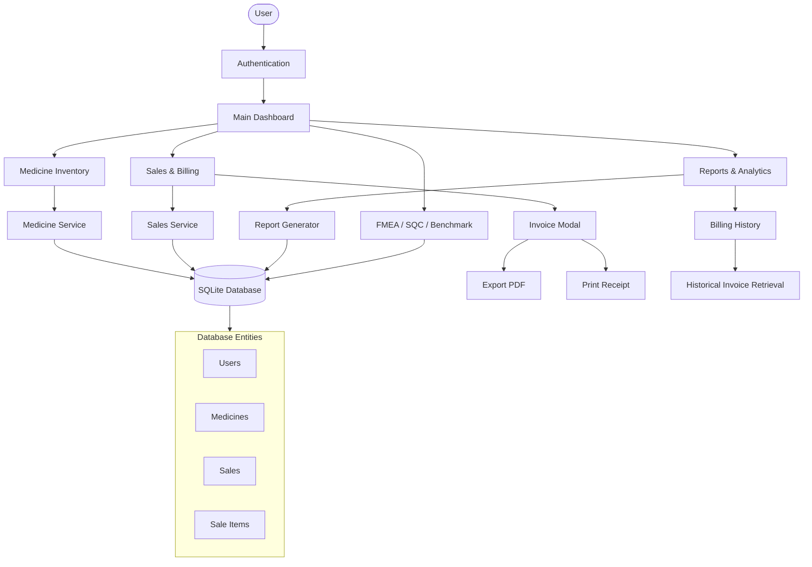

# Pharmacy Management System

## Software Requirements Specification

**Student:** Priyanshu Pokhariya  
**Enrollment No:** 2410303005  
**Program:** B.Tech CSE (IoT & DS)  
**Section:** C  
**Academic Session:** 2026–27  
**University:** Amrapali University, Haldwani  

---

## 2. DOCUMENT CONTROL

| Document Version | Date | Prepared By | Purpose | Status |
| :--- | :--- | :--- | :--- | :--- |
| 1.0 | October 2026 | Priyanshu Pokhariya | Final Academic Project Submission | Complete |

---

## 3. INTRODUCTION

### 3.1 Purpose
The purpose of this document is to define the Software Requirements Specification (SRS) for the **Pharmacy Management System**. It provides a comprehensive overview of the application's functional capabilities, architectural design, database structure, and technical constraints.

### 3.2 Scope
This SRS covers the current implementation of the Pharmacy Management System, a desktop application built to manage daily pharmacy operations, including inventory control, patient billing, automated invoice generation, and analytical reporting.

### 3.3 Intended Users
- **Pharmacists:** Daily operators handling sales, billing, and medicine lookups.
- **Administrators/Owners:** Managers requiring full access to inventory modification, financial reports, and quality tracking tools.

### 3.4 Product Overview
The Pharmacy Management System is a lightweight, high-performance desktop application designed for local operation. It leverages a robust SQLite database and a modern Graphical User Interface (GUI) to replace manual ledger tracking with digital efficiency.

### 3.5 Definitions / Abbreviations
- **CRUD:** Create, Read, Update, Delete
- **GUI:** Graphical User Interface
- **FMEA:** Failure Mode and Effects Analysis
- **SQC:** Statistical Quality Control
- **PDCA:** Plan-Do-Check-Act

---

## 4. PROBLEM STATEMENT

Pharmacies currently relying on manual record-keeping face several operational challenges:
- **Manual medicine record management:** Tracking hundreds of medicines on paper leads to data loss and disorganization.
- **Difficulty finding medicines quickly:** Pharmacists struggle to physically locate or verify the availability of medicines while customers wait.
- **Stock tracking issues:** Inability to instantly know when a medicine is out of stock.
- **Expiry monitoring:** Manual expiry tracking often results in dispensing expired drugs or financial losses due to unsold expired stock.
- **Billing errors:** Manual calculators and handwritten receipts lead to calculation mistakes.
- **Manual sales record maintenance:** Keeping track of daily revenue and patient histories on paper is inefficient.
- **Difficulty retrieving previous invoices:** Looking up a past transaction for a returning patient is time-consuming.
- **Limited reporting/analytics:** Lack of automated insights prevents data-driven decision-making.

---

## 5. OBJECTIVES

The Pharmacy Management System aims to solve these problems by achieving the following objectives:
- **Faster medicine search and retrieval** using optimized database indexes.
- **Accurate inventory management** with digital tracking.
- **Reliable medicine filtering and sorting** by category, manufacturer, and expiry.
- **Quick dashboard search** for immediate stock validation.
- **Efficient database queries** to handle large inventories locally.
- **Safe billing and stock deduction** utilizing atomic database transactions.
- **Patient-based invoice generation** capturing essential patient details.
- **Historical billing retrieval** enabling seamless lookup of past sales.
- **PDF invoice generation** for digital record-keeping.
- **Printing support** for physical receipts.
- **Reporting and analytics** for business intelligence (revenue, stock alerts).
- **Data validation and error prevention** ensuring data integrity.

---

## 6. PROJECT SCOPE

### In-Scope Functionality
- **Authentication:** Secure login for system access.
- **Admin and Pharmacist roles:** Role-based access control.
- **Dashboard:** Centralized summary metrics and low-stock alerts.
- **Medicine inventory:** Full CRUD operations for medicines.
- **Search:** Real-time search capabilities.
- **Filters:** Narrowing inventory by category and manufacturer.
- **Sorting:** Sorting by price, expiry, and quantity.
- **Quick Search:** Instant lookup from the dashboard.
- **Partial-text search:** Searching by partial medicine name or code.
- **Database optimization:** Index-backed search performance.
- **Sales and billing:** Cart management and checkout workflow.
- **Patient information:** Capturing patient name, phone, and age during billing.
- **Invoice generation:** Automated invoice number assignment.
- **PDF download:** Exporting bills to PDF.
- **Print workflow:** Standard desktop print dialog integration.
- **Billing history:** Viewing complete chronological sales records.
- **Historical invoice retrieval:** Opening and re-printing past invoices.
- **Reports and analytics:** Pandas and Matplotlib-backed data visualization.
- **Benchmarking:** Real-time search query performance testing.
- **FMEA:** Failure Mode and Effects Analysis tracking module.
- **SQC / defect tracking:** Statistical Quality Control logging.
- **Pareto & Fishbone:** Quality analysis tools.
- **PDCA:** Plan-Do-Check-Act lifecycle tracking.

### Out-Of-Scope Functionality
- Online payment gateway processing.
- E-commerce/cart for direct customer access.
- Online customer ordering or delivery tracking.
- External hospital or insurance API integration.

---

## 7. USER ROLES

### ADMIN
The Admin has unrestricted access to the entire system.
- Can log into the application.
- Can view the Dashboard and all alerts.
- Can Add, Update, and **Delete** medicines from the inventory.
- Can process Sales and generate Invoices.
- Can view all Reports and Analytics.
- Can access FMEA, SQC, and Benchmark modules.

### PHARMACIST
The Pharmacist is restricted to day-to-day operations.
- Can log into the application.
- Can view the Dashboard and alerts.
- Can view and search the Medicine Inventory.
- Can Add and Update medicines.
- **Cannot** Delete medicines from the inventory.
- Can process Sales and generate Invoices.
- Can view Reports and Billing History.

---

## 8. SYSTEM OVERVIEW

The application follows a monolithic desktop architecture with distinct internal layers:

- **Presentation/UI Layer:** Built with CustomTkinter for a modern, responsive interface.
- **Application/Service Layer:** Python modules coordinating business logic (AuthService, MedicineService, SalesService).
- **Database Layer:** SQLite relational database managing persistent data locally.
- **Reporting/Analytics Layer:** Pandas for data manipulation and Matplotlib for rendering charts.

### Technology Stack
- **Programming Language:** Python 3
- **GUI Framework:** CustomTkinter / Tkinter
- **Database:** SQLite3
- **Data Analysis:** Pandas
- **Data Visualization:** Matplotlib
- **PDF Generation:** FPDF
- **Version Control:** Git / GitHub

---

## 9. FUNCTIONAL REQUIREMENTS

**FR-01 User Authentication**
- **Description:** The system shall require users to authenticate via username and password.
- **Priority:** High
- **Acceptance Condition:** Valid credentials grant access; invalid credentials show an error message.

**FR-02 Dashboard**
- **Description:** The system shall display key metrics (total medicines, low stock, out of stock) upon login.
- **Priority:** High
- **Acceptance Condition:** The dashboard accurately reflects the current database state.

**FR-03 Medicine Inventory Management**
- **Description:** The system shall allow creating, reading, updating, and (for Admins) deleting medicines.
- **Priority:** High
- **Acceptance Condition:** Changes to medicines are saved to the database immediately.

**FR-04 Medicine Search**
- **Description:** The system shall provide a search bar to find medicines by name, code, category, or manufacturer.
- **Priority:** High
- **Acceptance Condition:** The inventory table updates in real-time based on the query.

**FR-05 Search Filters**
- **Description:** The system shall allow filtering medicines by specific categories and manufacturers.
- **Priority:** Medium
- **Acceptance Condition:** Dropdown selections correctly filter the displayed inventory.

**FR-06 Sorting**
- **Description:** The system shall allow sorting inventory by columns such as Expiry Date, Price, and Quantity.
- **Priority:** Medium
- **Acceptance Condition:** Clicking column headers accurately sorts the data.

**FR-07 Dashboard Quick Search**
- **Description:** The system shall provide a quick search mechanism directly on the dashboard.
- **Priority:** Low
- **Acceptance Condition:** Quick search executes a lookup and transitions to the inventory view.

**FR-08 Partial Text Search**
- **Description:** The system shall support partial matching for medicine names and codes.
- **Priority:** High
- **Acceptance Condition:** Searching "para" returns "Paracetamol".

**FR-09 Database Query Optimization**
- **Description:** The system shall use B-tree indexes for fast retrieval.
- **Priority:** High
- **Acceptance Condition:** Searches execute smoothly without UI freezing.

**FR-10 Sales & Billing**
- **Description:** The system shall allow adding items to a cart and processing a sale.
- **Priority:** High
- **Acceptance Condition:** Processing a sale deducts stock quantities correctly.

**FR-11 Patient Information**
- **Description:** The system shall capture Patient Name, Age, and Phone during billing.
- **Priority:** High
- **Acceptance Condition:** Patient Name is mandatory for completing a sale.

**FR-12 Invoice Generation**
- **Description:** The system shall automatically generate a unique Invoice Number for every sale.
- **Priority:** High
- **Acceptance Condition:** Successful checkout displays an invoice receipt modal.

**FR-13 PDF Download**
- **Description:** The system shall allow exporting the invoice receipt as a PDF.
- **Priority:** Medium
- **Acceptance Condition:** Clicking 'Download PDF' saves a correctly formatted PDF to the disk.

**FR-14 Print**
- **Description:** The system shall allow printing the invoice receipt.
- **Priority:** Medium
- **Acceptance Condition:** Clicking 'Print' opens the OS default printing dialog.

**FR-15 Billing History**
- **Description:** The system shall display a chronological list of all past transactions.
- **Priority:** High
- **Acceptance Condition:** The Reports section shows an accurate table of past bills.

**FR-16 Historical Invoice Retrieval**
- **Description:** The system shall allow viewing the full details of past invoices.
- **Priority:** High
- **Acceptance Condition:** Selecting a past bill and clicking 'View Bill' opens the original invoice modal.

**FR-17 Reports & Analytics**
- **Description:** The system shall generate visual reports for low stock, expiry, and sales.
- **Priority:** High
- **Acceptance Condition:** Pandas successfully aggregates data and displays it in tables and Matplotlib charts.

**FR-18 Benchmarking**
- **Description:** The system shall provide a tool to measure search query latency.
- **Priority:** Low
- **Acceptance Condition:** Executing the benchmark returns query times in milliseconds.

**FR-19 FMEA / Risk Analysis**
- **Description:** The system shall provide a module to log and calculate FMEA RPN scores.
- **Priority:** Low
- **Acceptance Condition:** RPN is correctly calculated as Severity × Occurrence × Detection.

**FR-20 SQC / Defect Tracking**
- **Description:** The system shall track quality defects and visualize them via a Pareto chart.
- **Priority:** Low
- **Acceptance Condition:** Defect frequencies are accurately plotted.

---

## 10. NON-FUNCTIONAL REQUIREMENTS

- **Performance:** Database lookups and UI rendering shall execute without noticeable lag on standard desktop hardware.
- **Reliability:** The system shall handle SQLite concurrent connections safely without locking up.
- **Security:** User passwords shall be hashed using SHA-256 PBKDF2 before storage.
- **Usability:** The interface shall feature a high-contrast, modern green/light color theme suitable for prolonged use.
- **Maintainability:** The codebase shall follow a modular structure separating UI, services, and models.
- **Data Integrity:** The system shall enforce Foreign Key constraints and Check constraints (e.g., price >= 0).
- **Compatibility:** The application shall run smoothly on standard Windows desktop environments.

---

## 11. DATABASE REQUIREMENTS

The system relies on a local SQLite relational database (`pharmacy.db`).

### Key Tables
1. **`users`**
   - **Primary Key:** `user_id`
   - **Columns:** `username`, `password_hash`, `role`
2. **`medicines`**
   - **Primary Key:** `medicine_id`
   - **Columns:** `medicine_code` (Unique), `medicine_name`, `category`, `manufacturer`, `batch_no`, `price` (Check >= 0), `quantity` (Check >= 0), `expiry_date`
3. **`sales`**
   - **Primary Key:** `sale_id`
   - **Columns:** `invoice_number` (Unique), `patient_name`, `patient_phone`, `patient_age`, `sale_date`, `total_amount` (Check >= 0), `user_id` (FK to users)
4. **`sale_items`**
   - **Primary Key:** `item_id`
   - **Columns:** `sale_id` (FK to sales, ON DELETE CASCADE), `medicine_id` (FK to medicines, ON DELETE RESTRICT), `quantity` (Check > 0), `price`, `subtotal`

### Indexes
- `idx_medicines_name` on `medicines(medicine_name)`
- `idx_medicines_category` on `medicines(category)`
- `idx_medicines_manufacturer` on `medicines(manufacturer)`
- `idx_medicines_expiry` on `medicines(expiry_date)`
- `idx_medicines_code` on `medicines(medicine_code)`
- `idx_sales_invoice` on `sales(invoice_number)`
- `idx_sales_patient` on `sales(patient_name)`
- `idx_sales_date` on `sales(sale_date)`

---

## 12. SEARCH & RETRIEVAL REQUIREMENTS

The system supports the following search capabilities:
- **Medicine name & code:** Partial and exact text matching.
- **Category & Manufacturer:** Dropdown-based exact filtering.
- **Partial text search:** Case-insensitive infix search (e.g., `LIKE '%query%'`).
- **Sorting:** Interactive table column sorting.

**Technical Note:** Arbitrary infix partial searches (`%query%`) perform full table scans in SQLite. However, B-tree indexes defined on categories, manufacturers, and expiry dates drastically accelerate exact lookups, range filtering, and table ordering by reducing memory page fetch overhead.

---

## 13. BILLING REQUIREMENTS

The billing workflow follows an atomic transactional process:
1. **Patient Details:** Entry of mandatory Patient Name and optional Age/Phone.
2. **Medicine Search:** Searching and adding items to the cart.
3. **Validation:** Verifying sufficient stock and valid quantities.
4. **Checkout:** Executing the sale inside a `BEGIN TRANSACTION` block.
5. **Invoice:** Generating a unique Invoice Number.
6. **PDF / Print:** Offering immediate export or physical printing.
7. **Billing History:** Persisting the transaction for future retrieval in the Reports tab.

---

## 14. REPORTING & ANALYTICS

The system utilizes Pandas to aggregate database records into the following reports:
- **Inventory Summary:** Key KPI counts for transactions and stock.
- **Stock Alerts:** Tables listing low-stock (≤10) and out-of-stock items.
- **Expiry Information:** Table identifying medicines expiring within 30 days.
- **Sales Analytics:** Transaction counts, total revenue, and average sale values.
- **Category Analysis:** Pandas group-by aggregation showing stock distribution by category.
- **Billing History:** Complete log of past invoices.
- **Charts:** Matplotlib-rendered bar and pie charts visualizing the aggregated data.

---

## 15. SECURITY & VALIDATION

- **Password Hashing:** Passwords are cryptographically hashed via `hashlib.pbkdf2_hmac` with a salt.
- **Role-Based Access:** UI elements and service methods enforce Admin vs. Pharmacist permissions (e.g., Delete blocking).
- **Input Validation:** Fields are restricted and validated before database insertion.
- **Duplicate Protection:** The system prevents the creation of multiple medicines with the same `medicine_code`.
- **Atomic Billing:** Cart checkouts utilize database transactions to ensure stock is never deducted if the sale fails to record.
- **SQL Parameterization:** All database queries utilize parameterized inputs (`?`) to completely prevent SQL injection attacks.

---

## 16. SYSTEM ARCHITECTURE

---

## 17. UI REQUIREMENTS

The system features a modern, professional interface:
- **Theme:** Clean Light/Green professional medical theme.
- **Currency:** Defaults to Indian Rupee (₹).
- **Navigation:** Sidebar layout for seamless switching between Dashboard, Inventory, Billing, Reports, Benchmark, FMEA, and SQC.
- **Responsiveness:** Dynamic modal sizing and table scaling.
- **Dialogs:** Native OS message boxes for confirmations and alerts.

---

## 18. TESTING & ACCEPTANCE

The application is heavily tested using Python's `unittest` framework.
- **Total Automated Tests:** 175
- **Coverage Categories:**
  - Database schema & integrity
  - Authentication & Role logic
  - Inventory CRUD operations
  - Search & Filtering
  - Sales & Billing transactions
  - Pandas Reports generation
  - FMEA, SQC, and Benchmark calculations
  - Invoice PDF generation & Billing History retrieval

---

## 19. LIMITATIONS

- **Desktop/Local Scope:** Designed as a localized desktop client, not a web application.
- **Database Engine:** SQLite is optimized for local usage but does not support highly concurrent multi-machine distributed access.
- **Printing:** Print workflows rely on the host OS Windows API.
- **Payments:** The system tracks transaction totals but does not integrate with live banking payment gateways.

---

## 20. FUTURE SCOPE

Future enhancements could include:
- Migration to a cloud database (PostgreSQL/MySQL) for multi-branch pharmacy synchronization.
- Integration with external payment gateways (UPI, Credit Cards).
- Barcode scanner hardware integration for instant medicine lookup.
- Automated remote cloud backups for disaster recovery.
- Patient history and prescription tracking.

---

## 21. ACCEPTANCE CRITERIA

- [x] Application launches and login screen authenticates correctly.
- [x] Admin can perform full CRUD on inventory; Pharmacist cannot delete.
- [x] Search, filters, and interactive column sorting function without errors.
- [x] Patient details are captured, and a valid sale generates a unique Invoice.
- [x] PDF generation and Printing mechanisms operate correctly.
- [x] The Billing History tab correctly queries and displays past invoices.
- [x] Historical invoices can be retrieved and viewed.
- [x] Reports successfully render Pandas tables and Matplotlib charts.
- [x] All 175 unit tests pass successfully.

---

## 22. TRACEABILITY

| Requirement ID | Module / Feature | Testing Coverage |
| :--- | :--- | :--- |
| FR-01 | Authentication (`auth_service.py`) | `test_auth_service.py` |
| FR-03 | Inventory CRUD (`medicine_service.py`) | `test_medicine_service.py` |
| FR-04, FR-08 | Search & Indexing (`medicine_service.py`) | `test_search.py` |
| FR-10 | Sales & Billing (`sales_service.py`) | `test_sales_service.py` |
| FR-11, FR-12 | Invoice Generation (`ui/billing.py`) | `test_billing.py` |
| FR-15, FR-16 | Billing History (`report_generator.py`) | `test_report_generator.py` |
| FR-17 | Reporting (`report_generator.py`) | `test_reports_view.py` |
| FR-19, FR-20 | Quality Tools (`fmea.py`, `sqc.py`) | `test_fmea.py`, `test_sqc.py` |
