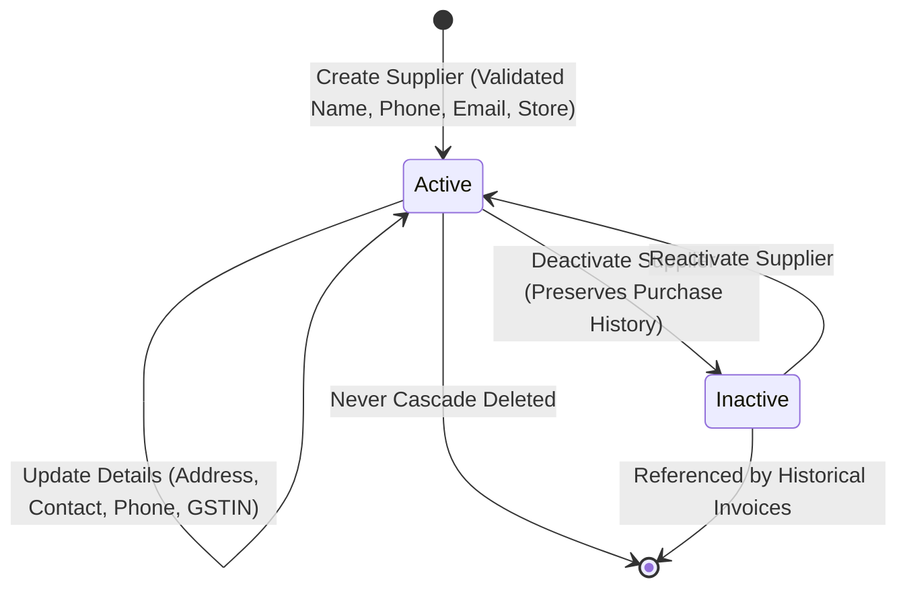
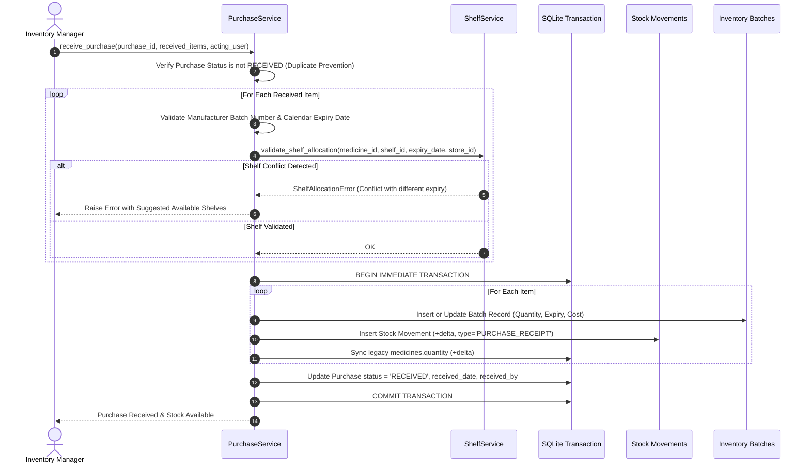
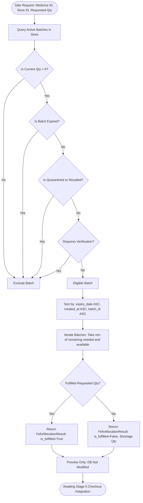

# Stage 4 Architecture: Purchasing, Batch Inventory, Shelf Allocation & FEFO Engine

---

## 1. Executive Summary

Stage 4 establishes the enterprise purchasing and batch-level inventory foundation for the Pharmacy Management System. Prior to Stage 4, inventory was tracked solely at the aggregate medicine level (`medicines.quantity`). Stage 4 introduces granular batch tracking, strict physical shelf allocation rules, supplier lifecycle management, a tamper-evident stock movement audit ledger, and a deterministic First Expiry, First Out (FEFO) allocation engine.

### Core Architectural Invariants:
1. **Production Database Safety**: The production database (`data/pharmacy.db`) remains completely untouched; schema changes are isolated to versioned migrations and test environments. Services operate safely even when running against unmigrated databases.
2. **Critical Shelf Allocation Rule**: Batches of the *same medicine* with *differing expiry dates* cannot share a shelf location. Batches of the *same medicine* with *matching expiry dates* may share a shelf. Different medicines may share a shelf.
3. **FEFO Eligibility & Preview**: Eligible stock is sorted strictly by earliest expiry date. Allocations during Stage 4 are previews only—no physical stock is deducted until Stage 5 POS integration.
4. **Audit Immutability**: All stock mutations are recorded atomically in `stock_movements` with a strict quantity sign convention (+ for additions, - for deductions). Movements are never updated or deleted; corrections require compensating adjustments.
5. **Multi-Store Isolation**: All suppliers, purchases, batches, locations, and movements are scoped to `store_id` and enforced in the service layer.

---

## 2. Supplier Lifecycle Management

Suppliers represent pharmaceutical manufacturers and distributors.

### Key Capabilities:
- **Validation**: Enforces non-empty names, valid phone formats (minimum 7 digits/chars), valid email formats (`@`), and proper store association.
- **Deactivation**: Suppliers are deactivated (`is_active = 0`) rather than deleted, preventing foreign key corruption with past purchase orders.
- **Store Scoping**: Suppliers can be assigned to a specific store (`store_id`) or marked global for multi-store visibility.
- **Service Layer**: Managed through [`SupplierService`](file:///C:/Users/priya/.gemini/antigravity/scratch/Pharmacy-Management-System-Clean/services/supplier_service.py) with full RBAC protection (`PERM_MANAGE_SUPPLIERS`).

---

## 3. Purchase Lifecycle & Goods Receipt Workflow

Purchases track supplier procurement orders from initial creation to verified goods receipt.

### Purchase Status Lifecycle:
1. `DRAFT`: Order entered, items and unit costs defined, but goods have not arrived. Stock is **not** available.
2. `ORDERED`: Order dispatched to supplier. Stock remains unreceived.
3. `RECEIVED`: Physical inventory inspected, manufacturer batches recorded, shelf allocations validated, and stock atomically posted to `inventory_batches` and `stock_movements`.
4. `CANCELLED`: Unreceived orders can be cancelled. Once a purchase is marked `RECEIVED`, cancellation is rejected to prevent inventory inconsistency without an approved return.

### Goods Receipt Flow:

### Idempotency & Safety Guards:
- **No Duplicate Receiving**: Attempting to receive an already `RECEIVED` purchase raises `ValueError` immediately.
- **Atomic Operations**: All batch inserts, stock updates, ledger entries, and status changes occur within a single database transaction. If any item fails validation, the entire receipt rolls back.
- **Batch Conflict Detection**: If an existing batch number for the same medicine and store has a conflicting expiry date, the transaction is rejected to prevent corrupted batch timelines.

---

## 4. Critical Shelf Allocation Rule

Physical organization in pharmacy storage requires strict separation of expiring inventory to avoid picking errors.

### The Rule:
> **The same medicine must be assigned to separate shelf locations when its expiry dates differ. Batches with the same expiry date may share a shelf, even if their batch numbers differ. Different medicines may share a shelf.**

### Verification Matrix:

| Scenario | Medicine | Batch | Expiry Date | Target Shelf | Result | Reason |
| :--- | :--- | :--- | :--- | :--- | :---: | :--- |
| **New Expiry on Occupied Shelf** | Paracetamol | P102 | 2026-11-30 | Shelf A-01 (has 2026-10-25) | ❌ **Rejected** | Differing expiry for same medicine. |
| **Matching Expiry on Same Shelf**| Paracetamol | P103 | 2026-11-30 | Shelf B-03 (has 2026-11-30) | ✅ **Allowed** | Identical expiry dates for same medicine. |
| **Different Medicine on Shelf** | Amoxicillin | A201 | 2027-01-15 | Shelf A-01 (has Paracetamol) | ✅ **Allowed** | Different medicines can share storage locations. |
| **Multi-Store Isolation** | Paracetamol | P104 | 2026-10-25 | Shelf S2-01 (Store B) | ✅ **Allowed** | Physical shelves belong to distinct store scopes. |
| **Unknown Expiry Date** | Paracetamol | P999 | `None` / Invalid | Any Shelf | ❌ **Rejected** | Batches without verified expiry cannot be co-located. |

### Shelf Conflict Suggestion:
When a conflict occurs, [`ShelfService.suggest_shelf_location()`](file:///C:/Users/priya/.gemini/antigravity/scratch/Pharmacy-Management-System-Clean/services/shelf_service.py) searches for existing shelves containing the exact same expiry date or empty shelves in the store and presents them to the operator.

---

## 5. Expiry Date Rules & Semantics

The system follows standard pharmaceutical calendar day conventions:
- **Calendar Boundary**: A batch with expiry date `YYYY-MM-DD` is valid through 23:59:59 of that date. It is officially **expired from `YYYY-MM-DD + 1 day` onward**.
- **Near-Expiry Threshold**: Configurable warning window (default: 30 days). Batches expiring within this window are flagged with warnings but remain sellable until the expiry date.
- **Strict Ineligibility**: Expired stock (`is_expired() == True`) is completely excluded from FEFO allocation and point-of-sale selection.
- **Verification Requirement**: Batches marked with `requires_verification = 1` or missing essential manufacturing/expiry data are excluded from sale eligibility until clinically verified.

---

## 6. FEFO (First Expiry, First Out) Selection Engine

The FEFO engine ensures that older expiring inventory is sold first, minimizing pharmaceutical waste.

### FEFO Selection Workflow:

### Deterministic Tie-Breaking:
When two batches share the exact same expiry date, the engine resolves ties deterministically:
1. `expiry_date ASC` (Earliest expiry first)
2. `created_at ASC` (Earlier received batch first)
3. `batch_id ASC` (Deterministic primary key tie-breaker)

### Stage 4 vs Stage 5 Scope Distinction:
- In **Stage 4**, [`InventoryService.preview_fefo_allocation()`](file:///C:/Users/priya/.gemini/antigravity/scratch/Pharmacy-Management-System-Clean/services/inventory_service.py) computes and previews allocations **without writing to the database**.
- In **Stage 5**, the billing transaction will consume the FEFO result to atomically deduct `inventory_batches.current_quantity`, record `stock_movements` with `SALE` type, and finalize invoice checkout.

---

## 7. Stock Movement Ledger & Quantity Reconciliation

### Tamper-Evident Ledger:
Every change to inventory is recorded in `stock_movements` with:
- `movement_type`: `PURCHASE_RECEIPT`, `ADJUSTMENT`, `RELOCATION`, `RETURN`, `WRITE_OFF`, `OPENING_BALANCE`, `SALE`.
- `quantity`: Signed integer (+ for addition, - for reduction).
- `reference_id`: Purchase ID, adjustment note, or invoice number.
- `created_by`: User ID of acting staff member.
- `created_at`: Timestamp.

### Multi-Dimensional Stock Invariants:
For any medicine $M$ in store $S$:
$$\text{Total Physical Stock} = \sum_{\text{all batches}} \text{current\_quantity}$$
$$\text{Sellable Stock} = \sum_{\text{eligible batches}} \text{current\_quantity} \quad (\text{not expired, active, verified, not quarantined})$$
$$\text{Total Physical Stock} = \text{Sellable} + \text{Expired} + \text{Quarantined} + \text{Unverified}$$

### Reconciliation Engine:
[`InventoryService.reconcile_store_inventory(store_id)`](file:///C:/Users/priya/.gemini/antigravity/scratch/Pharmacy-Management-System-Clean/services/inventory_service.py) cross-references:
1. Aggregate batch quantities vs legacy `medicines.quantity`.
2. Sum of all historical ledger deltas vs current batch stock.
3. Discrepancies are reported cleanly without silent or destructive database tampering.

---

## 8. Role-Based Access Control (RBAC) & Multi-Store Permissions

### Updated Permissions Matrix:

| Role | `manage_suppliers` | `manage_purchases` | `manage_inventory` | `view_stock_alerts` | `view_medicines` |
| :--- | :---: | :---: | :---: | :---: | :---: |
| **Owner** | ✅ | ✅ | ✅ | ✅ | ✅ |
| **Admin** | ✅ | ✅ | ✅ | ✅ | ✅ |
| **Inventory Manager** | ✅ | ✅ | ✅ | ✅ | ✅ |
| **Pharmacist** | ❌ | ❌ | ❌ | ✅ | ✅ |
| **Cashier** | ❌ | ❌ | ❌ | ❌ | ✅ |

### Cross-Store Isolation:
All service methods enforce store boundaries via `require_store_access(acting_user, target_store_id)`. Attempting to receive purchases, allocate stock, or create batches in an unauthorized store raises `PermissionError`.

---

## 9. Stage 5 Integration Requirements

Stage 5 will integrate Stage 4's foundation into the Point of Sale (POS) workflow:
1. **POS FEFO Checkout**: Replacing legacy bulk quantity deduction with atomic batch deduction driven by `preview_fefo_allocation()`.
2. **Batch Selection on Invoices**: Printing batch numbers and expiry dates on customer invoices.
3. **Customer Phone Validation**: Mandatory 10-digit mobile number checks.
4. **Payment Processing**: Multi-mode payment workflows (Cash, Card, UPI).
5. **Application-Wide Theme Polish**: Final cohesive styling across all views.
