# Advanced Pharmacy Management System: Comprehensive Architecture & Diagrams

This document provides the complete technical architecture and all 13 core architectural diagrams for the Pharmacy Management System, reflecting the fully integrated Stage 1 through Stage 5 implementations.

---

## 1. System Architecture Diagram

```mermaid
graph TB
    subgraph Client_Presentation_Layer ["Desktop Presentation Layer (CustomTkinter)"]
        UI_Login["Login & Store Selector View"]
        UI_Dash["Role-Specific Dashboards (Owner/Admin/Cashier/Inv)"]
        UI_POS["POS Billing & Invoice Modal (Cash/UPI/Card)"]
        UI_Med["Medicine CRUD & Search View (B-Tree Optimized)"]
        UI_Batch["Batch Inventory & Shelf Allocation View"]
        UI_Purch["Purchase Order & Goods Receiving View"]
        UI_Supp["Supplier Directory & Management View"]
        UI_Ret["Returns & Refund Management View"]
        UI_Rep["Reporting & Analytics View (Tabular & CSV)"]
        UI_Qual["Quality Control (FMEA / SQC / PDCA / Fishbone)"]
    end

    subgraph Business_Service_Layer ["Service Layer (Business Logic & Authorization)"]
        AuthSvc["AuthService & RBAC Enforcer"]
        MedSvc["MedicineService"]
        SearchSvc["SearchService (B-Tree + Filter Cache)"]
        SalesSvc["SalesService (FEFO Checkout & Returns)"]
        InvSvc["InventoryService (Batch Lifecycle)"]
        ShelfSvc["ShelfService (Shelf Expiry Rules)"]
        PurchSvc["PurchaseService (PO & Goods Receipt)"]
        SuppSvc["SupplierService"]
        AuditSvc["AuditService (Security Logging)"]
        RepSvc["ReportService (Aggregations & Exports)"]
    end

    subgraph Data_Access_Layer ["Data Access & SQLite Engine"]
        DBHandler["Database Manager (db.py / Connection Pool)"]
        SchemaMgr["Schema Migration & Compatibility Engine"]
        SyncMgr["Cross-Database Sync Engine"]
        SQLiteDB[("SQLite 3 Database (pharmacy.db)")]
    end

    UI_Login --> AuthSvc
    UI_Dash --> RepSvc
    UI_Dash --> AuditSvc
    UI_POS --> SalesSvc
    UI_Med --> MedSvc
    UI_Med --> SearchSvc
    UI_Batch --> InvSvc
    UI_Batch --> ShelfSvc
    UI_Purch --> PurchSvc
    UI_Supp --> SuppSvc
    UI_Ret --> SalesSvc
    UI_Rep --> RepSvc

    AuthSvc --> DBHandler
    MedSvc --> DBHandler
    SearchSvc --> DBHandler
    SalesSvc --> DBHandler
    InvSvc --> DBHandler
    ShelfSvc --> DBHandler
    PurchSvc --> DBHandler
    SuppSvc --> DBHandler
    AuditSvc --> DBHandler
    RepSvc --> DBHandler

    DBHandler --> SchemaMgr
    DBHandler --> SQLiteDB
```

---

## 2. Complete Entity-Relationship (ER) Diagram

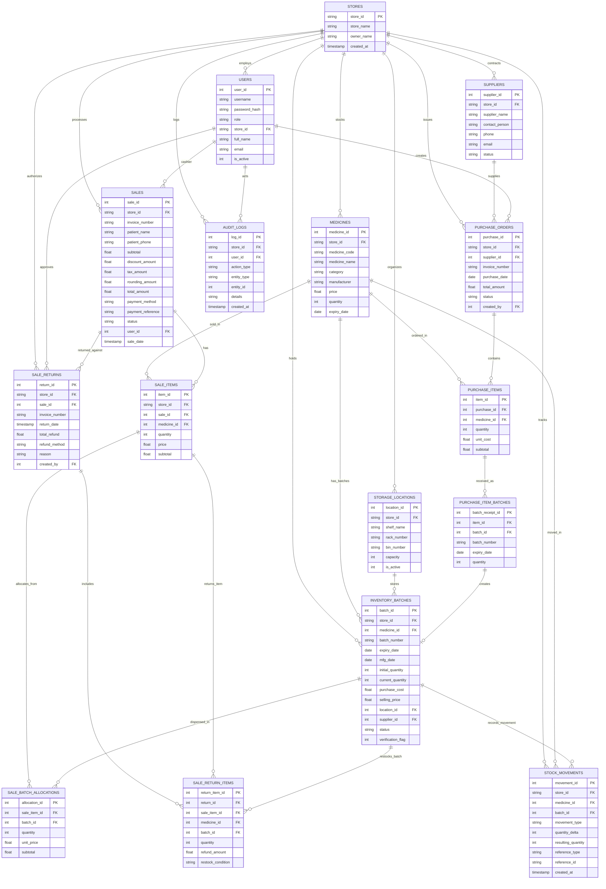

---

## 3. Use-Case Diagram

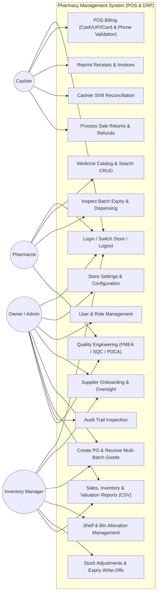

---

## 4. Role-Permission Matrix

```mermaid
graph TD
    subgraph Roles ["Canonical Application Roles"]
        R_Owner["Owner (Full Cross-Store Scope)"]
        R_Admin["Admin (Full Store Administration)"]
        R_Pharma["Pharmacist (Clinical & Dispensing Scope)"]
        R_Cashier["Cashier (POS Billing & Shift Scope)"]
        R_Inv["Inventory Manager (Purchasing & Warehouse Scope)"]
    end

    subgraph Permission_Gates ["Backend Permission Gates (services/rbac.py)"]
        P_USER["MANAGE_USERS"]
        P_STORE["MANAGE_STORE_SETTINGS"]
        P_AUDIT["VIEW_AUDIT_LOGS"]
        P_REP["VIEW_REPORTS / EXPORT_CSV"]
        P_POS["PROCESS_SALE / BILLING"]
        P_RET["PROCESS_RETURNS"]
        P_RECON["VIEW_CASHIER_RECONCILIATION"]
        P_MED["MANAGE_MEDICINES"]
        P_BATCH["MANAGE_BATCHES / SHELVES"]
        P_PURCH["MANAGE_PURCHASING / RECEIVE_GOODS"]
    end

    R_Owner --> P_USER
    R_Owner --> P_STORE
    R_Owner --> P_AUDIT
    R_Owner --> P_REP
    R_Owner --> P_POS
    R_Owner --> P_RET
    R_Owner --> P_MED
    R_Owner --> P_BATCH
    R_Owner --> P_PURCH

    R_Admin --> P_USER
    R_Admin --> P_STORE
    R_Admin --> P_AUDIT
    R_Admin --> P_REP
    R_Admin --> P_POS
    R_Admin --> P_RET
    R_Admin --> P_MED
    R_Admin --> P_BATCH
    R_Admin --> P_PURCH

    R_Pharma --> P_MED
    R_Pharma --> P_BATCH

    R_Cashier --> P_POS
    R_Cashier --> P_RET
    R_Cashier --> P_RECON

    R_Inv --> P_BATCH
    R_Inv --> P_PURCH
    R_Inv --> P_REP
```

---

## 5. Authentication & Authorization Flow

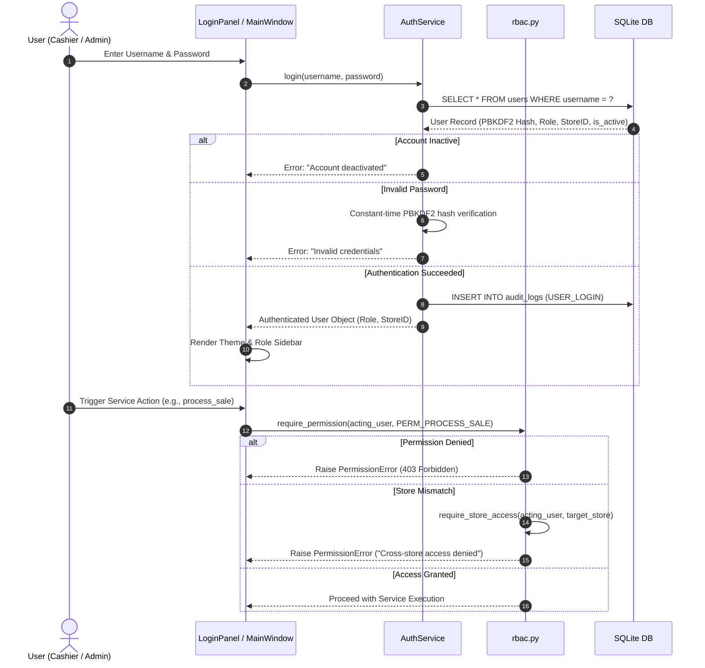

---

## 6. Purchase & Goods-Receiving Workflow

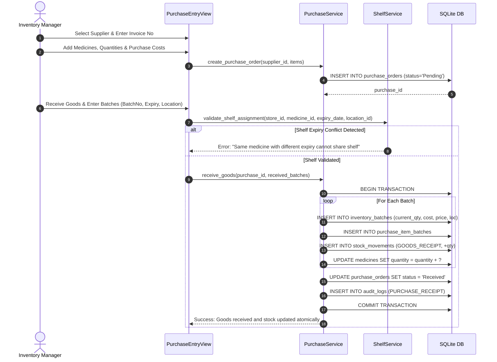

---

## 7. Batch & Shelf Allocation Workflow

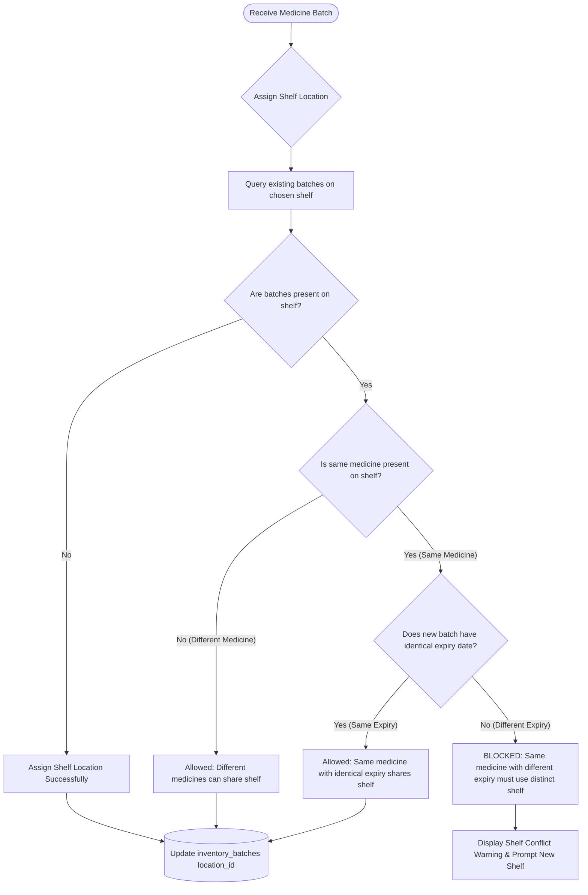

---

## 8. FEFO Allocation Algorithm

```mermaid
flowchart TD
    Start([Checkout Request: Med ID, Requested Qty]) --> LoadBatches[Query Eligible Batches for Store & Medicine]
    LoadBatches --> FilterRules{Filter Active Batches}
    
    FilterRules --> ExcludeExpired[Exclude expiry_date < today]
    FilterRules --> ExcludeZero[Exclude current_quantity <= 0]
    FilterRules --> ExcludeQuarantine[Exclude verification_flag != 0]
    FilterRules --> ExcludeInactive[Exclude status != 'Active']
    
    ExcludeExpired & ExcludeZero & ExcludeQuarantine & ExcludeInactive --> SortFEFO[Sort by Expiry ASC, Created ASC, BatchID ASC]
    SortFEFO --> SumStock{Total Eligible Stock >= Requested Qty?}
    
    SumStock -- No --> RollbackAbort[ABORT & ROLLBACK: Insufficient Stock Error]
    SumStock -- Yes --> InitLoop[Remaining Qty = Requested Qty]
    
    InitLoop --> ForEachBatch[Iterate Through Sorted Batches]
    ForEachBatch --> DeductCalc[Deduct Qty = min(Remaining Qty, Batch Current Qty)]
    DeductCalc --> DeductBatch[Deduct from Batch: current_quantity -= Deduct Qty]
    DeductBatch --> RecordAlloc[Insert sale_batch_allocations Record]
    DeductBatch --> RecordLedger[Insert stock_movements SALE_DISPENSE -Deduct Qty]
    DeductBatch --> UpdateRemaining[Remaining Qty -= Deduct Qty]
    
    UpdateRemaining --> MoreNeeded{Remaining Qty > 0?}
    MoreNeeded -- Yes --> ForEachBatch
    MoreNeeded -- No --> CompleteFEFO[FEFO Allocation Complete & Verified]
```

---

## 9. POS Billing & Payment Workflow

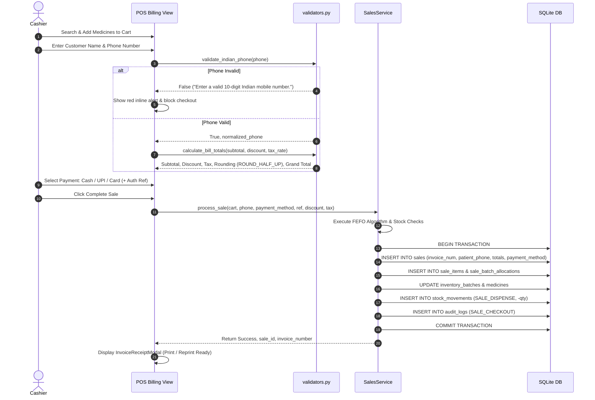

---

## 10. Stock Movement Lifecycle

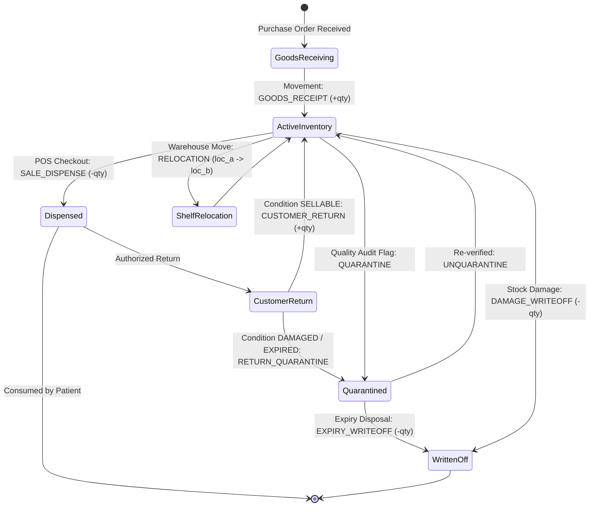

---

## 11. Returns and Refunds Workflow

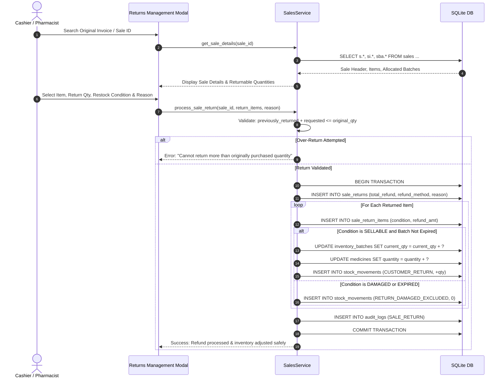

---

## 12. Database Transaction and Rollback Flow

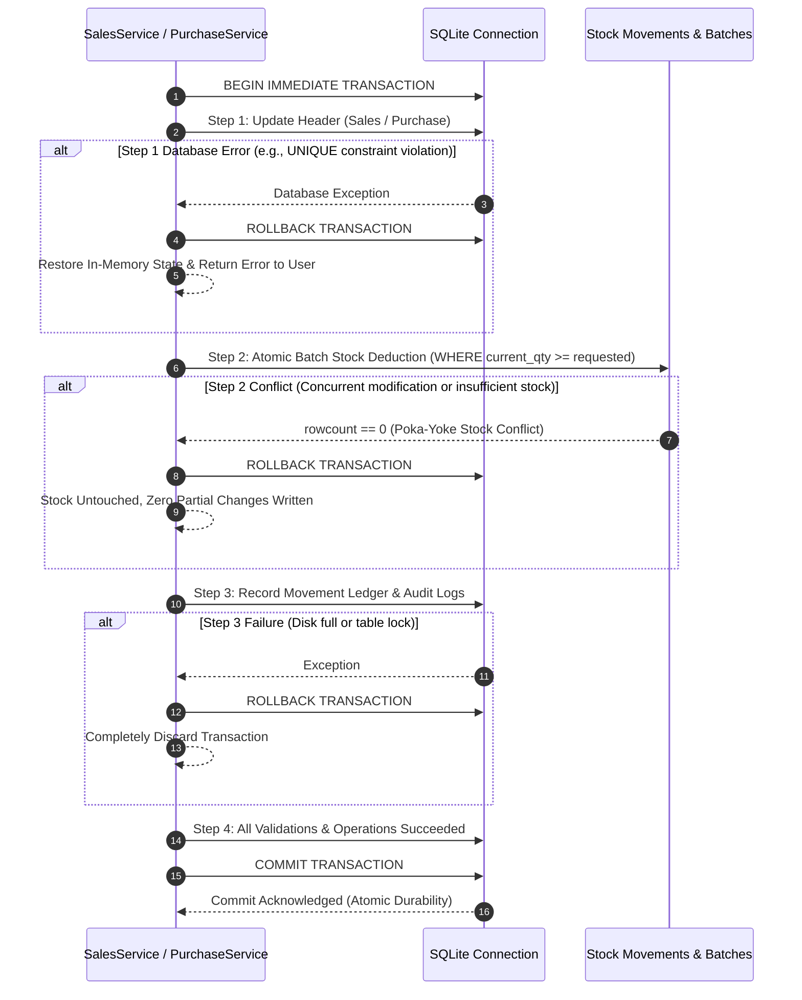

---

## 13. Report Generation and Data Flow

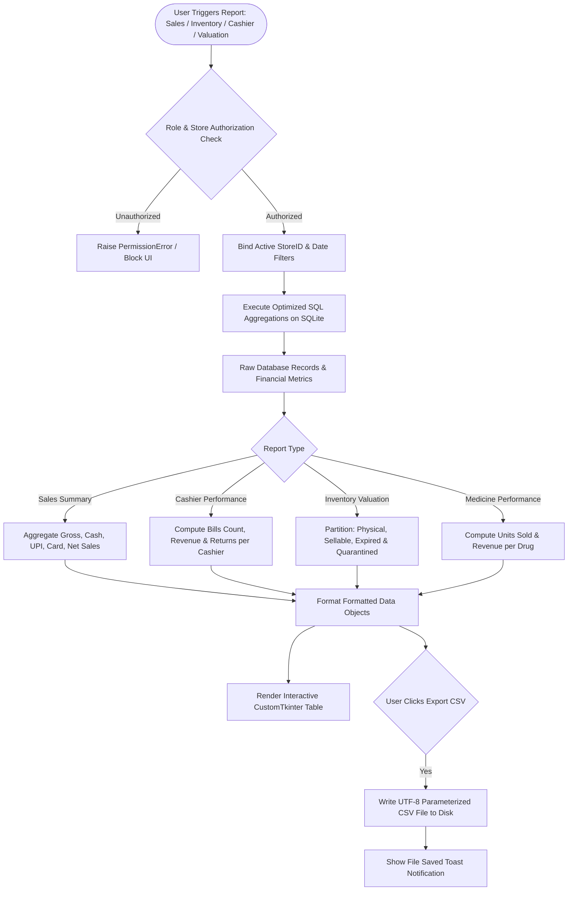
