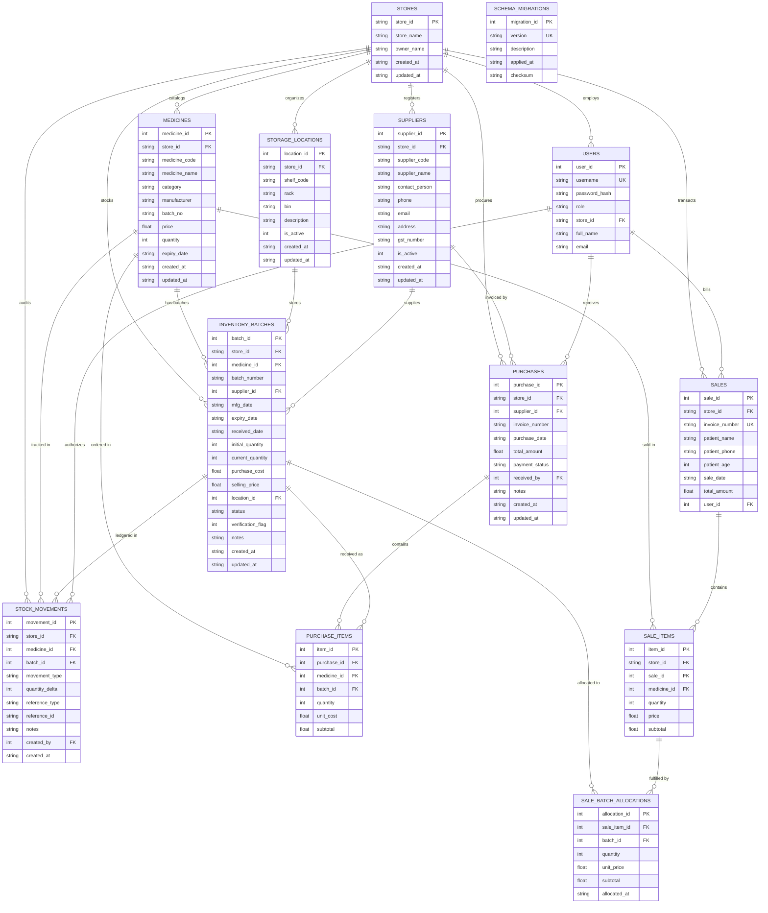

# Stage 2 Database Architecture & Normalized Schema Documentation

## 1. Architecture Overview

The Pharmacy Management System database architecture has been upgraded in **Stage 2** from a flat-inventory model to a **normalized, batch-wise, multi-store relational model**.

### Key Architectural Enhancements
1. **Multi-Store Tenant Isolation:** All entities (`users`, `medicines`, `suppliers`, `storage_locations`, `inventory_batches`, `purchases`, `sales`, `stock_movements`) are bound to a tenant `store_id`.
2. **Normalized Batch Inventory (`inventory_batches`):** Eliminates flat single-batch limitations. Individual stock batches are tracked with unique batch numbers, expiry dates, supplier references, physical shelf locations, and operational statuses (`Active`, `Expired`, `Quarantined`, `Recalled`).
3. **Physical Storage Hierarchy (`storage_locations`):** Tracks shelf codes, racks, and bins.
4. **Critical Shelf Allocation Rule Enforcement:** Implements physical safety separation: *Batches of the same medicine possessing different expiry dates must be stored on separate shelves to prevent dispensing errors.* Batches of the same medicine with the identical expiry date may share a shelf.
5. **Immutable Stock Movement Ledger (`stock_movements`):** Traceable transaction history for every stock change with standardized sign conventions (+ for additions, - for deductions).
6. **Procurement Workflow (`suppliers`, `purchases`, `purchase_items`):** Normalized purchase orders and goods receipt tracking.
7. **Pre-allocated POS Billing Schema (`sale_batch_allocations`):** Prepares many-to-many allocation between sale line items and specific inventory batches for First-Expiry, First-Out (FEFO) dispensing in later stages.
8. **Schema Migration Versioning (`schema_migrations`):** Automated, transactional, idempotent migration ledger.

---

## 2. Complete Entity Relationship Diagram (ERD)



---

## 3. Detailed Table Specifications & Constraints

### 3.1 `schema_migrations`
Tracks versioned migration history.
- `migration_id`: `INTEGER PRIMARY KEY AUTOINCREMENT`
- `version`: `TEXT UNIQUE NOT NULL` (e.g. `'20261029_01_batch_inventory'`)
- `description`: `TEXT NOT NULL`
- `applied_at`: `TEXT DEFAULT CURRENT_TIMESTAMP`
- `checksum`: `TEXT`

### 3.2 `storage_locations`
Represents physical storage hierarchy inside each store.
- `location_id`: `INTEGER PRIMARY KEY AUTOINCREMENT`
- `store_id`: `TEXT NOT NULL REFERENCES stores(store_id) ON DELETE CASCADE`
- `shelf_code`: `TEXT NOT NULL`
- `rack`: `TEXT`
- `bin`: `TEXT`
- `description`: `TEXT`
- `is_active`: `INTEGER DEFAULT 1 CHECK(is_active IN (0, 1))`
- `created_at`, `updated_at`: `TEXT`
- **Constraint:** `UNIQUE(store_id, shelf_code)`
- **Indexes:** `idx_locations_store_shelf` on `(store_id, shelf_code)`

### 3.3 `suppliers`
Suppliers directory for goods procurement.
- `supplier_id`: `INTEGER PRIMARY KEY AUTOINCREMENT`
- `store_id`: `TEXT NOT NULL REFERENCES stores(store_id) ON DELETE CASCADE`
- `supplier_code`: `TEXT NOT NULL`
- `supplier_name`: `TEXT NOT NULL`
- `contact_person`, `phone`, `email`, `address`, `gst_number`: `TEXT`
- `is_active`: `INTEGER DEFAULT 1 CHECK(is_active IN (0, 1))`
- `created_at`, `updated_at`: `TEXT`
- **Constraint:** `UNIQUE(store_id, supplier_code)`
- **Indexes:** `idx_suppliers_store` on `store_id`, `idx_suppliers_name` on `(store_id, supplier_name)`

### 3.4 `inventory_batches`
Normalized batch inventory. Supports multiple batches per medicine.
- `batch_id`: `INTEGER PRIMARY KEY AUTOINCREMENT`
- `store_id`: `TEXT NOT NULL REFERENCES stores(store_id) ON DELETE CASCADE`
- `medicine_id`: `INTEGER NOT NULL REFERENCES medicines(medicine_id) ON DELETE RESTRICT`
- `batch_number`: `TEXT NOT NULL`
- `supplier_id`: `INTEGER REFERENCES suppliers(supplier_id) ON DELETE SET NULL`
- `mfg_date`: `TEXT` (YYYY-MM-DD)
- `expiry_date`: `TEXT NOT NULL` (YYYY-MM-DD)
- `received_date`: `TEXT` (YYYY-MM-DD)
- `initial_quantity`: `INTEGER NOT NULL CHECK(initial_quantity >= 0)`
- `current_quantity`: `INTEGER NOT NULL CHECK(current_quantity >= 0)`
- `purchase_cost`: `REAL CHECK(purchase_cost IS NULL OR purchase_cost >= 0)`
- `selling_price`: `REAL NOT NULL CHECK(selling_price >= 0)`
- `location_id`: `INTEGER REFERENCES storage_locations(location_id) ON DELETE RESTRICT`
- `status`: `TEXT NOT NULL CHECK(status IN ('Active', 'Expired', 'Quarantined', 'Recalled'))`
- `verification_flag`: `INTEGER DEFAULT 0 CHECK(verification_flag IN (0, 1))` (1 for legacy records lacking supplier/mfg details)
- `notes`: `TEXT`
- `created_at`, `updated_at`: `TEXT`
- **Constraint:** `UNIQUE(store_id, medicine_id, batch_number)`
- **Indexes:**
  - `idx_batches_store_med` on `(store_id, medicine_id)` (fast medicine stock lookups)
  - `idx_batches_expiry` on `expiry_date` (FEFO allocation & near-expiry scans)
  - `idx_batches_status` on `status` (fast filtering of active vs blocked stock)
  - `idx_batches_location` on `location_id` (shelf audits)
  - `idx_batches_number` on `batch_number` (batch lookup)

### 3.5 `purchases` & `purchase_items`
Procurement transactions.
- `purchases`:
  - `purchase_id`: `INTEGER PRIMARY KEY AUTOINCREMENT`
  - `store_id`: `TEXT NOT NULL REFERENCES stores(store_id) ON DELETE CASCADE`
  - `supplier_id`: `INTEGER NOT NULL REFERENCES suppliers(supplier_id) ON DELETE RESTRICT`
  - `invoice_number`: `TEXT NOT NULL`
  - `purchase_date`: `TEXT NOT NULL`
  - `total_amount`: `REAL NOT NULL CHECK(total_amount >= 0)`
  - `payment_status`: `TEXT NOT NULL CHECK(payment_status IN ('PAID', 'PENDING', 'PARTIAL')) DEFAULT 'PAID'`
  - `received_by`: `INTEGER REFERENCES users(user_id) ON DELETE SET NULL`
  - `notes`: `TEXT`
  - **Constraint:** `UNIQUE(store_id, invoice_number)`
  - **Indexes:** `idx_purchases_store_date`, `idx_purchases_supplier`
- `purchase_items`:
  - `item_id`: `INTEGER PRIMARY KEY AUTOINCREMENT`
  - `purchase_id`: `INTEGER NOT NULL REFERENCES purchases(purchase_id) ON DELETE CASCADE`
  - `medicine_id`: `INTEGER NOT NULL REFERENCES medicines(medicine_id) ON DELETE RESTRICT`
  - `batch_id`: `INTEGER REFERENCES inventory_batches(batch_id) ON DELETE SET NULL`
  - `quantity`: `INTEGER NOT NULL CHECK(quantity > 0)`
  - `unit_cost`: `REAL NOT NULL CHECK(unit_cost >= 0)`
  - `subtotal`: `REAL NOT NULL CHECK(subtotal >= 0)`
  - **Indexes:** `idx_purchase_items_purchase`, `idx_purchase_items_medicine`

### 3.6 `stock_movements`
The immutable inventory audit ledger.
- `movement_id`: `INTEGER PRIMARY KEY AUTOINCREMENT`
- `store_id`: `TEXT NOT NULL REFERENCES stores(store_id) ON DELETE CASCADE`
- `medicine_id`: `INTEGER NOT NULL REFERENCES medicines(medicine_id) ON DELETE RESTRICT`
- `batch_id`: `INTEGER REFERENCES inventory_batches(batch_id) ON DELETE RESTRICT`
- `movement_type`: `TEXT NOT NULL CHECK(movement_type IN ('MIGRATION_OPENING', 'PURCHASE_RECEIPT', 'SALE_DISPENSE', 'CUSTOMER_RETURN', 'STOCK_ADJUSTMENT', 'STORE_TRANSFER', 'EXPIRY_WRITE_OFF', 'RECALL_QUARANTINE'))`
- `quantity_delta`: `INTEGER NOT NULL`
- `reference_type`: `TEXT` (e.g. `'SALE'`, `'PURCHASE'`, `'MIGRATION'`)
- `reference_id`: `TEXT` (e.g. invoice number)
- `notes`: `TEXT`
- `created_by`: `INTEGER REFERENCES users(user_id) ON DELETE SET NULL`
- `created_at`: `TEXT DEFAULT CURRENT_TIMESTAMP`
- **Indexes:** `idx_stock_movements_store_med`, `idx_stock_movements_batch`, `idx_stock_movements_type`, `idx_stock_movements_date`

### 3.7 `sale_batch_allocations`
Many-to-many allocation between sale items and batches.
- `allocation_id`: `INTEGER PRIMARY KEY AUTOINCREMENT`
- `sale_item_id`: `INTEGER NOT NULL REFERENCES sale_items(item_id) ON DELETE CASCADE`
- `batch_id`: `INTEGER NOT NULL REFERENCES inventory_batches(batch_id) ON DELETE RESTRICT`
- `quantity`: `INTEGER NOT NULL CHECK(quantity > 0)`
- `unit_price`: `REAL NOT NULL CHECK(unit_price >= 0)`
- `subtotal`: `REAL NOT NULL CHECK(subtotal >= 0)`
- `allocated_at`: `TEXT DEFAULT CURRENT_TIMESTAMP`
- **Indexes:** `idx_sale_alloc_item`, `idx_sale_alloc_batch`

---

## 4. Critical Shelf Allocation Rule

### Rule Definition
> **The same medicine must be stored in separate shelf locations when its batches have different expiry dates.**
> **Batches of the same medicine sharing the exact same expiry date may share a shelf location.**

### Operational Examples
| Medicine | Batch Number | Expiry Date | Quantity | Storage Location | Rule Assessment |
| :--- | :--- | :--- | :--- | :--- | :--- |
| Paracetamol 500mg | P101 | 2026-10-25 | 100 | Shelf A-01 | **Valid:** Initial allocation on Shelf A-01. |
| Paracetamol 500mg | P102 | 2026-11-30 | 150 | Shelf A-01 | **REJECTED:** Different expiry date (2026-11-30 vs 2026-10-25). Must be stored on a separate shelf (e.g. Shelf B-03). |
| Paracetamol 500mg | P102 | 2026-11-30 | 150 | Shelf B-03 | **Valid:** Placed on separate shelf B-03. |
| Paracetamol 500mg | P103 | 2026-11-30 | 80 | Shelf B-03 | **Valid:** Shares Shelf B-03 because expiry date matches P102 exactly (2026-11-30). |

### Enforcement Mechanics
- **Why not a database UNIQUE constraint?** A naive constraint like `UNIQUE(medicine_id, location_id)` would forbid P102 and P103 from sharing Shelf B-03 even though they have the same expiry date.
- **Service Layer Enforcement:** Enforced in `ShelfService.validate_shelf_allocation()`.
- **Conflict Auditor:** `ShelfService.detect_all_shelf_conflicts()` scans existing records and flags discrepancies without silent data moves.
- **Store Tenant Isolation:** Storage location IDs are partitioned by `store_id`. A shelf `SHELF-A01` in Store 1 is completely independent from `SHELF-A01` in Store 2.

---

## 5. Expiry Evaluation & FEFO Semantics

- **Date Comparison Standard:** Standard calendar date comparison (`YYYY-MM-DD`).
- **Expiry Cutoff:** A batch expiring on `2026-10-25` is considered valid through `2026-10-25 23:59:59` and considered **Expired on 2026-10-26 00:00:00 and later** (`reference_date > expiry_date`).
- **Status Progression:**
  - `Active`: `expiry_date >= current_date` and `current_quantity > 0` and not quarantined/recalled.
  - `Expired`: `expiry_date < current_date`. Automatically blocked from future sale dispensing.
  - `Quarantined`: Damaged or compromised stock awaiting audit.
  - `Recalled`: Batches flagged for vendor return or recall.
- **FEFO (First-Expiry, First-Out) Preparation:**
  Future billing algorithms query:
  ```sql
  SELECT * FROM inventory_batches
  WHERE store_id = ? AND medicine_id = ? AND status = 'Active' AND current_quantity > 0 AND expiry_date >= ?
  ORDER BY expiry_date ASC, batch_id ASC;
  ```

---

## 6. Stock Movement Quantity Sign Convention

| Movement Type | Delta Sign | Description |
| :--- | :---: | :--- |
| `MIGRATION_OPENING` | **+** | Initial opening inventory balance migrated from legacy system. |
| `PURCHASE_RECEIPT` | **+** | Inward stock received from supplier purchase invoice. |
| `CUSTOMER_RETURN` | **+** | Stock returned by customer and restored to inventory. |
| `STOCK_ADJUSTMENT` (Positive) | **+** | Physical inventory count discrepancy resolved upward. |
| `SALE_DISPENSE` | **-** | Stock deducted upon completed POS sale transaction. |
| `EXPIRY_WRITE_OFF` | **-** | Stock disposed or removed due to passing expiry date. |
| `STOCK_ADJUSTMENT` (Negative) | **-** | Physical inventory count discrepancy resolved downward. |
| `STORE_TRANSFER` | **-** | Stock transferred out to another pharmacy store branch. |
| `RECALL_QUARANTINE` | **-** | Stock removed from active inventory to quarantine bay. |

---

## 7. Backward Compatibility & Migration Safety

1. **Legacy Column Preservation:** The legacy columns on `medicines` (`quantity`, `batch_no`, `expiry_date`, `price`) remain in place. Existing views and search benchmarks continue operating without disruption.
2. **Double-Counting Prevention:**
   Legacy UI queries read `medicines.quantity`. Normalized services read `SUM(inventory_batches.current_quantity)`.
   The reconciliation service `ShelfService.reconcile_medicine_stock()` verifies that:
   $$\text{medicines.quantity} == \sum \text{inventory\_batches.current\_quantity} == \sum \text{stock\_movements.quantity\_delta}$$
3. **Rollback Safety:**
   `database.migration_stage2.rollback_stage2_migration(db)` cleanly drops newly created tables and deletes the `schema_migrations` record, returning the database to its exact baseline state without touching legacy tables.
